# L07-19 几何对称、横移长镜头与色彩揭示 · 提示词

> 本组练习：严格几何对称、墙纸与地砖图案、色彩象征与唯一异色、走廊侧面横移长镜头、图形匹配转场、用停顿与物件制造张力。｜ 配套教学：[L07-19 教学文件](../教学/L07-19-朴赞郁.md) ｜ 规范：[写作规范](../../模板/写作规范.md)
>
> 画风默认使用开关 A（风格化写实 CG）。如改用 2D 动画，删掉所有焦段、光圈、景深词。
>
> 本课风格指纹（只写技术，不写人名）：对称全景与物件大特写交替 ｜ 广角深焦 + 缓慢变焦推近 ｜ 镜像对称、框中框、图案线条 ｜ 深绿/青主色 + 唯一深红异色 ｜ 侧面平行横移、优雅推轨 ｜ 图形匹配转场、停顿与揭示。
>
> 本课所有练习都不写任何伤害情节。张力只来自构图、停顿、对视、物件与颜色。

---

### 练习1：绿色房间里的唯一一点红（难度 ★）

**目标**：用严格对称和一个缓慢的变焦推近，让"太完美的房间"变得不安。意图：让观众感到她在等一个答案，而答案不会让她好受。

**【生图 · Nano Banana】**

图1 关键帧：

```
A perfectly symmetrical wide shot of an original woman in her early thirties with a sleek black chin-length bob,
a high-collar dark crimson velvet dress, sitting upright at the exact center of a formal 1930s drawing room,
her hands folded on her knees, looking straight into the lens.
The walls are covered in a deep emerald-green wallpaper with a repeating gold geometric pattern; two identical tall windows, two identical brass floor lamps
and two identical green armchairs mirror each other on the left and right; black-and-white checkered floor tiles converge toward her.
She is the only red element in the frame. Camera at seated eye level, dead center, 28mm lens, deep focus.
Lighting: soft cool daylight from both windows, warm glow from the two lamps, shaped and precise, rich saturated greens.
Stylized semi-realistic 3D CG rendering, feature-film animation quality. Aspect ratio 2.39:1.
```

中文释义：严格对称全景，原创女子穿深红丝绒高领裙，端坐在 30 年代客厅正中，直视镜头；墙面是深祖母绿带金色几何纹墙纸；左右两侧窗、落地灯、扶手椅完全镜像；黑白棋盘格地砖汇聚到她身后；她是画面里唯一的红色；坐高正中、28mm、深焦；两侧窗光 + 两盏暖灯，饱和的绿。

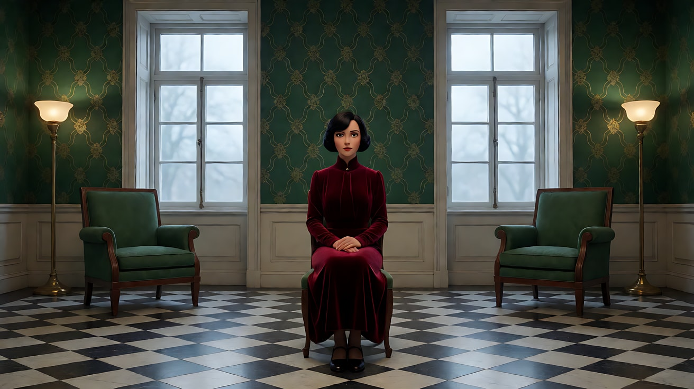

**【图生视频 · Seedance】**

```
【素材分工】@图片1 为首帧，锁定人物身份、红裙、房间的对称布局与墙纸图案。
【画风】风格化写实三维CG质感，宽银幕，饱和的深绿与深红。
她端坐不动，直视镜头，只是眨了一下眼，然后把交叠的双手慢慢分开，右手的食指在膝头轻轻敲了三下，停住。镜头以极缓慢的变焦推近，透视关系不变，对称构图始终居中，两侧的落地灯与窗户被慢慢推出画面边缘，最终停在她的中近景，墙纸的金色几何纹在她身后变得更清晰。
【声音】一只老座钟的滴答声，手指敲在丝绒上的三下闷响，窗外极远处的一声汽笛，配乐为一段缓慢的大键琴旋律，在她手指停住时戛然而止。
【约束】保持人物脸型、发型、服装不变；构图始终严格对称居中；画面中只有她一个人，她是唯一的红色；不要字幕、水印、Logo。
时长：8秒
```

**参数**：时长 8 秒 ｜ 画幅 2.39:1（平台无此选项时选 16:9）

**【检查点】**
- 推近过程中对称是否始终保持
- 红色是否是唯一的异色
- "敲三下、停住"是否清楚，配乐是否同步停止

**【常见问题与修复】**
| 现象 | 修复 |
|---|---|
| 对称偏移 | 写"中轴线始终穿过她的鼻尖" |
| 墙纸图案混乱 | 写"规则重复的金色几何纹，排列整齐" |
| 出现第二种红色 | 写"除了她的裙子，画面中没有任何红色" |
| 推近变成移动机位 | 写"变焦推近，机位不动，透视不变" |

---

### 练习2：一扇扇门的横移（难度 ★★）

**目标**：用侧面平行横移拍一条长走廊，每扇门后一种颜色，人物从画左走到画右。意图：让观众感到他正在一扇一扇地确认什么，而最后那扇门他不敢敲。

**【生图 · Nano Banana】**

图1 角色定妆：

```
Character turnaround sheet of an original man in his forties: neatly parted black hair with grey temples, a tired face,
a perfectly pressed dark grey three-piece suit, a deep purple tie, a small brass key on a ribbon in his hand.
Front view, three-quarter view, side view and back view, full body, eye-level camera, 50mm lens, deep focus,
plain light-grey background, even soft studio light from the front. Stylized semi-realistic 3D CG rendering, feature-film animation quality. Aspect ratio 16:9.
```

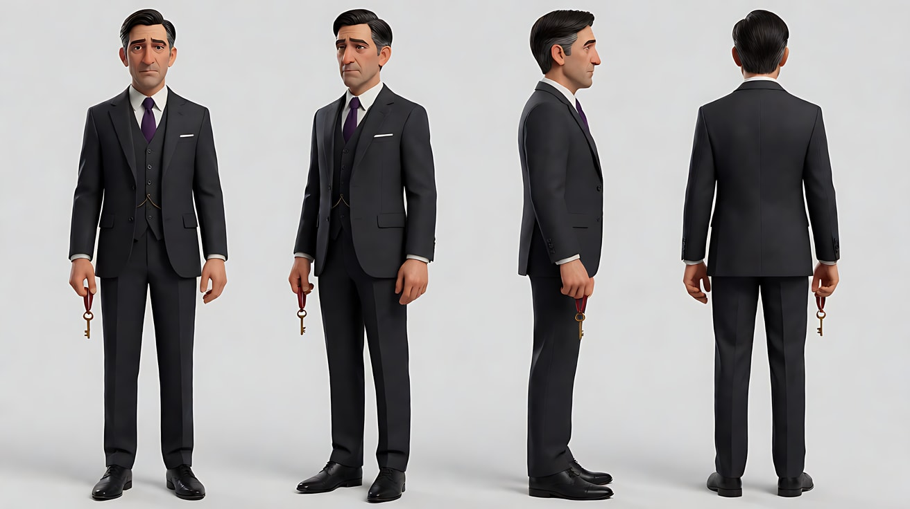

图2 场景：

```
An empty long narrow corridor of an old grand hotel seen exactly side-on, the far wall running parallel to the frame:
a row of identical tall dark wooden doors evenly spaced, each door half-open revealing a sliver of a room in a different solid color
(teal, ochre, violet, pale pink, deep green), a repeating patterned carpet, identical brass wall sconces between the doors, no people.
Wide shot, camera perpendicular to the wall at standing eye level, 35mm lens, deep focus, perfectly horizontal lines.
Lighting: warm brass sconce light along the corridor, each room glowing in its own color through the door gap.
Stylized semi-realistic 3D CG rendering, feature-film animation quality. Aspect ratio 2.39:1.
```

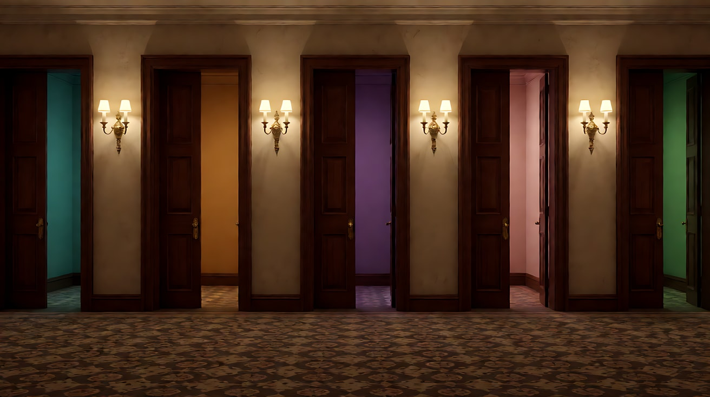

**【多图生视频 · Seedance】**

```
【素材分工】@图片1 锁定人物身份、西装、紫色领带与黄铜钥匙，不参考其背景；@图片2 仅参考走廊的侧面结构、门的间距与每个房间的颜色，不作为首帧。
【画风】风格化写实三维CG质感，宽银幕，精确的色彩分区。
镜头在走廊侧面，与墙面平行，随他从画左向画右同速横移，没有纵深运动。他沿着走廊慢慢走过一扇又一扇半开的门，每经过一扇门，门缝里不同颜色的光就在他的侧脸上换一次：青、赭黄、紫、浅粉。他每经过一扇门都侧头看一眼，脚步不停。走到最后一扇深绿色的门前，他停下，抬起手，指节停在门板前一寸，没有敲下去。镜头同时停住，他在画面正中。
【声音】无配乐，地毯吸收了大部分脚步声，只有每经过一扇门时，门后传来不同的细小声响：留声机的音乐、水龙头的滴水、钢琴的一个和弦、一声咳嗽；最后一扇门后完全寂静。
【约束】保持人物脸型、发型、服装不变；镜头只做侧面平行横移，不推进不后退；门后房间里不出现人物；不要字幕、水印、Logo、门牌号。
时长：10秒
```

**参数**：时长 10 秒 ｜ 画幅 2.39:1

**【检查点】**
- 镜头是否严格侧面平行、无纵深运动
- 颜色是否在他脸上依次变化
- 结尾"手停在门前一寸"的张力是否清楚

**【常见问题与修复】**
| 现象 | 修复 |
|---|---|
| 镜头跟到他身后变成纵深跟拍 | 写"镜头始终在走廊侧面，与墙面平行，像横向展开的画卷" |
| 门后出现人 | 约束写"门后房间都是空的" |
| 他敲了门 | 写"指节停在门板前，没有碰到门" |

---

### 练习3：茶杯里的海（难度 ★★★，首尾帧）

**目标**：用首尾帧做一次图形匹配转场：茶杯里旋转的茶水，以相同的圆形与旋转方向变成俯视的海面漩涡。意图：让观众感到她心里想着那片海。

**【生图 · Nano Banana】**

图1 首帧：

```
An extreme close-up straight-down overhead shot of a white porcelain teacup on a dark green lacquered table, filled with amber tea swirling in a clockwise spiral,
a single tea leaf turning in the center of the spiral, a woman's hand with a silver spoon just lifting out of the frame at the top edge.
The cup is perfectly centered and round in the frame. Camera directly above, 100mm macro lens, shallow depth of field at the cup rim.
Lighting: a soft cool window light from frame left, a small warm highlight on the tea surface.
Stylized semi-realistic 3D CG rendering, feature-film animation quality. Aspect ratio 16:9.
```

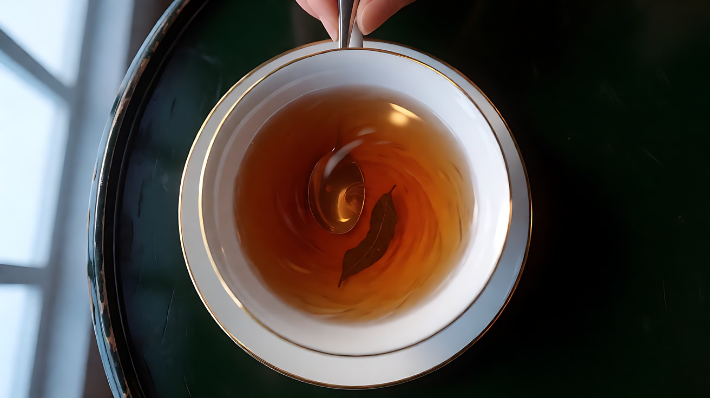

图2 尾帧：

```
An extreme high-angle overhead shot straight down onto a dark teal sea far below a cliff, a large natural whirlpool spiralling clockwise
at the exact center of the frame, white foam tracing the spiral, the circle of the whirlpool in the same size and position as the teacup in the previous image,
a thin edge of dark rocks at the top of the frame. Camera directly above, 35mm lens, deep focus.
Lighting: overcast cool daylight, a pale highlight on the water at the center.
Stylized semi-realistic 3D CG rendering, feature-film animation quality. Aspect ratio 16:9.
```

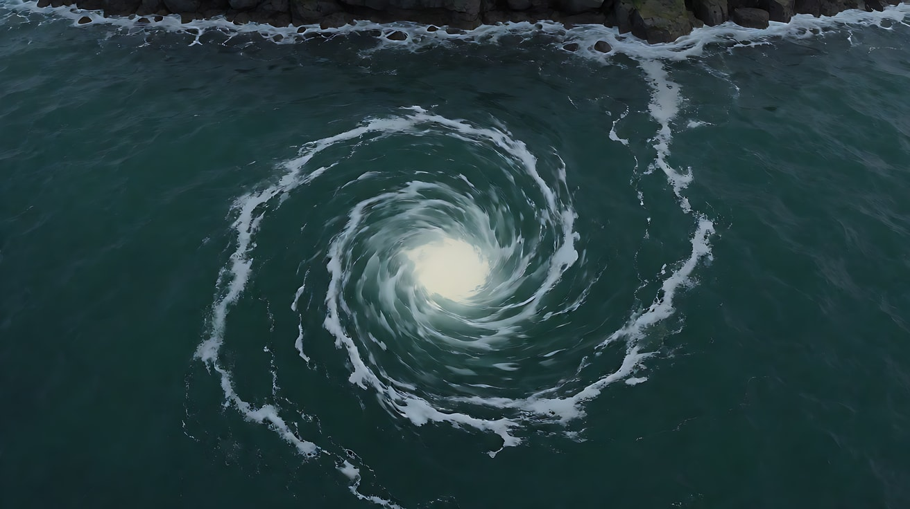

**【首尾帧生视频 · Seedance】**

```
【素材分工】@图片1 为首帧，确定茶杯的圆形构图、旋转方向与色调；@图片2 为尾帧，是最终画面目标，确定海面漩涡的位置与大小。只生成两帧之间的连续变化。
【画风】风格化写实三维CG质感，图形匹配转场。
俯视大特写，琥珀色的茶水在白瓷杯里顺时针旋转，中心的茶叶跟着打转。镜头垂直俯视不动，旋转的圆形保持在画面正中、大小不变，茶水的琥珀色逐渐加深为深青色，杯沿的白瓷渐渐变成白色浪沫，桌面的深绿漆面化为远处的礁石与海面。茶叶在中心化为一点白色的浪花。旋转方向始终是顺时针，速度不变。
【声音】勺子碰到杯沿的一声清响，然后茶水旋转的细微声音逐渐扩大，变成低沉的海浪与漩涡的轰鸣，远处一声海鸥。
【约束】旋转的圆形始终在画面正中、大小一致；旋转方向始终顺时针；一镜到底，不切镜头；不要字幕、水印、Logo。
时长：7秒
```

**参数**：时长 7 秒 ｜ 画幅 16:9

**【检查点】**
- 圆形的大小和位置是否从头到尾一致
- 旋转方向是否始终一致
- 转换是否逐渐发生，而不是硬切

**【常见问题与修复】**
| 现象 | 修复 |
|---|---|
| 圆形位置漂移 | 写"漩涡中心始终在画面正中" |
| 旋转方向反了 | 首尾帧都写"顺时针"，正文再强调一次 |
| 变成镜头拉远 | 写"镜头不动，是画面内容在变化" |

---

### 练习4：书房里的对峙（难度 ★★★★，多镜头）

**目标**：在一个完全对称的书房里，用三个镜头完成一次没有伤害、只有张力的对峙：对称全景 → 物件大特写 → 色彩揭示。意图：让观众感到"她已经知道了一切"。

**【生图 · Nano Banana】**

图1 角色定妆（两位原创角色）：

```
Character turnaround sheet of two original characters: a young woman in her mid-twenties with long straight black hair half tied back,
a pale ivory high-neck lace blouse and a long black skirt; an older man in his sixties with slicked-back silver hair and round gold spectacles,
a dark green velvet smoking jacket over a white shirt.
Front view, three-quarter view and side view of each, full body, eye-level camera, 50mm lens, deep focus,
plain light-grey background, even soft studio light from the front. Stylized semi-realistic 3D CG rendering, feature-film animation quality. Aspect ratio 16:9.
```

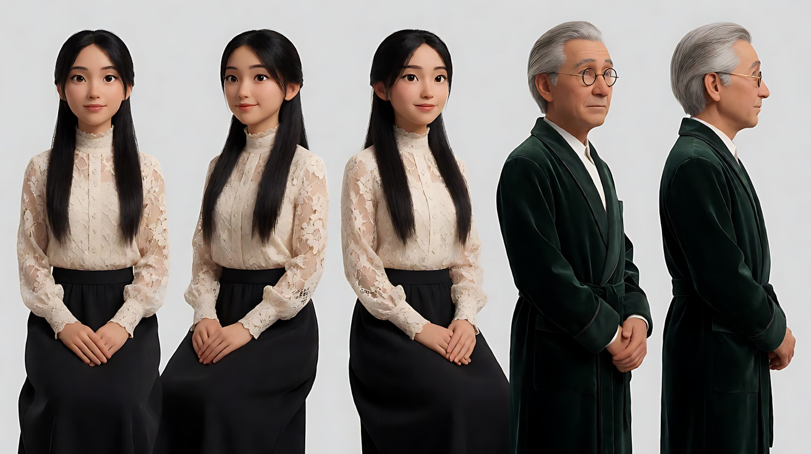

图2 场景：

```
An empty perfectly symmetrical private library in a 1930s mansion blending East Asian and Western architecture:
floor-to-ceiling dark wood bookshelves mirrored on both sides, a central aisle of patterned tiles leading to a long low reading table,
two identical green-shaded reading lamps on the table, a tall paper-screen window at the back center, no people.
Wide shot along the central axis, eye level, 24mm lens, deep focus, perfectly symmetrical one-point perspective.
Lighting: warm green-shaded lamp light on the table, cool soft daylight through the paper screen at the back, deep shadows between shelves.
Stylized semi-realistic 3D CG rendering, feature-film animation quality. Aspect ratio 2.39:1.
```

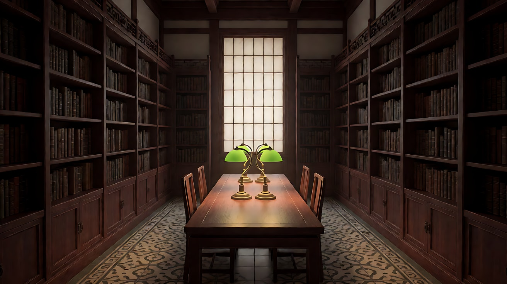

图3 镜头1关键帧：

```
Using the characters from image 1 and the library from image 2:
a perfectly symmetrical wide shot along the central axis, the young woman seated at the left end of the long reading table and the old man at the right end,
facing each other in profile, mirror images of each other, the two green lamps between them, the paper-screen window glowing behind at the center.
A single old envelope lies at the exact center of the table. Camera at seated eye level on the axis, 24mm lens, deep focus.
Lighting: warm lamp light from the table, cool daylight behind. Keep the faces, hairstyles and outfits exactly as in image 1.
Stylized semi-realistic 3D CG rendering, feature-film animation quality. Aspect ratio 2.39:1.
```

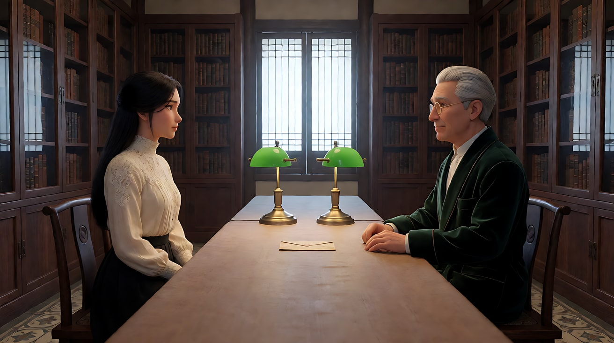

**【多图生视频 · Seedance】**

```
【素材分工】@图片1 锁定两人的身份与服装，不参考其背景；@图片2 仅参考书房的对称布局与灯光，不作为首帧；@图片3 为镜头1首帧。
【画风】风格化写实三维CG质感，宽银幕，深绿与象牙白，唯一的深红只在镜头3出现。
镜头1：严格对称全景，两人隔着长桌左右镜像对坐，桌子正中放着一只旧信封。镜头固定，中轴居中。女人伸出一根手指，把信封慢慢推到桌子中线以外，推向老人那一侧，停住。老人没有动，只是镜片后的眼睛垂下来看着信封。座钟的滴答声，信封纸在木桌上滑动的沙沙声。
镜头2：镜头切至俯视大特写，信封躺在深色木桌上，老人的手从画右入画，用两根手指掀开信封的封口，里面露出一角深红色的丝绸。他的手指停在那里。镜头固定。座钟滴答声变得很响，然后停了一拍。
镜头3：镜头切至女人的正面中近景，严格居中，身后是对称的书架。她直视镜头，平静地开口："你以为我不会找到它。"她身后两侧书架上的灯同时熄灭，只剩背后纸窗透出的光，窗纸上缓缓映出一整片深红色的光，像夕阳一样从中心向四周晕开，把她的轮廓勾成深红色。镜头以极缓慢的变焦推近她的眼睛。
【锁定】光线：书房暖色台灯与背后纸窗冷光，镜头3灯熄后只剩纸窗透出的深红光；女人：黑色长直发半扎、象牙白蕾丝高领衫、黑色长裙，始终在画左；老人：银色背头、金色圆框眼镜、深绿丝绒外套，始终在画右；全片的红色只来自信封里的丝绸与镜头3纸窗的光。
【声音】座钟滴答声贯穿，镜头2结尾停一拍；镜头3一句平静的对白后，一段低沉的弦乐和弦缓慢进入，无其他配乐。
【约束】保持两人脸型、发型、服装不变；两人不发生任何身体接触；不出现任何伤害情节；信封里只有一角红色丝绸；不要字幕、水印、Logo。
时长：13秒
```

**参数**：时长 13 秒 ｜ 画幅 2.39:1 ｜ 负载：3 个镜头、1 句对白、1 次灯光变化，属于"稳妥"偏上

**【检查点】**
- 镜头1两人是否完全镜像对称
- 镜头2是否只露出一角红色，没有展示全部
- 镜头3的红光是否从中心晕开、是否把张力推到最高

**【常见问题与修复】**
| 现象 | 修复 |
|---|---|
| 镜头2信封里的东西被完全拿出 | 写"他的手指只掀开封口，停住，没有取出" |
| 镜头3红光变成火光 | 写"像夕阳一样柔和的深红光，从纸窗外透进来" |
| 两人站起来走近对方 | 写"两人始终坐在长桌两端" |

---

### 练习5：原创 3 镜头场景《第十三扇门》（难度 ★★★★★）

**目标**：综合对称、横移、色彩象征、图形匹配、停顿与揭示，拍一个原创场景。故事：老宅主人去世后，他的女儿把一把黄铜钥匙交给服侍了父亲三十年的老管家，管家穿过长廊，打开了第十三扇门。意图：让观众感到他守了三十年的秘密，在这一刻被她轻轻揭开。

**分镜表**

| 镜头 | 景别 / 机位 | 运镜 | 色彩 | 功能 |
|---|---|---|---|---|
| 1 | 对称全景 → 钥匙特写 | 固定 → 变焦推近 | 深绿书房 + 黄铜 | 交出钥匙 |
| 2 | 走廊侧面全景 | 平行横移 | 每扇门一种颜色 | 走向秘密 |
| 3 | 门后正面对称 | 固定 | 整个房间深红 | 揭示 |

**【生图 · Nano Banana】**

图1 角色定妆（两位原创角色）：

```
Character turnaround sheet of two original characters: the daughter, a woman in her early thirties with a sleek black chin-length bob,
a high-collar black mourning dress with a small white collar; the old butler in his seventies, very upright, thin white hair combed back,
a black tailcoat, white gloves.
Front view, three-quarter view and side view of each, full body, eye-level camera, 50mm lens, deep focus,
plain light-grey background, even soft studio light from the front. Stylized semi-realistic 3D CG rendering, feature-film animation quality. Aspect ratio 16:9.
```

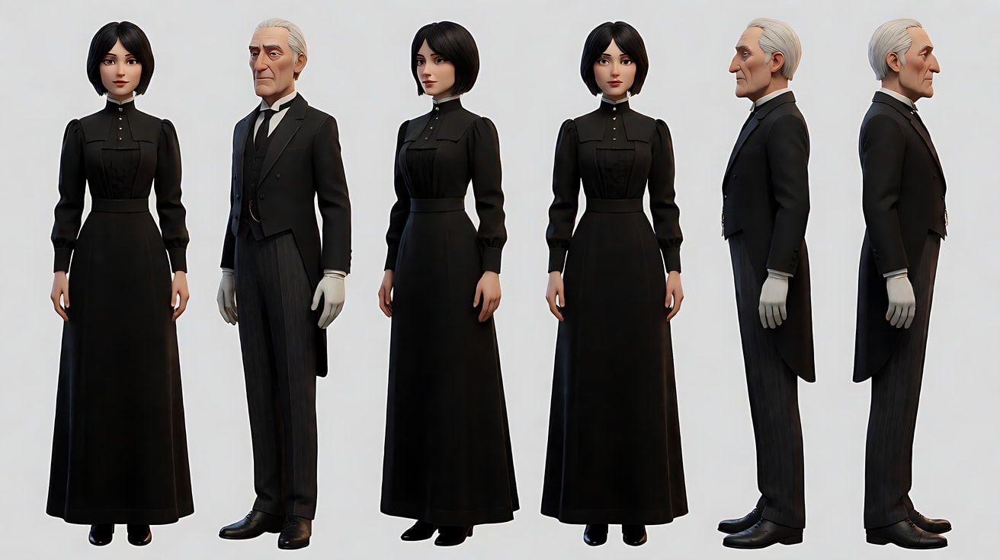

图2 场景：沿用练习2 图2（侧面长走廊，门后各有颜色）。

图3 镜头1关键帧：

```
Using the characters from image 1: a perfectly symmetrical medium-wide shot in a deep emerald-green study with gold geometric wallpaper,
the daughter seated at the center of a desk facing camera, the old butler standing at the exact center in front of the desk with his back to camera,
two identical green lamps on the desk on either side, an old brass key on a black ribbon lying at the center of the desk between them.
Camera at standing eye level on the central axis behind the butler, 28mm lens, deep focus.
Lighting: warm lamp light, rich saturated greens. Keep the faces, hairstyles and outfits exactly as in image 1.
Stylized semi-realistic 3D CG rendering, feature-film animation quality. Aspect ratio 2.39:1.
```

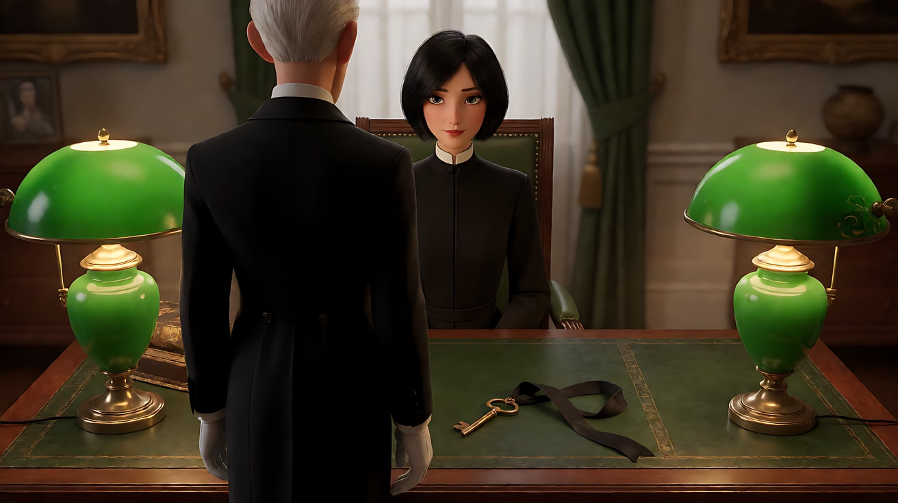

图4 镜头3关键帧：

```
Using the character from image 1: a perfectly symmetrical frontal shot from inside a small room looking back at an open dark wooden door,
the old butler standing exactly centered in the doorway, white gloves at his sides; the entire room around the camera is deep crimson —
crimson walls, crimson curtains, a single crimson armchair seen from behind in the foreground center, facing the door, empty.
The corridor behind him glows in warm brass light. Camera at seated eye level, centered behind the empty armchair, 35mm lens, deep focus.
Lighting: a single tall window off frame casting soft red-filtered light through the crimson curtains, the butler's face half in red light.
Keep the face, hairstyle and outfit exactly as in image 1. Stylized semi-realistic 3D CG rendering, feature-film animation quality. Aspect ratio 2.39:1.
```

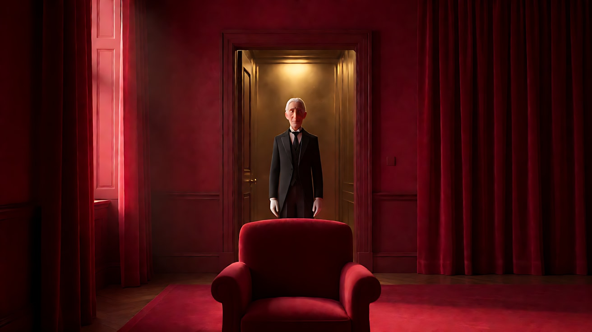

**【多图生视频 · Seedance】**

```
【素材分工】@图片1 锁定女儿与老管家的身份与服装，不参考其背景；@图片2 仅参考走廊的侧面结构与门后颜色，不作为首帧；@图片3 为镜头1首帧；@图片4 仅作为镜头3的构图与红色房间参考，不作为首帧。
【画风】风格化写实三维CG质感，宽银幕，深绿、黄铜与深红的色彩分区。
镜头1：严格对称中全景，深绿色的书房，女儿坐在书桌正中，老管家背对镜头站在桌前中轴上。女儿用一根手指把桌上的黄铜钥匙推向他。镜头以极缓慢的变焦推近，越过管家的肩膀，停在钥匙与他戴着白手套、缓缓伸入画面的手上。他拿起钥匙，手指收紧。座钟滴答声，钥匙在桌面上滑动的轻响。
镜头2：镜头切至走廊侧面，镜头与墙面平行，随老管家从画左向画右同速横移。他步伐笔直，一扇扇半开的门从他身后经过，门缝里的青、赭黄、紫、浅粉色光依次掠过他的侧脸。他数着门，嘴唇无声地动着。走到尽头第十三扇门前，他停下，镜头同时停住，他在画面正中，把钥匙插进锁孔。地毯上几乎听不见的脚步声，钥匙转动的一声清脆金属响。
镜头3：镜头切至门内，严格对称正面，镜头在一把背对镜头的深红色扶手椅后面，整个房间都是深红色。门被推开，老管家站在门口正中，身后是走廊的暖铜色光。他看着那把空着的扶手椅，慢慢摘下右手的白手套，停住，然后对着空椅子微微鞠了一躬。镜头固定。只剩门轴的余音和一段极轻的大键琴旋律。
【锁定】光线：镜头1为暖色台灯与饱和深绿；镜头2为走廊铜色壁灯与门缝里的彩色光；镜头3为透过深红窗帘的红光；女儿：黑色齐下巴短发、黑色高领丧服白小领；老管家：白发后梳、黑色燕尾服、白手套，手中始终握着黄铜钥匙直到插入锁孔；镜头2严格侧面横移。
【声音】座钟滴答声在镜头1，镜头2几乎无声只有钥匙转动声，镜头3门轴余音后大键琴进入，无对白。
【约束】保持两人脸型、发型、服装不变；红色只出现在镜头3的房间里；扶手椅是空的，房间里没有其他人；不出现任何伤害情节；不要字幕、水印、Logo、门牌号。
时长：15秒
```

**参数**：时长 15 秒 ｜ 画幅 2.39:1 ｜ 负载：3 个镜头、1 个变焦推近 + 1 个横移 + 1 个鞠躬，属于"有挑战"档；失败时把镜头2单独生成

**【检查点】**
- 六维是否都落地：对称全景与钥匙特写 / 深焦与变焦推近 / 镜像对称与门的框中框 / 深绿 → 彩色 → 深红的色彩揭示 / 侧面横移 / 停顿与揭示
- 红色是否只在镜头3出现
- 镜头3"对空椅子鞠躬"是否完成了情绪揭示

**【常见问题与修复】**
| 现象 | 修复 |
|---|---|
| 镜头3扶手椅上出现人 | 约束写"扶手椅始终是空的" |
| 镜头2变成背后跟拍 | 写"镜头在走廊侧面，与墙面平行" |
| 镜头1红色提前出现 | 【画风】与约束都写"红色只出现在镜头3" |
| 门太多数不清 | 改为"走到走廊尽头的最后一扇门" |
