# L07-20 单一光源、剪影与雾中轮廓 · 提示词

> 本组练习：只用一个有动机的主光源、让暗部自然衰减、剪影、雾中光的形状、实用光（台灯、路灯、车灯、灯塔）、一冷一暖的色彩克制。｜ 配套教学：[L07-20 教学文件](../教学/L07-20-罗杰迪金斯.md) ｜ 规范：[写作规范](../../模板/写作规范.md)
>
> 画风默认使用开关 A（风格化写实 CG）。本课大量镜头是剪影或背影，看不到面部细节，可以尝试开关 B（写实摄影质感）。如改用 2D 动画，删掉所有焦段、光圈、景深词。
>
> 本课风格指纹（只写技术，不写人名）：古典干净的大全景与小人物 ｜ 32mm 左右中等焦段、空间可读 ｜ 简洁构图、负空间、强剪影 ｜ 单一主光源、暗部自然衰减、雾显光形、一冷一暖 ｜ 固定或极平稳移动 ｜ 光的变化本身成为节拍。
>
> 每写一盏灯之前，先回答："这束光在这个世界里是从哪来的？"答不出来，就删掉。

---

### 练习1：一盏台灯（难度 ★）

**目标**：整个画面只有一个光源，暗部自然掉下去，不补光。意图：让观众感到深夜里只有她还醒着。

**【生图 · Nano Banana】**

图1 关键帧：

```
A medium shot of an original woman in her forties with short wavy grey-streaked hair, reading glasses pushed up on her head,
a dark knitted cardigan, sitting at a wooden kitchen table late at night, a stack of unpaid bills and a cold cup of tea in front of her, her hands around the cup.
She is placed on the left third of the frame, a dark doorway and a sleeping hallway in the deep right background.
Camera at seated eye level, 32mm lens, moderate depth of field, the background readable but dim.
Lighting: a single small warm tungsten desk lamp on the table at frame left as the only source, hard-ish falloff,
her face lit on the left side and falling into deep shadow on the right, no fill light, the rest of the kitchen sinking naturally into darkness,
a faint cool blue moonlight edge through a window at the back. Restrained palette: warm amber and deep blue only.
Stylized semi-realistic 3D CG rendering, feature-film animation quality. Aspect ratio 16:9.
```

中文释义：中景，原创中年女人深夜坐在厨房木桌前，面前一叠账单和一杯冷茶；人物在画左三分之一，右侧深处是暗的门洞与走廊；坐高、32mm、中等景深；画左一盏暖色小台灯是唯一光源，脸左亮右暗，不补光，厨房其余部分自然沉入黑暗；后窗一丝冷蓝月光；只有琥珀与深蓝两种颜色。

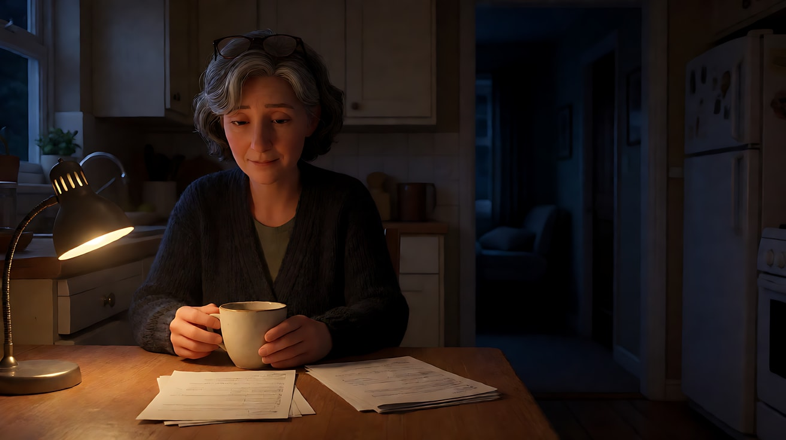

**【图生视频 · Seedance】**

```
【素材分工】@图片1 为首帧，锁定人物身份、服装、厨房布局与单一台灯光源。
【画风】风格化写实三维CG质感，单一光源，暗部自然衰减。
她双手捂着茶杯，低头看着桌上的账单，过了一会儿，把最上面那张翻过去，扣在桌上，用手掌压住。她抬起头，看向右侧黑暗的走廊，听了一下，又低下头。台灯的光稳定不变，暗部始终是暗部。镜头固定。结尾停在她手掌压着账单、脸一半在灯光里一半在黑暗中的画面上。
【声音】无配乐，冰箱低鸣，墙上挂钟的滴答，纸张翻过的轻响，走廊深处传来一声孩子翻身的轻微床板声。
【约束】保持人物脸型、发型、服装不变；只有台灯一个主光源，不增加补光，不出现其他灯；镜头固定；账单上不出现可读文字；不要字幕、水印、Logo。
时长：8秒
```

**参数**：时长 8 秒 ｜ 画幅 16:9

**【检查点】**
- 是否只有一个主光源，脸是否一侧亮一侧暗
- 暗部是否自然衰减（没有被"提亮"）
- 色彩是否只有暖琥珀和深蓝

**【常见问题与修复】**
| 现象 | 修复 |
|---|---|
| 整个厨房被照亮 | 写"台灯只照亮桌面和她的半边脸，其余部分沉入黑暗" |
| 出现顶灯或补光 | 约束写"画面中不出现其他灯，不补光" |
| 暗部死黑看不到走廊 | 写"走廊很暗但能隐约看到门框轮廓" |

---

### 练习2：黄昏山脊的剪影（难度 ★★）

**目标**：用黄昏天空做唯一光源，让人物成为纯黑剪影，靠三层明度（亮天、灰雾、黑地）读出画面。意图：让观众感到他们走向的地方不会有人等他们。

**【生图 · Nano Banana】**

图1 角色定妆（三位原创角色）：

```
Character turnaround sheet of three original characters, a team of geological surveyors: a tall man in his fifties with a wide-brimmed hat and a long canvas coat carrying a tripod;
a woman in her thirties with a short ponytail, a hooded field jacket and a large backpack; a young man in his twenties with a beanie, a puffer vest and a rolled map tube.
Front view, three-quarter view and side view of each, full body, eye-level camera, 50mm lens, deep focus,
plain light-grey background, even soft studio light from the front. Stylized semi-realistic 3D CG rendering, feature-film animation quality. Aspect ratio 16:9.
```

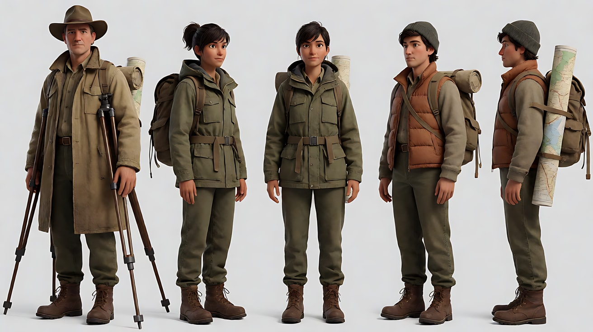

图2 场景：

```
An empty long bare ridge line in a high desert at dusk, the sun already set below the horizon, the sky graded from deep orange at the horizon to deep blue above,
a thin layer of mist lying in the valley below the ridge, the ridge itself pure black against the sky, no people.
Extreme wide shot, camera low in the valley looking up at the ridge, 50mm lens, deep focus, the ridge line in the lower third of the frame,
huge negative space of sky above. Lighting: the afterglow of the set sun as the only light source, no fill.
Restrained palette: orange and deep blue only. Stylized semi-realistic 3D CG rendering, feature-film animation quality. Aspect ratio 2.39:1.
```

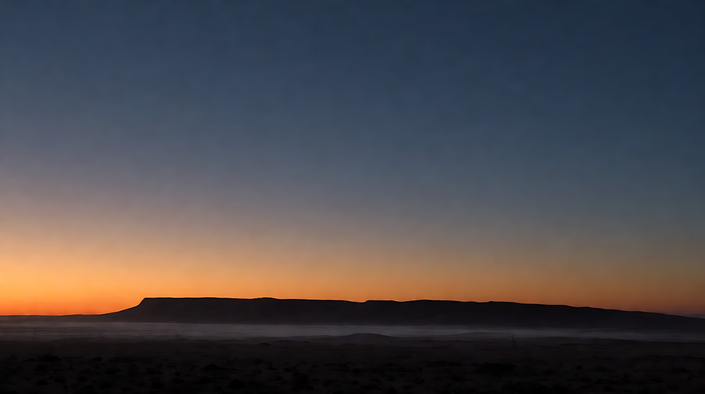

**【多图生视频 · Seedance】**

```
【素材分工】@图片1 仅锁定三人的轮廓、帽子、背包与道具形状，用于剪影识别，不参考其面部与背景；@图片2 仅参考山脊、天空渐变与薄雾，不作为首帧。
【画风】风格化写实三维CG质感，宽银幕，剪影，单一天光。
大全景，低机位从山谷仰望山脊。三个测绘员从画面右侧一个接一个走上山脊，在黄昏天空前成为纯黑剪影，看不到任何面部细节，只能从轮廓认出宽檐帽与三脚架、背包、地图筒。他们沿着山脊向画左慢慢走，间距相等，然后一个接一个走下山脊另一侧，身影从脚开始逐渐沉入地平线以下，最后一个人的帽檐消失。镜头固定。天空的橙色在这段时间里慢慢变暗变蓝，山谷的薄雾缓缓流动。结尾停在空空的山脊与只剩一道橙色余光的天空上。
【声音】无配乐，高原的风声，远处的碎石滚落声，脚步踩在砂石上的细响随人物远去而消失，最后只剩风声和一声很低的长音。
【约束】三人始终是纯黑剪影，不出现面部细节；天光是唯一光源；镜头固定；不要字幕、水印、Logo。
时长：10秒
```

**参数**：时长 10 秒 ｜ 画幅 2.39:1

**【检查点】**
- 人物是否是纯黑剪影，轮廓是否可辨
- 三层明度（亮天、灰雾、黑地）是否清楚
- 人物是否"沉入"地平线，而不是走出画面

**【常见问题与修复】**
| 现象 | 修复 |
|---|---|
| 人物脸部被照亮 | 写"人物正面完全背光，纯黑，没有任何反光" |
| 天空颜色太多 | 写"天空只有从橙到深蓝的渐变" |
| 人物从画面侧边走出 | 写"他们走下山脊另一侧，从脚开始沉入地平线以下" |

---

### 练习3：灯塔光束扫过雾（难度 ★★★，首尾帧）

**目标**：用一个**移动**的实用光源揭示空间：灯塔的光束每扫过一次，就照亮雾中的人一瞬。意图：让观众感到她每靠近一步，都在确认那个人还在。

**【生图 · Nano Banana】**

图1 角色定妆：

```
Character turnaround sheet of an original woman in her late twenties: long dark hair tied low, a heavy dark-green oilskin raincoat with the hood down,
rubber boots, a small unlit storm lantern in her hand.
Front view, three-quarter view, side view and back view, full body, eye-level camera, 50mm lens, deep focus,
plain light-grey background, even soft studio light from the front. Stylized semi-realistic 3D CG rendering, feature-film animation quality. Aspect ratio 16:9.
```

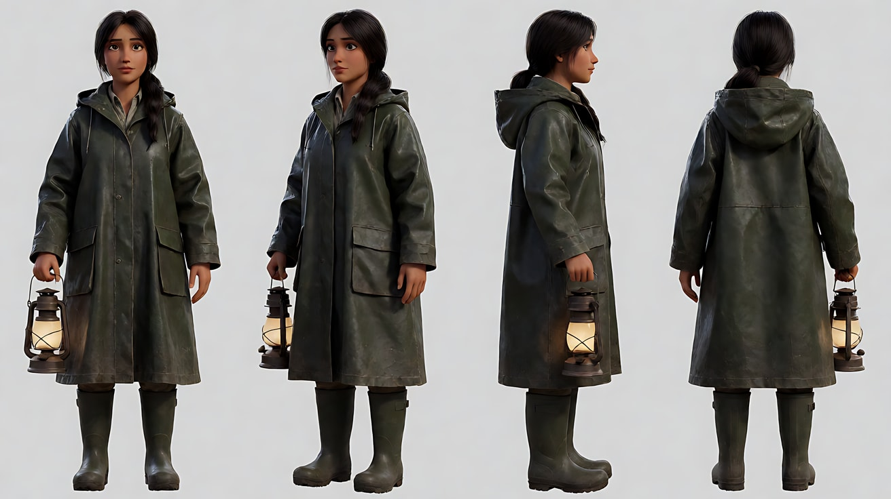

图2 首帧：

```
Using the character from image 1: a wide shot of a long narrow stone breakwater pier at night in thick sea fog, a lighthouse at the far end barely visible as a glow.
She stands small at the near end of the pier with her back to camera, a dark silhouette; the pier disappears into the fog ahead of her.
A broad beam from the lighthouse is sweeping across the fog from frame right, forming a solid visible cone of light above her head.
Camera at standing eye level behind her, 32mm lens, moderate depth of field. Lighting: the lighthouse beam as the only light source,
the fog glowing where the beam passes, everything else dark blue-black. Restrained palette: cold white beam and deep blue.
Keep the hairstyle and outfit exactly as in image 1. Stylized semi-realistic 3D CG rendering, feature-film animation quality. Aspect ratio 2.39:1.
```

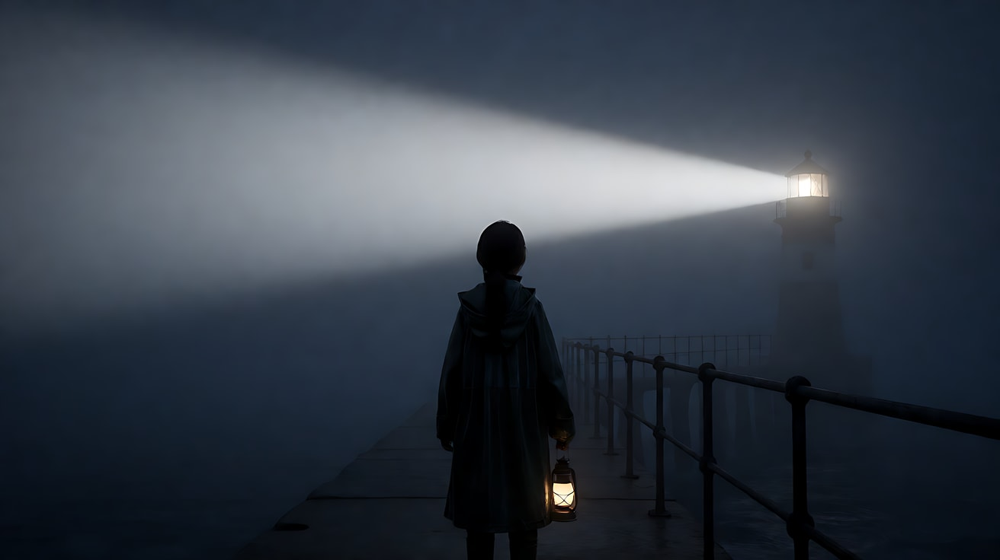

图3 尾帧：

```
Using the character from image 1 and the same pier, fog and lighting as image 2:
she is now far along the pier, close to the base of the lighthouse, standing still; in front of her, a second figure — an old man in a long coat —
stands at the very end of the pier as a pure black silhouette against the glowing fog lit by the beam passing directly overhead.
Both are rim-lit by the beam, faces not visible. Camera at the same position, 32mm lens, moderate depth of field.
Stylized semi-realistic 3D CG rendering, feature-film animation quality. Aspect ratio 2.39:1.
```

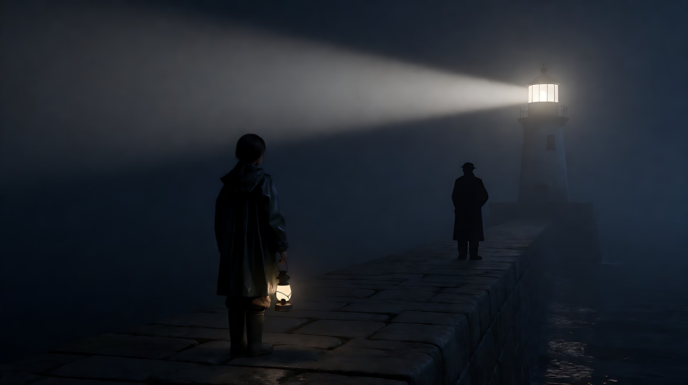

**【首尾帧生视频 · Seedance】**

```
【素材分工】@图片2 为首帧，确定防波堤构图、浓雾与灯塔光束；@图片3 为尾帧，是最终画面目标；@图片1 仅锁定女人的发型与雨衣，不参考其背景。只生成两帧之间的连续动作。
【画风】风格化写实三维CG质感，宽银幕，单一移动光源，浓雾。
她沿着狭长的防波堤向雾中的灯塔走去，脚步不快。灯塔的光束每隔几秒从右向左扫过一次浓雾，光束经过时，雾被照成一道发光的锥形，她的轮廓被勾出一圈冷白的亮边；光束离开后，她又沉回深蓝的黑暗里。第三次光束扫过时，防波堤尽头的雾里出现了一个穿长大衣的身影，纯黑剪影。她停下脚步。镜头固定在原位，不跟随。
【声音】无配乐，海浪拍打防波堤的声音，雾笛每隔一阵响起一声低沉长鸣，她的胶靴踩在湿石上的声音，在她停下时只剩海浪与雾笛。
【约束】灯塔光束是唯一光源；两人始终是剪影或轮廓，不出现面部细节；镜头固定；不要字幕、水印、Logo。
时长：10秒
```

**参数**：时长 10 秒 ｜ 画幅 2.39:1

**【检查点】**
- 光束是否周期性扫过，每次扫过都照亮她一瞬
- 雾里的光是否"有形状"（锥形光束）
- 第二个人物是否在光束扫过时才被揭示

**【常见问题与修复】**
| 现象 | 修复 |
|---|---|
| 光束不动，变成常亮 | 写"光束每隔几秒从右向左扫过一次，扫过之后画面回到黑暗" |
| 雾太薄看不出光束 | 写"浓雾，光束在雾中形成清晰的实体光锥" |
| 第二个人物一开始就出现 | 写"第三次光束扫过时，才在尽头的雾里出现一个身影" |

---

### 练习4：玻璃大楼里的流动光（难度 ★★★★，多镜头）

**目标**：在没有灯的高层空楼层里，唯一的光来自对面大楼外墙上缓慢流动的巨型屏幕光，人物变成剪影，玻璃制造多重反射。意图：让观众感到两个人在同一个空间里，却看不清彼此。

**【生图 · Nano Banana】**

图1 角色定妆（两位原创角色）：

```
Character turnaround sheet of two original characters: a woman in her thirties with a sharp short undercut, a long black trench coat, black gloves;
a man in his forties with a shaved head and a short beard, a grey suit with no tie, a slim metal briefcase.
Front view, three-quarter view and side view of each, full body, eye-level camera, 50mm lens, deep focus,
plain light-grey background, even soft studio light from the front. Stylized semi-realistic 3D CG rendering, feature-film animation quality. Aspect ratio 16:9.
```

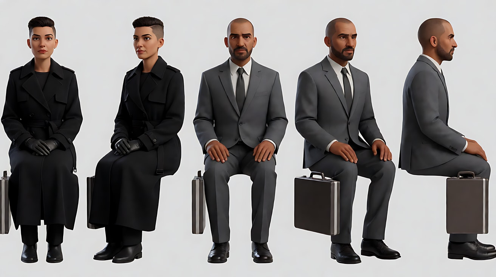

图2 场景：

```
An empty unfinished open-plan floor high in a glass skyscraper at night, no lights inside, floor-to-ceiling glass walls on all sides,
several freestanding glass partition panels creating layered reflections, a bare concrete floor.
Through the far glass wall, the facade of the neighboring tower is covered by a huge animated screen displaying slowly drifting abstract shapes of glowing blue and violet light, no text.
Wide shot at eye level, 32mm lens, moderate depth of field. Lighting: the giant screen across the street as the only light source,
its moving blue-violet light washing over the floor and reflecting in the glass partitions. Restrained palette: blue-violet light and black.
Stylized semi-realistic 3D CG rendering, feature-film animation quality. Aspect ratio 2.39:1.
```

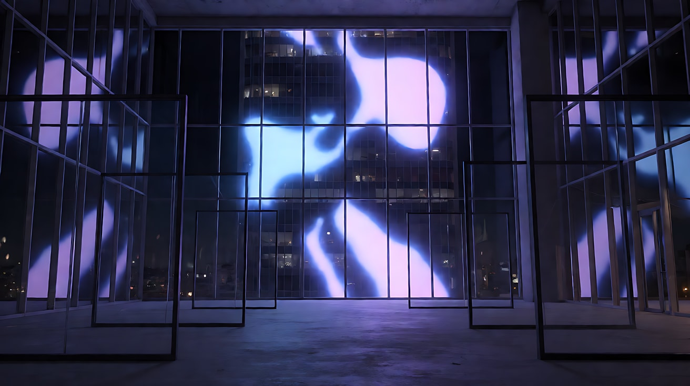

图3 镜头1关键帧：

```
Using the characters from image 1 and the floor from image 2:
a wide shot, the woman standing as a pure black silhouette on the left against the glowing far glass wall, the man as another silhouette on the right,
several glass partitions between them reflecting both figures multiple times so it is hard to tell which is real.
Camera at eye level, 32mm lens, moderate depth of field. Lighting: the drifting blue-violet screen light from behind them as the only source.
Keep the silhouettes and outfits as in image 1. Stylized semi-realistic 3D CG rendering, feature-film animation quality. Aspect ratio 2.39:1.
```

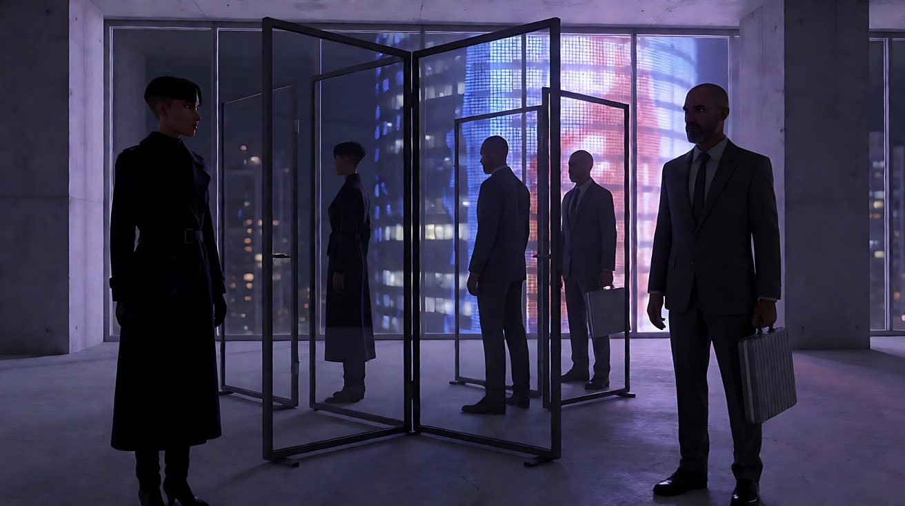

**【多图生视频 · Seedance】**

```
【素材分工】@图片1 锁定两人的轮廓与服装，不参考其背景；@图片2 仅参考空楼层、玻璃隔断与对面大楼的屏幕光，不作为首帧；@图片3 为镜头1首帧。
【画风】风格化写实三维CG质感，宽银幕，单一流动光源，剪影。
镜头1：固定全景，女人在画左、男人在画右，两人都是纯黑剪影，背后的巨型屏幕光缓慢地流动，蓝紫色的光斑在地面和玻璃隔断上游走。玻璃把两人的轮廓反射成好几个，分不清哪个是真的。男人把金属手提箱慢慢放在地上。远处城市的低鸣，高楼的风声。
镜头2：镜头切至男人的侧面中景剪影，他的轮廓被屏幕光勾出一圈蓝紫色的亮边，面部完全在黑暗中。他把手提箱向前推，箱子在水泥地上滑向画左。屏幕上的光斑缓慢掠过，他的影子在地面上拉长又缩短。箱子滑动的摩擦声。
镜头3：镜头切至玻璃隔断的反射，画面里同时出现女人真实的剪影和她在玻璃中的两个倒影，三个轮廓并排。手提箱滑入画面，停在她脚边。她低头看了一眼，没有弯腰，抬头看向画右。屏幕光在这一刻从蓝紫转为一片深蓝，所有轮廓都暗下去一半。镜头固定。一声很低的电子长音。
【锁定】光线：对面大楼的巨型屏幕光是唯一光源，蓝紫色，缓慢流动，室内无任何灯；女人：短发、黑色长风衣，始终在画左；男人：光头、短须、灰色西装，始终在画右；两人始终是剪影，不出现面部细节。
【声音】无配乐，城市低鸣与高楼风声贯穿，箱子放下与滑动的声音，最后一声很低的电子长音，无对白。
【约束】保持两人轮廓、发型、服装不变；不出现面部细节；屏幕上不出现文字；不出现任何伤害情节；不要字幕、水印、Logo。
时长：12秒
```

**参数**：时长 12 秒 ｜ 画幅 2.39:1 ｜ 负载：3 个镜头、1 个推箱动作，属于"稳妥"档

**【检查点】**
- 是否只有屏幕光一个光源
- 玻璃反射是否制造了"分不清真假"的多重轮廓
- 镜头3的光色变化是否只有一次，且不增加新光源

**【常见问题与修复】**
| 现象 | 修复 |
|---|---|
| 室内出现吊灯或灯带 | 约束写"室内没有任何灯" |
| 屏幕出现文字或广告 | 写"屏幕上只有缓慢漂移的抽象光斑" |
| 剪影被照亮成正面人像 | 写"两人都背对或侧对光源，面部在黑暗中" |

---

### 练习5：原创 3 镜头场景《暴雪加油站》（难度 ★★★★★）

**目标**：综合单一光源、实用光、剪影、雪雾中光的形状、负空间与一冷一暖的色彩克制，拍一个原创场景。故事：暴雪夜，一名被困的长途司机走进荒原上唯一亮着灯的加油站，老站长给他倒了一杯热咖啡，什么也没问。意图：让观众感到在无边的黑暗里，这一盏灯就是全部的善意。

**分镜表**

| 镜头 | 景别 / 机位 | 运镜 | 唯一光源 | 功能 |
|---|---|---|---|---|
| 1 | 极大远景 | 固定 | 加油站的一盏钠灯（暖） | 荒原里唯一的光 |
| 2 | 室内中景 | 固定 | 柜台上方一只白炽灯泡（暖），窗外雪夜（冷） | 一杯咖啡 |
| 3 | 室外全景，逆光 | 极平稳缓慢后退 | 卡车车灯（冷白）穿过雪雾 | 再出发 |

**【生图 · Nano Banana】**

图1 角色定妆（两位原创角色）：

```
Character turnaround sheet of two original characters: a long-haul truck driver in his forties, broad-shouldered, a thick sheepskin-collared work jacket,
a knitted cap, a short dark beard; an old gas station keeper in his seventies, thin and stooped, a faded red-checked flannel shirt under a quilted vest,
thick glasses, a white stubble.
Front view, three-quarter view and side view of each, full body, eye-level camera, 50mm lens, deep focus,
plain light-grey background, even soft studio light from the front. Stylized semi-realistic 3D CG rendering, feature-film animation quality. Aspect ratio 16:9.
```

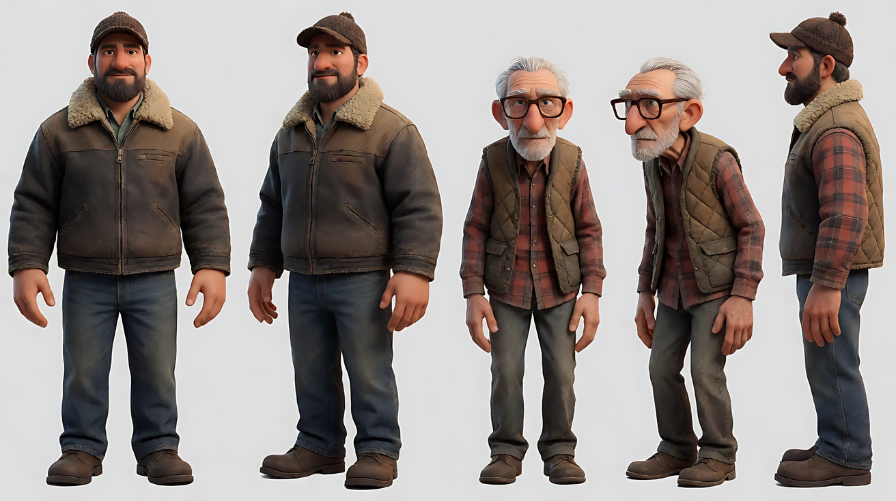

图2 镜头1关键帧：

```
An extreme wide shot of a vast flat snow-covered plain at night in a blizzard, a tiny isolated gas station at the lower right third of the frame,
lit only by a single warm sodium-vapor lamp on a pole, the falling snow glowing in a cone of amber light around it,
a parked truck's dark shape beside it, everything else deep blue-black, the horizon invisible in the storm, huge negative space.
Camera at eye level far away, 50mm lens, deep focus. Lighting: the single sodium lamp as the only light source, no moon.
Restrained palette: warm amber and deep blue only. Stylized semi-realistic 3D CG rendering, feature-film animation quality. Aspect ratio 2.39:1.
```

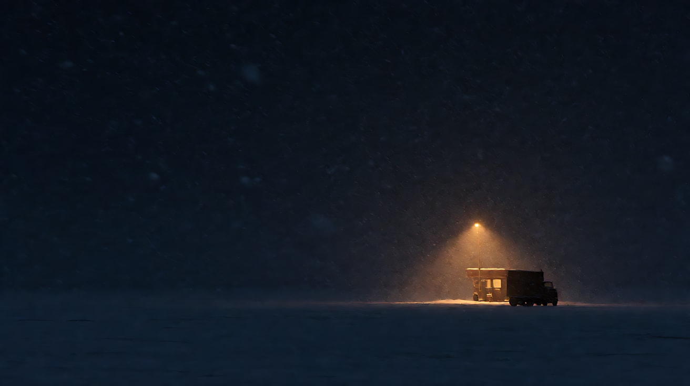

图3 镜头2关键帧：

```
Using the characters from image 1: a medium shot inside the tiny gas station shop at night, the driver standing at the counter on the left with snow on his shoulders,
the old keeper behind the counter on the right pouring coffee from a dented metal pot into a paper cup.
A single bare warm incandescent bulb hangs above the counter as the only interior light, the shop shelves falling into shadow,
the window behind them showing the cold blue blizzard outside. Camera at standing eye level, 32mm lens, moderate depth of field.
Lighting: warm bulb from above, no fill, steam from the coffee catching the light. Keep the faces, hairstyles and outfits exactly as in image 1.
Stylized semi-realistic 3D CG rendering, feature-film animation quality. Aspect ratio 2.39:1.
```

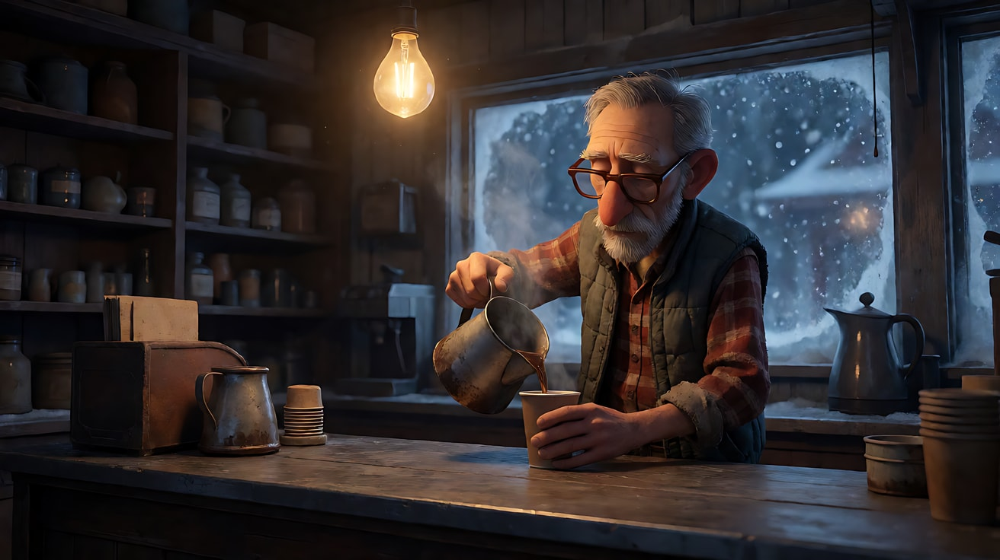

**【多图生视频 · Seedance】**

```
【素材分工】@图片1 锁定司机与老站长的身份与服装，不参考其背景；@图片2 为镜头1首帧；@图片3 仅作为镜头2的构图与灯光参考，不作为首帧。
【画风】风格化写实三维CG质感，宽银幕，单一光源，暖琥珀与深蓝两色。
镜头1：固定极大远景，暴风雪中的荒原一片漆黑，只有画面右下角的小加油站被一盏钠灯照亮，琥珀色的光锥里雪花密密地飘落。一个小小的人影从停着的卡车旁走出来，顶着风雪走向加油站的门，推门进去，门内透出一瞬暖光又合上。镜头不动。呼啸的风雪声，远处钠灯电流的嗡声。
镜头2：镜头切至加油站店内中景，柜台上方一只白炽灯泡是唯一的光，货架沉在暗处。司机站在柜台前，肩上的雪正在融化。老站长从凹陷的金属壶里倒了一杯热咖啡，蒸汽在灯下升起，他把杯子推到司机面前，什么也没说，转身去调收音机。司机双手捧住杯子，低头喝了一口，肩膀放松下来。窗外是冷蓝色的风雪。镜头固定。咖啡倒入纸杯的声音，收音机里断断续续的老歌，风拍窗户的声音。
镜头3：镜头切至加油站门外的全景，逆光。卡车已经发动，车灯冷白的光穿过雪雾，在雪中照出两道清晰的光柱。司机从加油站门口走向卡车，在车灯前成为纯黑剪影，他停了一下，回头朝店里举了举手。店门口，老站长的剪影站在暖黄的门框里，也举了一下手。镜头极平稳地缓慢后退，加油站和卡车在风雪里越来越小。车门关上的闷响，引擎声，风雪声。
【锁定】光线：镜头1唯一光源为钠灯（暖琥珀）；镜头2唯一光源为柜台上方白炽灯（暖），窗外冷蓝；镜头3唯一主光为卡车车灯（冷白），门框里透出暖光；司机：羊皮领工作夹克、毛线帽、短黑胡须；老站长：红格子法兰绒衬衫、绗缝背心、厚眼镜；全片只有暖琥珀与深蓝两种主色。
【声音】风雪声贯穿；镜头2有咖啡声、收音机老歌与风拍窗声；镜头3车门与引擎声，无配乐，无对白。
【约束】保持两人脸型、发型、服装不变；每个镜头只有一个主光源，不补光；镜头3两人为剪影，不出现面部细节；招牌与货架不出现文字；不要字幕、水印、Logo。
时长：15秒
```

**参数**：时长 15 秒 ｜ 画幅 2.39:1 ｜ 负载：3 个镜头、1 个倒咖啡动作、1 个挥手呼应，属于"有挑战"档；失败时把镜头1单独生成

**【检查点】**
- 六维是否都落地：极大远景与室内中景 / 中等焦段、空间可读 / 负空间与剪影 / 每镜头单一光源、雪雾显光形、琥珀与深蓝 / 固定与极平稳后退 / 光的切换（钠灯 → 灯泡 → 车灯）就是节拍
- 每个镜头是否真的只有一个主光源
- 镜头3两人的剪影举手是否形成呼应

**【常见问题与修复】**
| 现象 | 修复 |
|---|---|
| 镜头1雪原被月光照亮 | 写"没有月亮，钠灯之外一片漆黑" |
| 镜头2店内灯火通明 | 写"只有柜台上方一只裸灯泡，货架在暗处" |
| 镜头3车灯光柱不明显 | 写"大雪中车灯形成两道清晰的冷白光柱" |
| 出现第三种颜色（如绿色、红色） | 约束写"全片只有暖琥珀与深蓝两种主色"，并把老站长的衬衫改成"褪色的棕格子" |
