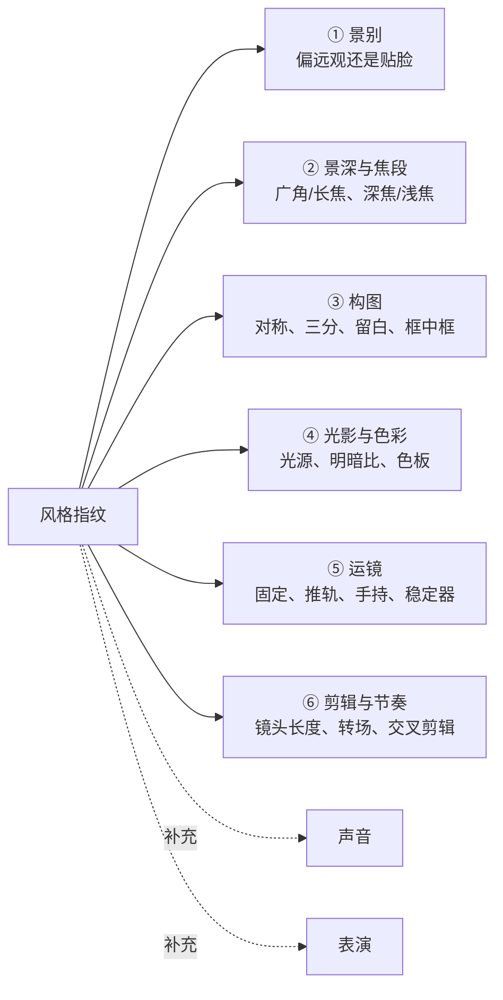
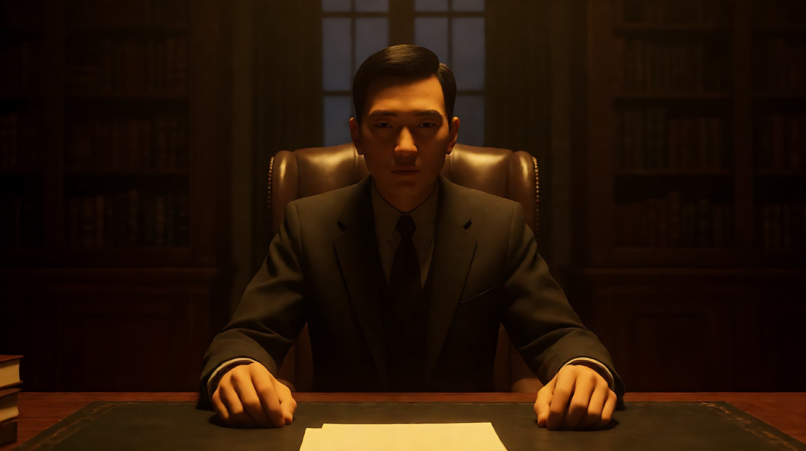
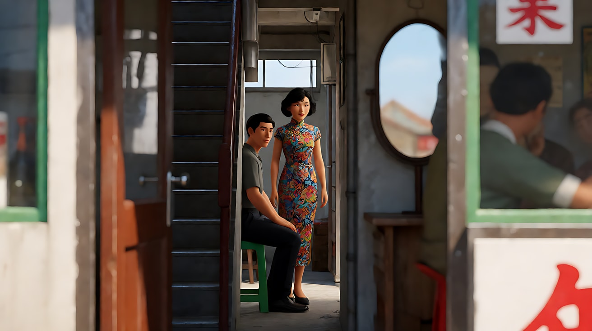

# L07-00 风格拆解方法论：六维风格指纹

> 段位：高级 ｜ 建议用时：90 分钟 ｜ 配套提示词：[L07-00-风格拆解方法论-提示词](../提示词/L07-00-风格拆解方法论-提示词.md)

## 学习目标

- 理解"导演风格"不是一种气质，而是一组**反复出现、互相配合的技术选择**
- 掌握"六维风格指纹"：景别 / 景深与焦段 / 构图 / 光影与色彩 / 运镜 / 剪辑与节奏（补充：声音与表演）
- 能从一部电影里拆出一张指纹表，并标出"规则"和"打破规则的那一刻"
- 能把指纹表翻译成**不含导演名、片名、角色名**的提示词，并说清为什么必须这样写
- 能用六种"功能型导演声音"给同一个原创场景换上完全不同的手感

## 一、概念讲解

### 1. 风格 = 重复出现的选择

前六个模块教的是"乐器"：景别、焦段、构图、光、运镜、剪辑。导演风格就是**一个人长期偏爱的乐器组合**。一位导演拍一百个镜头，如果其中八十个都是"正面、对称、固定、平光"，这就是他的指纹。

所以拆风格时不要问"他拍得美不美"，要问：

```
他最常把摄影机放在哪？  用什么焦段？  画面怎么排？
光从哪来、什么颜色？    摄影机动不动、怎么动？  多久切一次？
```

还有一句更重要的：**风格里最有意义的，往往是"打破规则"的那一刻。** 一个几乎从不移动摄影机的导演，突然推了一次轨，那就是全片的情感高点。

### 2. 六维风格指纹



| 维度 | 拆什么 | 记录方式（举例） |
|---|---|---|
| ① 景别 | 全片最常见的景别；特写出现在什么时候 | "全景占六成，特写只在揭示时出现" |
| ② 景深与焦段 | 广角还是长焦；背景清楚还是虚掉 | "广角近拍人脸，背景到墙角都清楚" |
| ③ 构图 | 人物放在哪；是否对称；留白在哪边 | "人物居中，走廊消失点在画面正中" |
| ④ 光影与色彩 | 主光来源、方向、明暗比、色温、色板 | "顶光，眼窝落在阴影里，琥珀暖色" |
| ⑤ 运镜 | 摄影机动不动；动的话用什么方式、什么速度 | "极慢推轨，几乎察觉不到" |
| ⑥ 剪辑与节奏 | 平均镜头长度；转场方式；是否交叉剪辑 | "一场戏一个镜头；用溶接过渡" |
| 补充：声音 | 配乐多少；环境声密度；静默何时出现 | "配乐只在段落结尾进入" |
| 补充：表演 | 表演尺度：克制、夸张、面无表情 | "演员正对镜头说话，几乎不动" |

### 3. 从一部电影拆出指纹表：五步法

```
① 选片   ── 选一部"最像他"的作品，不选转型之作
② 选场   ── 选三场功能不同的戏：开场 / 对峙或高潮 / 结尾
③ 逐镜记录 ── 每个镜头记一行：景别、焦段感、构图、光、运镜、时长
④ 统计   ── 数一数：哪个选项出现得最多？哪个只出现了一次？
⑤ 提炼   ── 写出"默认值"（规则）和"例外"（打破规则的时刻及其意义）
```

逐镜记录表（建议用表格软件，一个镜头一行）：

| 镜号 | 景别 | 焦段感 | 构图 | 光源 / 色 | 运镜 | 估计时长 | 这一镜在做什么 |
|---|---|---|---|---|---|---|---|
| 1 | 大全景 | 广角 | 中心对称 | 顶部荧光，冷白 | 缓慢前推 | 长 | 建立空间 |
| 2 | 中景 | 标准 | 人物居中 | 同上 | 固定 | 中 | 介绍人物 |
| … | | | | | | | |

> 提示：时长只要分"短 / 中 / 长"即可，不必掐秒表。拆片的目的是找**倾向**，不是做精确统计。

统计完，写成一张**指纹表**，每个维度只写一句"默认值"和一句"例外"：

```
┌──────────┬───────────────────────────┬───────────────────────┐
│ 维度      │ 默认值（规则）               │ 例外（打破规则的时刻）     │
├──────────┼───────────────────────────┼───────────────────────┤
│ 景别      │ 全景、中景为主                │ 结尾第一次用大特写         │
│ 焦段      │ 广角，深焦                   │ —                     │
│ 构图      │ 中心对称                     │ 主角崩溃时画面歪斜         │
│ 光色      │ 动机光，暖黄                  │ 真相揭开时只剩冷白         │
│ 运镜      │ 固定                        │ 全片唯一一次推轨           │
│ 剪辑      │ 长镜头，慢                    │ 高潮处密集交叉剪辑         │
└──────────┴───────────────────────────┴───────────────────────┘
```

### 4. 把指纹翻译成提示词：只写技术，不写人名

翻译规则只有一条：**每个维度写成模型能看见的物理描述。**

| 不要写 | 要写成 |
|---|---|
| "某某导演风格" | "严格中心对称构图，正面平视，人物站在画面正中，消失点在人物头部后方" |
| "像某部电影那样的光" | "唯一光源是桌上的烛火，从画面下方偏左照亮脸部，背景沉入暗部" |
| "某某式长镜头" | "一个连续镜头不剪切，摄影机以步行速度在人物身后跟随，穿过两扇门" |
| "某某式色调" | "低饱和粉色与薄荷绿为主色，阴影偏暖，没有纯黑" |
| "某某式剪辑" | "镜头切至……"，并在多镜头里用镜头数量和景别变化体现节奏 |

翻译后的一段"风格开关"可以直接放进 Seedance 的【画风】或镜头描述前面，例：

```
【风格】中心对称构图，正面平视，固定机位，平光无硬阴影，低饱和粉彩配色；人物正对镜头站定，动作简短而克制。
```

### 5. 六种功能型导演声音

本课用六种**按功能而非按人名**定义的"导演声音"作为翻译中枢：先判断一位导演最接近哪种声音，再用指纹表做细调。

| 声音 | 摄影机 | 光 | 色 | 剪辑 / 节奏 | 表演 | 适合 |
|---|---|---|---|---|---|---|
| 观察自然主义 | 隐形、有动机，多固定或轻微手持 | 现场光 / 动机光，柔 | 低饱和、真实 | 长镜头，晚切 | 克制、生活化 | 现实题材、纪实感 |
| 古典构图 | 稳重、平衡，运动有分寸 | 有动机但经过雕琢 | 和谐受控 | 耐心，踩在节拍上 | 收敛、精确 | 年代戏、高端广告 |
| 动感本能 | 手持、跟拍、贴近 | 硬光、高反差 | 冲击、去饱和的颗粒感 | 快、有打击感 | 用力、外放 | 动作、运动 |
| 表现主义风格 | 设计感强的运动、大胆构图 | 戏剧化、把动机光推到极致 | 高饱和、标志性色板 | 有音乐性 | 风格化、姿态化 | MV、时尚、奇幻 |
| 亲密极简 | 近焦段、小幅移动 | 单一柔光源 | 暖或克制 | 慢，少切 | 微表情、压抑 | 个人、情感、孤独 |
| 图形形式主义 | 固定或精确、几何化 | 硬、被塑形 | 限定色板 | 精确、面无表情的节奏 | 风格化或冷面 | 设计感品牌、冷面喜剧 |

一条纪律：**一个项目只用一种声音**。偏离声音必须是有意的转折信号——规则先立起来，打破才有意义。

### 6. 版权与平台合规：为什么提示词里不写人名

1. **平台规则**：主流生成平台的使用条款普遍限制"冒充或模仿特定真实人物""生成侵犯第三方知识产权的内容"。提示词里出现真实人名、片名，可能触发审核拦截，也可能让作品在发布时被投诉。
2. **风格与作品的边界**：一般而言，构图、光位、运镜这类**技法本身**属于公共的电影语言；而具体影片的角色、台词、标志性画面、美术设计属于作品内容。我们学的是前者，绝不复制后者。（具体法律问题以所在地法规和专业意见为准。）
3. **名字对模型是噪音**：模型对一个名字的理解，是网上相关图片的"平均印象"，往往只剩最表面的符号（某种配色、某种服装），恰恰丢掉了真正有价值的调度和节奏。写技术描述反而更可控。
4. **对真人的尊重**：仍在世的导演有人格权和署名利益；用他的名字给 AI 作品贴标签，等于替他背书。

> 结论：**教学文件里点名分析，提示词里只写技术。** 本模块所有提示词文件都遵守这一点。

## 二、情绪与叙事功能

| 技法 | 观众的感受 | 常用场景 |
|---|---|---|
| 一以贯之的风格 | "这是一个人拍的"，信任作者 | 长片、系列短剧、品牌系列 |
| 打破风格的那一刻 | 心里一震："出事了" | 转折、高潮、角色崩溃 |
| 指纹表 + 声音 | 创作者自己不再"每镜重新掷骰子" | 多段生成、多集项目 |
| 只写技术不写人名 | 作品有来源但不是翻拍 | 所有需要发布的 AI 作品 |

## 三、经典影片案例

### 《教父》（1972，弗朗西斯·福特·科波拉）——指纹表示范

- 场景：开场婚礼段落。室内是昏暗书房，教父逐一接见求助者；室外是阳光下热闹的婚礼。
- 怎么拍的：摄影指导戈登·威利斯大量使用**顶光**，人物眼窝常常落进阴影；整体曝光偏暗，色调偏琥珀暖黄；摄影机以固定和缓慢的运动为主；室内与室外在剪辑中来回切换。片尾受洗仪式与多处行动交叉剪辑。
- 指纹表（简化）：

| 维度 | 默认值 | 例外 / 意义 |
|---|---|---|
| 景别 | 中景、中近景为主，对话耐心 | 开场从求助者近景缓慢拉开，引出教父 |
| 景深与焦段 | 标准焦段，不炫技 | — |
| 构图 | 稳定、古典，人物多处在暗部包围中 | — |
| 光影与色彩 | 顶光、低调、琥珀暖色 | 室外婚礼是明亮日光，与书房形成对照 |
| 运镜 | 固定或极慢 | — |
| 剪辑与节奏 | 耐心的段落剪辑 | 片尾受洗与行动交叉剪辑，形成高潮 |

- 为什么这样拍：顶光让掌权者"不可读"；室内暗、室外亮，把"家族生意"和"家族生活"分在两个光的世界里。最接近的功能型声音是**古典构图**。



### 《花样年华》（2000，王家卫）——同一方法拆另一种风格

- 场景：两位主角在狭窄楼梯和面摊之间多次擦肩。
- 怎么拍的：摄影由杜可风与李屏宾担任；大量**框中框**（门框、窗框、镜子）与前景遮挡；常用较长焦段隔着空间"偷看"人物；擦肩时用慢动作配上反复出现的主题音乐；女主角的旗袍不断更换，成为时间流逝的标记。
- 指纹表（简化）：

| 维度 | 默认值 | 例外 / 意义 |
|---|---|---|
| 景别 | 中景、近景，常只拍局部（手、背、腰） | — |
| 景深与焦段 | 偏长焦，浅景深，前景虚化遮挡 | — |
| 构图 | 框中框、偏离中心、大面积遮挡 | — |
| 光影与色彩 | 暖色室内灯、浓郁的红与绿 | — |
| 运镜 | 缓慢横移、窥视式 | — |
| 剪辑与节奏 | 慢动作 + 重复主题音乐，段落式 | 重复本身就是节奏：同一动作一再出现 |

- 为什么这样拍：遮挡和窄空间制造"想靠近又不敢"的距离；重复的慢动作把日常变成仪式。最接近的功能型声音是**表现主义风格**与**亲密极简**之间。

> 注意：两张表的维度完全相同，但"默认值"天差地别。这就是指纹表的价值——**用同一把尺子量不同的人**。



## 四、在 AI 中怎么实现

- **生图阶段**：把指纹表的①②③④翻译进关键帧：景别、焦段、构图位置、光源方向与色温。风格的大部分"看起来像"发生在这一步。
- **视频阶段**：把⑤⑥和声音翻译进 Seedance：一个主运镜、镜头数量与景别变化、【声音】写配乐多少和环境声密度。
- **模型擅长**：构图规则（对称、居中、留白）、光源方向与色温、天气与介质（雾、雨、灰尘）、单一而清楚的运镜。
- **要避开**：在提示词里写导演名、片名、角色名；指望一个名字带来全部风格；在一个项目里混用多种声音；只模仿表面符号（服装、配色）却不模仿调度和节奏。

## 五、练习作业

1. 选一部你喜欢的电影，按五步法挑三场戏，至少记录 30 个镜头，填完逐镜记录表。
2. 根据统计写出六维指纹表，每个维度一句"默认值"、一句"例外"。
3. 把指纹表翻译成一段不含任何人名、片名的【风格】描述（不超过 80 字），请同伴盲读，看能否猜出是哪种功能型声音。
4. 完成配套提示词练习1–5：同一个原创洗衣房场景，换六种声音拍。

## 六、自检清单

- [ ] 我能说出六个维度，以及两个补充维度
- [ ] 我的指纹表每个维度都有"默认值"和"例外"
- [ ] 我能说出例外时刻在剧情上的意义
- [ ] 我的提示词里没有任何导演名、片名、原片角色名、品牌名
- [ ] 我能把一种风格归到六种功能型声音之一，并说出理由
- [ ] 一个项目里我只用了一种声音，偏离是有意的

## 七、配套提示词

→ [L07-00-风格拆解方法论-提示词](../提示词/L07-00-风格拆解方法论-提示词.md)

---

上一课：[L06-06 连续性与首尾帧链](../../06-镜头语言综合与分镜/教学/L06-06-连续性与首尾帧链.md) ｜ 下一课：[L07-01 希区柯克：悬念机器](L07-01-希区柯克.md) ｜ [返回总目录](../../README.md)
