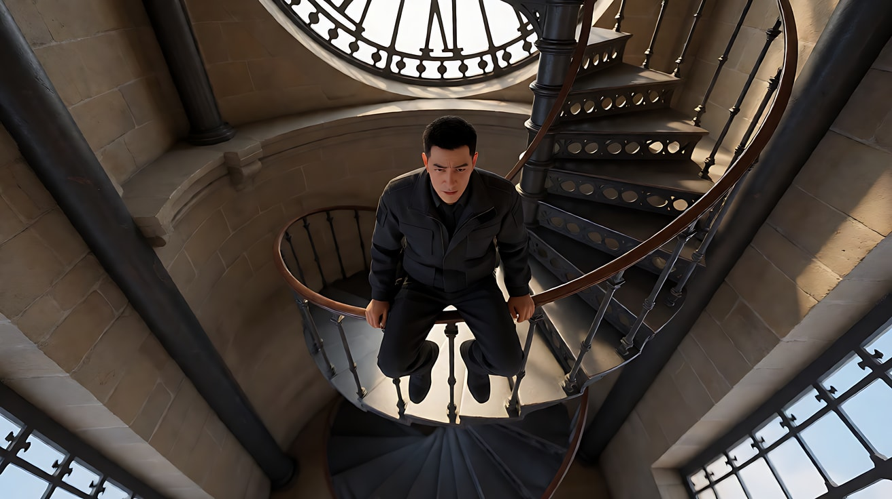
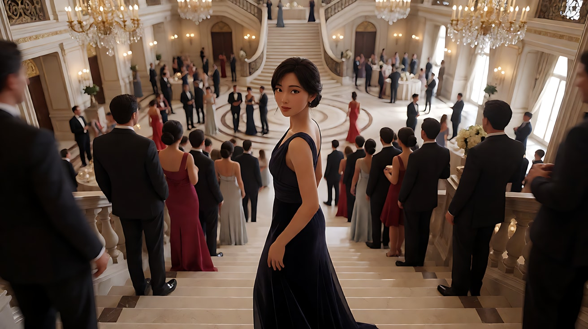
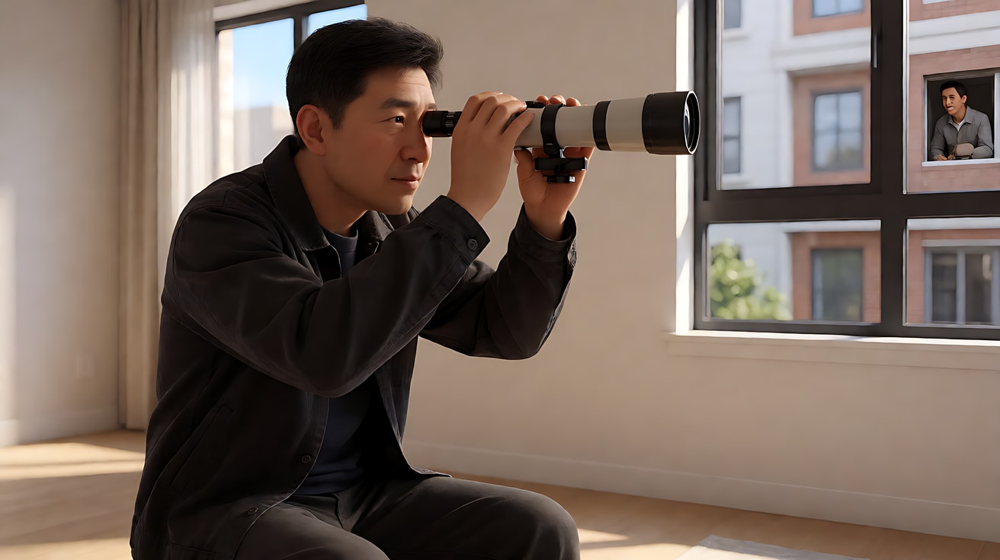

# L07-01 希区柯克：悬念机器

> 段位：高级 ｜ 建议用时：90 分钟 ｜ 配套提示词：[L07-01-希区柯克-提示词](../提示词/L07-01-希区柯克-提示词.md)

## 学习目标

- 能说清"悬念"和"惊吓"的区别，以及"让观众比角色知道得多"为什么能制造悬念
- 能拆出希区柯克的六维风格指纹，尤其是**主观镜头三段式**、**滑动变焦**、**高位俯拍**
- 能分析《迷魂记》《美人计》《后窗》中的代表性镜头
- 能用不含人名的提示词复现这些技法，拍一个原创的悬念场景

## 一、概念讲解

### 1. 导演简介

阿尔弗雷德·希区柯克（Alfred Hitchcock，1899–1980），英国出生，先在英国拍片，1939 年前往好莱坞，被称为"悬念大师"。他做过字幕卡设计和美术指导，习惯在开拍前把每个镜头画成分镜，再按分镜"组装"电影。他与法国导演特吕弗的长篇访谈后来出版为《希区柯克与特吕弗对话录》（1966），书中系统讲了他的悬念理论。

### 2. 代表作

| 年份 | 片名 | 值得看的技法 |
|---|---|---|
| 1940 | 《蝴蝶梦》 | 空间与"缺席者"的压迫感 |
| 1946 | 《美人计》 | 从高处大全景一路降到手中钥匙的升降镜头 |
| 1954 | 《后窗》 | 几乎全片限制在主角公寓视角的主观结构 |
| 1958 | 《迷魂记》 | 钟楼楼梯的滑动变焦（"眩晕效果"） |
| 1959 | 《西北偏北》 | 空旷平原上的白日危险 |
| 1960 | 《惊魂记》 | 浴室段落的密集剪辑；楼梯处的高位俯拍 |
| 1963 | 《群鸟》 | 日常空间被逐渐"填满" |

### 3. 六维风格指纹表

| 维度 | 默认值 | 例外 / 关键时刻 |
|---|---|---|
| ① 景别 | 用景别控制"观众知道多少"：全景交代危险物，近景锁住角色的不知情 | 关键物件给特写（钥匙、杯子、手） |
| ② 景深与焦段 | 标准焦段为主，清楚交代空间 | **滑动变焦**：推轨与变焦反向，背景透视扭曲 |
| ③ 构图 | 精确设计；常用高位俯拍让角色显得渺小、被命运俯视 | 关键时刻的极端俯拍 |
| ④ 光影与色彩 | 黑白时期多用明暗对比与投影；彩色时期用色彩做心理符号（如《迷魂记》中的绿色） | 楼梯、门缝、窗口的光把危险框起来 |
| ⑤ 运镜 | 有目的的推进：把观众的注意力"带"到线索上 | 从全景一路推到小物件的长距离运动 |
| ⑥ 剪辑与节奏 | **看—被看—反应**的主观剪辑；悬念段落拉长时间 | 惊吓段落用极短镜头密集剪辑 |
| 补充：声音 | 配乐承担紧张（与作曲家伯纳德·赫尔曼长期合作） | 关键时刻的安静与单一声音 |
| 补充：表演 | 角色表面镇定，危险藏在画面里 | — |

### 4. 两个核心原理

**悬念 vs 惊吓（桌下装置理论）**

希区柯克在对话录里举过一个例子：两个人在桌边聊天，桌下有一个装置，突然爆开——观众只得到几秒的惊吓。如果先让观众**看到**桌下的装置、看到墙上的钟，两人还在聊无关的话——观众会紧张整整十几分钟。

```
惊吓：  聊天 ──────────── 聊天 ── 砰！     观众：吓一跳（几秒）
悬念：  [先给观众看桌下装置 + 时钟]
        聊天 ── 时钟 ── 聊天 ── 装置 ── 聊天 …  观众：一直揪着心
```

关键：**信息不对称**——观众知道，角色不知道。

**主观镜头三段式（看—所见—反应）**

```
┌────────────┐    ┌────────────┐    ┌────────────┐
│ 角色看向画外 │ →  │ 他看到的东西 │ →  │ 角色的反应   │
│  （近景）    │    │（主观镜头）  │    │  （近景）    │
└────────────┘    └────────────┘    └────────────┘
     观众被"放进"角色的眼睛，与他一起发现
```

**滑动变焦（Dolly Zoom）**

```
摄影机向后拉  ←←←  同时  →→→  镜头变焦推近
结果：主体大小不变，背景透视被拉长或压扁 → "世界在晃，人还在原地"
```

### 5. 常见误解

| 误解 | 实际情况 |
|---|---|
| 悬念 = 黑暗、吓人 | 悬念来自信息不对称，可以发生在大白天（《西北偏北》的平原） |
| 滑动变焦用得越多越好 | 它是极少数时刻的"眩晕"信号，一部片里用一两次 |
| 风格就是金发女主、楼梯、鸟 | 那是作品元素，不是技法；我们学的是信息控制与主观剪辑 |
| 主观镜头 = 镜头摇晃 | 他的主观镜头往往是稳定的，靠"看—所见—反应"的剪辑建立 |

## 二、情绪与叙事功能

| 技法 | 观众的感受 | 常用场景 |
|---|---|---|
| 观众知道得比角色多 | 揪心、想提醒角色 | 危险靠近、秘密即将曝光 |
| 主观镜头三段式 | 代入角色、与他一起发现 | 偷看、搜寻、发现线索 |
| 滑动变焦 | 眩晕、世界失衡、顿悟 | 恐高、惊觉真相 |
| 高位俯拍 | 渺小、被命运俯视、无处可逃 | 危险降临前一刻 |
| 长距离推到小物件 | "注意这个！" | 引出关键道具 |

## 三、经典影片案例

### 《迷魂记》（1958，阿尔弗雷德·希区柯克）钟楼楼梯

- 场景：患有恐高症的前警探追上钟楼的旋转楼梯，向下望去。
- 怎么拍的：向下看楼梯井的主观镜头使用了**推轨与变焦反向同时进行**的手法，楼梯井的透视被拉长，仿佛在眼前"下坠"。这个效果常被称为"眩晕效果"（Vertigo effect），据记载由第二摄制组摄影师艾尔敏·罗伯茨实现，为了拍摄，楼梯井被做成横放的微缩模型。
- 为什么这样拍：恐高无法"表演"出来，只能让观众的眼睛也失去平衡。镜头是主观的，所以眩晕直接落在观众身上。



### 《美人计》（1946，阿尔弗雷德·希区柯克）宴会钥匙

- 场景：女主角在宅邸的宴会上，手里藏着一把酒窖钥匙。
- 怎么拍的：镜头从楼梯上方的高位大全景开始，俯视整个宴会大厅，然后一路下降、推近，穿过人群，最终停在她背在身后的手和手里那把钥匙的特写。
- 为什么这样拍：一个镜头完成了"从世界到秘密"的聚焦。观众现在知道钥匙在哪，而宴会上的其他人不知道——之后每一次有人靠近，都是悬念。



### 《后窗》（1954，阿尔弗雷德·希区柯克）偷看对面

- 场景：腿上打着石膏的摄影记者困在公寓，用望远镜观察对面楼的邻居。
- 怎么拍的：全片几乎都限定在他的公寓视角。反复使用"他看向窗外（近景）→ 对面窗户里的画面（主观、长焦）→ 他的反应（近景）"的三段式。
- 为什么这样拍：观众被迫和主角一样只能"看"、不能动，主角的窥视也成了观众的窥视。当危险最终越过院子走向他时，观众和他一样无路可逃。



## 四、在 AI 中怎么实现

**复现技法，而不是复制作品**：不要生成钟楼、金发女郎、望远镜偷看凶案；要学的是"先给观众看危险物、让角色不知道"、"看—所见—反应"、"推拉反向的眩晕"、"高位俯拍压住角色"。把这些装进你自己的原创故事。

- **生图阶段**：
  - 危险物关键帧：用全景或中景把"危险物 + 不知情的角色"放在同一画面（桌下的计时装置在前景、人物在中景聊天）。
  - 主观镜头：首帧写 `point-of-view shot from the character's eye level`，主观画面用长焦、略带窥视的遮挡（门缝、窗框）。
  - 俯拍：`high overhead shot looking straight down the stairwell`。
- **视频阶段**：
  - 主观三段式写成三个镜头：`镜头1 近景看向画外 → 镜头切至她看到的…（主观镜头）→ 镜头切至她的近景反应`。
  - 滑动变焦写成："镜头向后拉的同时变焦推近，人物大小保持不变，身后走廊的透视被拉长"——这是**一个主运镜**，不要再叠加其他运动。
  - 悬念靠"插入危险物镜头"：在对话镜头之间插一个计时装置的特写，模型几乎不费时长。
- **模型擅长**：俯拍、长距离推近到物件、稳定的主观镜头、灯光与阴影。
- **要避开**：在提示词里写导演名、"眩晕效果"等带人名或片名的术语（写"滑动变焦"）；用"炸弹、刀、血"等触发词（改为"嘀嗒作响的金属盒""深色痕迹"）；把"意外"写成高潮。滑动变焦在模型里不一定稳定，失败时退而求其次用"缓慢推近 + 背景透视拉长"描述，或拆成首尾帧。

## 五、练习作业

1. 选《后窗》或《惊魂记》中的任意一段，记录 15 个镜头，标出哪些是"看"、哪些是"所见"、哪些是"反应"。
2. 用"桌下装置理论"改写一个日常场景（例如两人在餐厅吃饭），写出你会插入的三个"危险物镜头"。
3. 完成配套提示词练习1–5，最后一组拍一个原创的三镜头悬念场景。

## 六、自检清单

- [ ] 我能用一句话说清悬念与惊吓的区别
- [ ] 我的场景里，观众知道一个角色不知道的信息
- [ ] 主观镜头写成了"看—所见—反应"三个镜头
- [ ] 滑动变焦是这个片段唯一的主运镜
- [ ] 提示词里没有导演名、片名、原片角色名，也没有触发词

## 七、配套提示词

→ [L07-01-希区柯克-提示词](../提示词/L07-01-希区柯克-提示词.md)

---

上一课：[L07-00 风格拆解方法论](L07-00-风格拆解方法论.md) ｜ 下一课：[L07-02 库布里克：对称与一点透视](L07-02-库布里克.md) ｜ [返回总目录](../../README.md)
