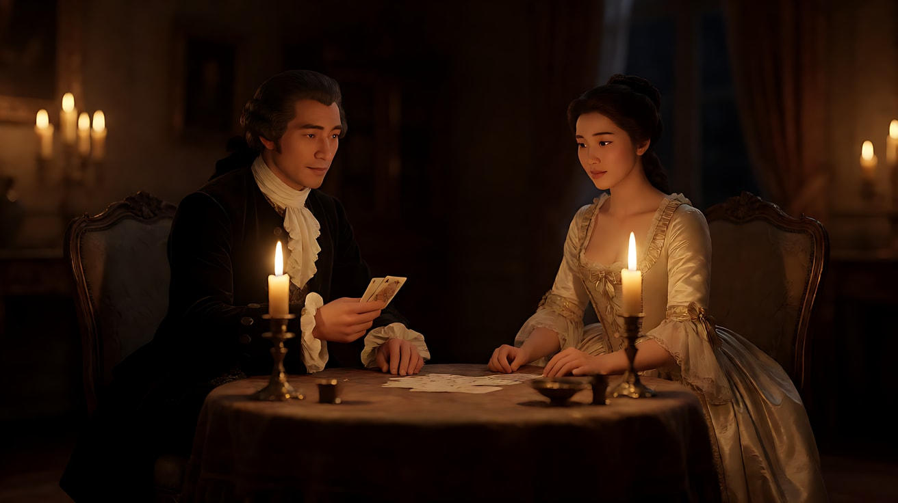

# L07-02 库布里克：对称与一点透视

> 段位：高级 ｜ 建议用时：90 分钟 ｜ 配套提示词：[L07-02-库布里克-提示词](../提示词/L07-02-库布里克-提示词.md)

## 学习目标

- 能识别"一点透视对称"构图，并说出它为什么让人感到冷静、宿命甚至不安
- 能拆出库布里克的六维风格指纹：广角、对称、长距离跟拍、动机光、冷静的凝视
- 能分析《闪灵》《巴里·林登》《2001 太空漫游》中的代表性镜头
- 能用不含人名的提示词复现"一点透视 + 稳定器长跟拍 + 烛光 + 低头上目凝视"

## 一、概念讲解

### 1. 导演简介

斯坦利·库布里克（Stanley Kubrick，1928–1999），美国纽约出生，青年时期是《Look》杂志的摄影师，后来自学成为导演，1960 年代起长期定居英国工作。他以极端的完美主义闻名：反复拍摄同一镜头、亲自研究镜头和技术、每部片几乎都跨越不同类型（战争、科幻、历史、恐怖）。风格却始终可辨：**冷静、对称、精确，像一位旁观的科学家**。

### 2. 代表作

| 年份 | 片名 | 值得看的技法 |
|---|---|---|
| 1957 | 《光荣之路》 | 战壕中长距离的后退跟拍 |
| 1964 | 《奇爱博士》 | 作战室的巨大环形空间与顶部光环 |
| 1968 | 《2001 太空漫游》 | 一点透视走廊；骨头到飞行器的匹配剪辑 |
| 1971 | 《发条橙》 | 广角近拍人脸；开场从眼睛特写拉开 |
| 1975 | 《巴里·林登》 | 烛光拍摄；从细节缓慢变焦拉开成"油画" |
| 1980 | 《闪灵》 | 稳定器低机位跟拍；酒店走廊对称构图 |
| 1987 | 《全金属外壳》 | 营房中轴构图；后退跟拍的训话 |
| 1999 | 《大开眼戒》 | 圣诞彩灯构成的实用光源 |

### 3. 六维风格指纹表

| 维度 | 默认值 | 例外 / 关键时刻 |
|---|---|---|
| ① 景别 | 全景与中景为主，人物常被空间包围 | 广角近景人脸，表情被轻微变形 |
| ② 景深与焦段 | **广角**，深焦，空间线条清楚 | 《巴里·林登》用慢速变焦从细节拉成全景 |
| ③ 构图 | **一点透视中心对称**：消失点在画面正中，人物常站在中轴线上 | 对称被打破往往意味着秩序崩塌 |
| ④ 光影与色彩 | **动机光**：烛光、灯带、天花板灯箱都在画内 | 色彩常有一种主导色（如《闪灵》里的红色卫生间） |
| ⑤ 运镜 | 沿中轴线**前进或后退的长距离跟拍**；稳定器贴地跟随 | 固定的"凝视"长镜头 |
| ⑥ 剪辑与节奏 | 慢、长，镜头保持得比观众预期更久 | 大胆的匹配剪辑跨越时空 |
| 补充：声音 | 古典音乐与既有曲目的反差使用 | 寂静中的单一声音（脚步、呼吸） |
| 补充：表演 | 冷静或夸张两极；**低头上目的凝视**（头微低、眼睛向上看镜头） | — |

### 4. 一点透视对称示意

```
┌──────────────────────────────────────────┐
│ ╲                                      ╱ │
│   ╲          天花板灯带               ╱   │
│     ╲──────────────────────────────╱     │
│      │ ╲                        ╱ │      │
│ 左墙 │    ╲        ●          ╱    │ 右墙 │
│ 门   │      ╲   消失点      ╱      │  门  │
│      │       │    ▲人物    │       │      │
│      │      ╱    (中轴)    ╲      │      │
│     ╱──────────────────────────────╲     │
│   ╱            地毯花纹              ╲   │
│ ╱                                      ╲ │
└──────────────────────────────────────────┘
  所有线条汇聚到画面正中 → 观众的眼睛被"吸"进去，无处可逃
```

### 5. 常见误解

| 误解 | 实际情况 |
|---|---|
| 风格 = 画面对称就行 | 对称要配合**广角 + 深焦 + 中轴运动 + 冷静表演**，否则只是"整齐" |
| 一点透视总是"美" | 它在他的片子里常带来压迫与宿命感：空间在审视人物 |
| 烛光戏就是调暗画面 | 光源必须在画内、可见，脸上的光要真实地随烛火颤动 |
| 低头上目凝视 = 瞪眼 | 关键是**头部下压、眼睛上翻**，眼白露出在瞳孔下方，嘴角几乎不动 |
| 要用他的片名和场景 | 学的是"中轴前进的跟拍""画内动机光"，不是复刻走廊、双胞胎、太空站 |

## 二、情绪与叙事功能

| 技法 | 观众的感受 | 常用场景 |
|---|---|---|
| 一点透视对称 | 秩序、冷静、宿命、被空间审视 | 机构、走廊、仪式、权力空间 |
| 广角近景人脸 | 不适、人物"不太对劲" | 疯狂边缘、威胁靠近 |
| 中轴长距离跟拍 | 被拖进迷宫、无法回头 | 探索、追逐、巡视 |
| 烛光 / 画内光源 | 时代的真实、皮肤的温度、私密 | 年代戏、夜戏、密谋 |
| 低头上目凝视 | 危险、失控、内心已经越界 | 角色转变的时刻 |

## 三、经典影片案例

### 《闪灵》（1980，斯坦利·库布里克）三轮车穿越走廊

- 场景：男孩骑着小三轮车，在空荡的酒店走廊里一圈圈地骑行。
- 怎么拍的：稳定器（当时刚问世，由其发明者加勒特·布朗亲自操作）以接近男孩高度的低机位紧跟在他身后，长距离连续跟随；车轮在木地板和地毯之间交替，声音在"响亮—安静—响亮"之间切换。走廊的构图常常是对称的。
- 为什么这样拍：低机位让观众处在孩子的高度；流畅却无法停下的跟随，把酒店变成一个没有尽头的迷宫；声音的节奏让每一个转角都像会遇到什么。


### 《巴里·林登》（1975，斯坦利·库布里克）烛光牌局

- 场景：十八世纪贵族在夜间的室内赌牌、交谈。
- 怎么拍的：摄影指导约翰·奥尔科特与导演为了只用烛光拍摄，采用了原本为航天任务研制的超大光圈（f/0.7）镜头，景深非常浅，人物脸上是烛火的暖光，背景沉入黑暗。全片还经常从一个细节缓慢变焦拉开，最终形成一幅像古典油画的全景。
- 为什么这样拍：画内光源让观众相信"那个时代没有电灯"；慢速拉开让人物在风景与阶级的画框里变小，冷静地看着他们的野心。



### 《2001 太空漫游》（1968，斯坦利·库布里克）骨头与飞行器

- 场景：史前猿人第一次把骨头当作工具，兴奋地把它抛向空中。
- 怎么拍的：骨头在空中翻转，下一个镜头直接切到在太空中飞行的细长人造飞行器，两者的形状与运动方向相互呼应。
- 为什么这样拍：一次匹配剪辑跨越了数百万年，说"工具"的历史就是人类的历史。这是他"冷静旁观"的极致：没有解释，只有形状。


## 四、在 AI 中怎么实现

**复现技法，而不是复制作品**：不要生成有地毯花纹的酒店走廊、双胞胎、太空站或红色卫生间；要学的是"中轴对称 + 广角深焦 + 沿中轴运动 + 画内光源 + 冷静凝视"，用在你自己的原创空间里（地铁站、图书馆书架之间、医院走廊、温室）。

- **生图阶段**：写 `one-point perspective, perfectly symmetrical composition, vanishing point at the exact center of the frame, the character standing on the central axis`；焦段写 18–24mm，`deep focus`；光源写在画内（`a row of ceiling light panels`、`dozens of candles on the table`）。
- **视频阶段**：一个镜头只做一件事——"沿中轴线以步行速度前进 / 后退，始终保持对称"；稳定器写成"稳定器低机位贴地跟随，画面平稳无晃动"。凝视写成具体动作："他微微低下头，眼睛向上直视镜头，嘴角不动"。
- **模型擅长**：对称构图、走廊与重复结构、画内光源、平稳的直线推轨。
- **要避开**：写导演名、片名、"斯坦尼康"等品牌（写"稳定器"）；跟拍时让镜头转弯或环绕（会破坏对称）；烛光戏里加入顶光或补光把脸打平；凝视时加入大幅度表情。

## 五、练习作业

1. 在你生活的城市找三个能拍出一点透视的空间（走廊、过道、隧道），拍手机照片，标出消失点位置。
2. 观看《闪灵》或《全金属外壳》的任一段落，记录 10 个镜头，统计其中对称构图和沿中轴运动的比例。
3. 完成配套提示词练习1–5，最后一组拍一个原创的三镜头场景。

## 六、自检清单

- [ ] 我的消失点在画面正中，人物站在中轴线上
- [ ] 焦段是广角，景深够深，空间线条清楚
- [ ] 每个光源都在画内可见
- [ ] 运镜沿中轴直线进行，没有转弯或环绕
- [ ] 凝视写成了"低头、上目、不动"的具体动作
- [ ] 提示词里没有导演名、片名、品牌名

## 七、配套提示词

→ [L07-02-库布里克-提示词](../提示词/L07-02-库布里克-提示词.md)

---

上一课：[L07-01 希区柯克：悬念机器](L07-01-希区柯克.md) ｜ 下一课：[L07-03 奥逊·威尔斯：深焦与低角度](L07-03-奥逊威尔斯.md) ｜ [返回总目录](../../README.md)
