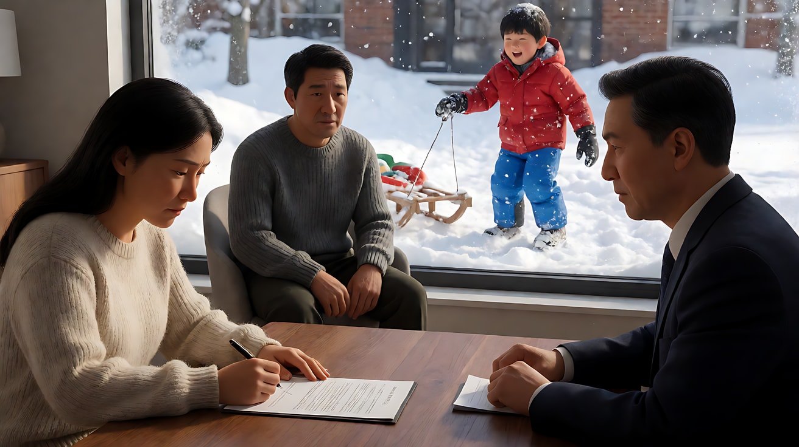
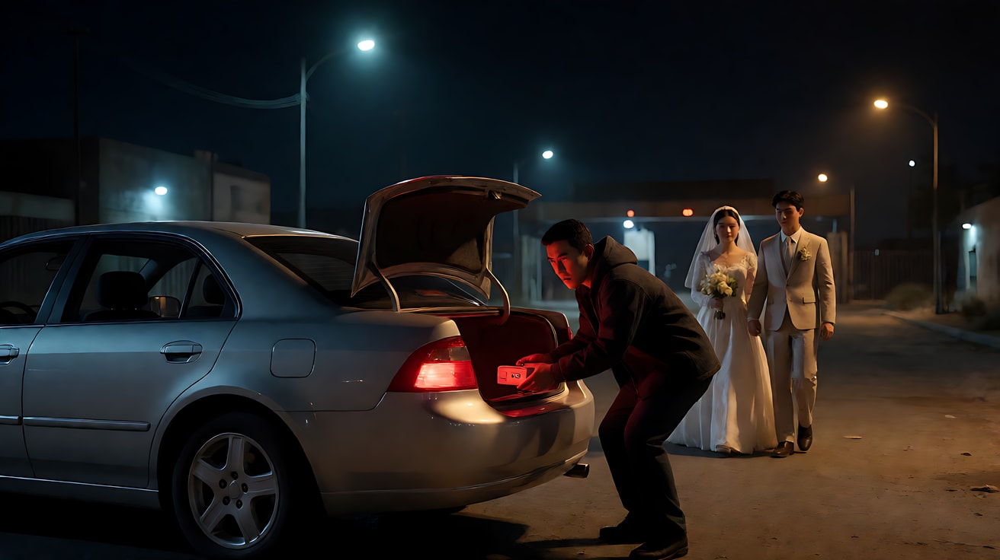

# L07-03 奥逊·威尔斯：深焦与低角度

> 段位：高级 ｜ 建议用时：90 分钟 ｜ 配套提示词：[L07-03-奥逊威尔斯-提示词](../提示词/L07-03-奥逊威尔斯-提示词.md)

## 学习目标

- 能解释"深焦多层调度"：前、中、后景同时清楚，观众自己选择看哪里
- 能说出"低角度仰拍 + 画内天花板"如何同时表达权力与压迫
- 能拆出奥逊·威尔斯的六维风格指纹，并分析《公民凯恩》《历劫佳人》的代表性镜头
- 能用不含人名的提示词复现深焦、低角度带天花板、长镜头和明暗对照

## 一、概念讲解

### 1. 导演简介

奥逊·威尔斯（Orson Welles，1915–1985），美国导演、演员、编剧。他先以舞台剧（水星剧团）和广播剧（1938 年的《世界大战》广播）成名，25 岁时与 RKO 签约，自编自导自演了处女作《公民凯恩》（1941）。这部片子把舞台调度、广播的声音剪辑和大胆的摄影结合起来，长期位列各类"影史最佳"榜单。之后他的创作屡遭制片厂干预（如《安倍逊大族》被删剪重剪），但始终保持强烈的视觉个性。

### 2. 代表作

| 年份 | 片名 | 值得看的技法 |
|---|---|---|
| 1941 | 《公民凯恩》 | 深焦多层调度、低角度带天花板、早餐蒙太奇 |
| 1942 | 《安倍逊大族》 | 大宅里的长镜头调度 |
| 1947 | 《上海小姐》 | 结尾镜子迷宫中的碎裂映像 |
| 1958 | 《历劫佳人》 | 开场约三分钟的升降长镜头 |
| 1962 | 《审判》 | 巨大的办公空间与表现主义阴影 |
| 1965 | 《午夜钟声》 | 粗粝的战场剪辑 |

### 3. 六维风格指纹表

| 维度 | 默认值 | 例外 / 关键时刻 |
|---|---|---|
| ① 景别 | 全景与中全景，让一个画面里同时容纳多个人物关系 | 新闻放映室等场景里人物只剩剪影 |
| ② 景深与焦段 | **深焦 + 广角**：前景大物件与远处人物同时清楚 | 个别"深焦"镜头实际借助了多次曝光合成 |
| ③ 构图 | 前景、中景、后景三层调度；**低角度仰拍**常把天花板放进画面 | 高角度俯拍让强者突然变小 |
| ④ 光影与色彩 | 黑白**明暗对照**：强烈的单向光、大面积黑暗、剪影 | 投影仪光柱里的烟雾 |
| ⑤ 运镜 | 长镜头与升降：一个镜头连续完成多次调度 | 穿过招牌、天窗的"不可能"运动 |
| ⑥ 剪辑与节奏 | 段落长镜头与快速蒙太奇两极 | 用快速甩镜连接的时间跳跃 |
| 补充：声音 | 广播剧式的声音剪辑：对白重叠、声音桥接两个场景 | 空旷大厅中的回声 |
| 补充：表演 | 舞台感强、姿态鲜明 | — |

### 4. 深焦与低角度示意

```
深焦三层调度（侧视）                       低角度 + 天花板（侧视）

  摄影机                                    ┌──────────── 天花板（画内可见）
   ◉ ──▶ [前景：桌上的文件]  清楚             │        ▲
         [中景：两人交谈]    清楚             │       人物（显得高大、
         [后景：窗外的孩子]  清楚             │        被天花板压住）
                                           ◉ ←─ 摄影机贴近地面，向上仰
  观众自己决定看哪一层 → 关系同时成立        权力 + 囚笼 同时成立
```

为什么天花板重要：当时多数制片厂布景没有天花板（方便打光和放麦克风），摄影机很少仰拍到顶。《公民凯恩》的布景做了天花板（据记载用布料制作，可在上方藏麦克风），于是仰拍能看到屋顶——人物被抬高，同时被罩住。

### 5. 常见误解

| 误解 | 实际情况 |
|---|---|
| 深焦 = 画面全清楚就行 | 深焦的价值在**调度**：三层里各有一件事在发生，彼此构成关系 |
| 低角度只是让人显得威风 | 带上天花板后，低角度同时是"被困住"；权力和囚笼是同一件事 |
| 长镜头 = 镜头不切就行 | 长镜头里要有多次构图变化：人物走位、摄影机升降，每一刻都是新画面 |
| 明暗对照 = 画面很暗 | 关键在**单向硬光 + 大面积纯黑**，亮处要真正亮 |

## 图解

> 这些示意图由多种生图模型分别生成（包括 Nano Banana、GPT Image 等），只用来说明镜头概念；不同模型的画面不能互相比较效果，也不能当作视频成片。


下面不是某部影片的复刻，只示范这一课要拆的两件事同时出现：机位极低，而且前景的人和后景的人都清楚。


近处的人被撑得很大，远处的人仍然清楚。权力和空间关系在同一幅画里，不靠切镜头来解释。

## 二、情绪与叙事功能

| 技法 | 观众的感受 | 常用场景 |
|---|---|---|
| 深焦多层调度 | 看到命运在后景悄悄发生，前景的人还不知道 | 家庭决定、交易、背叛 |
| 低角度带天花板 | 强大又被困、权力的重量 | 掌权者、独裁、野心膨胀 |
| 高角度俯拍 | 曾经的强者变渺小 | 失势、孤独 |
| 长镜头升降 | 一个完整、无法打断的时间 | 开场、倒计时、群戏 |
| 明暗对照 / 剪影 | 人物不可知、真相被遮蔽 | 调查、神秘人物 |

## 三、经典影片案例

### 《公民凯恩》（1941，奥逊·威尔斯）童年被送走

- 场景：雪地木屋里，母亲签字把儿子交给银行家监护；男孩在屋外雪地里玩雪橇。
- 怎么拍的：摄影指导格雷格·托兰德使用深焦。室内前景是母亲与银行家在桌边签字，中景是不情愿的父亲，后景的窗户里能清楚看到男孩在雪地里玩耍、喊叫。镜头在一个连续调度里完成，人物在三层之间走动。
- 为什么这样拍：男孩的命运在前景被签掉，而他本人在后景毫不知情地玩耍——观众同时看到"决定"和"被决定的人"，这份残酷不需要任何台词说明。



### 《公民凯恩》（1941，奥逊·威尔斯）早餐蒙太奇

- 场景：凯恩与第一任妻子的婚姻，在几顿早餐中被压缩讲完。
- 怎么拍的：一系列早餐对话，用快速甩镜连接。从新婚的亲昵开始，两人的话越来越少、越来越冷；最后一个画面里，两人坐在长桌两端，各自沉默地读报，妻子读的是对手的报纸。
- 为什么这样拍：时间被压缩成几个"同一位置、不同状态"的切片，距离的变化就是关系的变化。


### 《历劫佳人》（1958，奥逊·威尔斯）开场升降长镜头

- 场景：美墨边境小镇的夜晚，有人把一个定时装置放进汽车后备箱。
- 怎么拍的：开场是一个约三分钟的连续升降镜头。镜头先给出装置的特写，然后升起，跟随汽车穿过街道，又与一对步行的新婚夫妇交错，经过边境检查站，汽车与夫妇时而同框时而分开；镜头结束不久，装置爆发。
- 为什么这样拍：观众从第一秒就知道危险在哪里，长镜头不允许剪辑"喘气"，每一秒都在倒计时。这也是"观众知道得比角色多"的长镜头版本。



## 四、在 AI 中怎么实现

**复现技法，而不是复制作品**：不要生成雪地木屋、雪橇、报业大亨、边境小镇的爆炸；要学的是"三层同时清楚且各有事件""低角度带天花板""单向硬光与剪影""一个镜头里连续完成调度"。

- **生图阶段**：深焦写 `deep focus, f/11, the foreground object, the middle-ground characters and the background figure all in sharp focus`，并分别写清三层各在做什么；低角度写 `camera almost at floor level, tilted upward, the ceiling beams visible above the character`；明暗对照写 `a single hard light from one side, the rest of the frame falling into pure black`。
- **视频阶段**：深焦镜头尽量**固定或只做一个缓慢后拉**，让三层的事件自己发生；长镜头升降写清"起点构图 → 升起或下降 → 终点构图"，中间只让一个人走位。
- **模型擅长**：深焦静态构图、单向硬光、仰拍建筑空间、烟雾中的光柱。
- **要避开**：写导演名、片名、原片角色名；在深焦镜头里让三层的人同时做大动作（会互相抢、变形）；把"定时装置爆开"写进画面（触发词，且模型会演砸）。若需要危险物，写"嘀嗒作响的金属盒"，并在它发生任何变化之前结束镜头。

## 五、练习作业

1. 看《公民凯恩》前 40 分钟，找出 5 个深焦三层调度的画面，写出每一层在发生什么。
2. 设计一个家庭场景，让"决定"在前景发生、"被决定的人"在后景毫不知情，画一张侧视示意图。
3. 完成配套提示词练习1–5，最后一组拍一个原创的三镜头场景。

## 六、自检清单

- [ ] 深焦画面里三层各有一件事，彼此构成关系
- [ ] 低角度镜头里能看到天花板
- [ ] 明暗对照有一个单向硬光源，暗部是真正的黑
- [ ] 长镜头里只有一个主运动，人物走位清楚
- [ ] 提示词里没有导演名、片名、原片角色名、触发词

## 七、配套提示词

→ [L07-03-奥逊威尔斯-提示词](../提示词/L07-03-奥逊威尔斯-提示词.md)

---

上一课：[L07-02 库布里克：对称与一点透视](L07-02-库布里克.md) ｜ 下一课：[L07-04 黑泽明：天气、长焦与动势](L07-04-黑泽明.md) ｜ [返回总目录](../../README.md)
