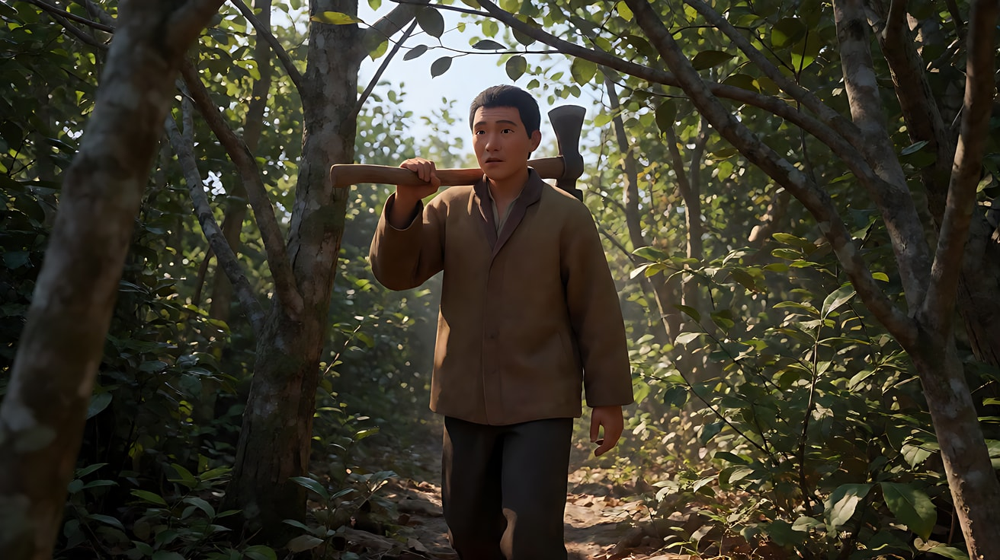
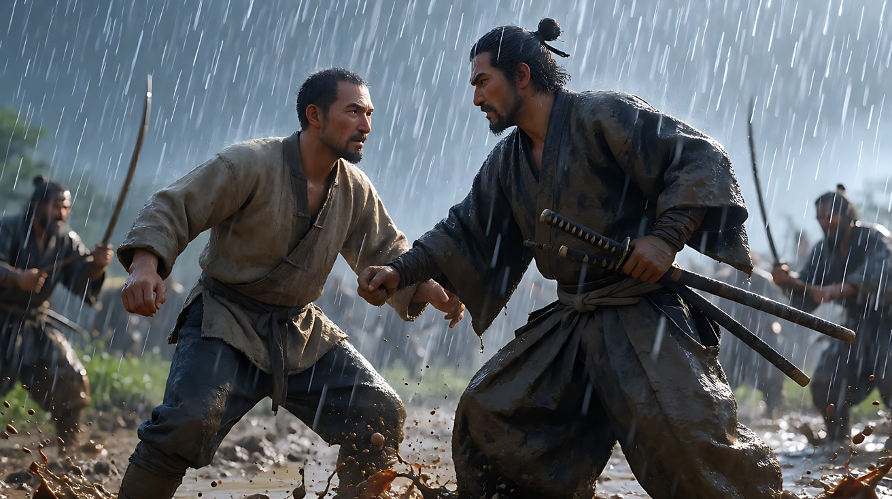
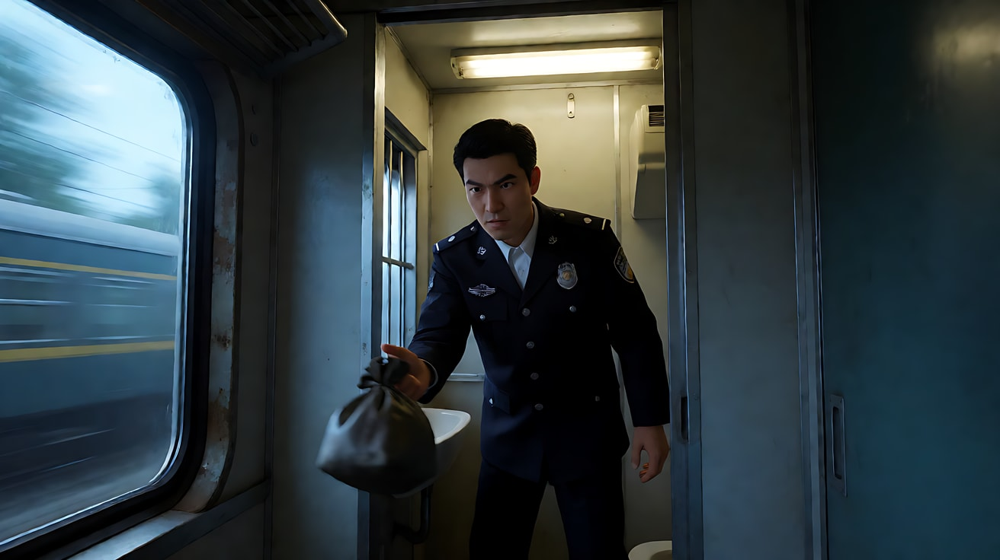

# L07-04 黑泽明：天气、长焦与动势

> 段位：高级 ｜ 建议用时：90 分钟 ｜ 配套提示词：[L07-04-黑泽明-提示词](../提示词/L07-04-黑泽明-提示词.md)

## 学习目标

- 能解释长焦压缩如何让奔跑、人群、风雨显得更密集、更有力量
- 能说出"天气即情绪"：雨、风、雾在黑泽明电影中的叙事功能
- 能拆出黑泽明的六维风格指纹：长焦、多机位、横移、动势构图、划像转场
- 能分析《罗生门》《七武士》《天国与地狱》的代表性段落
- 能用不含人名的提示词复现"画面里永远有东西在动"

## 一、概念讲解

### 1. 导演简介

黑泽明（1910–1998），日本导演，早年学习绘画，1936 年进入 PCL 制片厂（后并入东宝），在导演山本嘉次郎手下当副导演，1943 年以《姿三四郎》出道。《罗生门》在 1951 年获威尼斯电影节金狮奖，让西方真正"看见"了日本电影。他的动作调度、天气运用和多机位拍法深刻影响了后来的西部片、武侠片与好莱坞大片。1990 年获奥斯卡终身成就奖。

### 2. 代表作

| 年份 | 片名 | 值得看的技法 |
|---|---|---|
| 1950 | 《罗生门》 | 直拍太阳穿过树叶；城门下的暴雨 |
| 1952 | 《生之欲》 | 以葬礼回忆重组叙事 |
| 1954 | 《七武士》 | 多机位长焦拍动作；暴雨泥泞中的决战；划像转场 |
| 1957 | 《蜘蛛巢城》 | 浓雾与森林 |
| 1961 | 《用心棒》 | 风卷尘土的空镇；长焦宽银幕构图 |
| 1963 | 《天国与地狱》 | 宽银幕的室内群像调度；列车段落多机位同步拍摄 |
| 1980 | 《影子武士》 | 大规模军阵与色彩 |
| 1985 | 《乱》 | 以颜色区分的军队、宏大的战场 |

### 3. 六维风格指纹表

| 维度 | 默认值 | 例外 / 关键时刻 |
|---|---|---|
| ① 景别 | 全景与中景为主，群像与个体同框 | 动作高潮中长焦近景 |
| ② 景深与焦段 | **长焦**：压缩纵深，让人群、雨线、奔跑显得密集而扁平 | 室内群像也用宽银幕深调度 |
| ③ 构图 | **动势构图**：对角线、旗帜、树枝、人群方向形成力的走向；宽银幕中常把人物分布成几何阵列 | — |
| ④ 光影与色彩 | 黑白时期：天气塑造质感（雨、雾、尘、强烈阳光）；彩色时期：大色块区分阵营 | 直拍太阳穿过树叶 |
| ⑤ 运镜 | **横移跟拍**：长焦下的横向移动，背景像流动的画卷 | 固定机位的人物大调度 |
| ⑥ 剪辑与节奏 | **多机位**同时拍摄，剪辑时可以从多个角度切同一个动作；**划像**连接段落；同轴切近（轴向剪辑） | 动作的最后一击后长时间静止 |
| 补充：声音 | 风雨声、马蹄声做节奏；配乐与画面常形成对位 | 打斗前的寂静 |
| 补充：表演 | 动作幅度大、姿态雕塑化；主角常有标志性身体习惯 | — |

### 4. 长焦压缩 + 动势示意

```
广角（24mm）：人物之间距离拉开，雨线稀疏           长焦（300mm）：纵深被压扁
┌──────────────────────────────┐            ┌──────────────────────────────┐
│     人          人             │            │ ╱╱人╱╱人╱╱人╱╱人╱╱人╱╱人╱╱  │
│           人                   │            │ ╱╱人╱人╱╱╱人╱人╱╱人╱╱人╱╱  │
│  人                  人        │            │ ╱人╱╱人╱人╱╱╱人╱╱人╱人╱╱  │
│   ╱       ╱        ╱          │            │ ╱╱╱╱╱╱╱╱╱╱╱╱╱╱╱╱╱╱╱╱╱  │
└──────────────────────────────┘            └──────────────────────────────┘
  空间开阔、松散                                 人群密集、雨像一堵墙、力量集中

动势：画面里永远有东西在动——风吹树、旗帜翻卷、雨斜落、人群奔向同一方向
划像：一道边界从画面一侧扫到另一侧，新场景"推走"旧场景
```

### 5. 常见误解

| 误解 | 实际情况 |
|---|---|
| 风格 = 武士、刀、古装 | 那是题材；技法是长焦、天气、动势、多机位，可以用于任何题材 |
| 下雨就是加一层雨效果 | 他的雨要在长焦下"看得见"，常常又大又密，打在泥地和人身上 |
| 划像是过时的转场 | 在他手里划像是一种干脆的节奏标点，用来跳过时间、推进段落 |
| 长焦只是"拍得远" | 长焦的意义是压缩：让纵深变扁、让人群成墙、让奔跑似乎原地挣扎 |

## 二、情绪与叙事功能

| 技法 | 观众的感受 | 常用场景 |
|---|---|---|
| 长焦压缩 | 密集、混乱、身处其中的挤压感 | 战斗、人群、追逐 |
| 天气（雨、风、雾、尘） | 外在的风暴就是内心的风暴 | 决战、背叛、迷失 |
| 横移跟拍 | 背景流动，人物持续向前 | 赶路、奔跑、行军 |
| 动势构图 | 画面充满能量，即使人物静止 | 对峙前、等待中 |
| 多机位 + 同轴切近 | 同一刻被反复强调，冲击加倍 | 动作的关键一击 |
| 划像 | 干脆利落地翻过一页 | 段落转换、时间跳跃 |

## 三、经典影片案例

### 《罗生门》（1950，黑泽明）樵夫入林

- 场景：樵夫扛着斧头走进森林，后来发现了现场。
- 怎么拍的：摄影师宫川一夫用一连串跟拍镜头表现他穿过树林，镜头有时在前、有时在侧、有时从上方的树枝间穿过；阳光穿过树叶在他身上闪动，影片中有直接把镜头对准太阳的画面，这在当时很少见。城门下的暴雨段落，据记载在水中加入墨汁，让雨在黑白画面里更显眼。
- 为什么这样拍：明暗不断闪烁的树林让"真相"从一开始就斑驳不清；天气（烈日与暴雨）把森林与城门两个时空清楚地区分开。



### 《七武士》（1954，黑泽明）暴雨决战

- 场景：影片结尾，村民与武士在暴雨和泥泞中迎战来袭的山贼。
- 怎么拍的：多台摄影机同时拍摄，大量使用长焦，雨线又密又斜，人马在泥浆中翻滚；剪辑在多个角度之间快速切换，局部动作与大全景交替。全片还多处使用划像来推进段落。
- 为什么这样拍：长焦把雨、泥、人压成一堵墙，观众无法看清"全局"，只能感受到混乱和体力的极限——这正是战斗本身的体验。



### 《天国与地狱》（1963，黑泽明）列车交付赎金

- 场景：主角按照绑匪指示，在高速行驶的列车上，从洗手间狭窄的窗口把装赎金的包扔出去。
- 怎么拍的：这个段落据记载只有一次拍摄机会（借用了真实运行的列车），因此调用多台摄影机同步拍摄，从车内多个角度与车外同时记录。宽银幕画面中，车厢内的警探群像被精确排布。
- 为什么这样拍：只有一次机会的"真实时间"被多机位完整保存下来，剪辑时可以在角度之间切换而不破坏动作的连续性，紧张感来自"不可重来"。



## 四、在 AI 中怎么实现

**复现技法，而不是复制作品**：不要生成武士、山贼、城门、列车赎金；要学的是"长焦压缩 + 天气 + 横移 + 动势 + 多机位同轴切近 + 划像"，用在你的原创故事里（守堤、赶集、救火、马拉松、风暴中的码头）。

- **生图阶段**：长焦写 `telephoto 300mm lens, compressed perspective, background flattened`；天气写得具体（`heavy diagonal rain, large visible streaks, mud splashing`、`strong wind bending the reeds`、`thick fog rolling between trees`）；动势写一个方向（`all the reeds and banners bend toward frame right`）。
- **视频阶段**：横移写"镜头以长焦与人物平行横移，背景快速向反方向流动"；多机位写成多镜头："镜头切至同一轴线上更近的景别"；划像写"一道竖直的边界从画左扫向画右，新画面推走旧画面"。
- **模型擅长**：雨、风、雾、尘土、旗帜、草浪、人群远景、长焦横移。
- **要避开**：写导演名、片名；用"刀、剑、砍杀、血"等词（改为"木杖、长杆""倒地不起""深色泥浆"）；近景多人肢体打斗（手和脸会崩）；一个镜头里同时有大雨 + 复杂动作 + 快速运镜三件事，保留两件。

## 五、练习作业

1. 看《七武士》最后的雨战，数一数有多少个镜头是长焦，多少个是广角，画面里"在动的东西"有哪些。
2. 选一个日常运动场景（例如送外卖的电动车穿过雨夜），写出长焦横移版和广角跟拍版两条描述，比较情绪差异。
3. 完成配套提示词练习1–5，最后一组拍一个原创的三镜头场景。

## 六、自检清单

- [ ] 我写了具体焦段，长焦时说明了"压缩"
- [ ] 天气写得具体（方向、密度、打在什么上）
- [ ] 画面里至少有一样东西在持续运动
- [ ] 多机位写成了"同一动作、同一轴线、更近景别"的切镜
- [ ] 提示词里没有导演名、片名、武器与暴力触发词

## 七、配套提示词

→ [L07-04-黑泽明-提示词](../提示词/L07-04-黑泽明-提示词.md)

---

上一课：[L07-03 奥逊·威尔斯：深焦与低角度](L07-03-奥逊威尔斯.md) ｜ 下一课：[L07-05 小津安二郎：低机位与空镜](L07-05-小津安二郎.md) ｜ [返回总目录](../../README.md)
