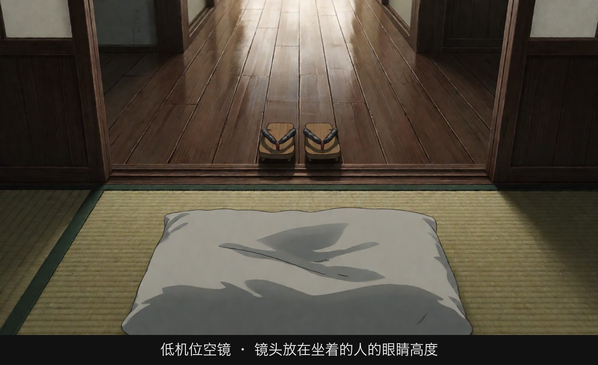
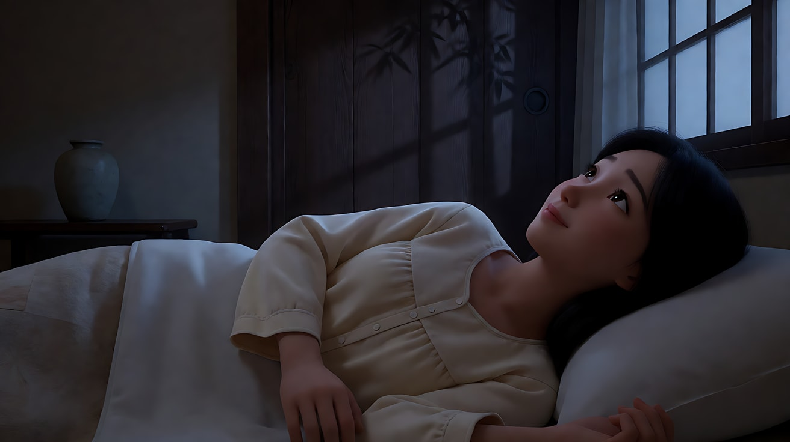
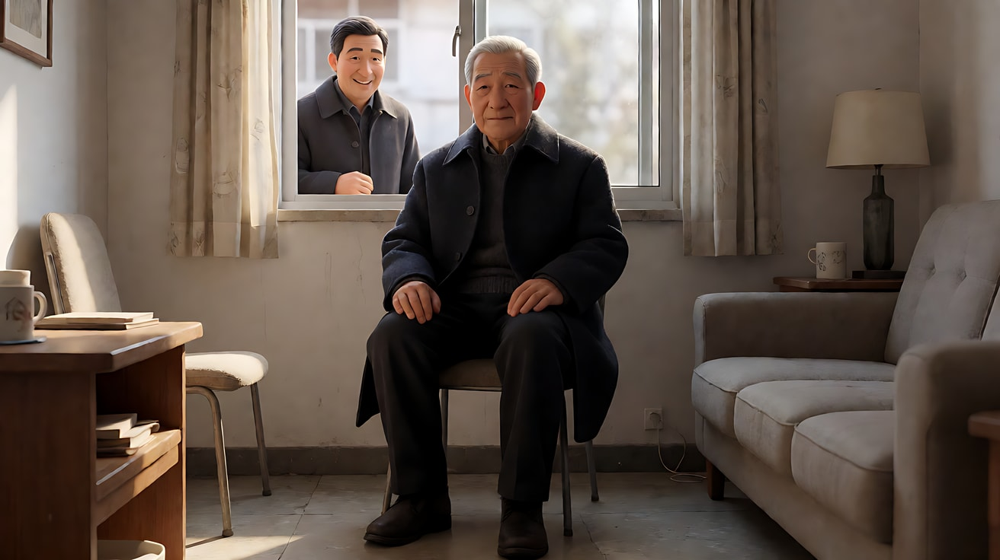
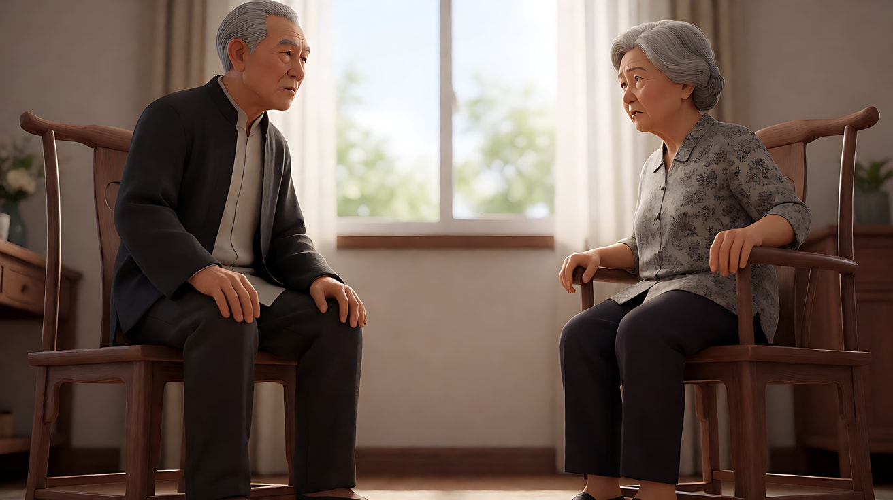

# L07-05 小津安二郎：低机位与空镜

> 段位：高级 ｜ 建议用时：90 分钟 ｜ 配套提示词：[L07-05-小津安二郎-提示词](../提示词/L07-05-小津安二郎-提示词.md)

## 学习目标

- 能说出"榻榻米低机位 + 固定镜头 + 正面构图"三件事如何共同营造平静、尊重、旁观的距离
- 能解释"枕镜头 / 空镜"在段落之间的作用
- 能识别小津式对话中的"视线不匹配"，并理解它为什么不让人困惑
- 能分析《晚春》《东京物语》的代表性镜头
- 能用不含人名的提示词复现低机位、固定、正面、空镜与视线方向

## 一、概念讲解

### 1. 导演简介

小津安二郎（1903–1963），日本导演，几乎整个职业生涯都在松竹公司。早期拍了大量默片喜剧和小市民电影（如《我出生了，但……》，1932），战后进入成熟期，以《晚春》（1949）开始的一系列家庭片闻名：父母老去、女儿出嫁、家庭散开。他长期与摄影师厚田雄春合作。他的风格极度一致，被称为"一辈子只拍一部电影"——但正是这种一致，让每一次细微的变化都显得意味深长。

### 2. 代表作

| 年份 | 片名 | 值得看的技法 |
|---|---|---|
| 1932 | 《我出生了，但……》 | 默片时期的家庭喜剧，已有正面构图 |
| 1949 | 《晚春》 | 京都旅馆里的花瓶空镜 |
| 1951 | 《麦秋》 | 家庭群像的正面排布 |
| 1953 | 《东京物语》 | 尾道开场与结尾的空镜段落 |
| 1958 | 《彼岸花》 | 第一部彩色片，红色小物件形成色点 |
| 1960 | 《秋日和》 | 母女关系的变奏 |
| 1962 | 《秋刀鱼之味》 | 遗作，父亲与女儿出嫁 |

### 3. 六维风格指纹表

| 维度 | 默认值 | 例外 / 关键时刻 |
|---|---|---|
| ① 景别 | 中景、中全景，人物坐姿完整入画 | 极少用特写；情感高点反而保持距离 |
| ② 景深与焦段 | 几乎只用标准焦段（常被认为是 50mm），透视自然 | — |
| ③ 构图 | **低机位**（约为榻榻米上坐姿的高度）、**正面**、稳定的几何框架（门框、拉门、走廊）；人物常并排面向同一方向 | — |
| ④ 光影与色彩 | 柔和均匀的室内光；彩色片中低饱和画面里点缀**红色小物件** | — |
| ⑤ 运镜 | 战后作品中摄影机**几乎不动** | 偶尔出现的移动镜头因稀少而显眼 |
| ⑥ 剪辑与节奏 | 直接切，几乎不用溶接与淡入淡出；段落之间插入**空镜**（烟囱、晾衣竿、火车、招牌、走廊）；对话正反打中人物**视线接近镜头**，常不遵守 180 度轴线 | 情感最重的时刻插入空镜，而不是推近人脸 |
| 补充：声音 | 轻快甚至有些"不合时宜"的配乐；日常环境声（火车、汽笛、风铃） | — |
| 补充：表演 | 克制、礼貌、重复的日常对话；情绪藏在微笑和沉默里 | — |

### 4. 低机位、正面与视线示意

```
侧视：机位高度                               俯视：视线不匹配的正反打
                                                 常规（遵守轴线）
 站立视线 ─────── ◉  常规机位                     A ──看向右──▶   ◀──看向左── B
                                                 小津式（视线接近镜头）
 坐姿视线 ─────── ◉  小津机位                       镜头1: A 几乎正对镜头说话
 （榻榻米）  人物坐在地上 ▲                          镜头2: B 也几乎正对镜头回答
 ───────── 榻榻米 ─────────                         观众感觉被"直接说给自己听"

空镜在段落之间：
[家中对话] → [空镜：晾衣竿] → [空镜：烟囱] → [下一场：办公室]
            （时间与地点的呼吸）
```

### 5. 常见误解

| 误解 | 实际情况 |
|---|---|
| 低机位 = 从地面仰拍 | 机位只是比常规低，约为坐在榻榻米上的人的高度，镜头基本保持水平，**不是仰拍** |
| 空镜 = 漂亮风景 | 空镜是日常而具体的东西（晾衣竿、走廊、招牌），作用是时间与情绪的"呼吸" |
| 视线不匹配是失误 | 是有意的选择：人物仿佛直接对观众说话，同时保持礼貌的距离 |
| 固定镜头 = 沉闷 | 画面里人物的进出、门框的层次、空镜的节奏，都在持续"动" |

## 图解

> 这些示意图由多种生图模型分别生成（包括 Nano Banana、GPT Image 等），只用来说明镜头概念；不同模型的画面不能互相比较效果，也不能当作视频成片。




镜头放在坐在地板上的人的眼睛高度，走廊里没有人。空镜不是废镜头，它让观众在人进来之前先习惯这个空间的节奏。

## 二、情绪与叙事功能

| 技法 | 观众的感受 | 常用场景 |
|---|---|---|
| 低机位 + 固定 | 平静、尊重、像坐在一旁的家人 | 家庭日常、饭桌、告别 |
| 正面构图、并排人物 | 一家人共同面对同一件事 | 看海、看烟花、等待 |
| 视线接近镜头 | 话直接说给观众听，又不失礼 | 对话、请求、告白 |
| 空镜 / 枕镜头 | 时间流逝、情绪沉淀、留给观众消化 | 段落之间、情感高点之后 |
| 情感高点保持距离 | 克制中的巨大悲伤 | 失去、离别 |

## 三、经典影片案例

### 《晚春》（1949，小津安二郎）旅馆里的花瓶

- 场景：女儿即将出嫁前，与父亲在京都旅馆同宿。夜里她躺在被褥上，对父亲说话，父亲已经睡着。
- 怎么拍的：她看着天花板微笑，然后表情慢慢变得复杂；镜头切到黑暗房间里的一只花瓶，拉门上有竹影；再回到她的脸，眼中似有泪光；再回到花瓶。
- 为什么这样拍：她心里的念头没有说出口，导演也不替她说。花瓶空镜给出一段"无人的时间"，观众把自己的理解投射进去。这个镜头至今被影评人反复讨论，正说明了空镜的力量。



### 《东京物语》（1953，小津安二郎）尾道的开场与结尾

- 场景：老夫妇从尾道去东京看望子女，回来后妻子病逝。
- 怎么拍的：开场先是一组空镜——港口、石灯笼、经过的火车、小镇屋顶——然后才是老夫妇在家里收拾行李。结尾，丈夫独自坐在家中，邻居路过窗口寒暄，他平静地回应，说一个人以后日子会很长；随后又是海面与驶过的船。
- 为什么这样拍：首尾呼应的空镜构成一个"框"。同样的小镇，开场有两个人，结尾只剩一个人——变化本身不需要特写。



### 《东京物语》（1953，小津安二郎）正面对话

- 场景：守寡的儿媳与公公、婆婆之间的多次对话。
- 怎么拍的：低机位、固定。正反打时，两个人物都几乎正对镜头说话，视线方向与常规轴线并不严格匹配。
- 为什么这样拍：对话像是直接说给观众听，观众同时站在两个人的位置上。这种"轻微的不对"让人更专注于人物本身的善意与哀伤。



## 四、在 AI 中怎么实现

**复现技法，而不是复制作品**：不要生成尾道、旅馆花瓶、老夫妇进京；要学的是"坐姿高度的水平机位 + 固定 + 正面几何框架 + 空镜节奏 + 视线接近镜头"，用在你自己的原创家庭故事里（老屋、公寓、小面馆、渔村）。

- **生图阶段**：机位写 `camera placed low at the eye height of a person kneeling on the floor, lens level, not tilted up`；构图写 `frontal composition, framed by sliding doors and a corridor`；焦段写 `50mm lens, natural perspective`；画幅可用 `Aspect ratio 4:3`。空镜单独生成，可用开关 B 写实摄影。
- **视频阶段**：每个镜头都写"镜头固定，不移动"；动作只写一个日常小动作（倒茶、叠衣、扇扇子）；正反打写"他几乎正对镜头说话，视线落在镜头旁边一点"；空镜写成独立镜头"镜头切至空镜：……"。
- **模型擅长**：固定构图、室内柔光、空镜（晾衣、烟囱、街道、走廊）、坐姿小动作。
- **要避开**：写导演名、片名、原片角色名；写"仰拍"（会被理解成低角度仰视）；加入推拉摇移；情感高点写"泪流满面的特写"——小津式做法是保持距离或切空镜。

## 五、练习作业

1. 看《东京物语》前 15 分钟，列出所有空镜，写出它们出现在哪两场戏之间。
2. 在家里用手机把镜头放在坐姿高度、水平、正面拍一张"家人吃饭"，再用站立视线拍一张，比较感受。
3. 完成配套提示词练习1–5，最后一组拍一个原创的三镜头场景。

## 六、自检清单

- [ ] 机位是坐姿高度、水平，不是仰拍
- [ ] 每个镜头都固定不动
- [ ] 构图正面，用门框、拉门、走廊形成几何框架
- [ ] 段落之间或情感高点用了空镜
- [ ] 对话正反打时人物视线接近镜头
- [ ] 提示词里没有导演名、片名、原片角色名

## 七、配套提示词

→ [L07-05-小津安二郎-提示词](../提示词/L07-05-小津安二郎-提示词.md)

---

上一课：[L07-04 黑泽明：天气、长焦与动势](L07-04-黑泽明.md) ｜ 下一课：[L07-06 塔可夫斯基：时间雕刻](L07-06-塔可夫斯基.md) ｜ [返回总目录](../../README.md)
