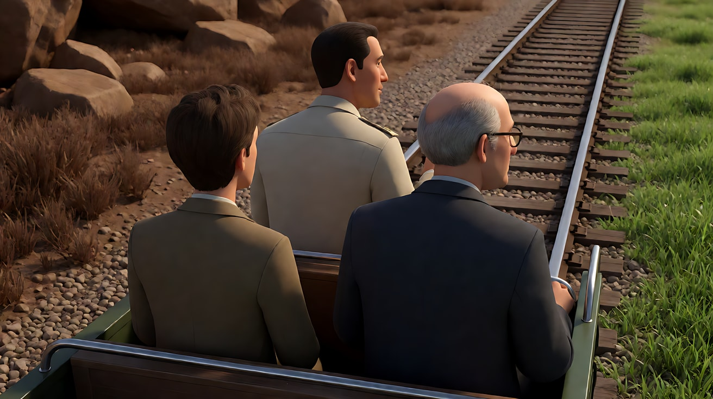
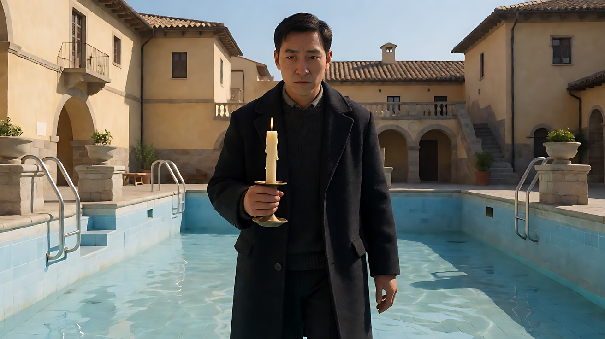
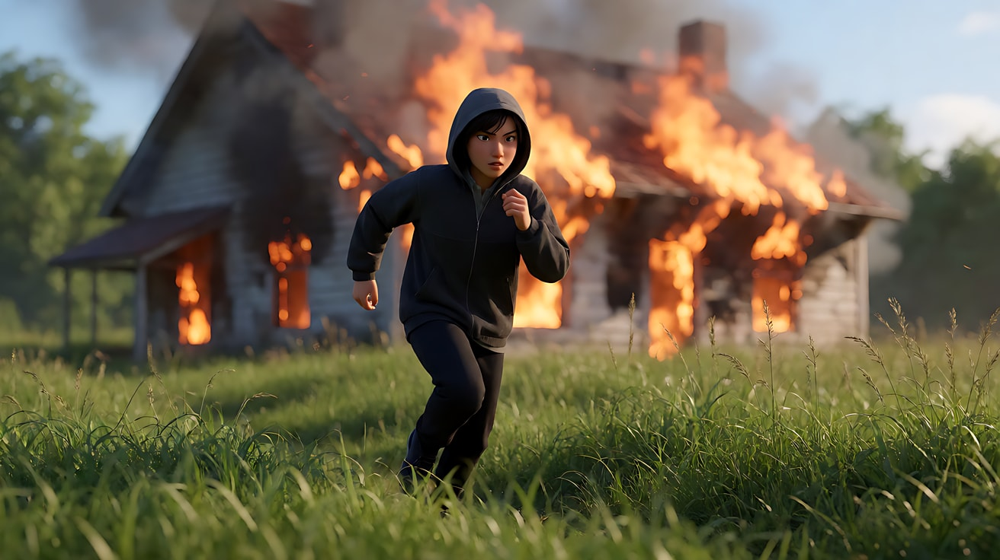

# L07-06 塔可夫斯基：时间雕刻

> 段位：高级 ｜ 建议用时：100 分钟 ｜ 配套提示词：[L07-06-塔可夫斯基-提示词](../提示词/L07-06-塔可夫斯基-提示词.md)

## 学习目标

- 理解"雕刻时光"：镜头的价值来自时间在画面里的流动，而不是剪辑的拼接
- 能拆出塔可夫斯基的六维风格指纹：长镜头、缓慢推轨、水火风元素、黑白与彩色交替
- 能分析《潜行者》《乡愁》《牺牲》中的代表性长镜头
- 能在 AI 的短时长限制下，用"一个镜头只做一件慢事"的方式复现时间感

## 一、概念讲解

### 1. 导演简介

安德烈·塔可夫斯基（Andrei Tarkovsky，1932–1986），苏联导演，毕业于全苏国立电影学院（VGIK）。一生只完成七部长片，处女作《伊万的童年》（1962）即获威尼斯金狮奖。后期离开苏联，在意大利拍摄《乡愁》，在瑞典拍摄《牺牲》，1986 年在巴黎病逝。他在著作《雕刻时光》中提出：电影的本质是"时间的印记"，导演像雕刻家一样，从时间的大块里凿去不需要的部分。

### 2. 代表作

| 年份 | 片名 | 值得看的技法 |
|---|---|---|
| 1962 | 《伊万的童年》 | 梦境与现实交替 |
| 1966 | 《安德烈·卢布廖夫》 | 黑白正片，结尾转为彩色的圣像画 |
| 1972 | 《飞向太空》 | 黑白与彩色交替；空间站里的水与记忆 |
| 1975 | 《镜子》 | 风吹过田野；记忆、梦与新闻片交织；彩色、黑白、单色交替 |
| 1979 | 《潜行者》 | "区"外是棕褐单色，进入"区"后变成彩色 |
| 1983 | 《乡愁》 | 举着烛火穿过干涸水池的长镜头 |
| 1986 | 《牺牲》 | 结尾房屋燃烧的长镜头 |

### 3. 六维风格指纹表

| 维度 | 默认值 | 例外 / 关键时刻 |
|---|---|---|
| ① 景别 | 全景与中景，人物与环境同时存在 | 人脸近景通常也是长时间保持 |
| ② 景深与焦段 | 标准到中长焦，画面柔和，不追求夸张透视 | — |
| ③ 构图 | 人物常背对或侧对镜头，被风景、建筑、废墟包围 | 悬浮的身体打破重力 |
| ④ 光影与色彩 | 自然光、阴天光、潮湿空间里的反光；**黑白（或单色）与彩色交替**，标志现实 / 记忆 / 另一个世界 | 色彩的切换本身就是叙事事件 |
| ⑤ 运镜 | **极慢的推轨**与横移，速度慢到几乎察觉不到 | 跟随物件（水面漂浮物）的俯拍移动 |
| ⑥ 剪辑与节奏 | **长镜头**，平均镜头长度远超同时代电影；时间不被压缩 | 意外的硬切进入梦或记忆 |
| 补充：声音 | 水滴、风、远处火车、鸟鸣；电子与环境混合的声音设计；配乐极少 | 寂静 |
| 补充：表演 | 人物常静止、凝望；动作缓慢而仪式化 | — |
| 补充：元素 | **水**（雨、积水、室内落雨）、**火**（燃烧的房屋、烛火）、**风**（吹过田野、窗帘）反复出现 | — |

### 4. 时间感示意

```
普通剪辑：  |镜头|镜头|镜头|镜头|镜头|镜头|   → 时间被压缩、被跳过
时间雕刻：  |────────────── 一个镜头 ──────────────|  → 时间在画面里"流"

在一个长镜头里：
  ① 起点：人物在画面边缘，水滴落进积水
  ② 推轨极慢地向前……（观众开始注意到风、光、声音）
  ③ 中途：风吹起窗帘，光在墙上移动
  ④ 终点：人物仍在原处，但观众的感受已经改变

画面的"内容"很少，"时间"很多 —— 观众被迫进入角色的时间
```

### 5. 常见误解

| 误解 | 实际情况 |
|---|---|
| 长镜头 = 拍得久 | 长镜头里要有"时间的压力"：一个持续的动作、一个缓慢变化的环境、一个不断被延迟的结果 |
| 慢 = 沉闷 | 慢让观众开始看见平时看不见的东西：水面的纹理、风的方向、脸上的光 |
| 黑白彩色交替 = 回忆用黑白 | 在他的电影里，颜色的分配并不总是"回忆＝黑白"，有时是"另一个世界＝彩色"；关键是**切换本身成为事件** |
| 水火风 = 加特效 | 元素要真实、具体、有物理反馈：水滴进碗里的声音、火把空气烤得扭曲 |

## 二、情绪与叙事功能

| 技法 | 观众的感受 | 常用场景 |
|---|---|---|
| 长镜头 | 与角色一起"度过"这段时间 | 等待、行走、仪式、坚持 |
| 极慢推轨 | 一种几乎察觉不到的吸引与沉思 | 凝望、回忆、祈祷 |
| 水（雨、积水、滴水） | 记忆、净化、时间的侵蚀 | 废墟、老屋、梦 |
| 火 | 毁灭与献祭、不可挽回 | 结局、决定 |
| 风 | 无形力量经过、某种"降临" | 陌生人离开、预兆 |
| 黑白 / 彩色切换 | 跨过一道看不见的门槛 | 进入另一个世界、梦醒 |

## 三、经典影片案例

### 《潜行者》（1979，安德烈·塔可夫斯基）进入"区"

- 场景：向导带着作家与教授，乘坐一辆铁轨上的小型轨道车驶向神秘的"区"。
- 怎么拍的：轨道车段落是一组很长的镜头，画面长时间停留在三人的后脑与侧脸上，只听见车轮压过铁轨的节奏声。影片在"区"外的部分是棕褐单色；当他们到达"区"之后，画面转为彩色，草地的绿色第一次出现。
- 为什么这样拍：漫长的车轮声把观众"运送"过去，色彩的出现让观众亲身经历"跨过门槛"，不需要任何解释。



### 《乡愁》（1983，安德烈·塔可夫斯基）护送烛火

- 场景：俄国诗人在意大利温泉小镇，履行一位"疯子"托付的仪式——举着点燃的蜡烛穿过已经放干水的温泉池。
- 怎么拍的：一个约九分钟的长镜头。镜头缓慢横移，跟随他从池子一端走到另一端；烛火两次被风吹灭，他两次走回起点重新点燃，第三次用手和大衣护着火，终于走到池边。
- 为什么这样拍：仪式的意义就在于"完整的时间"——任何剪辑都会让观众怀疑他有没有真的走完。观众和他一起屏住呼吸。



### 《牺牲》（1986，安德烈·塔可夫斯基）燃烧的房屋

- 场景：主人公履行对上帝的誓言，烧掉了自己的房子。
- 怎么拍的：一个长镜头，摄影机在远处缓慢横移，房子在背景熊熊燃烧，家人在前景的草地上奔跑、追赶。据记载第一次拍摄时摄影机发生故障，剧组只得把房子重新搭建再烧一次。
- 为什么这样拍：毁灭只能发生一次，所以必须在一个不间断的时间里看完；观众无处可逃，只能看着火把一切吞没。



## 四、在 AI 中怎么实现

**复现技法，而不是复制作品**：不要生成轨道车驶入"区"、温泉池里举烛火、海边燃烧的房子；要学的是"一个镜头只做一件慢事""水火风作为具体的物理元素""用单色到彩色的切换表示跨过门槛"。

- **AI 的时长限制**：Seedance 一次只能生成几秒到十几秒，不可能做九分钟长镜头。做法是：
  1. **一个片段 = 一个持续的慢动作 + 一个极慢的运镜**，不切镜头；
  2. 用首尾帧链把多个片段接成"伪长镜头"（参见 L06-06）；
  3. 在剪辑里保留每段的完整时长，不剪碎。
- **生图阶段**：写元素的物理细节（`rain falling through a hole in the ceiling into a shallow puddle on the wooden floor`、`wind sweeping in waves across a field of tall grass`）；单色写 `sepia monochrome` 或 `black-and-white`。
- **视频阶段**：运镜写"极慢的推轨，速度慢到几乎察觉不到"；声音写具体的水滴、风、远处火车；色彩切换写成"跨过门口的一瞬间，画面从棕褐单色变为彩色"。
- **模型擅长**：水滴、积水反光、风吹草浪、烛火、远处的火、缓慢推轨。
- **要避开**：写导演名、片名、原片角色名；在一个慢镜头里塞多个动作；把火写成"爆炸"；让人物悬浮（模型常处理成跳跃或飘浮特效，失败率高，必要时用首尾帧锁定）。

## 五、练习作业

1. 看《乡愁》烛火段落，不快进，记录你在第几分钟开始"等不及"，又在第几分钟重新被吸引。写下是什么把你拉回来的。
2. 写一个只有一个动作的 10 秒镜头（例如"她把一碗水端过房间"），列出画面中会被观众注意到的五个细节。
3. 完成配套提示词练习1–5，最后一组拍一个原创的三镜头场景。

## 六、自检清单

- [ ] 每个片段只有一个慢动作、一个极慢运镜
- [ ] 水、火、风写成了具体的物理细节
- [ ] 单色 / 彩色切换有一个明确的"门槛"
- [ ] 声音写了具体的水滴、风、远处声响
- [ ] 提示词里没有导演名、片名、原片角色名

## 七、配套提示词

→ [L07-06-塔可夫斯基-提示词](../提示词/L07-06-塔可夫斯基-提示词.md)

---

上一课：[L07-05 小津安二郎：低机位与空镜](L07-05-小津安二郎.md) ｜ 下一课：[L07-07 塞尔乔·莱昂内：大远景与大特写](L07-07-塞尔乔莱昂内.md) ｜ [返回总目录](../../README.md)
