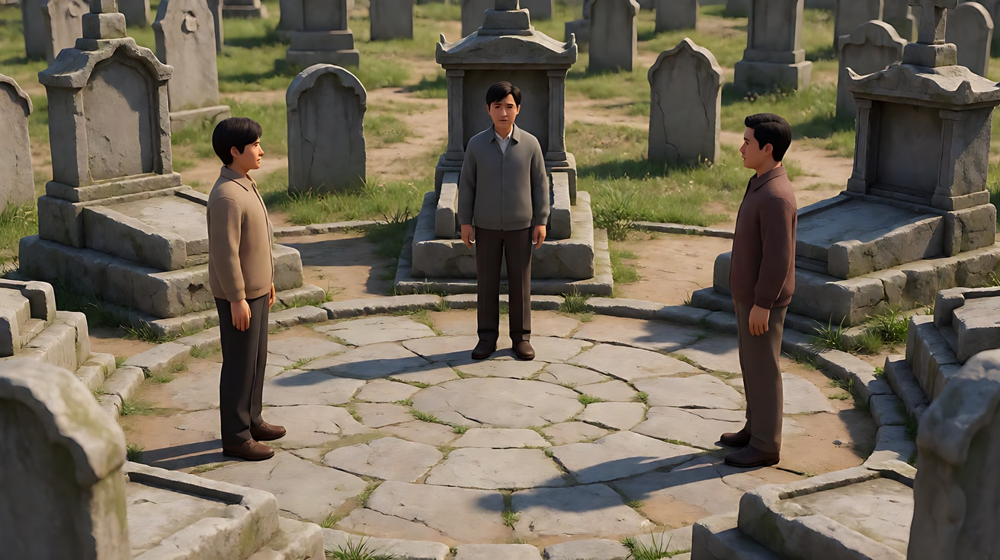
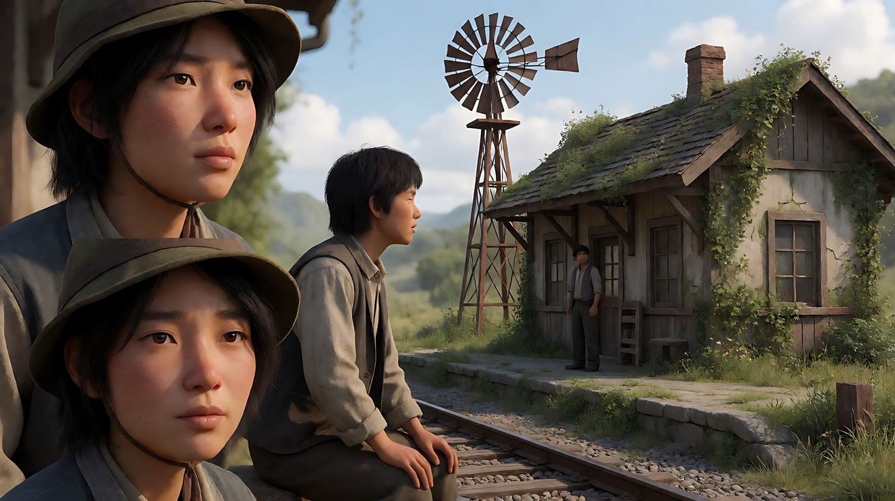
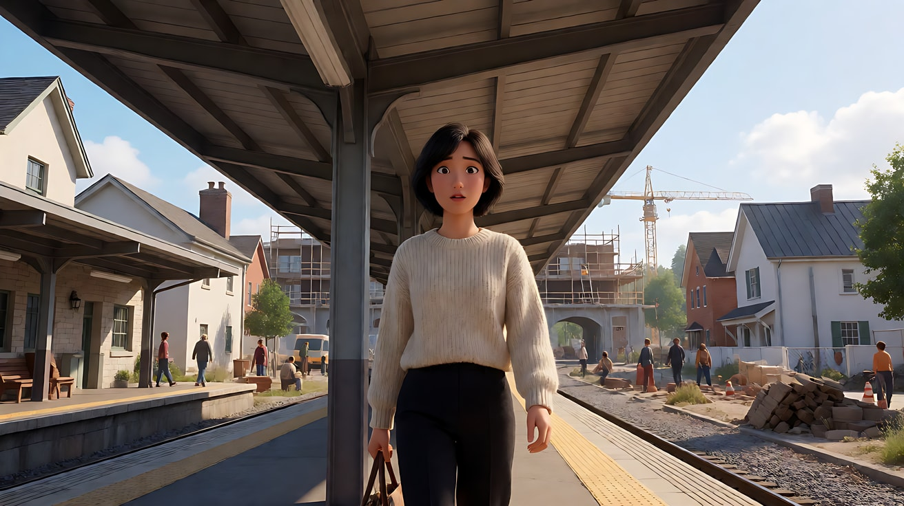

# L07-07 塞尔乔·莱昂内：大远景与大特写

> 段位：高级 ｜ 建议用时：90 分钟 ｜ 配套提示词：[L07-07-塞尔乔莱昂内-提示词](../提示词/L07-07-塞尔乔莱昂内-提示词.md)

## 学习目标

- 能解释"大远景与眼部大特写对撞"为什么能把一场等待拍成史诗与心理战
- 能说出宽银幕画幅如何同时容纳"一张脸 + 整片荒野"
- 能拆出莱昂内的六维风格指纹：宽银幕、景别极端对撞、仪式化对峙、音乐节奏剪辑、被拉长的时间
- 能分析《黄金三镖客》《西部往事》的代表性段落
- 能用不含人名、不含武器词的提示词复现"仪式化对峙"

## 一、概念讲解

### 1. 导演简介

塞尔乔·莱昂内（Sergio Leone，1929–1989），意大利导演，出生于电影世家，早年在罗马为多部在意大利拍摄的好莱坞史诗片担任副导演。1964 年的《荒野大镖客》开启了所谓"意大利式西部片"的风潮（这部片子与黑泽明的《用心棒》情节高度相似，后来双方以和解了结版权纠纷）。他与作曲家埃尼奥·莫里康内长期合作，音乐与画面的结合成为他最鲜明的签名。

### 2. 代表作

| 年份 | 片名 | 值得看的技法 |
|---|---|---|
| 1964 | 《荒野大镖客》 | 宽银幕、极端特写、冷面主角 |
| 1965 | 《黄昏双镖客》 | 怀表音乐盒作为对峙的计时器 |
| 1966 | 《黄金三镖客》 | 结尾墓地的三方对峙 |
| 1968 | 《西部往事》 | 开场漫长的车站等待；升降镜头揭示小镇 |
| 1971 | 《革命往事》 | 闪回与慢动作 |
| 1984 | 《美国往事》 | 跨越数十年的时间结构 |

### 3. 六维风格指纹表

| 维度 | 默认值 | 例外 / 关键时刻 |
|---|---|---|
| ① 景别 | **两极化**：大远景（人物是荒野中的小点）与眼部大特写（一双眼睛横贯画面）直接对撞，中间景别较少 | 对峙高潮时景别逐步收紧到只剩眼睛 |
| ② 景深与焦段 | 前景大特写的脸 + 后景远处的人物同框，纵深极大 | 长焦压缩的热浪与尘土 |
| ③ 构图 | **宽银幕**（约 2.35:1），左右两端各放一个元素，中间是空旷空间；前景脸部占据画面一侧 | 圆形场地中的三角站位 |
| ④ 光影与色彩 | 强烈日光、汗水、尘土；土黄与焦褐色调 | 阴影中的帽檐遮住眼睛 |
| ⑤ 运镜 | 多为固定或缓慢推近；**升降镜头**在音乐高潮时揭示大场景 | 环绕或快速推进到眼睛 |
| ⑥ 剪辑与节奏 | **被拉长的时间**：等待、凝视、微小动作被反复切换；对峙段落的剪辑**按音乐节拍加速** | 高潮前一刻的绝对静止 |
| 补充：声音 | 音乐是叙事的一部分（据记载部分配乐在拍摄前完成并在现场播放）；寂静中放大的小声音（水滴、苍蝇、风车） | 音乐骤停 |
| 补充：表演 | 冷面、沉默、眯眼；台词极少 | — |

### 4. 景别对撞与宽银幕示意

```
宽银幕（约 2.35:1）前景脸 + 后景人物：
┌──────────────────────────────────────────────────────────────┐
│█████                                                          │
│██████  ← 前景：一张脸的侧面                       ▲  远处的人物   │
│██████     （极近、清楚）                          │  （很小）     │
│█████                                              │              │
│───────────────────── 荒野地平线 ──────────────────────────────│
└──────────────────────────────────────────────────────────────┘

仪式化对峙的剪辑节奏（随音乐加速）：
 大远景（长） → 中景 → 近景 → 手 → 眼 → 眼 → 眼 → 手 → 眼 → [静止] → 动作
 |──── 慢 ────|─── 中 ───|─ 快 ─|快|快|快|快|快|          |
```

### 5. 常见误解

| 误解 | 实际情况 |
|---|---|
| 风格 = 西部牛仔、枪手 | 那是题材；技法是"景别对撞 + 宽银幕 + 拉长时间 + 音乐节奏"，可用于任何对峙（谈判、比赛、家族争产） |
| 大特写越多越好 | 大特写之所以有力量，是因为它与大远景对撞；全是特写就没有对比 |
| 对峙要快 | 恰恰相反：时间被拉得很长，"不发生"才是紧张的来源 |
| 音乐只是配上去的 | 剪辑节奏跟着音乐走，音乐结构就是场景结构 |

## 二、情绪与叙事功能

| 技法 | 观众的感受 | 常用场景 |
|---|---|---|
| 大远景 | 人物渺小、荒野无情、命运宏大 | 出场、行路、对峙开局 |
| 眼部大特写 | 进入心理战、读取意图 | 对峙、怀疑、决断 |
| 前景脸 + 后景人物 | 两人的关系在一个画面里完成 | 追踪、监视、等待某人到来 |
| 被拉长的等待 | 焦灼、期待、"快点发生吧" | 开场、对峙前 |
| 音乐节奏剪辑 | 仪式感、命运感 | 高潮、决断 |
| 升降镜头揭示 | 世界突然打开 | 抵达新地方 |

## 三、经典影片案例

### 《黄金三镖客》（1966，塞尔乔·莱昂内）墓地三方对峙

- 场景：影片结尾，三个人在一座圆形墓地广场上各占一方，相互对峙。
- 怎么拍的：先用大远景交代三人在圆形场地上的三角站位；随着莫里康内的配乐推进，镜头在三人之间切换，景别逐步收紧——全身、腰部、手、脸，最后只剩眼睛的大特写，剪辑速度跟着音乐越来越快；音乐高潮后是一瞬间的静止，然后动作发生。
- 为什么这样拍：三方对峙让"看谁"成为问题，观众和角色一样不停地在三人之间转移注意力。景别收紧 + 节奏加速，让几分钟的等待变成一场纯粹的心理战。



### 《西部往事》（1968，塞尔乔·莱昂内）车站开场

- 场景：三个人在荒野中的小火车站等候一列火车。
- 怎么拍的：开场长达十余分钟，几乎没有对白。镜头反复切换于等待的细节：水滴一滴滴落在一人的帽檐上、一只苍蝇在另一人脸上爬、生锈的风车吱呀转动、指关节被掰响。大特写的脸与空旷车站的大远景交替出现。
- 为什么这样拍：把"等待"本身变成戏。被放大的微小声音让寂静变得刺耳，观众的耐心被拉到极限，当火车终于到来，紧张已经积满。



### 《西部往事》（1968，塞尔乔·莱昂内）升降镜头揭示小镇

- 场景：一位女子乘火车抵达小镇车站，却发现没有人来接她。
- 怎么拍的：她走进车站，镜头随之升起，越过车站屋顶，在音乐主题响起的同时，揭示出车站后方正在热闹建设中的小镇全景。
- 为什么这样拍：音乐与镜头运动同时"打开"，把一个人的孤单抵达变成一个世界的展开。



## 四、在 AI 中怎么实现

**复现技法，而不是复制作品**：不要生成牛仔、枪手决斗、墓地、车站等候三人组；要学的是"大远景 ↔ 眼部大特写的对撞""前景脸 + 后景人物的宽银幕构图""拉长的等待 + 放大的小声音""随音乐加速的对峙剪辑"，用在你的原创故事里（盐湖边的谈判、拍卖会、老宅争钥匙、棋局）。

- **生图阶段**：画幅写 `ultra-wide 2.39:1 widescreen frame`；大特写写 `extreme close-up of only the eyes, filling the entire width of the frame, squinting, beads of sweat`；前景脸写 `the profile of a face in the extreme foreground at frame left, sharp, while a tiny figure approaches far away at frame right`。
- **视频阶段**：对峙写成多镜头，从大远景开始逐镜收紧到眼睛；每个大特写镜头只写一个微动作（眯眼、眼珠一转、汗珠滑落）；【声音】写清"音乐越来越急，在最后一镜骤停"。
- **模型擅长**：大远景荒野、热浪尘土、眼部大特写、汗水、风沙、强烈日光。
- **要避开**：写导演名、片名、原片角色名；写"枪、手枪、开枪、决斗致死"等触发词——改为"仪式化的对峙""腰间的黑色金属物件"，或者干脆换成无武器的对峙；对峙的结果不要演出来，停在动作发生前的那一刻。
- **画幅**：Seedance 选 21:9 画幅以接近宽银幕。

## 五、练习作业

1. 看《黄金三镖客》结尾对峙，数一数从大远景到眼部大特写一共用了多少个镜头，并标出镜头长度在哪里开始明显变短。
2. 设计一个无武器的三方对峙（例如三个兄弟姐妹争夺父亲留下的一把钥匙），写出十个镜头的景别序列。
3. 完成配套提示词练习1–5，最后一组拍一个原创的三镜头场景。

## 六、自检清单

- [ ] 画幅是宽银幕
- [ ] 大远景与眼部大特写直接对撞，中间景别很少
- [ ] 至少一个画面里同时有前景大特写和后景远处人物
- [ ] 等待被拉长，小声音被放大
- [ ] 对峙停在动作发生前，没有写出结果
- [ ] 提示词里没有导演名、片名、原片角色名、武器词

## 七、配套提示词

→ [L07-07-塞尔乔莱昂内-提示词](../提示词/L07-07-塞尔乔莱昂内-提示词.md)

---

上一课：[L07-06 塔可夫斯基：时间雕刻](L07-06-塔可夫斯基.md) ｜ 下一课：[L07-08 韦斯·安德森：平面对称与色板](L07-08-韦斯安德森.md) ｜ [返回总目录](../../README.md)
