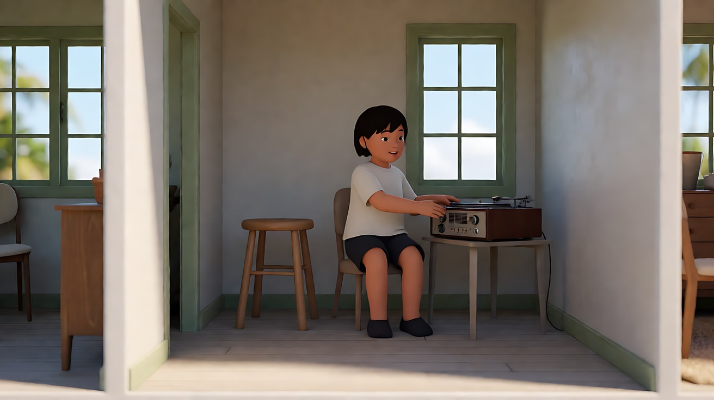
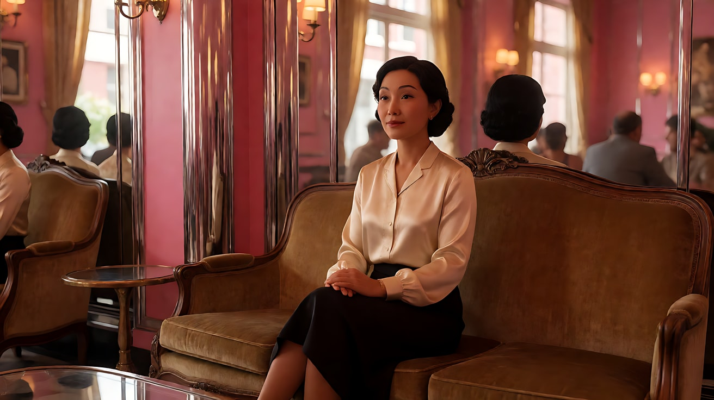
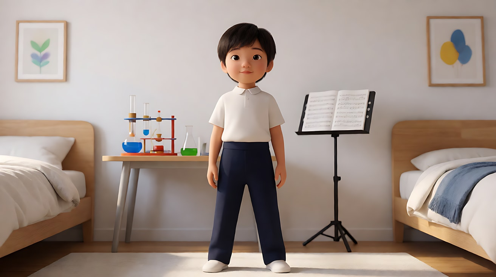

# L07-08 韦斯·安德森：平面对称与色板

> 段位：高级 ｜ 建议用时：90 分钟 ｜ 配套提示词：[L07-08-韦斯安德森-提示词](../提示词/L07-08-韦斯安德森-提示词.md)

## 学习目标

- 能区分"一点透视对称"（纵深）与"平面正面构图"（像舞台剖面），并说出各自的情绪
- 能说出粉彩限定色板如何成为叙事工具，而不只是装饰
- 能拆出韦斯·安德森的六维风格指纹：中心对称、平面正面、横向平移、快速摇镜、俯拍桌面、冷面表演
- 能分析《月升王国》《布达佩斯大饭店》《天才一族》的代表性段落
- 能用不含人名的提示词复现这些技法，而不陷入"粉色滤镜"的表面模仿

## 一、概念讲解

### 1. 导演简介

韦斯·安德森（Wes Anderson，1969– ），美国导演，出生于得克萨斯州休斯敦。他的早期作品与欧文·威尔逊合作编剧，长期与摄影师罗伯特·约曼合作。他的电影几乎一眼可辨：对称、正面、色彩被严格设计、人物冷面而认真。这种"玩偶屋"般的形式背后，常常是关于失去、家庭破碎与怀旧的悲伤故事——形式的精确，恰恰是在控制难以控制的情感。

### 2. 代表作

| 年份 | 片名 | 值得看的技法 |
|---|---|---|
| 1998 | 《青春年少》 | 季节/月份分章、冷面表演 |
| 2001 | 《天才一族》 | 家庭成员逐一正面登场；慢动作配歌曲 |
| 2004 | 《水中生活》 | 船体剖面布景上的横移 |
| 2009 | 《了不起的狐狸爸爸》 | 定格动画中的平面构图 |
| 2012 | 《月升王国》 | 开场在房屋剖面中横移与摇镜 |
| 2014 | 《布达佩斯大饭店》 | 按年代切换画幅；粉色酒店与糕点盒 |
| 2018 | 《犬之岛》 | 定格动画、正面对称 |
| 2021 | 《法兰西特派》 | 黑白与彩色交替、章节结构 |

### 3. 六维风格指纹表

| 维度 | 默认值 | 例外 / 关键时刻 |
|---|---|---|
| ① 景别 | 全景、中景，人物常**全身入画**站在画面正中 | 俯拍桌面上的手和物件特写 |
| ② 景深与焦段 | 偏广角，景深较深，透视被压平到"舞台感" | — |
| ③ 构图 | **中心对称 + 平面正面构图**（planimetric）：摄影机与背景墙平行，人物正对镜头，像站在舞台剖面上 | 人物排成一排正面站立 |
| ④ 光影与色彩 | 柔和平光，少硬阴影；**限定粉彩色板**（粉、薄荷绿、芥末黄、淡蓝），每部片有主色 | 色板随时代或段落改变 |
| ⑤ 运镜 | **横向平移**（像经过玩偶屋的剖面）与**快速摇镜**（甩到另一个人或另一个方向），运动都是直线、90 度、精确的 | 慢动作配歌曲 |
| ⑥ 剪辑与节奏 | 精确、带喜剧节奏的剪辑；章节标题、字卡、旁白 | 画幅随时代切换 |
| 补充：声音 | 旁白、流行歌曲与古典乐、冷面对白 | — |
| 补充：表演 | **冷面**：语速平、表情少、动作像被精确计时 | 情绪崩溃时仍保持克制 |

### 4. 平面正面 vs 一点透视

```
一点透视对称（纵深，见 L07-02）           平面正面构图（舞台剖面）
┌─────────────────────────┐            ┌─────────────────────────┐
│ ╲                     ╱ │            │ ┌───┐   ┌───┐   ┌───┐   │
│   ╲                 ╱   │            │ │窗 │   │门 │   │窗 │   │ ← 背景墙与镜头平行
│     ╲     ●       ╱     │            │ └───┘   └───┘   └───┘   │
│      │    人     │      │            │           人             │ ← 人物正对镜头
│     ╱           ╲       │            │ ═══════════════════════ │ ← 地面像舞台边缘
│   ╱               ╲     │            └─────────────────────────┘
└─────────────────────────┘
  线条汇向中心：被吸进去、压迫          没有纵深线：像在看玩偶屋、看一幅画

横向平移（玩偶屋剖面）：
  [厨房] ──镜头横移──▶ [客厅] ──镜头横移──▶ [楼梯] ──快速上摇──▶ [二楼卧室]
```

### 5. 常见误解

| 误解 | 实际情况 |
|---|---|
| 风格 = 粉色滤镜 + 对称 | 色板是**美术设计**出来的（墙、衣服、道具），不是后期加的滤镜；而且还要有平面构图、精确运镜、冷面表演 |
| 对称就是一点透视 | 他更常用的是**平面正面构图**：背景墙平行于镜头，没有汇聚线 |
| 摄影机可以随便动 | 他的运动几乎都是直线横移、90 度摇镜、垂直升降，像机械装置一样精确 |
| 冷面 = 没有感情 | 冷面是把情感压住，让观众替角色感受 |

## 二、情绪与叙事功能

| 技法 | 观众的感受 | 常用场景 |
|---|---|---|
| 中心对称、正面平视 | 秩序、仪式、略带荒诞的认真 | 人物登场、宣布、对峙 |
| 平面正面构图 | 像看玩偶屋或一幅画，温柔的距离 | 家庭、群像、机构 |
| 粉彩限定色板 | 童话、怀旧、被保存的记忆 | 回忆、小世界 |
| 横向平移 | 依次参观一个完整的世界 | 开场介绍、多房间同时发生 |
| 快速摇镜 | 喜剧节奏、注意力的突然转移 | 对话、反应、发现 |
| 俯拍桌面 | 仪式化的动作、物件的重要性 | 写信、打包、计划 |

## 三、经典影片案例

### 《月升王国》（2012，韦斯·安德森）开场的房屋剖面

- 场景：海岛上一栋房子里，一家人各自待在不同的房间。
- 怎么拍的：镜头在房子里横向平移、上下移动、九十度摇转，依次经过一个个房间，像在参观一个被切开的玩偶屋；孩子们在唱机上播放一张讲解管弦乐器的唱片，音乐贯穿整个段落。
- 为什么这样拍：一个连续、精确的运动交代了整个家庭的空间与关系，同时让观众感觉这个世界"被精心安排"——而女孩用望远镜向外看的画面暗示她想逃离这个安排。



### 《布达佩斯大饭店》（2014，韦斯·安德森）画幅即年代

- 场景：故事分为多个时间层：1930 年代的酒店黄金时期、1960 年代的衰落时期，以及更晚的叙事框架。
- 怎么拍的：1930 年代段落使用接近方形的 1.37:1 画幅，1960 年代使用宽银幕 2.35:1，1980 年代与当下使用 1.85:1。黄金时期的酒店是粉色外墙，色彩饱满；1960 年代则是褪色的橙与棕。
- 为什么这样拍：画幅与色板本身就是时间标记，观众不需要字幕也能感到"我们回到了过去"。这是形式承担叙事的典型例子。



### 《天才一族》（2001，韦斯·安德森）家庭成员登场

- 场景：开场介绍天才一家每个成员的童年与成年。
- 怎么拍的：每个成员都以正面、居中、全身或中景的构图登场，常常站在自己的房间正中，房间里的道具诉说他们的特长；旁白冷静地讲述他们的成就与失败。
- 为什么这样拍：像翻一本家庭相册，每张照片都端正而完整；正因为构图如此"体面"，后来每个人的失败与孤独才更显得心酸。



## 四、在 AI 中怎么实现

**复现技法，而不是复制作品**：不要生成粉色大酒店、门童、糕点盒、童子军营地；要学的是"中心对称 + 平面正面 + 限定色板 + 直线横移 + 90 度快速摇镜 + 俯拍桌面 + 冷面表演"，用在你自己的原创小世界里（灯塔邮局、山顶缆车站、老式理发店、海边旅舍）。

- **生图阶段**：写 `planimetric frontal composition, the camera parallel to the back wall, the character standing at the exact center facing the lens`；色板写具体的三到四种颜色（`a limited pastel palette of dusty pink, mint green, mustard yellow and pale blue`）；光写 `soft flat even light, almost no hard shadows`；俯拍写 `a top-down overhead shot looking straight down at the table`。
- **视频阶段**：横移写"镜头沿直线向画右横移，像经过剖开的房间"；快速摇镜写"镜头快速向右甩九十度，停在另一个人的正面居中构图上"；表演写"面无表情，语速平稳，动作停顿精确"。
- **模型擅长**：对称构图、平光、粉彩色、桌面俯拍、直线横移。
- **要避开**：写导演名、片名、原片角色名；只写"粉色滤镜"；让摄影机斜向运动或手持；人物表情过于夸张。快速摇镜在模型中可能产生模糊或变形，必要时改用硬切到对方的正面居中构图。

## 五、练习作业

1. 选《布达佩斯大饭店》或《月升王国》任意 10 个镜头截图，标出哪些是平面正面构图，哪些是一点透视。
2. 为你的原创小世界设计一个四色色板，写出每种颜色用在什么物件上（墙、制服、道具、招牌）。
3. 完成配套提示词练习1–5，最后一组拍一个原创的三镜头场景。

## 六、自检清单

- [ ] 背景墙与镜头平行，人物站在正中、正对镜头
- [ ] 色板限定在三到四种具体颜色，并写在物件上而不是滤镜上
- [ ] 运镜是直线横移、90 度摇镜或垂直升降
- [ ] 表演冷面、动作精确
- [ ] 提示词里没有导演名、片名、原片角色名

## 七、配套提示词

→ [L07-08-韦斯安德森-提示词](../提示词/L07-08-韦斯安德森-提示词.md)

---

上一课：[L07-07 塞尔乔·莱昂内：大远景与大特写](L07-07-塞尔乔莱昂内.md) ｜ 下一课：[L07-09 诺兰：实景尺度与时间结构](L07-09-诺兰.md) ｜ [返回总目录](../../README.md)
