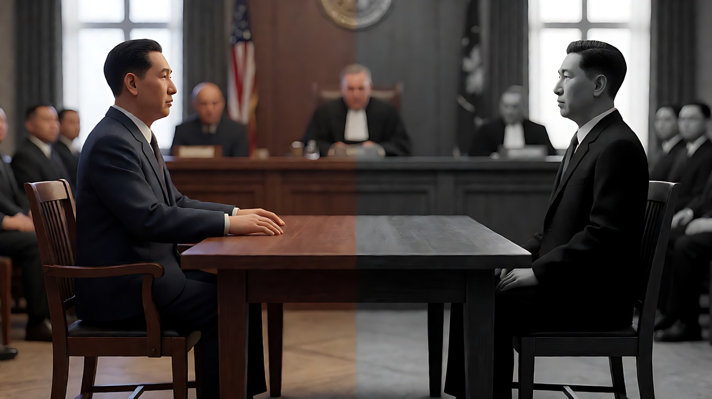

# L07-09 诺兰：实景尺度与时间结构

> 段位：高级 ｜ 建议用时：100 分钟 ｜ 配套提示词：[L07-09-诺兰-提示词](../提示词/L07-09-诺兰-提示词.md)

## 学习目标

- 能解释"实景与大尺度"为何让观众相信画面的物理真实
- 能说出大画幅宽银幕的质感特征，以及如何在提示词中不提品牌地描述它
- 能拆解诺兰的交叉剪辑与非线性时间结构
- 能分析《盗梦空间》《敦刻尔克》《奥本海默》的代表性设计
- 能在 AI 的单段生成中，用"多条线索各占一个镜头"的方式复现交叉剪辑

## 一、概念讲解

### 1. 导演简介

克里斯托弗·诺兰（Christopher Nolan，1970– ），英国出生的导演、编剧，常与弟弟乔纳森·诺兰合作编剧，长期与制片人艾玛·托马斯合作。他以低成本黑白片《追随》（1998）出道，凭《记忆碎片》（2000）的倒叙结构成名，此后执导"黑暗骑士"三部曲、《盗梦空间》《星际穿越》《敦刻尔克》《信条》《奥本海默》等。他坚持胶片拍摄，大量使用大画幅摄影机与实拍特效，并把**时间**作为反复探讨的主题。《奥本海默》（2023）为他赢得奥斯卡最佳导演奖。

### 2. 代表作

| 年份 | 片名 | 值得看的技法 |
|---|---|---|
| 2000 | 《记忆碎片》 | 彩色段倒序、黑白段正序，最终交汇 |
| 2006 | 《致命魔术》 | 日记嵌套日记的多层叙事 |
| 2008 | 《黑暗骑士》 | 部分段落使用大画幅摄影机；城市中实拍的卡车翻转 |
| 2010 | 《盗梦空间》 | 多层梦境交叉剪辑；实景旋转走廊 |
| 2014 | 《星际穿越》 | 实际种植的玉米田；时间膨胀 |
| 2017 | 《敦刻尔克》 | 一周、一天、一小时三条时间线交叉 |
| 2020 | 《信条》 | 正向与逆向时间同框 |
| 2023 | 《奥本海默》 | 彩色主观线与黑白客观线；实拍特效 |

### 3. 六维风格指纹表

| 维度 | 默认值 | 例外 / 关键时刻 |
|---|---|---|
| ① 景别 | 大远景交代尺度（人在巨大的环境里），对话多为中近景 | 大画幅的人脸特写，细节极其清晰 |
| ② 景深与焦段 | 大画幅带来浅景深与极高解析；实景远景深而清晰 | — |
| ③ 构图 | 宽银幕与大画幅（接近 1.43:1）之间切换；人物常被巨大结构、地平线、机械包围 | 摄影机固定在交通工具上（驾驶舱、车头、船头） |
| ④ 光影与色彩 | 自然光与实景光源为主，色彩偏冷、克制；用黑白与彩色区分叙事视角 | — |
| ⑤ 运镜 | 稳定的跟拍、航拍、固定在载具上的机位，强调物理真实 | — |
| ⑥ 剪辑与节奏 | **交叉剪辑**：多条线索平行推进、越剪越快、最终交汇；**非线性时间**：倒叙、嵌套、不同时间尺度 | 用持续上升的配乐把多条线拧成一股 |
| 补充：声音 | 持续加速的配乐与"永远在上升"的音阶错觉；钟表嘀嗒；巨大的低频；有时刻意压低对白 | 突然的寂静 |
| 补充：特效 | **实用特效优先**：实景搭建、实物爆破、真飞机真船，数字特效用于补充 | — |

### 4. 交叉剪辑与时间结构示意

```
《敦刻尔克》式：三条不同时间尺度的线交叉推进，最终交汇
  陆地（一周）  ▇▇▇▇──────▇▇▇────▇▇──▇─▇┐
  海上（一天）  ──▇▇▇▇────▇▇▇───▇▇─▇──▇─┼─▶ 交汇点
  空中（一小时）────▇▇▇▇───▇▇▇──▇▇▇─▇▇▇┘
                  ↑ 越往后，每段越短，切换越快

《记忆碎片》式：两条线相向而行
  彩色段（倒序）：  ◀── E  D  C  B  A
  黑白段（正序）：      1  2  3  4  5 ──▶
                                交汇 ★
```

### 5. 常见误解

| 误解 | 实际情况 |
|---|---|
| 风格 = 烧脑剧情 | 结构服务于情感：交叉剪辑的目的是让多条线的紧张同时达到顶点 |
| 实拍 = 不用任何特效 | 实拍优先，数字特效用于补充和清理；关键是让观众相信物体有重量 |
| 大画幅 = 画面更大 | 关键是质感：极高的细节、浅景深的大场景、自然的肤色和颗粒 |
| 交叉剪辑 = 来回切 | 必须有节奏设计：每条线都在升级，切换越来越快，最后汇合 |

## 二、情绪与叙事功能

| 技法 | 观众的感受 | 常用场景 |
|---|---|---|
| 实景大尺度 | 敬畏、物理真实、"这是真的" | 自然、工程、战争、太空 |
| 固定在载具上的机位 | 身处其中、无法逃离 | 驾驶、飞行、航行 |
| 交叉剪辑 | 多重紧张叠加，同时到达顶点 | 救援、倒计时、高潮 |
| 非线性时间 | 好奇、重新理解、恍然大悟 | 记忆、身份、因果 |
| 持续上升的配乐 | 永远不能放松的紧张 | 倒计时、追逐 |
| 黑白 / 彩色双线 | 主观与客观、内心与外部 | 审讯、回忆、人物传记 |

## 三、经典影片案例

### 《盗梦空间》（2010，克里斯托弗·诺兰）旋转走廊与多层梦境

- 场景：第二层梦境中，因为上一层梦里的车辆翻滚，酒店走廊的重力不断变化，人物在墙壁和天花板上搏斗。
- 怎么拍的：剧组实际建造了一条可以整体旋转的走廊布景，演员在真实旋转的空间里表演。同时，影片在多层梦境之间交叉剪辑：上一层的面包车在慢动作中坠落，下一层的走廊失重，再下一层的雪山要塞里行动正在进行。
- 为什么这样拍：实景旋转让身体的反应真实可信；多层交叉剪辑让一个"坠落"的时间被拉长成整个高潮，几条线的紧张叠在一起。


### 《敦刻尔克》（2017，克里斯托弗·诺兰）三条时间线

- 场景：1940 年的敦刻尔克大撤退。
- 怎么拍的：影片分为"防波堤（一周）""海上（一天）""空中（一小时）"三条线，交叉剪辑推进，到结尾汇合在同一时刻。拍摄大量使用大画幅摄影机，动用了真实的船只与老式战机。配乐运用持续上升的音阶错觉，并混入钟表的嘀嗒声。
- 为什么这样拍：三个不同长度的时间被压缩到同一个节奏里，观众同时经历"漫长的等待"和"致命的一小时"；声音从不让人放松。


### 《奥本海默》（2023，克里斯托弗·诺兰）彩色与黑白

- 场景：原子弹之父的传记，以听证会为框架。
- 怎么拍的：以主人公主观视角讲述的部分是彩色，以另一位人物视角呈现的客观部分是黑白；全片用大画幅胶片拍摄，其中黑白大画幅胶片据报道是为本片专门研制的。核试验的画面以实拍特效为主。
- 为什么这样拍：颜色成为"谁在讲述"的标记，观众不需要字幕就知道视角已经改变。



## 四、在 AI 中怎么实现

**复现技法，而不是复制作品**：不要生成梦境、旋转走廊、海滩撤退、原子弹试验；要学的是"实景大尺度""载具固定机位""多线交叉剪辑""持续上升的配乐""颜色区分视角"，用在你自己的原创故事里（洪水救援、灯塔停电、矿井、跨海大桥合龙）。

- **生图阶段**：
  - 大画幅质感写 `large-format film look, extremely fine detail, natural skin tones, subtle film grain, shallow depth of field even in wide shots`（不写品牌）；
  - 实景尺度写人与结构的比例（`a tiny figure at the base of a massive concrete dam wall, the wall filling ninety percent of the frame`）；
  - 载具机位写 `camera rigidly mounted on the bow of the boat, facing the driver`。
- **视频阶段**：
  - 交叉剪辑：一个片段里每条线占一个镜头，"镜头切至另一处……"；更长的交叉剪辑在剪辑软件里完成，每条线单独生成多段；
  - 声音写"持续上升、永不落下的弦乐音阶，混着越来越快的钟表嘀嗒声"；
  - 实用特效写成物理反馈："真实的水花打在镜头上""整个舱体随浪剧烈颠簸"。
- **模型擅长**：大尺度建筑与自然、水花、云层、载具运动、冷色自然光。
- **要避开**：写导演名、片名、原片角色名、"IMAX"等品牌；"爆炸、战机、炸弹"等触发词（改为"巨大的火光""老式螺旋桨飞机"）；在一个片段里塞进四条以上的线。

## 五、练习作业

1. 画出《敦刻尔克》或《盗梦空间》任一段落的交叉剪辑时间线，标出每条线的镜头长度如何变化。
2. 为一个原创救援故事设计三条不同时间尺度的线（例如一夜、一小时、十分钟），写出它们在何处交汇。
3. 完成配套提示词练习1–5，最后一组拍一个原创的三镜头场景。

## 六、自检清单

- [ ] 尺度用"人与结构的比例"写清楚了
- [ ] 大画幅质感用技术描述而不是品牌名
- [ ] 交叉剪辑里每条线有自己的空间、人物和升级
- [ ] 声音有持续上升的紧张设计
- [ ] 提示词里没有导演名、片名、原片角色名、品牌名、触发词

## 七、配套提示词

→ [L07-09-诺兰-提示词](../提示词/L07-09-诺兰-提示词.md)

---

上一课：[L07-08 韦斯·安德森：平面对称与色板](L07-08-韦斯安德森.md) ｜ 下一课：[L07-10 维伦纽瓦：巨物、剪影与沉默](L07-10-维伦纽瓦.md) ｜ [返回总目录](../../README.md)
