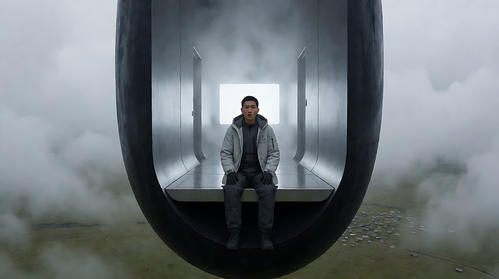
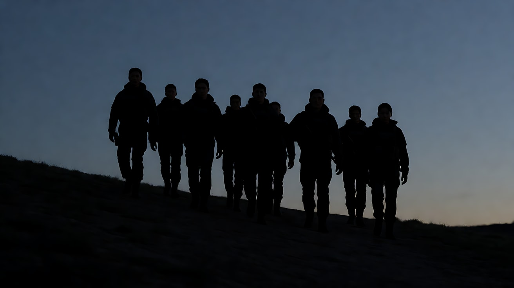
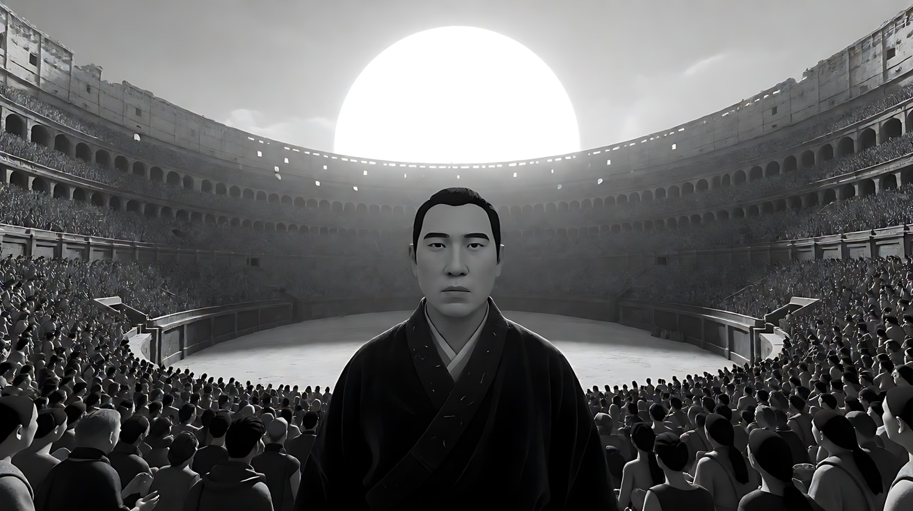

# L07-10 维伦纽瓦：巨物、剪影与沉默

> 段位：高级 ｜ 建议用时：90 分钟 ｜ 配套提示词：[L07-10-维伦纽瓦-提示词](../提示词/L07-10-维伦纽瓦-提示词.md)

## 学习目标

- 能解释"巨物与渺小人类"的尺度对比如何制造敬畏与不安
- 能说出剪影、雾、近乎单色的色板为什么让画面"更少却更重"
- 能拆出维伦纽瓦的六维风格指纹，并理解低频声音在他电影里的叙事作用
- 能分析《降临》《边境杀手》《沙丘2》的代表性段落
- 能用不含人名的提示词复现"巨物 + 剪影 + 雾 + 慢 + 低频"

## 一、概念讲解

### 1. 导演简介

丹尼斯·维伦纽瓦（Denis Villeneuve，1967– ），加拿大魁北克导演。早期以法语片成名，《焦土之城》（2010）获奥斯卡最佳外语片提名；之后进入好莱坞，执导《囚徒》《边境杀手》《降临》《银翼杀手 2049》与《沙丘》系列。他长期与摄影师罗杰·迪金斯（《囚徒》《边境杀手》《银翼杀手 2049》）、布拉德福德·杨（《降临》）、格雷格·弗雷泽（《沙丘》系列）合作，配乐则来自约翰·约翰松、汉斯·季默等人。他的电影常被形容为"安静的巨大"：画面极简、节奏缓慢，但每一个镜头都很重。

### 2. 代表作

| 年份 | 片名 | 值得看的技法 |
|---|---|---|
| 2010 | 《焦土之城》 | 克制的长镜头与残酷的真相 |
| 2013 | 《囚徒》 | 阴冷的自然光、雨与雪 |
| 2013 | 《宿敌》 | 整体偏黄的单色调 |
| 2015 | 《边境杀手》 | 暮色中的剪影行进；夜视镜头 |
| 2016 | 《降临》 | 雾中悬浮的巨型外星飞行器；进入飞行器内部 |
| 2017 | 《银翼杀手 2049》 | 橙色雾霾中的废城与巨大雕像 |
| 2021 | 《沙丘》 | 巨型建筑与沙漠中的渺小人类 |
| 2024 | 《沙丘2》 | 红外黑白拍摄的竞技场段落 |

### 3. 六维风格指纹表

| 维度 | 默认值 | 例外 / 关键时刻 |
|---|---|---|
| ① 景别 | **大远景**：人物在巨大结构或荒原前只是一个小点；对话多为克制的中近景 | 极少的特写落在眼睛和手上 |
| ② 景深与焦段 | 广角大远景 + 中长焦人物镜头；常让背景被雾吞没 | — |
| ③ 构图 | **巨物居中或横贯画面**，人物渺小地放在底部；几何化、粗野主义的建筑；大面积负空间 | 剪影排成一线 |
| ④ 光影与色彩 | **近乎单色**：灰、雾白、橙色雾霾、沙黄；**剪影**与逆光；光常从一个方向来、被雾散开 | 红外黑白、整片橙色 |
| ⑤ 运镜 | 缓慢推近、缓慢航拍、稳定的跟随；摄影机很少急动 | — |
| ⑥ 剪辑与节奏 | **慢**：镜头停留得长，信息很少；沉默的段落 | 动作段落短促而干脆 |
| 补充：声音 | **低频**：深沉的轰鸣、类似号角或机械的低音，常常与画面中巨物的出现绑定；对白稀少 | 突然的完全静音 |
| 补充：表演 | 内敛、少言，用眼神和呼吸承载 | — |

### 4. 巨物、剪影与雾示意

```
巨物与渺小人类（尺度对比）              剪影行进（逆光 + 地平线）
┌──────────────────────────┐          ┌──────────────────────────┐
│ ░░░░░░░░░░░░░░░░░░░░░░░░ │ ← 雾      │       淡橙色暮光天空        │
│ ░░░░░┌──────────┐░░░░░░░ │          │                          │
│ ░░░░░│          │░░░░░░░ │          │  ▲   ▲   ▲   ▲   ▲        │ ← 人物剪影，等距
│ ░░░░░│   巨物    │░░░░░░░ │          │▄▄█▄▄▄█▄▄▄█▄▄▄█▄▄▄█▄▄▄▄▄▄▄│ ← 地平线（沙脊）
│ ░░░░░│          │░░░░░░░ │          │██████████████████████████│ ← 暗部纯黑
│ ░░░░░└──────────┘░░░░░░░ │          └──────────────────────────┘
│            ·  ← 人      │             没有面孔、只有轮廓 → 角色变成"一个群体、一个命运"
└──────────────────────────┘
  巨物占满画面，人物只是一个点；雾吞掉背景 → 敬畏与不安

声音：巨物出现 ──▶ 低频轰鸣（观众先"听见"它的重量）
```

### 5. 常见误解

| 误解 | 实际情况 |
|---|---|
| 风格 = 科幻大场面 | 他的现实题材（《囚徒》《边境杀手》）同样用尺度、剪影和沉默；技法不依赖科幻 |
| 巨物越复杂越好 | 他的巨物往往**极简**：一块黑色的弧形、一座粗野主义的方块，形状越简单越神秘 |
| 慢 = 拖沓 | 慢是让观众感到重量与不安；信息被克制地放出 |
| 低频就是音乐很响 | 低频是"身体能感到的声音"，常与巨物或威胁的出现同步，而不是一直轰着 |

## 二、情绪与叙事功能

| 技法 | 观众的感受 | 常用场景 |
|---|---|---|
| 巨物与渺小人类 | 敬畏、未知、无力 | 第一次接触、抵达、面对体制 |
| 剪影 | 人物变成命运的符号，身份被抹去 | 行进、出发、执行任务 |
| 雾与近乎单色 | 信息被隐藏，世界失去边界 | 未知空间、废墟、梦魇 |
| 缓慢推近 | 被吸引又害怕靠近 | 接近巨物、审视 |
| 低频声音 | 身体先于理智感到威胁 | 巨物出现、危险临近 |
| 沉默 | 紧张被压在表面下 | 等待、对峙、调查 |

## 三、经典影片案例

### 《降临》（2016，丹尼斯·维伦纽瓦）进入飞行器

- 场景：语言学家随军方第一次进入悬停在草原上空的巨型外星飞行器。
- 怎么拍的：飞行器是一块形状极简、像被纵向切开的黑色椭圆巨石，悬浮在低垂的云雾中，人类营地在下方显得极小。进入时，人们乘升降平台进入底部的开口，在通道里重力方向发生改变，他们沿着原本是"墙"的地面走向尽头一面发白的屏幕，屏幕后是浓雾。摄影由布拉德福德·杨担任，整体色调灰白、柔和、近乎单色；约翰·约翰松的配乐和声音设计以低沉人声和低频为主。
- 为什么这样拍：巨物的极简形状让"未知"无法被解读；雾与灰白让一切细节都被藏起；低频声音让观众的身体先于大脑感到敬畏。



### 《边境杀手》（2015，丹尼斯·维伦纽瓦）暮色中的剪影

- 场景：特别行动小组在黄昏时分越过边境，向地下隧道进发。
- 怎么拍的：摄影师罗杰·迪金斯把小组拍成一排剪影，在暮色天空与暗黑地平线之间缓缓走下坡，消失进黑暗；随后的隧道段落使用夜视与热成像画面。
- 为什么这样拍：剪影抹去了每个人的面孔与身份，他们变成一支"走进黑暗的队伍"。观众不知道谁是好人，只感到一种不可逆的下沉。



### 《沙丘2》（2024，丹尼斯·维伦纽瓦）红外黑白竞技场

- 场景：哈克南家族母星上的角斗竞技场。
- 怎么拍的：摄影师格雷格·弗雷泽使用红外摄影拍摄这一段，画面成为一种诡异的黑白：皮肤发白，阴影的位置与常规黑白不同，天空中的"黑色太阳"让一切看起来像另一个物理世界。巨大的竞技场与密集的观众构成压倒性的尺度。
- 为什么这样拍：一个星球的"非人感"不靠台词解释，靠光的物理性质本身。单色化让这个世界冷酷而陌生。



## 四、在 AI 中怎么实现

**复现技法，而不是复制作品**：不要生成椭圆外星飞船、沙虫、哈克南竞技场、橙色雾霾里的巨型雕像；要学的是"极简巨物与渺小人物的比例""逆光剪影""雾吞掉背景的单色画面""缓慢推近""与巨物同步的低频声音"，用在你自己的原创世界里（废弃射电望远镜、地下蓄水穹顶、荒原上的信号塔、巨型水坝）。

- **生图阶段**：巨物写形状要**简单**（`a colossal smooth black monolith`、`a vast brutalist concrete block`），比例写清（`the person is a tiny dot at the bottom of the frame`）；剪影写 `backlit silhouettes against a pale dusk sky, no facial details visible`；色板写 `near-monochrome palette of fog grey and pale sand`。
- **视频阶段**：运镜写"极缓慢的推近 / 航拍"；节奏写"人物几乎不动，雾缓慢流动"；声音写"一个深沉的低频轰鸣，在巨物出现时响起，身体能感到的震动"。
- **模型擅长**：雾、沙、巨大的极简结构、剪影、空旷的荒原、缓慢航拍。
- **要避开**：写导演名、片名、原片角色名、原片中的标志性造型；巨物写太多细节（会变成杂乱的科幻机甲）；在剪影镜头里写面部表情（剪影没有脸）；节奏写快。

## 五、练习作业

1. 看《降临》前 30 分钟，记录飞行器第一次出现时的景别、色彩和声音，各用一句话描述。
2. 设计一个"没有外星人、没有怪物"的巨物：一座废弃的工业结构或自然奇观，写出它与人物的比例关系。
3. 完成配套提示词练习1–5，最后一组拍一个原创的三镜头场景。

## 六、自检清单

- [ ] 巨物形状简单，与人物的比例写清楚了
- [ ] 剪影镜头是逆光，没有写面部表情
- [ ] 色板近乎单色，雾或尘吞掉了背景
- [ ] 运镜缓慢，人物几乎不动
- [ ] 低频声音与巨物的出现同步
- [ ] 提示词里没有导演名、片名、原片角色名

## 七、配套提示词

→ [L07-10-维伦纽瓦-提示词](../提示词/L07-10-维伦纽瓦-提示词.md)

---

上一课：[L07-09 诺兰：实景尺度与时间结构](L07-09-诺兰.md) ｜ 下一课：[L07-11 大卫·芬奇：精准与冷调](L07-11-大卫芬奇.md) ｜ [返回总目录](../../README.md)
