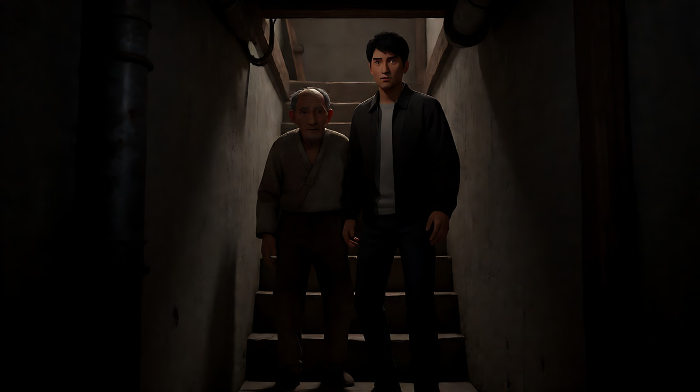

# L07-11 大卫·芬奇：精准与冷调

> 段位：高级 ｜ 建议用时：60 分钟 ｜ 配套提示词：[L07-11-大卫芬奇-提示词](../提示词/L07-11-大卫芬奇-提示词.md)

## 学习目标

- 能说出芬奇"隐形运镜"的核心规则：镜头只在人物动的时候动，而且和人物同速
- 能用六维风格指纹拆解芬奇的一个场景，并把每一维转译成不含人名的技术描述
- 能分辨"冷绿黄调 + 低调暗部"和"随便调成绿色"的区别
- 能用 Seedance 写出一个锁定机位、精确跟随、暗部有层次的 3 镜头原创场景

## 一、概念讲解

### 1. 导演简介

大卫·芬奇（David Fincher，1962 年生于美国科罗拉多州丹佛）十八岁左右进入工业光魔（ILM）做视效相关工作，之后在广告和音乐录影带领域成名，执导过麦当娜《Vogue》等作品。1992 年以《异形3》进入长片，但片厂干预让他很受挫。1995 年的《七宗罪》奠定了他的个人风格：**一切都被控制**——机位、光线、表演节奏、剪辑点，都不留给偶然。

他以拍很多条著称，演员常被要求重复到"不再表演"为止。他关心的不是一个镜头"好看"，而是每一帧"没有多余的东西"。

### 2. 代表作

| 片名 | 年份 | 摄影指导 | 风格看点 |
|---|---|---|---|
| 《七宗罪》 | 1995 | 达柳斯·康第 | 连绵雨夜、低调暗部、部分拷贝采用银保留类冲印工艺，黑位深、饱和低 |
| 《搏击俱乐部》 | 1999 | 杰夫·克罗南威斯 | 脏绿与黄的肤色、精确的视效运镜 |
| 《十二宫》 | 2007 | 哈里斯·萨维德斯 | 早期数字摄影机拍摄，克制的 70 年代质感，长时间的沉默 |
| 《社交网络》 | 2010 | 杰夫·克罗南威斯 | 密集对白、正反打锁定、琥珀与暗绿 |
| 《龙纹身的女孩》 | 2011 | 杰夫·克罗南威斯 | 冷灰北欧、硬朗的对称 |
| 《消失的爱人》 | 2014 | 杰夫·克罗南威斯 | 精准的家居空间、黄绿色温、冷静的叙述 |
| 《心灵猎人》（剧集） | 2017–2019 | 多位，含埃里克·梅塞施密特 | 审讯室对话、对称锁定、低饱和 |
| 《曼克》 | 2020 | 埃里克·梅塞施密特 | 黑白数字摄影 |
| 《杀手》 | 2023 | 埃里克·梅塞施密特 | 程序化的动作、冷静的旁白 |

### 3. 六维风格指纹

| 维度 | 签名特征 | 提示词转译（技术描述） |
|---|---|---|
| 景别 | 以中景、中近景为主；对话多用干净的单人中近景，很少用极端大特写；插入镜头（文件、屏幕、手）精确而短 | "单人中近景，肩部以上，画面里只有一个人" |
| 景深与焦段 | 中等焦段（约 35–50mm 感），景深中等偏浅但背景仍可辨认；不靠虚化制造美感 | "50mm 镜头，中等景深，背景书架可辨认但略柔" |
| 构图 | 强迫症式的居中与对称、水平线绝对水平、人物视线有准确的留空；画面里没有一件"没用"的道具 | "人物居中，门框两侧对称，地平线完全水平，背景干净" |
| 光影与色彩 | 低调照明，暗部大面积但保留细节；顶光与实用光（台灯、荧光灯、屏幕）为动机；色温偏黄绿、冷青，肤色被压低饱和 | "头顶荧光灯为唯一主光，偏黄绿色温，暗部占画面一半以上但细节可见，低饱和" |
| 运镜 | "隐形运镜"：机位锁定，或用轨道/遥控云台做极平稳的移动；镜头只在人物动时动，与人物同速，像被人物牵着走 | "镜头与人物同速平移，人物在画面中的位置始终不变，运动极平稳，无晃动" |
| 剪辑与节奏 | 剪辑点精准、节奏快而均匀；对话正反打切得很密；大量信息靠插入镜头交代；配乐常是低频电子氛围 | "镜头切至……插入特写，短促，随即切回" |

### 4. 示意图：隐形运镜的规则

```
人物：  站立 ─────── 起步走 ═══════════ 停下 ─────── 坐下
                       ║                ║
镜头：  锁定 ─────── 同速跟移 ═════════ 同时停 ───── 锁定（微微下降与人物同高）

画面里人物的位置：  [   ●   ]   [   ●   ]   [   ●   ]   [   ●   ]
                    始终在同一个画面位置 → 观众感觉不到"镜头在动"
```

```
强迫症式构图（门框 + 中心 + 水平）
┌──────────────────────────────┐
│ ▐█▌                    ▐█▌ │  ← 两侧门框/书架严格对称
│ ▐█▌        ●           ▐█▌ │  ← 人物在中线
│ ▐█▌       ███          ▐█▌ │
│━━━━━━━━━━━━━━━━━━━━━━━━━━━━━━│  ← 桌面/地平线绝对水平
│   暗部（细节可见，不是死黑）    │
└──────────────────────────────┘
```

## 二、情绪与叙事功能

| 技法 | 观众的感受 | 常用场景 |
|---|---|---|
| 锁定机位 + 同速跟移 | 冷静、被监视、"一切都在掌控中"；观众不被镜头带节奏，只能盯着人物 | 调查、职场博弈、审讯 |
| 低调暗部 + 顶光 | 真相藏在暗处；人物的眼睛有时陷在阴影里，不可读 | 犯罪、秘密、心理压迫 |
| 黄绿/冷青色温 | 病态、疲惫、不健康的城市夜晚 | 办公室、地下室、公寓 |
| 精准居中对称 | 秩序、强迫、冷漠的制度 | 机构、审讯室、豪宅 |
| 快而均匀的剪辑 | 信息密度高、智力上的紧张 | 对话战、推理段落 |

一句话：芬奇用"控制"制造不安——画面越平静、越整齐，观众越觉得哪里不对。

## 三、经典影片案例（镜头拆解）

### 《社交网络》（2010，大卫·芬奇）开场酒吧对话
- 场景：大学生马克和女友埃丽卡在嘈杂的酒吧里对话，马克语速极快、话题跳跃，最后埃丽卡提出分手。
- 怎么拍的：几乎全部是两人的单人正反打，机位稳定、景别接近，两人在桌子两侧；背景是酒吧暖色实用光和人群。对白极密，剪辑点跟着话语的锋芒切换。这场戏常被提到拍了近百条。
- 为什么这样拍：意图是"让观众感到这个人聪明到让身边的人窒息"。镜头不炫技，把全部注意力交给语速和反应；正反打的节奏本身就是一场辩论。
- 六维速写：景别＝单人中近景；焦段＝中焦、背景可辨；构图＝对称的正反打；光＝酒吧实用暖光、低调；运镜＝基本锁定；剪辑＝密集正反打。


### 《社交网络》（2010，大卫·芬奇）亨利赛艇赛
- 场景：一对双胞胎兄弟在英国亨利赛艇赛上比赛并最终落败。
- 怎么拍的：大量使用移轴镜头制造"微缩模型"感，景深被压成一条窄带；配乐是改编自格里格《山魔王的宫殿》的电子化版本，节奏不断加速；剪辑在赛艇、观众、对手之间快速循环。
- 为什么这样拍：意图是"让观众感到他们的世界像一个精致的玩具，而他们正在输掉它"。这是芬奇少有的"显性风格"段落，但依然遵守精确的剪辑节奏。


### 《十二宫》（2007，大卫·芬奇）地下室
- 场景：漫画家格雷史密斯为了追查线索，跟着一位老人走进他家的地下室，暗处传来楼上的脚步声。
- 怎么拍的：低调照明，大面积暗部，光源少而有动机；镜头不追求惊吓式运动，依靠空间（狭窄楼梯、地下室）、声音（楼上的木地板吱嘎声）和人物停顿制造威胁。
- 为什么这样拍：意图是"让观众感到他走进了一个可能出不去的地方"。芬奇不给观众"吓一跳"的释放，只给持续的压力。



## 四、在 AI 中怎么实现：复现技法，而不是复制作品

### 1. 技法转译表

| 原片做法 | 不要这样写 | 应该这样写 |
|---|---|---|
| 隐形运镜 | "芬奇式运镜" | "镜头与人物同速平移，人物在画面中的位置不变，运动极平稳" |
| 冷绿黄调 | "调成绿色" | "头顶荧光灯偏黄绿色温，肤色低饱和，暗部偏冷青" |
| 低调暗部 | "很暗" | "暗部占画面一半以上但细节可见，唯一主光来自台灯" |
| 强迫症构图 | "构图完美" | "人物居中，两侧书架对称，桌面水平线完全水平" |
| 精准剪辑 | "节奏很快" | 用"镜头切至……插入特写"写清楚每一个切点 |

### 2. 生图与视频分工

- **生图阶段**：构图、对称、暗部比例、色温全部在关键帧里定死。芬奇风格最依赖"第一帧就对"——视频模型只负责动得极稳。
- **视频阶段**：每个镜头写"镜头锁定不动"或"与人物同速跟移"，二选一。加一句"运动极平稳，无晃动、无呼吸感"。
- **模型擅长**：锁定机位下的小动作（翻文件、抬眼、停住手）、荧光灯的轻微闪烁、屏幕光照在脸上。
- **要避开**：手持晃动、快速甩镜、大幅推拉；高饱和色彩；"惊吓式"的突然动作；直接写恐怖或暴力细节。

### 3. 常见误解

| 误解 | 真相 |
|---|---|
| 芬奇 = 画面调绿 | 绿/黄只是色温倾向，关键是**低饱和 + 暗部有层次 + 光有来源** |
| 芬奇镜头从来不动 | 他的镜头经常在动，只是动得让你察觉不到——与人物同速、极平稳 |
| 暗就是看不清 | 他的暗部有细节，黑位深但不死黑；AI 里要写"暗部细节可见" |
| 对称就是把人放中间 | 对称包括门框、灯、桌面线、视线留空，整个画面的"秩序" |
| 拍很多条 = AI 多抽卡 | 他的多条是为了去掉表演痕迹；AI 里对应的是**减少动作**，让一个小动作做干净 |

## 五、练习作业

1. 选《社交网络》或《消失的爱人》的任意一段对话，暂停 5 帧，逐帧标出人物在画面中的位置，验证"镜头动时人物位置不变"。
2. 用六维指纹表拆解《十二宫》或《七宗罪》中你记得的一个场景，每维写一句技术描述。
3. 完成配套提示词练习1–5，重点比较练习2的"同速跟移"和普通跟拍的差异。

## 六、自检清单

- [ ] 每个镜头只选了"锁定"或"同速跟移"之一
- [ ] 写了"运动极平稳，无晃动"
- [ ] 光有具体来源（荧光灯、台灯、屏幕），色温写的是倾向而不是"绿色滤镜"
- [ ] 暗部写了"细节可见"
- [ ] 构图写清了对称元素和水平线
- [ ] 提示词里没有导演名、片名、角色名

## 七、配套提示词

→ [L07-11-大卫芬奇-提示词](../提示词/L07-11-大卫芬奇-提示词.md)

---

上一课：[L07-10 维伦纽瓦](L07-10-维伦纽瓦.md) ｜ 下一课：[L07-12 斯皮尔伯格](L07-12-斯皮尔伯格.md) ｜ [返回总目录](../../README.md)
