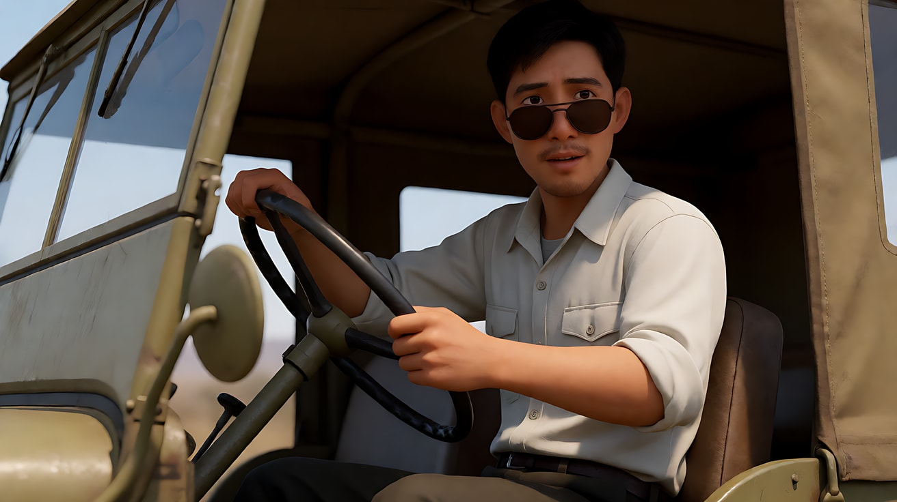
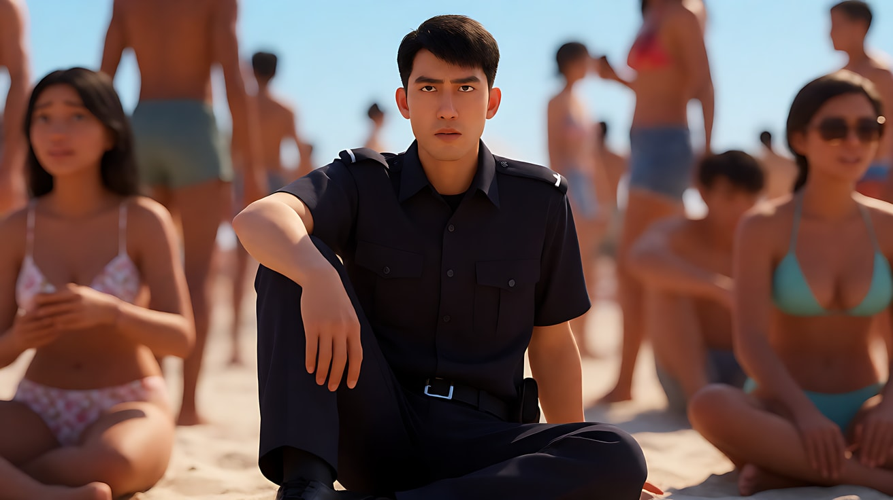
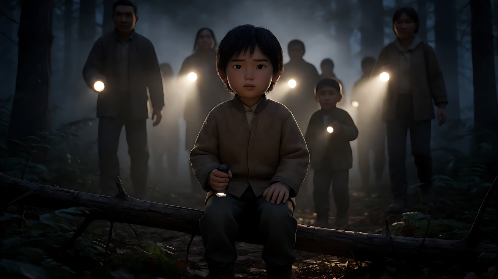

# L07-12 斯皮尔伯格：凝视与调度

> 段位：高级 ｜ 建议用时：60 分钟 ｜ 配套提示词：[L07-12-斯皮尔伯格-提示词](../提示词/L07-12-斯皮尔伯格-提示词.md)

## 学习目标

- 能说出"斯皮尔伯格脸"的构成：仰望、睁大的眼睛、微张的嘴、画外的奇观、缓慢推近
- 理解"一镜多调度"：一个不切的镜头里，靠演员和摄影机走位得到全景、双人、近景多种构图
- 能用逆光、雾和光束把"奇观"写成有来源的光
- 能把机位放到孩子的眼睛高度，用视角讲故事
- 能用 Seedance 写出"先看脸、后揭示"的原创多镜头场景

## 一、概念讲解

### 1. 导演简介

史蒂文·斯皮尔伯格（Steven Spielberg，1946 年生于美国俄亥俄州辛辛那提）少年时期就用 8mm 摄影机拍短片。1971 年的电视电影《决斗》让他进入电影圈，1975 年的《大白鲨》被普遍视为现代暑期大片的开端。他横跨冒险、科幻、战争、历史正剧，几十年保持商业与口碑的平衡。

他的长期合作者构成了一套稳定的"声音"：剪辑师迈克尔·卡恩、作曲约翰·威廉姆斯，以及从《辛德勒的名单》（1993）开始几乎掌镜他全部作品的摄影师雅努什·卡明斯基。

他的风格核心是**观众的视线管理**：先让你看到人物在看什么之前的那张脸，再给你答案；尽量不切镜头，而是让人和摄影机一起动，把一场戏"编舞"出来。

### 2. 代表作

| 片名 | 年份 | 摄影指导 | 风格看点 |
|---|---|---|---|
| 《大白鲨》 | 1975 | 比尔·巴特勒 | 海滩滑动变焦、"看不见的威胁"、低机位水面视角 |
| 《第三类接触》 | 1977 | 维尔莫什·日格蒙德 | 门缝里涌进的强光、仰望的脸 |
| 《夺宝奇兵》 | 1981 | 道格拉斯·斯洛科姆 | 剪影英雄、清晰的动作调度 |
| 《E.T. 外星人》 | 1982 | 艾伦·达维奥 | 孩子高度的机位、雾中手电光束、逆光剪影 |
| 《侏罗纪公园》 | 1993 | 迪恩·坎迪 | 首次见到恐龙的仰望凝视 |
| 《辛德勒的名单》 | 1993 | 雅努什·卡明斯基 | 黑白、手持纪实感 |
| 《拯救大兵瑞恩》 | 1998 | 雅努什·卡明斯基 | 降低饱和、窄快门角度的战场段落 |
| 《少数派报告》 | 2002 | 雅努什·卡明斯基 | 过曝高光、冷蓝漂白质感 |
| 《林肯》 | 2012 | 雅努什·卡明斯基 | 窗光剪影、室内低调 |
| 《造梦之家》 | 2022 | 雅努什·卡明斯基 | 带自传色彩，讲述少年与摄影机 |

### 3. 什么是"斯皮尔伯格脸"

影评人凯文·B·李在 2011 年的视频随笔《The Spielberg Face》里给这个镜头起了名字：人物**睁大眼睛、嘴唇微张、仰望画外**某个我们还没看到的东西，镜头常常缓慢推近。斯皮尔伯格先给观众看"惊奇的反应"，再给"惊奇的对象"，观众的情绪被人物的脸提前带好了。

### 4. 六维风格指纹

| 维度 | 签名特征 | 提示词转译（技术描述） |
|---|---|---|
| 景别 | 揭示前常用人物近景/中近景反应镜头，揭示时切到人物极小、奇观极大的大全景；一镜多调度里景别在同一镜头内变化 | "近景，人物仰望画外上方；镜头切至大全景，人物只占画面底部一小块" |
| 景深与焦段 | 广角到中焦为主，深焦让前后景都清晰，便于多层调度；揭示镜头常用广角强调尺度 | "28mm 广角，深焦，前景人物与远处背景同时清晰" |
| 构图 | 前景人物 + 背景奇观的纵深构图；剪影；孩子视角下大人只露出腰部以下 | "机位在孩子眼睛高度，大人只露出腰部以下和手里的手电" |
| 光影与色彩 | 逆光、轮廓光、雾中光束；门缝或窗口涌进的强光；卡明斯基时期常见过曝的窗与高光 | "逆光从人物身后照来，雾中形成清晰光束，人物边缘被勾亮" |
| 运镜 | 缓慢推近人物的脸；"一镜多调度"——摄影机在轨道上随演员走位重新构图，不切镜头 | "镜头缓慢推近她的脸"；"人物从远处走向镜头，镜头同时后退，从全景变为近景，不切镜头" |
| 剪辑与节奏 | 先反应后揭示；剪辑清晰、空间方向明确；用调度代替剪辑；配乐大量参与情绪 | "镜头1只拍脸，不给出她看到的东西；镜头切至她视线方向的大全景" |

### 5. 示意图：先看脸，后揭示


```
一镜多调度（俯视走位图）

  [背景人物 B]                    ← B 留在远处做小动作
        │
        │  A 从远处走向镜头
        ▼
      [A] ─────────→ [A]          ← A 停在镜头前
                       ▲
  轨道 ════════════[摄影机]        ← 摄影机同时后退并微摇
  构图变化：大全景 → 双人中景（A 前 B 后） → A 近景 + B 在背景
```

## 二、情绪与叙事功能

| 技法 | 观众的感受 | 常用场景 |
|---|---|---|
| 仰望凝视脸 | 惊奇、敬畏、被提前"带入情绪" | 第一次看到奇观、神迹、巨物 |
| 先反应后揭示 | 好奇心被拉满，揭示时释放 | 冒险、科幻、怪物出场 |
| 一镜多调度 | 流畅、沉浸，观众不察觉剪辑，戏像在眼前发生 | 家庭场景、多人对话、紧张的准备 |
| 逆光与光束 | 神秘、希望、未知的力量 | 夜晚搜索、外来者降临 |
| 孩子视角 | 世界变大，大人变得陌生甚至危险 | 成长故事、家庭冲突 |

## 三、经典影片案例（镜头拆解）

### 《侏罗纪公园》（1993，斯皮尔伯格）第一次看到腕龙
- 场景：古生物学家格兰特坐在吉普车里，注意到车外的东西。
- 怎么拍的：先拍他的反应——他摘下墨镜，从座位上站起来，眼睛盯着画外，镜头停在他和埃莉的脸上；他把埃莉的头扳过去，让她也看。之后才切到恐龙的全景，人物在画面里显得很小，配乐的主旋律随之进入。
- 为什么这样拍：意图是"让观众感到一个毕生研究化石的人第一次看到活物"。先反应后揭示，让观众通过他的脸感到震撼，再亲眼看到。



### 《大白鲨》（1975，斯皮尔伯格）海滩上的警长
- 场景：警长布罗迪坐在拥挤的海滩上，紧张地盯着海面。
- 怎么拍的：前景不断有路人横穿画面，每次走过都像一次"擦除"，把镜头换到离他更近的景别；当危险终于发生时，用了滑动变焦——摄影机推向他的同时变焦拉远，背景仿佛被拉开，他的脸保持大小不变。
- 为什么这样拍：意图是"让观众感到他最害怕的事正在发生，而周围没有人注意"。路人擦除让观众和他一起在人群中寻找，滑动变焦把他的惊恐变成空间的变形。



### 《E.T. 外星人》（1982，斯皮尔伯格）孩子的高度
- 场景：全片多个家庭与夜晚搜索的段落。
- 怎么拍的：机位大量放在孩子的眼睛高度。除了母亲，大多数大人在很长篇幅里只被拍到腰部以下，比如搜寻者腰间晃动的一串钥匙；夜晚树林里，手电光束在雾中从人群背后穿过来，形成逆光剪影。
- 为什么这样拍：意图是"让观众站在孩子这一边"。大人没有脸，就成了陌生的威胁；逆光让搜寻者只剩轮廓，更像入侵者。



## 四、在 AI 中怎么实现：复现技法，而不是复制作品

### 1. 技法转译表

| 原片做法 | 不要这样写 | 应该这样写 |
|---|---|---|
| 仰望凝视脸 | 写导演名或"某某脸" | "近景，仰拍，人物睁大眼睛、嘴唇微张，视线投向画外上方，暖光从画外上方照亮她的脸，镜头缓慢推近" |
| 先反应后揭示 | "看到一个巨大的东西" | 镜头1只写脸和光，镜头2才写奇观的全景 |
| 一镜多调度 | "复杂的长镜头" | "人物从远处走向镜头，镜头同时后退并微摇，从全景变为近景，背景人物保持小动作，不切镜头" |
| 逆光光束 | "神秘的光" | "强光从人物背后的门口照入，薄雾中形成清晰光束，人物成为剪影" |
| 孩子视角 | "从孩子的角度" | "机位离地约一米，大人只露出腰部以下和手里的手电" |

### 2. 生图与视频分工

- **生图阶段**：反应镜头的关键帧要把"光从奇观方向来"画好——脸上的光就是奇观存在的证据。揭示镜头用广角、深焦、人物占画面很小的比例。
- **视频阶段**：反应镜头只写一个缓慢推近 + 一个小动作（摘眼镜、站起、屏住呼吸）。一镜多调度只写一条走位路径，背景人物给小动作。
- **模型擅长**：雾中光束、逆光剪影、人物仰望的表情、缓慢推近。
- **要避开**：一镜多调度里写超过两次走位；同时让两个人做主动作；把揭示和反应写在同一个镜头里导致模型提前画出奇观。

### 3. 常见误解

| 误解 | 真相 |
|---|---|
| 仰望脸就是"表情夸张" | 关键是光与视线：光来自奇观方向，眼神有焦点；表情克制反而更可信 |
| 他靠大量剪辑制造节奏 | 他非常擅长**不剪**——用走位在一个镜头里完成多种景别 |
| 光束 = 加特效光 | 光束需要介质（雾、烟、尘）和明确的来源（门、窗、手电、车灯） |
| 孩子视角 = 低角度仰拍 | 是机位**高度**放在孩子眼睛，平视孩子、仰视大人，不是全程夸张仰拍 |
| 只要揭示画面够大就行 | 没有前面的反应镜头，揭示就没有情绪 |

## 五、练习作业

1. 重看《侏罗纪公园》腕龙段落，数一数在恐龙出现前，镜头给了几次人物反应。
2. 找一段你喜欢的斯皮尔伯格家庭场景，画出俯视走位图，标出摄影机在一个镜头里得到了几种构图。
3. 完成配套提示词练习1–5，重点比较练习3的"单镜头调度"和用切镜完成同样内容的差别。

## 六、自检清单

- [ ] 反应镜头和揭示镜头分开写
- [ ] 脸上的光来自奇观方向
- [ ] 光束写了介质（雾、尘）和来源
- [ ] 一镜多调度只有一条主走位，背景人物只做小动作
- [ ] 孩子视角写的是机位高度，而不是夸张角度
- [ ] 提示词里没有导演名、片名、角色名

## 七、配套提示词

→ [L07-12-斯皮尔伯格-提示词](../提示词/L07-12-斯皮尔伯格-提示词.md)

---

上一课：[L07-11 大卫·芬奇](L07-11-大卫芬奇.md) ｜ 下一课：[L07-13 阿方索·卡隆](L07-13-阿方索卡隆.md) ｜ [返回总目录](../../README.md)
