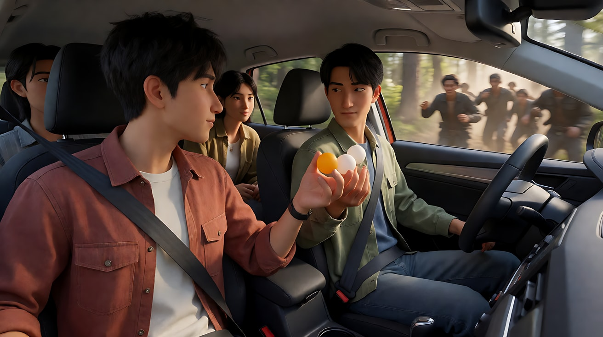
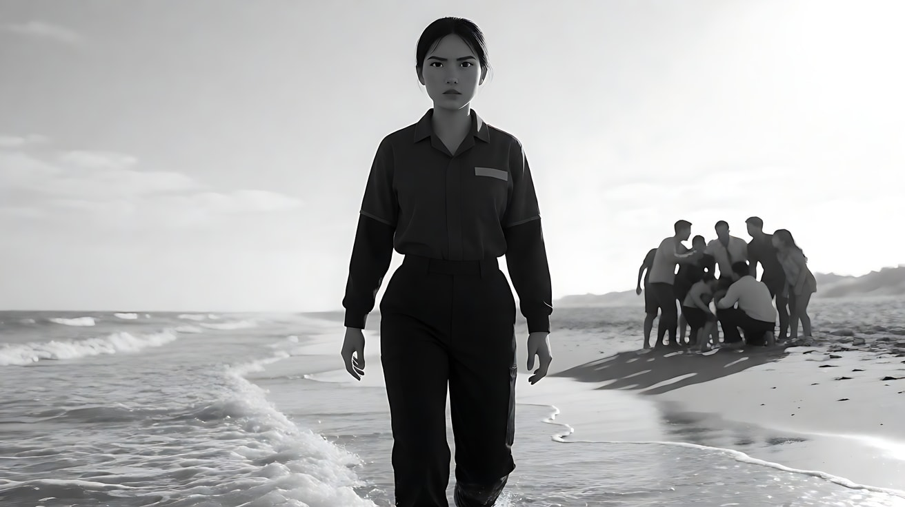

# L07-13 阿方索·卡隆：沉浸式长镜头

> 段位：高级 ｜ 建议用时：60 分钟 ｜ 配套提示词：[L07-13-阿方索卡隆-提示词](../提示词/L07-13-阿方索卡隆-提示词.md)

## 学习目标

- 理解卡隆与卢贝兹基的长镜头为什么"沉浸"：广角、近距离、自然光、环境里同时发生的事
- 能区分"炫技长镜头"和"让观众无处可逃的长镜头"
- 学会写环绕调度：镜头围绕人物移动，但每一段路径都有动作动机
- 掌握在 AI 中"隐藏剪辑点"的写法，用前景遮挡把两个镜头缝成一个
- 能用 Seedance 写出一个原创的沉浸式三段调度场景

## 一、概念讲解

### 1. 导演与摄影师简介

阿方索·卡隆（Alfonso Cuarón，1961 年生于墨西哥城）在墨西哥国立自治大学学过电影。他与同乡摄影师埃马努埃尔·卢贝兹基（Emmanuel Lubezki，外号"Chivo"）从学生时代就合作，两人的长片处女作《爱在歇斯底里时》（1991）就是共同完成的。之后他们一起拍了《小公主》（1995）、《远大前程》（1998）、《你妈妈也一样》（2001）、《人类之子》（2006）和《地心引力》（2013）。

卢贝兹基同时也是泰伦斯·马力克和伊纳里图的长期合作者，凭《地心引力》《鸟人》《荒野猎人》连续三年获得奥斯卡最佳摄影。《罗马》（2018）则由卡隆本人亲自掌镜，以黑白大画幅数字摄影拍摄，他凭此片获得奥斯卡最佳导演和最佳摄影。

两人的共同信条可以概括为：**让观众和人物处在同一个时空里，不给观众剪辑带来的"喘息"**。

### 2. 代表作

| 片名 | 年份 | 摄影指导 | 风格看点 |
|---|---|---|---|
| 《你妈妈也一样》 | 2001 | 卢贝兹基 | 手持漂浮、镜头会离开主角去看路边的社会现实、旁白插入 |
| 《哈利·波特与阿兹卡班的囚徒》 | 2004 | 迈克尔·塞雷辛 | 系列中风格最"作者化"的一部，季节转场 |
| 《人类之子》 | 2006 | 卢贝兹基 | 车内环绕长镜头、战区长镜头、灰冷自然光 |
| 《地心引力》 | 2013 | 卢贝兹基 | 开场十余分钟不切的太空长镜头、LED 光箱照明 |
| 《罗马》 | 2018 | 卡隆本人 | 黑白、缓慢横摇与横移、海滩救援长镜头 |

### 3. 六维风格指纹

| 维度 | 签名特征 | 提示词转译（技术描述） |
|---|---|---|
| 景别 | 在同一镜头内从全景滑到近景再滑回去；常用中全景保留环境，人物不脱离世界 | "镜头从全景靠近到她的中近景，又退回全景，不切镜头" |
| 景深与焦段 | 广角镜头贴近演员拍摄，深焦让背景事件清晰可见 | "21mm 广角，镜头距离她的脸不到一米，深焦，背景里的人群同样清晰" |
| 构图 | 人物嵌在环境里；前景人物的同时，背景有另一件事在发生（社会背景、危险正在靠近） | "前景是她，背景里一队工人在拉电线，两件事同时在画面里" |
| 光影与色彩 | 自然光、阴天的柔光、窗光；色彩低饱和、灰冷；《罗马》为黑白 | "阴天的漫射自然光，没有人工补光的痕迹，低饱和灰冷色调" |
| 运镜 | 超长镜头；摄影机在人物之间漂浮、环绕、穿行；运动有动机（跟随一个人、转向一个声音） | "镜头围绕三人缓慢环绕半圈，每次转向都因为有人开口或回头" |
| 剪辑与节奏 | 极少剪辑；数字拼接隐藏剪辑点；时间是"实时"的，观众无法跳过任何一秒 | "画面被前景经过的卡车完全遮挡后，镜头切至……"（隐藏切点） |

### 4. 示意图：环绕调度与隐藏切点

```
车内环绕调度（俯视）

        前挡风玻璃
   ┌─────────────────┐
   │  [司机]  [副驾]  │      ① 镜头起于前方，拍两人
   │      ↻ 镜头      │      ② 有人说话 → 镜头转向后座
   │  [后座A] [后座B] │      ③ 窗外出现异动 → 镜头转向窗外
   └─────────────────┘      ④ 回到司机 —— 每一次转向都有动机
```

```
隐藏切点：用前景遮挡把两段缝成一个"长镜头"

镜头1 ─────────────▶ [前景卡车/墙/人完全遮住画面] ◀───────────── 镜头2
       广角跟随她                 ↑ 切点藏在这里            继续跟随她
```

## 二、情绪与叙事功能

| 技法 | 观众的感受 | 常用场景 |
|---|---|---|
| 不切的长镜头 | 没有喘息，观众被困在人物的时间里 | 危机、逃亡、生死时刻 |
| 广角近距离 | 身体在场感，仿佛自己就站在人物身边 | 车内、人群、狭窄空间 |
| 背景里的社会事件 | 世界比主角更大；个人命运嵌在时代里 | 社会写实、反乌托邦 |
| 环绕调度 | 观众在多人之间"转头看"，像同车的乘客 | 多人封闭空间 |
| 自然光 | 真实、不被美化 | 写实正剧、家庭记忆 |

一句话：卡隆的长镜头不是为了炫，而是为了**让观众不能离开**。

## 三、经典影片案例（镜头拆解）

### 《人类之子》（2006，阿方索·卡隆）车内伏击
- 场景：西奥、朱利安和其他几人挤在一辆车里赶路，前一刻两人还在玩互相吹乒乓球的小游戏，下一刻树林里冲出来一群人。
- 怎么拍的：摄影机在车内移动、旋转，在前座与后座之间、车内与窗外之间转向，一镜到底持续约四分钟。为此剧组改装了车辆，并使用了一种能在车厢内自由移动的特殊遥控摄影装置，摄影师在车外操作。
- 为什么这样拍：意图是"让观众感到自己就坐在这辆车里，无法下车"。轻松的游戏与突发危机在同一个不切的镜头里发生，观众没有剪辑带来的心理准备。



### 《地心引力》（2013，阿方索·卡隆）开场
- 场景：地球轨道上，几名宇航员在维修哈勃望远镜，随后碎片来袭。
- 怎么拍的：开场是一个十余分钟、看不出剪辑点的数字长镜头。摄影机在太空中自由漂浮、环绕，甚至从外面进入斯通博士的头盔，变成她的主观视角，再退出来。演员的面部光照来自一个布满 LED 的光箱，可以精确地模拟地球反光与阳光的移动。
- 为什么这样拍：意图是"让观众感到太空没有上下、没有依靠"。没有剪辑、没有固定参照的镜头本身就是失重。


### 《罗马》（2018，阿方索·卡隆）海滩
- 场景：女佣克里奥不会游泳，却走进海浪里去救两个被冲远的孩子。
- 怎么拍的：黑白画面，摄影机沿着海岸线与她平行横移，持续跟着她一步步走进越来越深的浪里；没有切到孩子的特写，没有切到她的脸部大特写。救回孩子后，全家在沙滩上抱成一团，背后是逆光的天空。
- 为什么这样拍：意图是"让观众陪她走完每一步"。横向的距离让观众无法插手，只能看着，这种无力感就是悬念。



## 四、在 AI 中怎么实现：复现技法，而不是复制作品

### 1. 技法转译表

| 原片做法 | 不要这样写 | 应该这样写 |
|---|---|---|
| 沉浸式长镜头 | "超长的一镜到底" | "一镜到底不切镜头，镜头跟随她从……走到……"（2.5单段最长30秒；按复杂度决定是否接续，旧版差异见 [A-04](../../附录/A-04-官方案例与版本差异.md)） |
| 广角近距离 | "近距离拍摄" | "21mm 广角，镜头离她不到一米，她的脸在画面一侧，背景同时清晰" |
| 背景事件 | "背景很丰富" | 具体写背景里正在发生的一件事 |
| 环绕调度 | "镜头旋转" | "镜头围绕她缓慢环绕半圈，因为后座有人开口而转向后座" |
| 自然光 | "真实光线" | "阴天漫射光从车窗进入，没有人工补光" |
| 隐藏切点 | "无缝转场" | "画面被前景经过的公交车完全遮挡，镜头切至……" |

### 2. 生图与视频分工

- **生图阶段**：首帧就要有"背景事件"，并把广角的透视写出来（前景大、背景小但清晰）。
- **视频阶段**：每段只写一条运动路径；环绕最多半圈；用"有人回头 / 有声音传来"给转向动机。超过 15 秒的长镜头，用[连续性与首尾帧链](../../06-镜头语言综合与分镜/教学/L06-06-连续性与首尾帧链.md)接续。
- **模型擅长**：跟随行走、缓慢环绕、阴天光、背景人群的自然活动。
- **要避开**：一次生成里多次 360° 旋转；车内多人同时说话；镜头穿过玻璃或头盔这种模型难以处理的空间穿越；写具体伤亡细节。

### 3. 常见误解

| 误解 | 真相 |
|---|---|
| 长镜头越长越好 | 长度服务于"不能离开"的意图；没有危机的长镜头只是拖沓 |
| 卡隆的长镜头都是手持 | 很多是精密的机械与遥控装置、后期数字拼接，只是"看起来"像手持漂浮 |
| 广角会让人脸变形所以要避免 | 卢贝兹基就是用广角贴近制造在场感，变形是代价也是质感 |
| 自然光 = 不打光 | 是"看起来没打光"，光的方向和质量都被精心选择 |
| 镜头要一直动 | 每次运动都要有动机：有人开口、有人回头、有声音传来 |

## 五、练习作业

1. 重看《人类之子》车内段落，记下镜头每一次转向前发生了什么（谁说话、窗外出现了什么），验证"转向都有动机"。
2. 选一段你生活中的路线（买早餐、坐地铁），写出一个 15 秒的"一镜到底"分镜，标明背景里同时在发生的一件事。
3. 完成配套提示词练习1–5，练习4 重点体会"前景遮挡隐藏切点"。

## 六、自检清单

- [ ] 写了广角焦段和"离人物很近"的距离
- [ ] 背景里有一件具体的事在同时发生
- [ ] 每一次转向都有动作或声音动机
- [ ] 光是自然光，写了来源（阴天、窗、海面反光）
- [ ] 一次生成里只有一条主运动路径
- [ ] 提示词里没有导演名、摄影师名、片名、角色名

## 七、配套提示词

→ [L07-13-阿方索卡隆-提示词](../提示词/L07-13-阿方索卡隆-提示词.md)

---

上一课：[L07-12 斯皮尔伯格](L07-12-斯皮尔伯格.md) ｜ 下一课：[L07-14 泰伦斯·马力克](L07-14-泰伦斯马力克.md) ｜ [返回总目录](../../README.md)
