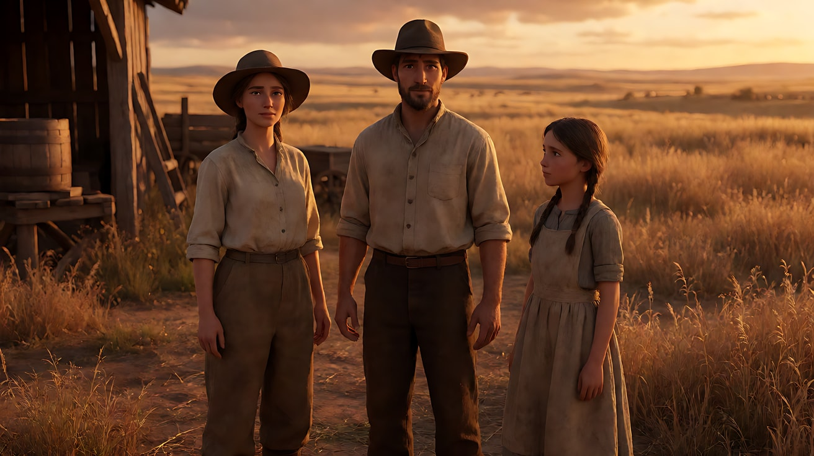
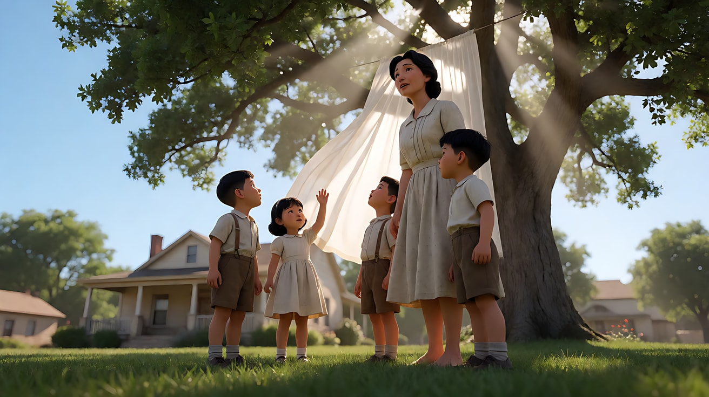
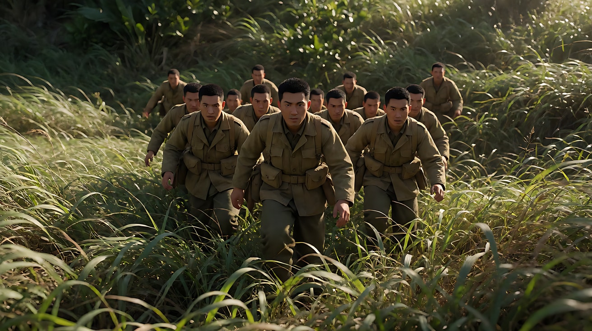

# L07-14 泰伦斯·马力克：魔幻时刻与漂浮

> 段位：高级 ｜ 建议用时：60 分钟 ｜ 配套提示词：[L07-14-泰伦斯马力克-提示词](../提示词/L07-14-泰伦斯马力克-提示词.md)

## 学习目标

- 能说出马力克影像的四个支柱：魔幻时刻逆光、稳定器漂浮、广角仰拍、耳语式旁白
- 理解"跳跃剪辑"在马力克电影里的功能：模仿记忆，而不是交代情节
- 能把"自然"写成镜头语言：草、水、光、风、手触摸万物
- 能用 Seedance 把一段原创记忆写成 3 个碎片镜头 + 一条连续旁白

## 一、概念讲解

### 1. 导演简介

泰伦斯·马力克（Terrence Malick，1943 年生于美国伊利诺伊州）在哈佛大学读哲学，后以罗德学者身份赴牛津，并翻译过海德格尔的著作。之后他进入美国电影学院（AFI）学习电影。

他的前两部长片《穷山恶水》（1973）和《天堂之日》（1978）获得极高评价，随后他离开影坛约二十年，1998 年以《细细的红线》回归并获柏林金熊奖。2005 年起他与摄影师埃马努埃尔·卢贝兹基合作了《新世界》《生命之树》（2011，戛纳金棕榈）、《通往仙境》等片，形成了今天人们熟悉的"漂浮影像"。

马力克极少接受采访，拍摄时常常在现场根据光和天气即兴调整，后期剪辑周期以年计——他的电影是在剪辑台上"写"出来的。

### 2. 代表作

| 片名 | 年份 | 摄影指导 | 风格看点 |
|---|---|---|---|
| 《穷山恶水》 | 1973 | 塔克·藤本、斯蒂文·拉纳等 | 少女的平静旁白与暴烈情节的反差 |
| 《天堂之日》 | 1978 | 内斯托·阿尔门德罗斯（哈斯克尔·韦克斯勒补拍部分） | 魔幻时刻的麦田、奥斯卡最佳摄影 |
| 《细细的红线》 | 1998 | 约翰·托尔 | 战场中的草与风、多人内心旁白 |
| 《新世界》 | 2005 | 埃马努埃尔·卢贝兹基 | 自然光、河流与森林 |
| 《生命之树》 | 2011 | 埃马努埃尔·卢贝兹基 | 童年碎片、广角仰拍、宇宙段落 |
| 《隐秘的生活》 | 2019 | 约尔格·维德默 | 阿尔卑斯山村、广角低机位 |

### 3. 什么是"魔幻时刻"

日出后、日落前太阳接近地平线的短暂时间。光低、暖、柔，从侧后方照来，影子长，天空仍有亮度。《天堂之日》大量外景就是在这段时间拍的，每天可用的时间很短，这正是它的光看起来"不真实"的原因。

### 4. 六维风格指纹

| 维度 | 签名特征 | 提示词转译（技术描述） |
|---|---|---|
| 景别 | 中景与全景为主，大量手、脚、草尖、水面的局部；很少给正面面部特写 | "中景，人物背对镜头；插入她的手指拂过草尖的局部" |
| 景深与焦段 | 广角为主，贴近人物，深焦；天空和地面同时进入画面 | "18mm 广角，离人物很近，深焦，天空占画面上半部" |
| 构图 | 低机位仰拍，人物常被裁切或偏在边缘；太阳经常直接入画；树冠、天空、地平线 | "低机位仰拍，太阳在画面右上角入画，人物在画左边缘被裁到肩膀" |
| 光影与色彩 | 自然光、魔幻时刻逆光、镜头光晕；暖金与天空的淡蓝；室内只用窗光 | "日落前低角度暖金逆光，人物边缘发亮，轻微镜头光晕，天空淡蓝" |
| 运镜 | 稳定器漂浮，跟随、环绕、上升，像一个好奇的灵魂在人物身边游荡；几乎从不静止 | "镜头低位漂浮跟随，轻柔地绕到她身前又上升望向天空" |
| 剪辑与节奏 | 跳跃剪辑、省略式剪辑：同一场景跳过中间动作；画面与耳语式旁白不同步；插入自然空镜 | "镜头切至同一片田野稍晚的时刻……"；"画外音（女声，耳语）：……" |

### 5. 示意图：画面、旁白、自然，三条线并行

```
时间线 ────────────────────────────────────────────────────▶

画面：  [她在麦田里走] ✂ [她的手拂过麦穗] ✂ [她已站在坡顶] ✂ [风吹过空田]
        （跳跃剪辑：跳过中间动作，像记忆一样只留碎片）

旁白：  ～～～～～～ "你还在吗？" ～～～～～～～～ "我一直在找你。" ～～～～
        （耳语，与画面不同步，像内心的提问）

光：    ████████ 魔幻时刻低角度暖金逆光，全程同一方向 ████████
```

```
机位：低、广、仰
            ☀ ← 太阳入画
         ╱
   ╲   ╱    天空占上半部
    ╲ ●     人物轮廓被逆光勾亮
 ────[▲]──── 地平线压低
      ↑ 镜头离地很近，18mm
```

## 二、情绪与叙事功能

| 技法 | 观众的感受 | 常用场景 |
|---|---|---|
| 魔幻时刻逆光 | 恩典、怀旧、时间正在流逝 | 童年、爱情、失去 |
| 漂浮的稳定器运镜 | 像灵魂或记忆在游荡，没有重量 | 回忆、心灵独白 |
| 广角低机位仰拍 | 人与天空、自然相连；孩子眼中的世界巨大 | 成长、信仰 |
| 耳语式旁白 | 内心的提问，私密而普遍 | 祈祷、思念 |
| 跳跃剪辑 | 记忆的碎片感，时间不连续 | 回忆、情感高潮 |
| 自然空镜插入 | 个人的痛与世界的永恒对照 | 转场、情绪停顿 |

## 三、经典影片案例（镜头拆解）

### 《天堂之日》（1978，泰伦斯·马力克）麦田与蝗灾
- 场景：20 世纪初美国得州大平原，一对恋人与女孩在农场做季节工。影片外景实际在加拿大艾伯塔省拍摄。
- 怎么拍的：大量外景在魔幻时刻拍摄，摄影师阿尔门德罗斯尽量依靠自然光，室内用窗光甚至火光。蝗灾段落据记载使用了从直升机上撒落的花生壳，并让演员倒着走、倒放胶片来模拟蝗虫腾起。
- 为什么这样拍：意图是"让观众感到这片丰饶的土地美得近乎神圣，也注定会失去"。低暖的光本身就有"即将结束"的感觉。



### 《生命之树》（2011，泰伦斯·马力克）童年段落
- 场景：20 世纪 50 年代得州小镇，三兄弟与父母的童年生活。
- 怎么拍的：摄影机贴着孩子低位漂浮，广角仰拍母亲、树冠和阳光；画面常是片段——草坪上的赤脚、窗帘被风吹起、手伸向一束光；耳语式旁白在画面上方流动，向母亲、向上帝发问。据报道马力克与卢贝兹基为本片拟过一套拍摄规则，例如尽量使用自然光、常拍逆光、多用广角。
- 为什么这样拍：意图是"让观众感到童年不是连续的故事，而是一些闪着光的瞬间"。跳跃剪辑和漂浮镜头复制了记忆的工作方式。



### 《细细的红线》（1998，泰伦斯·马力克）高草坡
- 场景：二战瓜达尔卡纳尔岛，一队士兵在齐腰高的草丛中向山坡推进。
- 怎么拍的：镜头低位穿行在草丛里，风让整片草浪起伏，阳光时隐时现；多位士兵的内心旁白交替出现，讨论的是自然与人性，而不是战术。
- 为什么这样拍：意图是"让观众感到自然对人类的战争毫不在意"。风吹草动的美与即将到来的残酷并置。



## 四、在 AI 中怎么实现：复现技法，而不是复制作品

### 1. 技法转译表

| 原片做法 | 不要这样写 | 应该这样写 |
|---|---|---|
| 魔幻时刻 | "唯美的夕阳" | "日落前低角度暖金逆光从人物身后照来，影子很长，轻微镜头光晕" |
| 稳定器漂浮 | 写设备品牌 | "镜头低位轻柔漂浮跟随，没有颠簸，像在空中滑行" |
| 广角仰拍 | "仰拍" | "18mm 广角，镜头离地很近向上仰拍，天空和树冠占画面上半部，太阳入画" |
| 耳语旁白 | "加上旁白" | "画外音（女声，耳语，语速很慢）：'……'" |
| 跳跃剪辑 | "快速剪辑" | "镜头切至同一地点稍晚的时刻，她已经站在坡顶"（跳过中间动作） |
| 自然 | "大自然很美" | "风从左向右压过草浪"、"手指拂过麦穗顶端" |

### 2. 生图与视频分工

- **生图阶段**：逆光与太阳位置要在关键帧里定下来，减少视频中光线漂移。背光或侧背是本课的造型选择，不是人脸审核保证；素材授权与入口规则仍需核对。
- **视频阶段**：每个镜头一个漂浮运动（跟随 / 上升 / 绕到身前），速度"轻柔"；旁白放在【声音】里，句子短、少、像提问。
- **模型擅长**：逆光草地、风、水、光晕、发丝透光、手的局部。
- **要避开**：多人对白；面部特写哭泣；剧烈动作；写"梦幻""唯美"之类空词——用光的方向和时间代替。

### 3. 常见误解

| 误解 | 真相 |
|---|---|
| 马力克 = 夕阳滤镜 | 是**真实的低角度太阳**带来的逆光、长影和天空亮度，方向必须一致 |
| 镜头乱飘就像了 | 漂浮有方向和动机：跟着孩子、转向光、升向天空 |
| 旁白越多越有诗意 | 他的旁白短而少，多是问题，而不是解释剧情 |
| 跳跃剪辑 = 剪错了 | 是有意省略中间动作，只保留情绪上最亮的瞬间 |
| 全片都是外景 | 室内同样重要，但只用窗光，人物常贴着窗、门、窗帘 |

## 五、练习作业

1. 在你所在城市找一次日落，记录从"太阳离地平线一拳高"到"太阳落下"之间光的变化，用手机拍三张逆光照片。
2. 写一段你的童年记忆，只写 5 个画面碎片和 2 句耳语旁白，不写任何情节交代。
3. 完成配套提示词练习1–5，练习4 重点体会"跳跃剪辑 + 连续旁白"。

## 六、自检清单

- [ ] 写了太阳的方向与高度（低角度、身后、入画）
- [ ] 运镜是漂浮的、有方向的，且每镜头只有一个
- [ ] 机位低、广角、天空入画
- [ ] 旁白短、少、是耳语、是提问
- [ ] 跳跃剪辑写成"同一地点稍晚的时刻"
- [ ] 提示词里没有导演名、摄影师名、片名、角色名

## 七、配套提示词

→ [L07-14-泰伦斯马力克-提示词](../提示词/L07-14-泰伦斯马力克-提示词.md)

---

上一课：[L07-13 阿方索·卡隆](L07-13-阿方索卡隆.md) ｜ 下一课：[L07-15 王家卫](L07-15-王家卫.md) ｜ [返回总目录](../../README.md)
