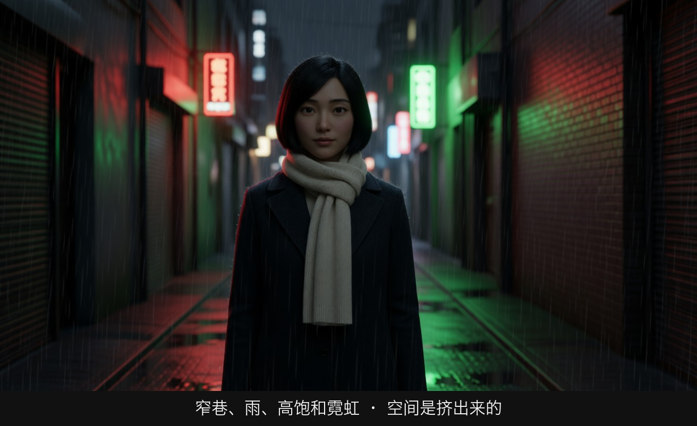
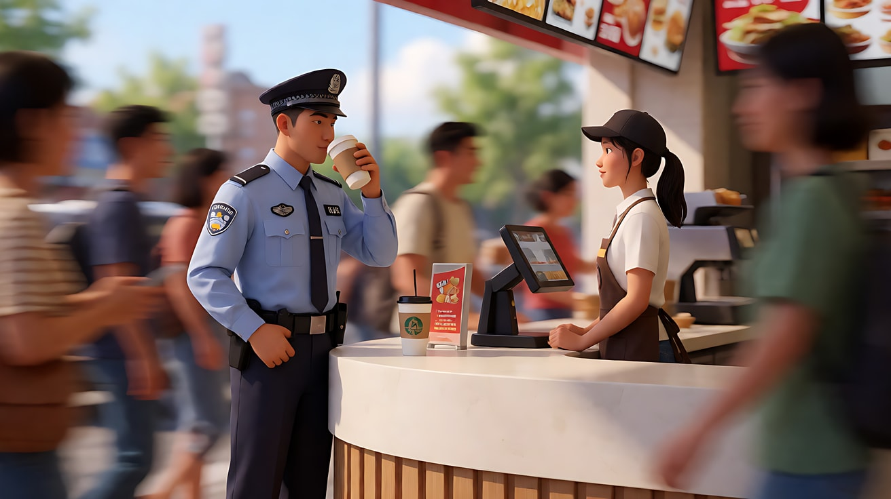
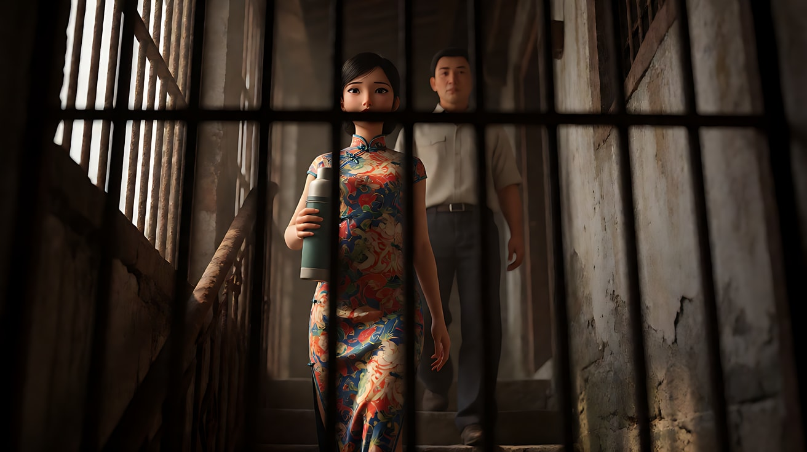
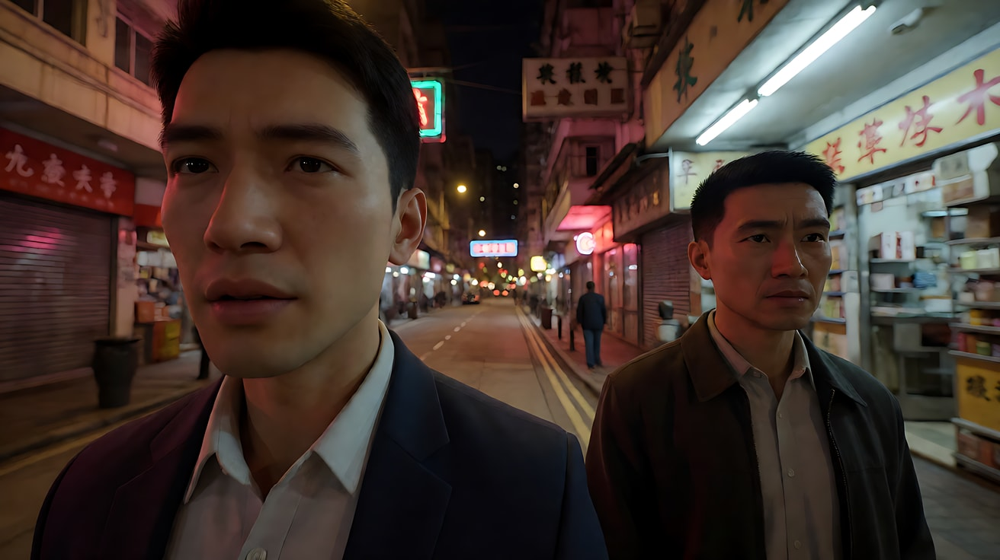

# L07-15 王家卫：抽帧、霓虹与暧昧

> 段位：高级 ｜ 建议用时：60 分钟 ｜ 配套提示词：[L07-15-王家卫-提示词](../提示词/L07-15-王家卫-提示词.md)

## 学习目标

- 能说出王家卫与杜可风影像的五个关键词：抽帧拖影、霓虹混合色温、手持、前景遮挡、狭窄空间
- 理解"抽帧/降格"在技术上是什么，以及为什么它能表现"人在城市里的孤独"
- 能分辨两种慢：升格慢动作（克制、回忆）与降格抽帧（时间失控、城市流动）
- 能用 Seedance 写出一个带内心独白、前景遮挡和混合色温的原创三镜头场景

## 一、概念讲解

### 1. 导演与摄影师简介

王家卫（1958 年生于上海，五岁随家人移居香港）早年在香港理工学院读平面设计，后进入无线电视（TVB）编剧训练班，做过多年编剧。1988 年以《旺角卡门》执导长片。

从《阿飞正传》（1990）开始，他与澳大利亚出生的摄影师杜可风（Christopher Doyle）长期合作，完成了《东邪西毒》《重庆森林》《堕落天使》《春光乍泄》《花样年华》《2046》。《花样年华》由杜可风与李屏宾共同掌镜。

王家卫以"没有完整剧本"、边拍边写、拍摄周期漫长著称，演员常常不知道完整故事。他的电影核心主题是**错过**：时间、记忆、擦肩而过的人。

### 2. 代表作

| 片名 | 年份 | 摄影指导 | 风格看点 |
|---|---|---|---|
| 《阿飞正传》 | 1990 | 杜可风 | 60 年代香港、湿热绿调、时钟与时间 |
| 《重庆森林》 | 1994 | 杜可风、刘伟强 | 抽帧拖影、手持、快餐店与霓虹 |
| 《东邪西毒》 | 1994 | 杜可风 | 沙漠、水影光斑、武侠的解构 |
| 《堕落天使》 | 1995 | 杜可风 | 超广角贴脸、霓虹夜色、黑白与彩色交替 |
| 《春光乍泄》 | 1997 | 杜可风 | 布宜诺斯艾利斯、饱和黄绿、黑白段落；王家卫获戛纳最佳导演 |
| 《花样年华》 | 2000 | 杜可风、李屏宾 | 升格慢动作、旗袍、窄巷与楼梯、前景遮挡 |
| 《2046》 | 2004 | 杜可风等 | 宽银幕画幅中的局部构图、大面积遮挡 |
| 《一代宗师》 | 2013 | 菲利普·勒苏尔 | 雨夜打斗、慢动作与水花 |

### 3. 什么是"抽帧/降格加印"

```
正常拍摄：24 格/秒拍，24 格/秒放          → 动作正常
升格慢动作：48 格/秒或更高拍，24 格/秒放   → 动作变慢、变柔（《花样年华》的走路）
降格加印（俗称"抽帧"）：
  低帧率 + 较慢快门拍摄  → 每格带拖影
  放映时把每格重复数次   → 动作一顿一顿、边缘拉成光带（《重庆森林》《堕落天使》的追逐与人群）
```

两种"慢"的情绪完全相反：升格是**把一瞬间拉长**，像回忆；抽帧是**时间在打滑**，像在城市里迷失。

### 4. 六维风格指纹

| 维度 | 签名特征 | 提示词转译（技术描述） |
|---|---|---|
| 景别 | 中近景、局部特写（手、背影、发髻、钟表）；人物常只露出一部分 | "局部特写，只拍她搭在楼梯扶手上的手和旗袍的袖口" |
| 景深与焦段 | 两个极端：长焦压缩 + 浅景深（《花样年华》），或超广角贴脸（《堕落天使》） | "长焦压缩，前景门框虚化"；或"超广角贴近脸部，透视夸张" |
| 构图 | 大面积前景遮挡：门框、窗格、铁栏、镜子、墙角；人物偏在画边；狭窄空间 | "透过半掩的门缝拍摄，门板占画面左侧一半，人物在右侧窄缝里" |
| 光影与色彩 | 霓虹与荧光灯、钨丝灯的混合色温；红绿撞色；湿热的绿与黄；夜晚为主 | "窗外红色霓虹从画左照入，室内一盏绿色荧光灯，两种色温同时落在脸上" |
| 运镜 | 手持、晃动、跟随；或固定机位下的升格慢动作；慢门拖影 | "手持跟随，轻微晃动"；"升格慢动作，镜头固定" |
| 剪辑与节奏 | 内心独白画外音；重复的配乐；跳切；字幕式的时间与日期；同一空间反复出现 | "画外音（女声，平静的独白）：……"；"同一走廊，镜头切至另一个夜晚" |

### 5. 示意图：前景遮挡 + 混合色温

```
┌──────────────────────────────────────┐
│█████████████│                        │
│█ 门板（前景 │   红色霓虹 ←窗外        │
│█  虚化）    │        ●  ← 人物挤在    │
│█████████████│       ███    窄缝里     │
│█████████████│   绿色荧光灯 ↓顶光      │
│█████████████│ ░░ 墙上的旧挂钟 ░░      │
└──────────────────────────────────────┘
   前景遮挡占画面一半 → 观众像在偷看
   红 + 绿两种色温同框 → 暧昧、不安、潮湿
```

## 图解

> 这些示意图由多种生图模型分别生成（包括 Nano Banana、GPT Image 等），只用来说明镜头概念；不同模型的画面不能互相比较效果，也不能当作视频成片。




空间窄，雨把霓虹砸在地上，脸一半在色光里、一半在暗里。拥挤和饱和是这张画的语法，不是滤镜名字。

## 二、情绪与叙事功能

| 技法 | 观众的感受 | 常用场景 |
|---|---|---|
| 抽帧拖影 | 时间失控、城市流动而人物静止的孤独 | 人群、追逐、夜街 |
| 升格慢动作 + 重复配乐 | 一瞬间被无限拉长，克制、怀旧 | 擦肩、等待、回忆 |
| 前景遮挡 | 偷看、隔阂、两人之间永远有障碍 | 暧昧关系、秘密 |
| 混合色温（霓虹） | 潮湿、暧昧、心神不定 | 夜晚的城市、小房间 |
| 狭窄空间 | 想靠近又不能，身体被迫贴近 | 楼梯、走廊、出租屋 |
| 内心独白 | 人物对自己说话，孤独而私密 | 开场、转折、结尾 |

## 三、经典影片案例（镜头拆解）

### 《重庆森林》（1994，王家卫）快餐店柜台
- 场景：警察 663 站在快餐店柜台前喝咖啡，店员阿菲在柜台另一头偷偷看他。
- 怎么拍的：两人几乎静止或动作很慢，周围的人群却高速流过，被拉成模糊的拖影。常见的解释是：演员刻意放慢动作，摄影机以低帧率、较慢快门拍摄，再加印成正常放映速度——于是周围正常走动的人变得极快、极糊，而"慢动作"的两人反而接近正常速度。
- 为什么这样拍：意图是"让观众感到在拥挤的城市里，只有这两个人的时间是另一种速度"。不用一句台词就讲出了"她眼里只有他"。



### 《花样年华》（2000，王家卫）去面档的窄巷
- 场景：苏丽珍拎着保温壶，一个人走下窄楼梯去面档买面；周慕云在同一条窄路上与她擦肩。
- 怎么拍的：升格慢动作，镜头多为固定或缓慢移动；大量透过墙角、栏杆、铁窗的前景遮挡；配乐（梅林茂作曲的圆舞曲主题）在全片多次重复出现；她的旗袍每次都不同，暗示时间已经过去。
- 为什么这样拍：意图是"让观众感到两个人想靠近又不敢"。窄空间让身体不得不贴近，慢动作拉长擦肩的那一秒，遮挡让观众始终隔着一层。



### 《堕落天使》（1995，王家卫）超广角与夜色
- 场景：杀手的经纪人、哑巴何志武等人在香港夜里各自游荡。
- 怎么拍的：大量超广角镜头贴近人物的脸，透视夸张，背景的街道被拉得很远；手持晃动；霓虹与荧光灯的冷暖混杂；部分段落用抽帧。
- 为什么这样拍：意图是"让观众感到人物离镜头很近，离彼此却很远"。超广角让脸占满前景，同时把世界推开。



## 四、在 AI 中怎么实现：复现技法，而不是复制作品

### 1. 技法转译表

| 原片做法 | 不要这样写 | 应该这样写 |
|---|---|---|
| 抽帧拖影 | 写导演名或片名 | "低帧率拖影效果：人物几乎静止，周围的人群被拉成流动的模糊光带，画面带轻微的顿挫感" |
| 升格慢动作 | "很有感觉的慢镜头" | "升格慢动作，她走下楼梯，裙摆缓慢摆动，镜头固定" |
| 霓虹混合色温 | "复古港风" | "窗外红色霓虹从画左照入，室内顶上一支绿色荧光灯" |
| 前景遮挡 | "偷拍视角" | "透过半掩的门缝拍摄，门板在前景占画面左侧一半并虚化" |
| 内心独白 | "加入文艺台词" | "画外音（男声，平静低沉的独白）：'……'" |

### 2. 生图与视频分工

- **生图阶段**：前景遮挡、混合色温、人物偏边的构图必须在关键帧里画好；长焦压缩的前景虚化最好在生图阶段完成。
- **视频阶段**：每个镜头只选一种"时间"：正常手持 / 升格慢动作 / 低帧率拖影。拖影写清楚"谁清晰、谁模糊"。
- **模型擅长**：霓虹反光、湿地面、人群拖影、慢动作中的布料和发丝、手持晃动。
- **要避开**：一个镜头里同时写慢动作和拖影；多句对白（改用独白画外音）；写"港风""复古滤镜"这类空词。

### 3. 常见误解

| 误解 | 真相 |
|---|---|
| 王家卫 = 加个黄绿滤镜 | 色彩来自画面里**真实存在的光源**：霓虹、荧光灯、钨丝灯、窗外招牌 |
| 抽帧就是慢动作 | 抽帧是"时间打滑"，升格是"时间拉长"，情绪相反 |
| 手持就是乱晃 | 手持贴着人物的情绪：她慌乱时晃，她静止时稳 |
| 遮挡是为了好看 | 遮挡是人物关系：两人之间永远隔着门、墙、玻璃 |
| 台词越文艺越像 | 独白是平静的、具体的（时间、数字、物件），不是抒情 |

## 五、练习作业

1. 用手机的"慢动作"和"延时/低帧率"各拍一段你在地铁站里静止站立的视频，对比两种"慢"的情绪。
2. 找你家里或楼道里三个能做前景遮挡的物体（门缝、栏杆、镜子），各拍一张照片，人物只占画面一小部分。
3. 完成配套提示词练习1–5，练习4 重点体会"同一个小空间里换三种遮挡"。

## 六、自检清单

- [ ] 每个镜头只选了一种时间处理（正常 / 升格 / 拖影）
- [ ] 拖影写清楚谁清晰、谁模糊
- [ ] 两种色温都写了具体来源
- [ ] 前景遮挡写了是什么、占画面多少
- [ ] 独白放在【声音】里，是平静的、具体的
- [ ] 提示词里没有导演名、摄影师名、片名、角色名

## 七、配套提示词

→ [L07-15-王家卫-提示词](../提示词/L07-15-王家卫-提示词.md)

---

上一课：[L07-14 泰伦斯·马力克](L07-14-泰伦斯马力克.md) ｜ 下一课：[L07-16 张艺谋](L07-16-张艺谋.md) ｜ [返回总目录](../../README.md)
