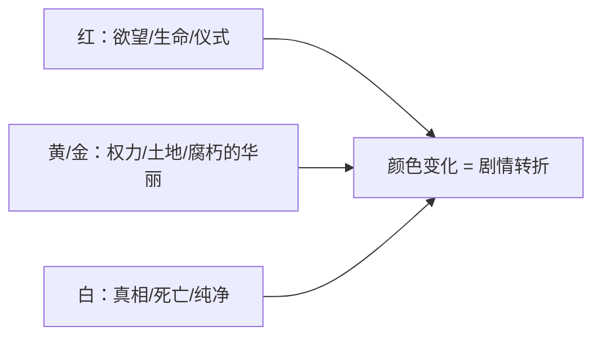
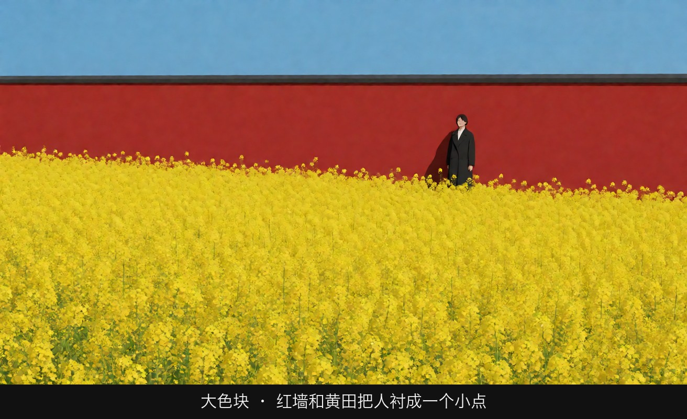
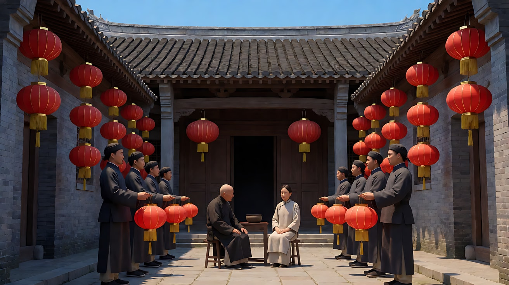
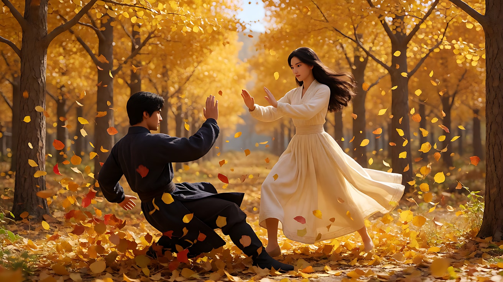
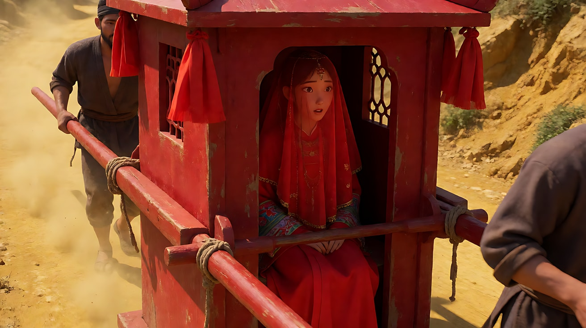

# L07-16 张艺谋：色块与群像

> 段位：高级 ｜ 建议用时：60 分钟 ｜ 配套提示词：[L07-16-张艺谋-提示词](../提示词/L07-16-张艺谋-提示词.md)

## 学习目标

- 能说出张艺谋影像的五个关键词：大色块、色彩象征、对称群像、仪式感、大场面调度
- 理解他"摄影师出身"对构图的影响：画面先是一个色彩平面，再是一个故事
- 能把"颜色"写成叙事：颜色的变化 = 情节的转折
- 能用 Seedance 写出对称群像与仪式动作，且只有一个主动作，群体只做同步小动作
- 能用该风格技法完成一个原创三镜头场景

## 一、概念讲解

### 1. 导演简介

张艺谋（1950 年生于陕西西安）在"文革"期间下乡、进工厂，1978 年破格考入北京电影学院摄影系，是"第五代导演"的代表人物。他先以摄影师身份成名：《一个和八个》（1983）、陈凯歌导演的《黄土地》（1984）都由他掌镜，后者那种大块黄土地与小小人物的构图，已经是他色块美学的雏形。

1987 年，他执导的处女作《红高粱》获得柏林电影节金熊奖。此后《菊豆》《大红灯笼高高挂》（威尼斯银狮）、《秋菊打官司》（威尼斯金狮）、《活着》（戛纳评审团大奖）奠定了他的国际地位。2002 年的《英雄》开启了中国商业大片时代。他还担任了 2008 年北京奥运会开幕式总导演。

摄影师出身让他首先用**面积**思考画面：一块红占多大，人占多小，群体排成什么形状。

### 2. 代表作

| 片名 | 年份 | 摄影指导 | 风格看点 |
|---|---|---|---|
| 《黄土地》（摄影） | 1984 | 张艺谋（导演陈凯歌） | 大片黄土、低地平线、人物极小 |
| 《红高粱》 | 1987 | 顾长卫 | 高粱地的红与绿、颠轿、结尾的红色日食 |
| 《菊豆》 | 1990 | 顾长卫、杨伦 | 染坊里垂落的彩色布匹 |
| 《大红灯笼高高挂》 | 1991 | 赵非 | 对称的四合院、点灯与封灯的仪式 |
| 《活着》 | 1994 | 吕乐 | 克制写实，皮影戏的红 |
| 《英雄》 | 2002 | 杜可风 | 不同版本的叙述被赋予红、蓝、白等不同的主色 |
| 《十面埋伏》 | 2004 | 赵小丁 | 竹林的绿、牡丹坊击鼓 |
| 《满城尽带黄金甲》 | 2006 | 赵小丁 | 金黄色的宫殿与菊花阵 |
| 《影》 | 2018 | 赵小丁 | 近乎黑白的水墨灰调 |

### 3. 六维风格指纹

| 维度 | 签名特征 | 提示词转译（技术描述） |
|---|---|---|
| 景别 | 两极：大远景里的人群与色块；单人近景的面部（常为正面、平静） | "大远景，人群只是画面中的一条红线"；"正面近景，人物面无表情" |
| 景深与焦段 | 大场面用长焦压缩人群成色块，或广角俯拍成图案；单人用中长焦 | "长焦压缩，几百人的队列被压成一整片红色" |
| 构图 | 严格对称、正面、中心；群体排成几何阵列；高俯拍；建筑的轴线 | "正面中心对称，院子两侧各站一排人，屋檐线完全水平" |
| 光影与色彩 | 高饱和大面积单色（红、黄、金、绿、白），颜色有象征意义；常一个场景一个主色 | "画面七成是高饱和的朱红，人物穿白色" |
| 运镜 | 以固定和缓慢的升降为主；大场面用高俯与缓慢升起；动作戏用慢动作 | "固定正面机位"；"镜头缓慢升起，变为高俯大远景" |
| 剪辑与节奏 | 仪式化的重复（每晚点灯、每次击鼓）；节奏庄重、对称；音乐与锣鼓参与剪辑 | "同一个仪式动作重复三次，每次景别更远" |

### 4. 示意图：色块与群像

```
高俯拍 · 对称群像（画面就是一面色彩平面）

┌──────────────────────────────────────┐
│ ▓▓▓▓▓▓▓▓▓▓▓▓▓▓▓▓▓▓▓▓▓▓▓▓▓▓▓▓▓▓▓▓▓▓▓▓ │ ← 金黄屋顶色块
│ ● ● ● ● ● ● ●   ░░░   ● ● ● ● ● ● ● │ ← 红衣人群左右对称
│ ● ● ● ● ● ● ●   ░○░   ● ● ● ● ● ● ● │ ← 中心：唯一的白衣人物
│ ● ● ● ● ● ● ●   ░░░   ● ● ● ● ● ● ● │
│ ▓▓▓▓▓▓▓▓▓▓▓▓▓▓▓▓▓▓▓▓▓▓▓▓▓▓▓▓▓▓▓▓▓▓▓▓ │ ← 中轴线贯穿
└──────────────────────────────────────┘
   规则：一个主色占大面积，一个"异色"点出主角
```



## 图解

> 这些示意图由多种生图模型分别生成（包括 Nano Banana、GPT Image 等），只用来说明镜头概念；不同模型的画面不能互相比较效果，也不能当作视频成片。




红和黄分成两大块，人小到只是色块上的一个点。颜色在这里是构图，不是点缀。

## 二、情绪与叙事功能

| 技法 | 观众的感受 | 常用场景 |
|---|---|---|
| 大面积单色 | 情绪被颜色直接点燃，强烈、本能 | 婚礼、欲望、权力 |
| 颜色变化 | 情节的转折被"看见"了 | 生死、真假、季节 |
| 对称群像 | 秩序、规训、个人被集体吞没 | 宫廷、家族、军阵 |
| 仪式动作的重复 | 命运感、制度的压迫 | 点灯、击鼓、祭祀 |
| 高俯大远景 | 上帝视角，人物如棋子 | 大场面、权力结构 |
| 单一异色人物 | 主角在集体中的孤立或反叛 | 人群中的个人 |

## 三、经典影片案例（镜头拆解）

### 《大红灯笼高高挂》（1991，张艺谋）点灯
- 场景：民国时期的大宅院，老爷每晚选择去哪位太太的院子，被选中的院子挂满红灯笼，太太还能享受捶脚。
- 怎么拍的：大量正面、对称的院落构图，建筑的中轴线居中，屋顶线条水平；"点灯"与"封灯"的仪式被反复拍摄，仆人列队提灯；老爷几乎不露正脸。全片在山西的乔家大院拍摄，青灰色的砖墙衬出灯笼的红。
- 为什么这样拍：意图是"让观众感到这座院子本身就是一套规则"。对称和重复让制度看起来不可撼动，红灯笼既是恩宠，也是牢笼。



### 《英雄》（2002，张艺谋）黄叶林
- 场景：在一段用红色为主色的叙述里，如月与飞雪在一片金黄的树林中交手。
- 怎么拍的：大量慢动作，满地满树的金黄落叶在风中扬起；随着一方倒下，画面中的树叶由金黄变为血红。全片以不同主色区分不同版本的叙述（红、蓝、白等），服装、布景、光色统一换色。
- 为什么这样拍：意图是"让观众用颜色分辨真话与谎言"。颜色不再是装饰，而是叙事结构本身。



### 《红高粱》（1987，张艺谋）颠轿与日食
- 场景：新娘九儿坐着红轿子出嫁，轿夫在黄土路上故意颠轿；片尾日食时，整个画面被染成一片红。
- 怎么拍的：颠轿段落用强烈的节奏、黄土飞扬、红轿与红盖头的大色块；轿夫赤膊、粗犷的唱腔。片尾画面被强烈的红色笼罩，人物站在红色的天地间。
- 为什么这样拍：意图是"让观众感到生命力在这片土地上喷薄"。红色是情欲、生命、也是死亡。



## 四、在 AI 中怎么实现：复现技法，而不是复制作品

### 1. 技法转译表

| 原片做法 | 不要这样写 | 应该这样写 |
|---|---|---|
| 大色块 | 写导演名或"中国风大片" | "画面七成是高饱和朱红色的布幔，人物穿白色站在中央" |
| 色彩象征 | "颜色很有意义" | 写清颜色的变化："满地金黄落叶逐渐变成深红" |
| 对称群像 | "很多人站整齐" | "正面中心对称，二十四名穿红衣的人分左右两列，每列十二人，间距相等" |
| 仪式感 | "很有仪式感" | 写出仪式的具体动作与重复："每人同时举灯、同时放下，动作整齐" |
| 大场面 | "史诗般的场面" | "高俯大远景，人群排成方阵，人物只占画面面积的百分之一" |

### 2. 生图与视频分工

- **生图阶段**：色块比例与对称必须在关键帧里画死；群像人数写具体数字和队形。颜色写"高饱和朱红/明黄/金色"，并写清光源（日光、灯笼光），避免平涂。
- **视频阶段**：群体只做"整齐的同步小动作"（同时抬灯、同时低头、同时击鼓一下），主角一人做主动作；镜头以固定或缓慢升降为主。
- **模型擅长**：大面积布料飘动、落叶、灯笼、整齐队列、高俯视角、慢动作。
- **要避开**：群体中每个人做不同的复杂动作；兵器打斗；写具体伤害；"史诗""大片"之类空词。

### 3. 常见误解

| 误解 | 真相 |
|---|---|
| 张艺谋 = 到处都是红色 | 他是"一场一个主色"，并让颜色**变化**来讲故事；《影》几乎没有颜色 |
| 色块就是饱和度拉满 | 色块是**面积**的决定：一种颜色占多少，异色点在哪里 |
| 群像就是人多 | 群像是**队形**：对称、方阵、中轴，人越多越要有几何秩序 |
| 仪式感靠慢动作 | 仪式感来自**重复**和**整齐**，慢动作只是放大 |
| 他只拍大场面 | 《秋菊打官司》《活着》《一秒钟》是克制的写实，风格随题材变化 |

## 五、练习作业

1. 选《大红灯笼高高挂》或《英雄》的任意 5 个画面截图，估算每个画面中主色占的面积比例。
2. 给"一场家族晚宴"设计三个版本的主色（红 / 金 / 白），每个版本写一句颜色所象征的意义。
3. 完成配套提示词练习1–5，练习3 重点体会"颜色变化 = 剧情转折"。

## 六、自检清单

- [ ] 每个镜头只有一个主色，写了面积比例
- [ ] 主角有一个"异色"区别于群体
- [ ] 群像写了人数、队形和对称轴
- [ ] 群体只做整齐的同步小动作
- [ ] 颜色的变化对应一个剧情转折
- [ ] 提示词里没有导演名、片名、角色名，没有兵器与伤害词

## 七、配套提示词

→ [L07-16-张艺谋-提示词](../提示词/L07-16-张艺谋-提示词.md)

---

上一课：[L07-15 王家卫](L07-15-王家卫.md) ｜ 下一课：[L07-17 侯孝贤](L07-17-侯孝贤.md) ｜ [返回总目录](../../README.md)
