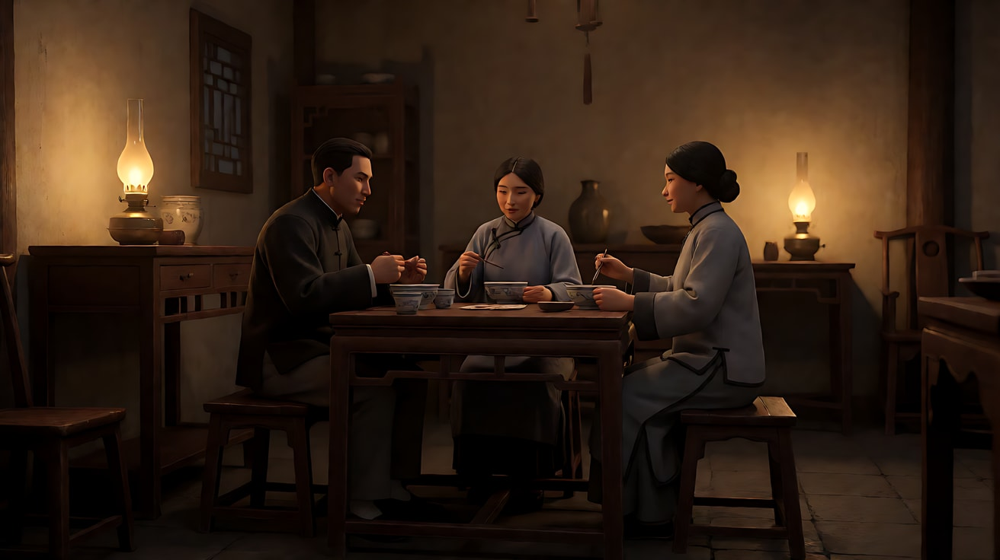
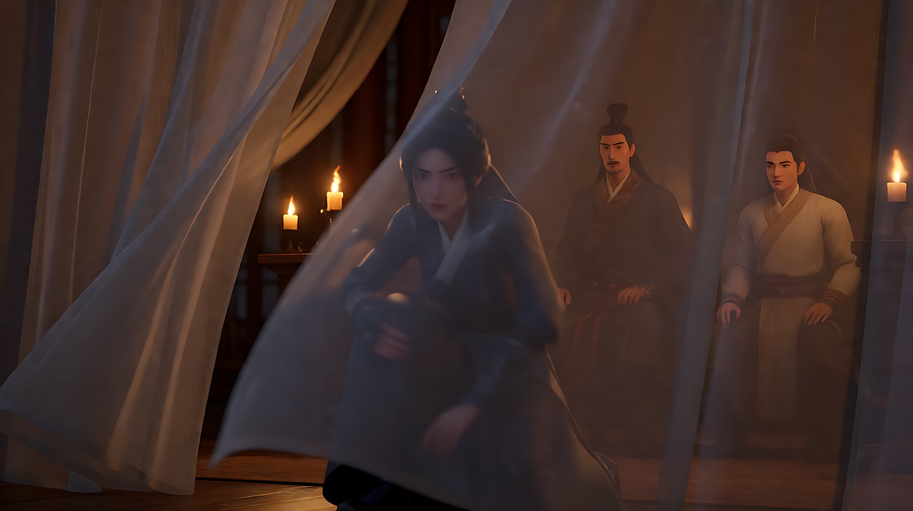

# L07-17 侯孝贤：远观长镜

> 段位：高级 ｜ 建议用时：60 分钟 ｜ 配套提示词：[L07-17-侯孝贤-提示词](../提示词/L07-17-侯孝贤-提示词.md)

## 学习目标

- 理解侯孝贤"远观"的美学：机位退后、不推近、不强调，让生活自己发生
- 能说出"一场一镜"的长镜头与卡隆式长镜头的区别：一个是静观，一个是沉浸
- 能用门框、窗、纱帘做遮挡，用自然光与实用光（油灯、窗光）照明
- 学会"留白"：人物出画后镜头仍停留，关键事件发生在画外
- 能用 Seedance 写出不推近、不强调、只有一个主动作的远观长镜头

## 一、概念讲解

### 1. 导演简介

侯孝贤（1947 年生于广东梅县，1948 年随家人迁居台湾）毕业于台湾艺专影剧科，早年做场记、副导演、编剧。1983 年的《风柜来的人》被视为台湾新电影的代表作之一，此后《童年往事》（1985）、《恋恋风尘》（1986）形成了他成熟的风格。1989 年《悲情城市》获威尼斯金狮奖，这是华语电影第一次获得该奖。2015 年他凭《刺客聂隐娘》获戛纳最佳导演。

他的长期合作者包括编剧朱天文、吴念真，以及摄影师李屏宾（Mark Lee Ping-bing）——两人从《童年往事》开始合作，延续到《戏梦人生》《海上花》《千禧曼波》《刺客聂隐娘》。

侯孝贤的核心是**距离**：他相信观众站远一点，才能看见人和环境、人和时间的关系。他常让非职业演员在镜头前"过日子"，而不是"表演"。

### 2. 代表作

| 片名 | 年份 | 摄影指导 | 风格看点 |
|---|---|---|---|
| 《风柜来的人》 | 1983 | 陈坤厚 | 海边少年、远景与留白 |
| 《童年往事》 | 1985 | 李屏宾 | 日式老屋、门框里的家庭、固定长镜头 |
| 《恋恋风尘》 | 1986 | 李屏宾 | 火车穿过隧道、山城九份、自然光 |
| 《悲情城市》 | 1989 | 陈怀恩 | 家族群像、门内门外、威尼斯金狮 |
| 《戏梦人生》 | 1993 | 李屏宾 | 布袋戏人生、真人口述与重现交织 |
| 《海上花》 | 1998 | 李屏宾 | 油灯光、一场一镜、淡入淡出 |
| 《千禧曼波》 | 2001 | 李屏宾 | 霓虹与慢动作的天桥开场 |
| 《刺客聂隐娘》 | 2015 | 李屏宾 | 接近方形的画幅、纱帘与烛光、山水空镜 |

### 3. 六维风格指纹

| 维度 | 签名特征 | 提示词转译（技术描述） |
|---|---|---|
| 景别 | 全景、中远景为主；几乎没有为强调情绪而切的特写；人物常在画面深处 | "中远景，人物在画面深处，只占画面高度的三分之一" |
| 景深与焦段 | 机位远离、中长焦从外面"看进去"；景深足以读清环境 | "机位在隔壁房间，中长焦，景深足以看清整个房间" |
| 构图 | 门框、窗框、廊柱、纱帘多层遮挡；画面里多重空间；人物常被半遮或在边缘 | "透过两道门框拍摄，前景门框在画面左右两侧，人物在第二道门框里" |
| 光影与色彩 | 自然光、窗光、油灯与烛光；低反差、不修饰；色彩真实偏暖或偏灰绿 | "唯一光源是桌上的一盏油灯，房间边缘沉入暗部"；"阴天窗光" |
| 运镜 | 固定为主，偶尔极缓慢的横摇跟随人物；从不为强调而推近 | "镜头固定，不推近"；"镜头极缓慢地向右横摇，跟随她走到另一个房间" |
| 剪辑与节奏 | 一场一镜；省略，重要事件发生在画外或被跳过；空镜（山、云、海、火车）过渡；淡入淡出 | "她走出画面后，镜头继续停留在空房间里"；"镜头切至山间云雾的空镜" |

### 4. 示意图：远观与多层空间

```
俯视平面图：机位退到隔壁房间

 ┌───────────────┬───────────────┬──────────────┐
 │   隔壁房间     │    主房间      │   后院        │
 │               │   [餐桌]       │              │
 │  [▲ 机位]─────┼──▶ ●  ●  ●     ┼───▶ 窗外树影 │
 │  中长焦        │  门框①        门框②          │
 └───────────────┴───────────────┴──────────────┘
   观众像站在门外的邻居：看得见，但进不去
```

```
留白：人物出画，镜头不走

 [ 她在画面里 ] ──▶ [ 她走向画右 ] ──▶ [ 她出画 ] ──▶ [ 空房间 + 风吹纱帘 ]
                                                  ↑ 镜头仍然停留，这里才是情绪
```

## 二、情绪与叙事功能

| 技法 | 观众的感受 | 常用场景 |
|---|---|---|
| 远观固定长镜头 | 克制、敬重，像旁观自己的家人 | 家庭生活、日常 |
| 门框与纱帘遮挡 | 隔着一层，看得见进不去，时间的距离 | 回忆、历史、私密 |
| 自然光与油灯 | 真实、朴素、时间的温度 | 旧时代、乡村、夜晚 |
| 留白 | 情绪在画外延续，由观众自己填补 | 离别、死亡、转折之后 |
| 省略 | 不看事件本身，只看事件之后的人 | 冲突、悲剧 |
| 空镜 | 人事变迁中，山和云不变 | 段落之间、时间流逝 |

一句话：侯孝贤不告诉你应该感受什么，他只是把你放在合适的距离上。

## 三、经典影片案例（镜头拆解）

### 《恋恋风尘》（1986，侯孝贤）开场
- 场景：一列火车在山间穿行。
- 怎么拍的：镜头从火车车头向前看，画面在隧道里漆黑一片，然后出口的光一点点变大，山间的绿色涌进来，再进入下一个隧道。没有人物，没有说明。
- 为什么这样拍：意图是"让观众感到这是一段要离开、也要回来的路"。黑暗与光的交替，就是少年离开山城去台北、又在思念中往返的节奏。


### 《海上花》（1998，侯孝贤）油灯下的长三书寓
- 场景：19 世纪末上海的高级妓院"长三书寓"，客人与倌人们吃饭、打牌、闲谈、争执。
- 怎么拍的：几乎一场戏一个镜头，场与场之间用淡入淡出连接；室内光线几乎全部以油灯为动机，画面沉在暖黄与暗部之间；镜头以缓慢的横向移动或横摇在人物之间游移，不切特写，不给"主角镜头"。
- 为什么这样拍：意图是"让观众感到这个封闭的世界里，人的情感被礼数与金钱层层包住"。看不清的脸和摇曳的灯，就是那个世界的距离。



### 《刺客聂隐娘》（2015，侯孝贤）纱帘之后
- 场景：女刺客隐娘潜入魏博节度使田季安的府中，躲在层层纱帘之后，看着他与身边的人。
- 怎么拍的：机位在纱帘之外，层层薄纱在风中缓慢飘动，烛光在纱后摇曳，人物时隐时现；全片多采用接近方形的画幅；动作戏极短，常在画面边缘或远处一闪而过。
- 为什么这样拍：意图是"让观众感到她一直在看，却始终没有出手"。纱帘是她与他之间的距离，也是她内心的犹豫。



## 四、在 AI 中怎么实现：复现技法，而不是复制作品

### 1. 技法转译表

| 原片做法 | 不要这样写 | 应该这样写 |
|---|---|---|
| 远观 | "很有距离感" | "机位在隔壁房间，透过门框拍摄，人物只占画面高度的三分之一" |
| 不推近 | 不写也会被模型推近 | 明确写"镜头固定，不推近，不切特写" |
| 门框遮挡 | "层次丰富" | "前景是两侧木门框，画面中间是第二道门框，人物在里面" |
| 自然光 | "自然真实" | "唯一光源是下午的窗光，从画左照入，房间深处偏暗" |
| 留白 | "意境" | "她走出画面后，镜头继续停留，只剩风吹动纱帘" |
| 省略 | "暗示" | 不写冲突本身，只写冲突之后："他已经坐在门槛上，背对屋内" |

### 2. 生图与视频分工

- **生图阶段**：机位远、门框遮挡、光源都在关键帧里画好；人物写小、写在画面深处。
- **视频阶段**：每个镜头写"固定，不推近"；只给一个人一个主动作，其他人吃饭、扇扇子、收碗等日常小动作；结尾常写"人物出画后镜头继续停留"。
- **模型擅长**：日常动作、风吹纱帘、油灯火苗、窗外树影、山间云雾。
- **要避开**：Seedance 默认倾向"给主角推近"，所以一定要写不推近；不写多人对白（改成一两句低声的家常话，或无对白）；不写打斗细节。

### 3. 常见误解

| 误解 | 真相 |
|---|---|
| 长镜头 = 镜头一直动 | 侯孝贤的长镜头多是**固定**的，时间在画面里流过 |
| 远景 = 冷漠 | 远是一种**尊重**，让人物保有隐私 |
| 没有特写所以没有情绪 | 情绪在动作、空间与留白里，观众自己靠近 |
| 留白就是空镜多 | 留白是**人走了镜头不走**，空间里还残留着人 |
| 自然光就是光线差 | 每一个光源都被选择：窗的位置、灯的高度、时间 |

## 五、练习作业

1. 在家里找一个能"透过两道门"看到餐桌的位置，用手机固定拍一分钟家人吃饭，不推近、不剪辑。
2. 把一个冲突场景（例如父子争吵）改写成"只拍争吵之后"的远观长镜头，写出 3 句镜头描述。
3. 完成配套提示词练习1–5，重点体会练习3 的"人物出画后镜头仍停留"。

## 六、自检清单

- [ ] 每个镜头都写了"固定，不推近"或"极缓慢横摇"
- [ ] 机位远，人物在画面深处，有门框或纱帘遮挡
- [ ] 光源是窗光、油灯、烛光等实用光
- [ ] 只有一个主动作，其他人做日常小动作
- [ ] 至少有一个"人物出画后镜头停留"的留白
- [ ] 提示词里没有导演名、摄影师名、片名、角色名

## 七、配套提示词

→ [L07-17-侯孝贤-提示词](../提示词/L07-17-侯孝贤-提示词.md)

---

上一课：[L07-16 张艺谋](L07-16-张艺谋.md) ｜ 下一课：[L07-18 奉俊昊](L07-18-奉俊昊.md) ｜ [返回总目录](../../README.md)
