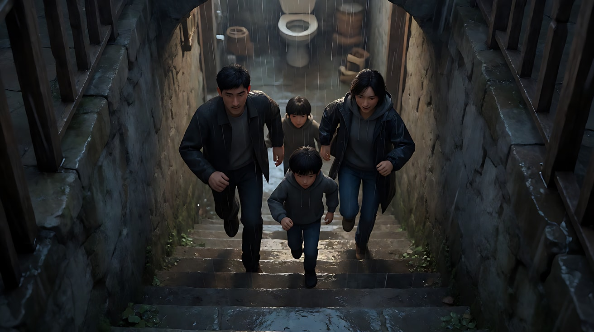
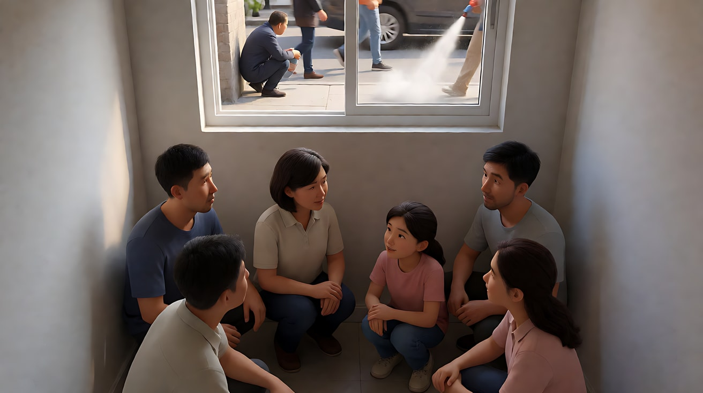
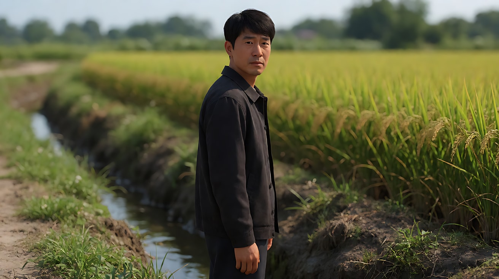

# L07-18 奉俊昊：垂直空间与阶级

> 段位：高级 ｜ 建议用时：60 分钟 ｜ 配套提示词：[L07-18-奉俊昊-提示词](../提示词/L07-18-奉俊昊-提示词.md)

## 学习目标

- 能说出奉俊昊如何把"阶级"拍成"高度"：楼梯、半地下、山坡、窗户的高低
- 能用画面里的分割线（墙角、门框、窗框）把人物分到不同的"世界"
- 理解"类型混合"：同一场戏里喜剧与惊悚的切换靠什么完成
- 能把天气（雨、阳光、雪）写成叙事，而不是背景
- 能用 Seedance 写出一个精确调度、上下对位的原创三镜头场景

## 一、概念讲解

### 1. 导演简介

奉俊昊（1969 年生于韩国大邱）在延世大学读社会学，后进入韩国电影艺术学院（KAFA）学习电影。2000 年以《绑架门口狗》执导长片，2003 年的《杀人回忆》让他成为韩国最重要的导演之一。

他以**亲手绘制极其精细的分镜**著称，几乎每个镜头在开拍前就已经画好，现场很少"多拍几个角度备用"。这种精确让他能在一场戏里精准地控制喜剧和恐怖的切换点。

2019 年的《寄生虫》获得戛纳金棕榈，并在奥斯卡获得最佳影片、最佳导演、最佳原创剧本、最佳国际影片四项大奖，是第一部获得奥斯卡最佳影片的非英语电影。他的长期合作摄影师有金炯求、洪坰杓等。

他的作品反复关注同一件事：**阶级是空间**。富人在上面、在前面、在阳光里；穷人在下面、在后面、在雨里。

### 2. 代表作

| 片名 | 年份 | 摄影指导 | 风格看点 |
|---|---|---|---|
| 《杀人回忆》 | 2003 | 金炯求 | 稻田、雨夜、结尾直视镜头 |
| 《汉江怪物》 | 2006 | 金炯求 | 怪物片里的家庭喜剧与政治讽刺 |
| 《母亲》 | 2009 | 洪坰杓 | 宽银幕中的孤独母亲、芦苇地 |
| 《雪国列车》 | 2013 | 洪坰杓 | 把阶级拍成"横向"：车尾到车头 |
| 《玉子》 | 2017 | 达柳斯·康第 | 山林童话与工业讽刺的混合 |
| 《寄生虫》 | 2019 | 洪坰杓 | 半地下与山顶豪宅、楼梯、暴雨 |
| 《米奇17号》 | 2025 | 达柳斯·康第 | 科幻外壳下的劳动讽刺 |

### 3. 六维风格指纹

| 维度 | 签名特征 | 提示词转译（技术描述） |
|---|---|---|
| 景别 | 偏好能同时看到"上和下"的全景与中全景；精准的插入特写（门把手、窗、物件）作为信息点 | "中全景，画面同时容纳楼梯上方的她和楼梯下方的他" |
| 景深与焦段 | 宽银幕 2.39:1、广角到中焦、深焦，让多个层级同时清晰 | "2.39:1 宽银幕，28mm，深焦，楼上与楼下都清晰" |
| 构图 | 垂直分层：楼梯、半地下窗、山坡；画面中的墙角、门框、窗框把人物切成两个世界；人物的高低位置就是权力 | "画面正中的墙角线把画面竖直切成两半，左边是阳光里的客厅，右边是昏暗的厨房" |
| 光影与色彩 | 富人空间：大窗、自然阳光、暖而干净；穷人空间：荧光灯、低窗、偏绿偏暗；天气直接参与叙事 | "落地窗外阳光照满客厅"；"半地下室只有街面高度的窗透进灰光" |
| 运镜 | 精确的推轨与升降，常做垂直运动（下降、上升）；镜头稳定、克制，不手持乱晃 | "镜头沿楼梯缓慢垂直下降，跟随他从坡顶走到坡底" |
| 剪辑与节奏 | 严格按分镜剪辑；同一场戏内的类型急转（笑声 → 沉默 → 惊悚）；音乐蒙太奇；声音先于画面带来转折 | "笑声中，门铃突然响起，镜头切至……" |

### 4. 示意图：阶级 = 高度

```
                ☀ 阳光
        ┌───────────────────┐
        │   山顶的房子       │  ← 上：宽窗、草坪、阳光
        └─────────┬─────────┘
                  │ 楼梯
                  │ 楼梯                ← 镜头沿楼梯垂直下降
                  │ 楼梯                  = 观众跟着"掉下去"
        ┌─────────┴─────────┐
        │   坡底的街道       │  ← 中：雨水向这里汇集
        └─────────┬─────────┘
        ┌─────────┴─────────┐
        │ 半地下室  [窗]▔▔▔  │  ← 下：窗户只到街面高度
        └───────────────────┘
```

```
画面分割线（墙角/门框把人物切进两个世界）

┌─────────────────┃──────────────────┐
│  阳光 · 客厅     ┃  昏暗 · 厨房       │
│     ● 主人       ┃       ● 佣人       │
│  （站得高）      ┃   （在台阶下）      │
└─────────────────┃──────────────────┘
                  ↑ 墙角线
```

## 二、情绪与叙事功能

| 技法 | 观众的感受 | 常用场景 |
|---|---|---|
| 垂直空间 | 权力与阶级一眼可见，不需要台词 | 豪宅、楼梯、半地下、山城 |
| 画面分割线 | 两个人在同一画面却不在同一世界 | 主仆、贫富、对立 |
| 精确调度 | 一切都在掌控中，观众预感"会出事" | 骗局、潜入、对峙 |
| 类型混合 | 笑着笑着就笑不出来了，被情绪伏击 | 黑色喜剧、社会惊悚 |
| 天气作为叙事 | 同一场雨，对富人是风景，对穷人是灾难 | 转折点、结局 |
| 直视镜头 | 观众被指认为共谋 | 结尾、真相 |

## 三、经典影片案例（镜头拆解）

### 《寄生虫》（2019，奉俊昊）暴雨夜的下坡
- 场景：基泽一家趁富人一家外出而聚在豪宅里，富人突然提前回家，他们好不容易逃出来，在暴雨中徒步回到自己的半地下室。
- 怎么拍的：一组连续的镜头里，他们沿着一段又一段的楼梯、坡道、隧道一路往下走，雨水和他们一起向下流；镜头多次用俯视或垂直方向的构图强调"往下"。回到家时，半地下室已经被淹，污水从马桶里涌出。
- 为什么这样拍：意图是"让观众感到同一场雨把两个家庭分到了天堂和地狱"。富人家的孩子此刻正在草坪上的帐篷里看雨。垂直的下坡就是阶级的高度差。



### 《寄生虫》（2019，奉俊昊）半地下室的窗
- 场景：基泽一家住在半地下室，窗户只比街面高一点。
- 怎么拍的：从室内拍向窗外，窗户在画面上方，街上只能看到行人的腿、路过的车轮、有人在窗外的墙根下小便、消毒车喷出的白烟灌进窗来；全家人在窗下的空间里蹲着、坐着。
- 为什么这样拍：意图是"让观众感到这家人生活在城市的'下面'"。窗户的高度就是他们的社会位置。



### 《杀人回忆》（2003，奉俊昊）结尾
- 场景：多年后，已经离开警队的朴斗满路过当年发现第一位受害者的稻田边的排水沟，一个女孩告诉他，前几天也有一个男人在这里往里看，长相"很普通"。
- 怎么拍的：朴斗满慢慢转过头，直视镜头，镜头停在他的脸上，片子结束。
- 为什么这样拍：意图是"让观众感到那个人可能就坐在电影院里"。直视镜头打破了第四面墙，把观众也拉进了这桩悬案。



## 四、在 AI 中怎么实现：复现技法，而不是复制作品

### 1. 技法转译表

| 原片做法 | 不要这样写 | 应该这样写 |
|---|---|---|
| 垂直空间 | 写导演名或"阶级感" | "楼梯从画面上方的阳光处延伸到画面下方的阴影里，他站在最下面一级仰头看" |
| 半地下窗 | "很穷的房子" | "窗户在画面上方，窗外只能看到街上行人的小腿和鞋" |
| 分割线 | "两人有隔阂" | "画面正中一道竖直墙角线把画面分成两半，她在左边阳光里，他在右边阴影里" |
| 类型混合 | "反转" | 用声音写出转折："笑声中门铃响起，所有人同时停住" |
| 天气叙事 | "下雨了" | "雨水沿着楼梯一级一级往下流，流向他站的地方" |
| 精确调度 | "调度很厉害" | 写清每个人的高低位置、每个镜头的起点与终点 |

### 2. 生图与视频分工

- **生图阶段**：用 2.39:1 宽银幕、深焦，把"上"和"下"放进同一个画面；分割线在关键帧里画准。
- **视频阶段**：运动以"垂直方向"为主（下降、上升、仰起、俯下）；每个镜头一个；类型转折靠一个**声音**或一个**静止**来触发。
- **模型擅长**：楼梯、雨水流动、阳光与阴影的对比、门铃与对讲屏幕、人物同时停住。
- **要避开**：直接写暴力与伤害（改为"倒地""深红色痕迹"并尽量放在画外）；多人对白交叉；把"阶级"写成形容词。

### 3. 常见误解

| 误解 | 真相 |
|---|---|
| 阶级题材 = 拍穷人的苦 | 他拍的是**空间关系**：同一画面里的上与下 |
| 类型混合 = 随意转换风格 | 转折点被精确设计，常由声音或物件触发 |
| 富人的家就要拍得奢华 | 豪宅的特点是**光与空**：大窗、阳光、干净、没有杂物 |
| 天气只是氛围 | 雨水流向哪里、阳光照到谁，都在讲谁在上谁在下 |
| 精确就是镜头不动 | 精确是**每个运动都提前设计好起点和终点**，常有垂直方向的移动 |

## 五、练习作业

1. 画一张你所在城市的"垂直剖面图"：最高处住着谁，最低处是什么。
2. 找三个你身边有"高低差"的空间（楼梯、天桥、地下通道），各拍一张照片，把两个人放在不同的高度上。
3. 完成配套提示词练习1–5，练习4 重点体会"用一个声音完成类型转折"。

## 六、自检清单

- [ ] 画面里有"上"和"下"，人物的高低位置有意义
- [ ] 至少一个镜头有分割线（墙角、门框、窗框）
- [ ] 运镜以垂直方向为主，每个镜头一个
- [ ] 天气（雨、阳光）参与叙事，写了它流向/照向谁
- [ ] 类型转折由一个声音或一个静止触发
- [ ] 提示词里没有导演名、片名、角色名，没有暴力触发词

## 七、配套提示词

→ [L07-18-奉俊昊-提示词](../提示词/L07-18-奉俊昊-提示词.md)

---

上一课：[L07-17 侯孝贤](L07-17-侯孝贤.md) ｜ 下一课：[L07-19 朴赞郁](L07-19-朴赞郁.md) ｜ [返回总目录](../../README.md)
