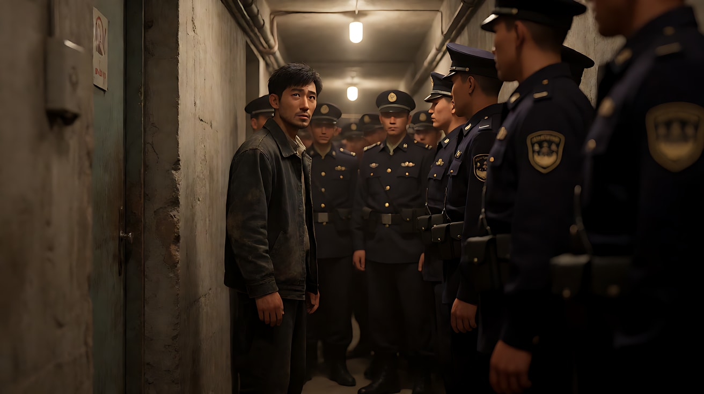
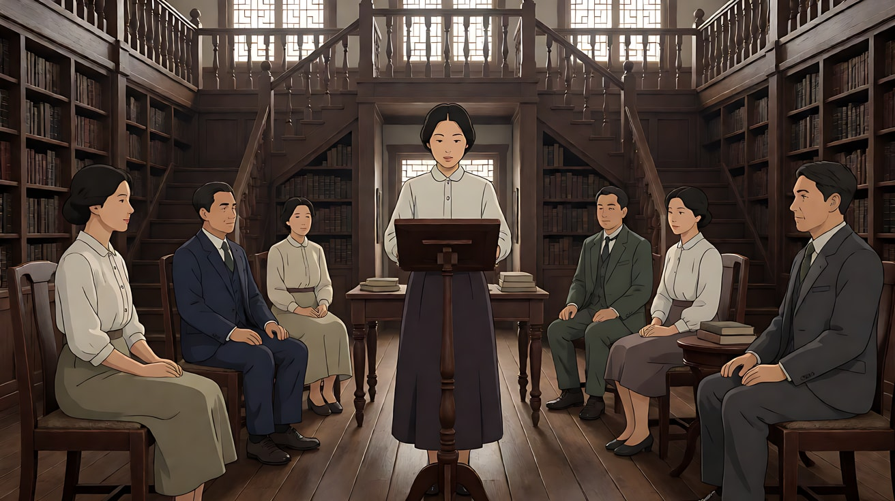
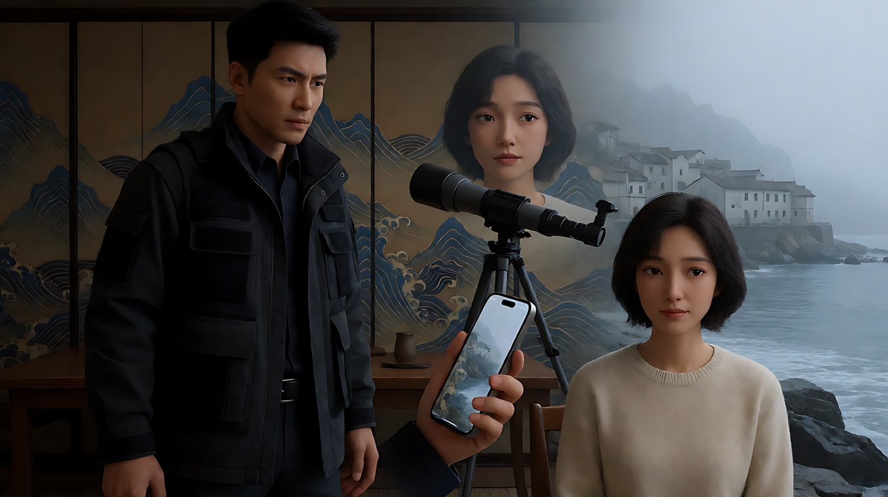

# L07-19 朴赞郁：几何、对称与暴烈之美

> 段位：高级 ｜ 建议用时：60 分钟 ｜ 配套提示词：[L07-19-朴赞郁-提示词](../提示词/L07-19-朴赞郁-提示词.md)

## 学习目标

- 能说出朴赞郁影像的五个关键词：几何对称、精致构图、横移长镜头、色彩象征、风格化的张力
- 理解"暴烈之美"的方法：张力来自形式（构图、节奏、色彩），而不是血腥细节
- 能设计"图形匹配转场"：用形状与运动把两个空间连在一起
- 学会在 AI 中把危险情节写成**形式上的紧张**，避开所有触发词
- 能用 Seedance 写出一个对称、横移、色彩揭示的原创三镜头场景

## 一、概念讲解

### 1. 导演简介

朴赞郁（1963 年生于韩国首尔）在西江大学读哲学，学生时代就组织电影社团，早年做过影评人和副导演。2000 年的《共同警备区》在韩国创下票房纪录，随后的"复仇三部曲"——《我要复仇》（2002）、《老男孩》（2003，戛纳评审团大奖）、《亲切的金子》（2005）——让他享誉世界。

此后他拍了《蝙蝠》（2009，戛纳评审团奖）、英语片《斯托克》（2013）、《小姐》（2016），以及凭《分手的决心》（2022）获得戛纳最佳导演。摄影师郑正勋（Chung Chung-hoon）掌镜了他从《老男孩》到《小姐》的大部分作品；《分手的决心》的摄影是金志勇。

他的电影常处理复仇、欲望、罪与罚，但画面极度讲究：每一帧都像一幅经过设计的版画。**题材越暴烈，形式越精致**——这种反差就是他的签名。

### 2. 代表作

| 片名 | 年份 | 摄影指导 | 风格看点 |
|---|---|---|---|
| 《共同警备区》 | 2000 | 金成福 | 南北边界线的对称构图 |
| 《老男孩》 | 2003 | 郑正勋 | 走廊横移长镜头、绿色调、紫色与红色象征 |
| 《亲切的金子》 | 2005 | 郑正勋 | 红色眼影、有一个版本让色彩逐渐褪去 |
| 《蝙蝠》 | 2009 | 郑正勋 | 白色的病房与韩屋、冷暖对撞 |
| 《斯托克》 | 2013 | 郑正勋 | 图形匹配转场（梳发与草浪） |
| 《小姐》 | 2016 | 郑正勋 | 和洋合璧的宅邸、对称书房、精致服装色彩 |
| 《分手的决心》 | 2022 | 金志勇 | 山与海的意象、手机屏幕视角、流动的转场 |

### 3. 六维风格指纹

| 维度 | 签名特征 | 提示词转译（技术描述） |
|---|---|---|
| 景别 | 精确的全景对称与大特写（眼睛、手、物件）交替；插入镜头极讲究 | "对称全景"之后"切至她手指的大特写" |
| 景深与焦段 | 对称全景常用广角深焦；也会用缓慢推变焦（zoom）制造凝视感 | "28mm 深焦对称全景"；"镜头缓慢变焦推近，透视不变" |
| 构图 | 严格几何对称、框中框、强烈的线条（书架、走廊、墙纸纹样）；人物居中或镜像对置 | "人物居中，两侧书架完全镜像，地面花砖的线条汇聚到她身后" |
| 光影与色彩 | 色彩有象征：红（欲望、复仇）、绿/青（压抑、病态）、紫；墙纸与服装的图案参与叙事；光型精致、风格化 | "整面墙是深绿色几何纹墙纸，她穿深红色，是画面里唯一的红" |
| 运镜 | 横移长镜头（侧面平行推轨）；优雅的推轨与升降；甩镜；运动匹配转场 | "镜头在走廊侧面平行横移，像在看一幅横向展开的画卷" |
| 剪辑与节奏 | 图形匹配转场；时间与空间的跳接；张力来自"停顿"与"揭示"；古典音乐 | "茶杯里旋转的茶水，形状匹配转为俯视的海面漩涡" |

### 4. 示意图：横移长镜头与图形匹配

```
横移长镜头（走廊侧面平行推轨，像横版卷轴）

  ┌────┬────┬────┬────┬────┬────┬────┐
  │门1 │门2 │门3 │门4 │门5 │门6 │门7 │  ← 每扇门后一种颜色/一个故事
  └────┴────┴────┴────┴────┴────┴────┘
       ● ───────────────────────▶          ← 人物向画右行走
  ════[摄影机]═══════════════════════▶     ← 镜头与走廊平行同速横移
  特点：没有纵深运动，观众只能"横着看完"
```

```
图形匹配转场

 [茶杯俯视：茶水旋转的圆] ──形状相同──▶ [海面俯视：漩涡的圆]
 [她梳头的手势]          ──运动相同──▶ [风吹草浪的方向]
```

## 二、情绪与叙事功能

| 技法 | 观众的感受 | 常用场景 |
|---|---|---|
| 几何对称 | 秩序之下的压抑；"太完美"带来的不安 | 豪宅、仪式、对峙 |
| 横移长镜头 | 冷静旁观，像看一幅展开的画卷；无法回避 | 走廊、连续事件 |
| 色彩象征 | 欲望与罪被颜色提前暗示 | 揭示、转折 |
| 图形匹配转场 | 两个空间/时间在潜意识里被连起来 | 回忆、心理联想 |
| 形式化的暴烈 | 强烈但不廉价，观众被形式震住 | 复仇、高潮 |
| 精致的插入特写 | 物件承载秘密 | 钥匙、信、手 |

## 三、经典影片案例（镜头拆解）

### 《老男孩》（2003，朴赞郁）走廊长镜头
- 场景：被囚禁十五年的吴大秀找到当年关押他的私人监禁所，在一条狭窄的走廊里，独自面对一大群看守。
- 怎么拍的：一个横向推轨长镜头，摄影机在走廊侧面与走廊平行移动，像横版卷轴游戏一样；人物在画面里左右推挤，镜头跟着缓慢地横移、后退、再前进，没有剪辑。据报道这个镜头拍了三天、十几条。
- 为什么这样拍：意图是"让观众感到他一个人与整个世界缠斗到筋疲力尽"。没有剪辑就没有"英雄式"的快剪，只有真实的疲惫；横向视角又让场面带着一种冷静的、几乎是滑稽的形式感。



### 《小姐》（2016，朴赞郁）书房朗读会
- 场景：20 世纪 30 年代，日本殖民时期的朝鲜，一座融合日式与英式建筑的宅邸中，姨父上月收藏了大量书籍，并让秀子小姐在书房里为宾客朗读。
- 怎么拍的：书房被设计为高度对称的空间，书架、楼梯与地面的线条汇聚到中心的朗读台；秀子位于画面中轴，宾客分坐两侧；镜头以优雅的推轨与对称构图交替，服装与陈设的色彩精确控制。
- 为什么这样拍：意图是"让观众感到这座房子本身就是一座精致的牢笼"。越对称、越华丽，人越被困住。



### 《分手的决心》（2022，朴赞郁）山与海
- 场景：刑警海俊调查一桩登山坠落案，与死者的中国妻子瑞莱之间产生暧昧。
- 怎么拍的：大量流动的转场——手机屏幕、望远镜、眼睛的特写把两个空间连接起来；瑞莱家中的墙纸图案像山又像海浪；影片后半段从山转向雾中的海边小镇。
- 为什么这样拍：意图是"让观众感到两人的关系像山与海一样，看似对立却互相映照"。图形与转场替代台词讲述了两人的心理距离。



## 四、在 AI 中怎么实现：复现技法，而不是复制作品

### 1. 技法转译表

| 原片做法 | 不要这样写 | 应该这样写 |
|---|---|---|
| 几何对称 | 写导演名或"韩式复仇美学" | "人物居中，两侧书架完全镜像，地面花砖线条汇聚到中心" |
| 横移长镜头 | 写原片的走廊缠斗 | "镜头在走廊侧面平行横移，他从画左走到画右，经过一扇扇门" |
| 色彩象征 | "颜色很有寓意" | "整个房间是深绿色，只有她手里的信封是深红色" |
| 图形匹配 | "酷炫转场" | "茶杯里旋转的茶水，以相同的圆形与旋转方向变为俯视的海面漩涡" |
| 风格化张力 | 任何伤害、器械、血迹相关词 | 用**停顿、对视、手的特写、门的开合、颜色突变**表达张力 |

### 2. 敏感题材的处理

朴赞郁的原片常有暴力内容，但他真正的方法是**形式**。在 AI 中：
- 把"对抗"写成"对峙"：两人对坐、对视、一件物件被推过桌面。
- 把"伤害"写成"颜色"：一个房间整面变成深红色、一块深红色的布落下。
- 把"打斗"写成"推挤与移动"：人群在走廊里推挤，他向前挤过去。
- 不写：枪、刀、血、杀、尸体、伤口、锤子等器械与伤害词。

### 3. 生图与视频分工

- **生图阶段**：对称、图案（墙纸、地砖）、色彩比例全部在关键帧里定死；道具（钥匙、信、茶杯）画精致。
- **视频阶段**：横移写"侧面平行横移、同速"；图形匹配写"形状相同、运动方向相同"；张力写停顿。
- **模型擅长**：精致室内、对称构图、布料与墙纸纹样、缓慢推轨、液体旋转。
- **要避开**：复杂的多人肢体对抗；直接的伤害画面；一个镜头里叠加两种转场。

### 4. 常见误解

| 误解 | 真相 |
|---|---|
| 朴赞郁 = 血腥暴力 | 他的力量在**形式**：对称、色彩、节奏；最狠的段落常常是静止的 |
| 对称就是把人放中间 | 是整个空间的镜像：墙纸、家具、灯、人物的对置 |
| 横移长镜头是为了炫技 | 横移拒绝了纵深与快剪，让观众无法躲进"英雄视角" |
| 色彩象征 = 红色 | 他的色彩系统很复杂：绿、紫、青、白都有特定意义 |
| 华丽就是堆满道具 | 每一件道具都有位置和功能，精致而不杂乱 |

## 五、练习作业

1. 重看《小姐》书房段落，画出书房的俯视平面图，标出中轴线和人物的对称位置。
2. 设计三组图形匹配转场（形状相同或运动方向相同），每组写两句画面描述。
3. 完成配套提示词练习1–5，重点体会练习4 的"不写伤害，只写张力"。

## 六、自检清单

- [ ] 对称构图写了镜像的元素（书架、灯、墙纸）
- [ ] 色彩写了主色和唯一的异色，并对应意义
- [ ] 横移写清"侧面、平行、同速"
- [ ] 图形匹配写清相同的形状或运动方向
- [ ] 张力用停顿、对视、物件、颜色表达，没有伤害词
- [ ] 提示词里没有导演名、片名、角色名

## 七、配套提示词

→ [L07-19-朴赞郁-提示词](../提示词/L07-19-朴赞郁-提示词.md)

---

上一课：[L07-18 奉俊昊](L07-18-奉俊昊.md) ｜ 下一课：[L07-20 罗杰·迪金斯](L07-20-罗杰迪金斯.md) ｜ [返回总目录](../../README.md)
