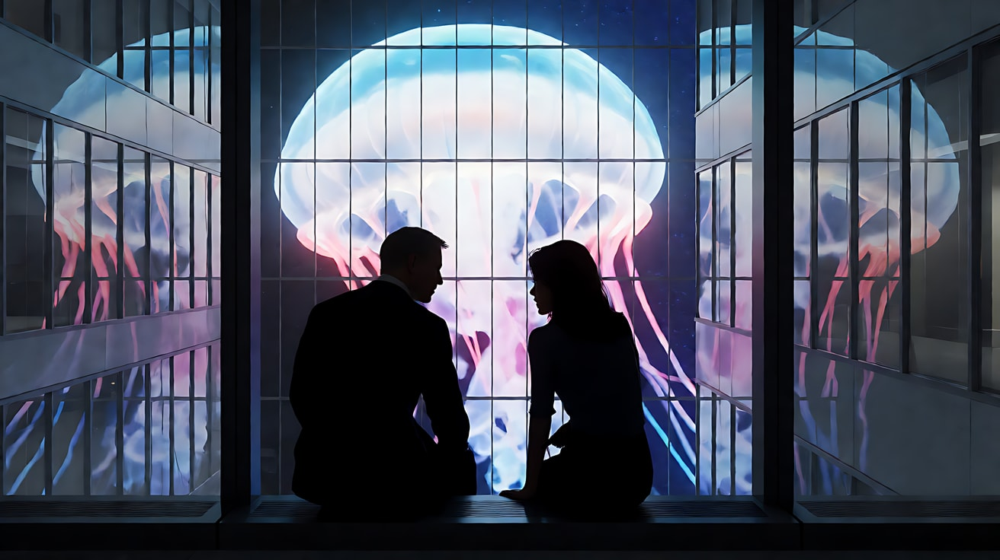
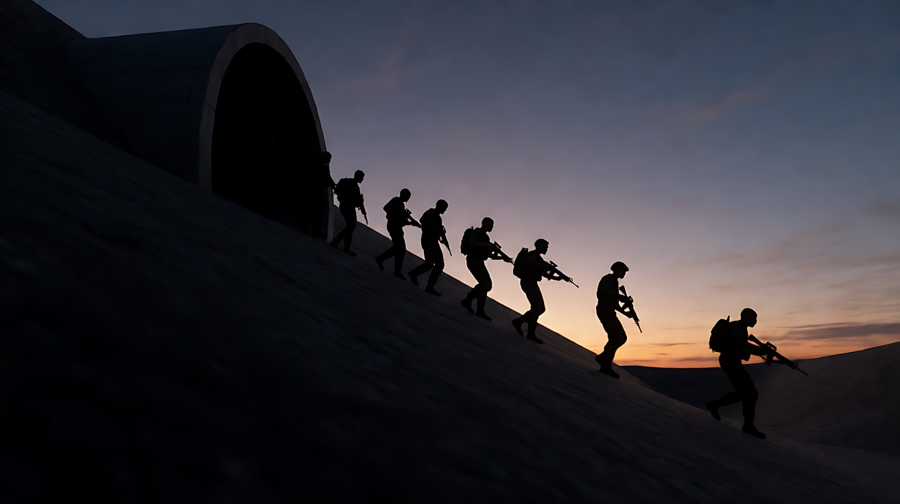
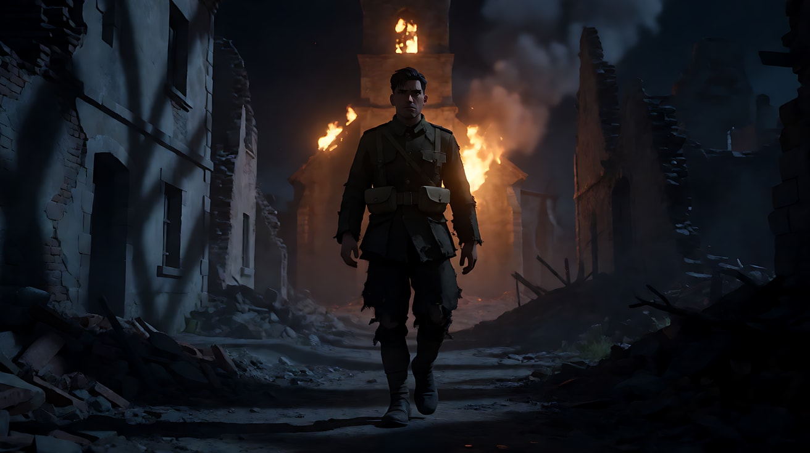

# L07-20 罗杰·迪金斯：剪影与单一光源

> 段位：高级 ｜ 建议用时：60 分钟 ｜ 配套提示词：[L07-20-罗杰迪金斯-提示词](../提示词/L07-20-罗杰迪金斯-提示词.md)

## 学习目标

- 理解摄影师的"风格"与导演风格的区别：迪金斯的签名是**克制**，他让画面服务于每一位导演
- 能说出迪金斯用光的核心：一个主光源、有动机、大而柔或小而硬，让暗部自然掉下去
- 能用剪影、雾与轮廓光、实用光（台灯、路灯、车灯、灯塔）讲故事
- 学会"色彩克制"：一个画面最多一冷一暖两种主色
- 能用 Seedance 写出只有一个光源、有剪影和雾的原创三镜头场景

## 一、概念讲解

### 1. 摄影师简介

罗杰·迪金斯（Roger Deakins，1949 年生于英国德文郡托基）先在巴斯艺术学院学摄影，后进入英国国家电影电视学院，早年拍摄纪录片。进入剧情片领域后，他与科恩兄弟长期合作，拍摄了《巴顿·芬克》《冰血暴》《谋杀绿脚趾》《逃狱三王》《缺席的人》《老无所依》《大地惊雷》等。他还为弗兰克·德拉邦特拍了《肖申克的救赎》，为萨姆·门德斯拍了《007：大破天幕杀机》《1917》，为丹尼斯·维伦纽瓦拍了《囚徒》《边境杀手》《银翼杀手2049》。

他获得过十多次奥斯卡最佳摄影提名，最终凭《银翼杀手2049》（2017）与《1917》（2019）两次获奖，2021 年被英国授予爵士头衔。《逃狱三王》（2000）常被认为是第一部全片使用数字中间片（DI）调色的好莱坞长片。

迪金斯常亲自掌机。他反复强调：摄影不应该"让人注意到摄影"。他的画面通常**简洁**——一个清楚的光源、一个清楚的构图、一个清楚的情绪。

### 2. 代表作

| 片名 | 年份 | 导演 | 风格看点 |
|---|---|---|---|
| 《巴顿·芬克》 | 1991 | 科恩兄弟 | 闷热的旅馆、壁纸与暗部 |
| 《肖申克的救赎》 | 1994 | 弗兰克·德拉邦特 | 雨中张开双臂的高角度镜头、监狱的冷色与窗光 |
| 《冰血暴》 | 1996 | 科恩兄弟 | 白茫茫雪原上的极简构图 |
| 《逃狱三王》 | 2000 | 科恩兄弟 | 数字调色的金黄干旱色调 |
| 《老无所依》 | 2007 | 科恩兄弟 | 汽车旅馆门缝下的光、荒原上的剪影 |
| 《杰西·詹姆斯遇刺》 | 2007 | 安德鲁·多米尼克 | 边缘模糊的镜头、提灯与火车灯 |
| 《007：大破天幕杀机》 | 2012 | 萨姆·门德斯 | 上海玻璃大楼的剪影打斗 |
| 《边境杀手》 | 2015 | 丹尼斯·维伦纽瓦 | 黄昏剪影队伍、夜视画面 |
| 《银翼杀手2049》 | 2017 | 丹尼斯·维伦纽瓦 | 橙色雾霾、移动的水影光 |
| 《1917》 | 2019 | 萨姆·门德斯 | 看起来像一个连续镜头；照明弹下的废墟 |

### 3. 六维风格指纹

| 维度 | 签名特征 | 提示词转译（技术描述） |
|---|---|---|
| 景别 | 古典、干净；大全景中的小人物与大地平线；不做花哨覆盖 | "大全景，人物只占画面高度的十分之一，地平线在画面下三分之一" |
| 景深与焦段 | 中等偏广的焦段为主，不追求极浅景深；空间清晰可读 | "32mm，中等景深，背景空间清晰可读" |
| 构图 | 简洁、负空间、强烈的剪影与图形；一个画面一个视觉中心 | "人物在画面右侧成为纯黑剪影，左侧大片是黄昏天空" |
| 光影与色彩 | 单一主光源（常为大面积柔光或一个实用光）；暗部自然衰减；雾与烟显出光的形状；色彩克制，一冷一暖 | "唯一光源是窗外的路灯，暖橙色，室内其余部分自然沉入暗部；薄雾中能看见光的形状" |
| 运镜 | 克制、有动机，常常是静止或极平稳的移动；需要时可以是精确设计的长镜头 | "镜头固定"；"镜头极平稳地缓慢后退" |
| 剪辑与节奏 | 作为摄影师，他用画面支持导演的节奏：剪影段落、光的变化本身成为节拍 | "照明光每扫过一次，画面就揭示一部分空间" |

### 4. 示意图：单一光源与剪影

```
单一光源的布局（俯视）

        [窗 / 路灯 / 灯塔] ← 唯一主光源
              ╲
               ╲ 光
                ●  人物：亮面朝光，暗面自然掉入黑暗
               ╱   （不补光，或只用环境的微弱反光）
     [▲ 机位]
   规则：如果你说不出光是从哪来的，就不要加这盏灯
```

```
剪影（逆光 + 雾）

┌──────────────────────────────────────┐
│░░░░░░ 黄昏天空（亮）░░░░░░░░░░░░░░░░░░│
│░░░░░░░░░░░░░░░░░░░░░░░░░░░░░░░░░░░░░░│
│▓▓▓▓▓▓▓▓▓▓ 薄雾层（中灰）▓▓▓▓▓▓▓▓▓▓▓▓▓▓│
│        ▐█▌   ▐█▌   ▐█▌               │ ← 人物：纯黑剪影
│████████████████████████████ 地面（黑）│
└──────────────────────────────────────┘
  亮天 + 中灰雾 + 黑地 = 三层明度，人物从层次里读出来
```

## 二、情绪与叙事功能

| 技法 | 观众的感受 | 常用场景 |
|---|---|---|
| 单一光源 | 真实、专注，观众知道该看哪里 | 室内对话、孤独时刻 |
| 剪影 | 人物变成符号，命运感、匿名感 | 黄昏、出发、对峙 |
| 雾与轮廓光 | 空间有深度，光有形状，神秘 | 夜晚、废墟、海边 |
| 实用光 | 世界的光就是叙事的光 | 门缝、车灯、灯塔、路灯 |
| 色彩克制 | 冷静、成熟，情绪不被颜色推着走 | 正剧、犯罪、科幻 |
| 负空间 | 人在环境中的渺小与孤立 | 雪原、荒漠、海面 |

一句话：迪金斯的光永远回答两个问题——"光从哪里来？"和"观众应该看哪里？"

## 三、经典影片案例（镜头拆解）

### 《007：大破天幕杀机》（2012，萨姆·门德斯）上海玻璃大楼
- 场景：邦德在上海一栋摩天大楼的空楼层里追踪一名杀手，两人在玻璃幕墙之间对峙、打斗。
- 怎么拍的：室内几乎不打光，主光源是对面大楼外墙上巨大的动态霓虹广告（水母形状的影像），透过玻璃照进来；两人大部分时间是纯黑剪影，玻璃的多重反射制造了层层叠叠的空间。
- 为什么这样拍：意图是"让观众感到这是一场看不清对手的较量"。剪影让动作变成图形，广告的流动光让空间不稳定。



### 《边境杀手》（2015，丹尼斯·维伦纽瓦）黄昏下的队伍
- 场景：一支特别行动小队在黄昏时分走向边境的地道入口。
- 怎么拍的：机位很低，队员一个接一个从画面中走下坡，逐渐沉入地平线以下；天空是黄昏最后的冷暖渐变，人物完全是剪影；随后画面切换为夜视与热成像的视角。
- 为什么这样拍：意图是"让观众感到他们正在走进一个没有回头路的黑暗"。人物沉入地平线，像被大地吞没。



### 《1917》（2019，萨姆·门德斯）照明弹下的废墟小镇
- 场景：一战时期，士兵斯科菲尔德在夜里穿过被炸毁的法国小镇。
- 怎么拍的：小镇几乎没有其他光源，主光来自天空中缓慢坠落的照明弹；照明弹移动时，废墟的影子在地面和墙上大幅旋转、拉长；燃烧的教堂提供暖色的逆光，人物在火光前成为剪影。
- 为什么这样拍：意图是"让观众感到这是一个噩梦般的、不断变形的世界"。一个移动的光源就足以让整座城市"活"起来。



## 四、在 AI 中怎么实现：复现技法，而不是复制作品

### 1. 技法转译表

| 原片做法 | 不要这样写 | 应该这样写 |
|---|---|---|
| 单一光源 | 写摄影师名或"顶级摄影" | "唯一光源是桌上的一盏台灯，暖色；房间其余部分自然沉入暗部，不补光" |
| 剪影 | "很有质感的剪影" | "人物在黄昏天空前成为纯黑剪影，看不到面部细节" |
| 雾与轮廓 | "神秘的雾" | "薄雾中，路灯的光形成清晰的锥形，人物边缘被逆光勾出一圈亮边" |
| 移动的实用光 | "光影变化" | "灯塔的光束每隔几秒扫过一次，每次扫过都照亮他一瞬" |
| 色彩克制 | "高级调色" | "画面只有两种主色：路灯的暖橙与夜色的深蓝" |

### 2. 生图与视频分工

- **生图阶段**：先写光源（是什么、在哪里、什么颜色、硬还是柔），再写人物；明确"不补光"、"暗部自然衰减"。剪影要写"纯黑，看不到面部细节"。
- **视频阶段**：光源的变化只有一个（一盏灯被打开、一束光扫过、天光变暗）；镜头运动克制，固定或极平稳。
- **练习优先**：逆光剪影、雾中光束、路灯与车灯、窗光、黄昏天空，可使用开关 B（写实摄影质感）。剪影是造型选择，不是素材审核保证，仍需核对授权与入口规则。
- **要避开**：同时写多个主光源；"均匀明亮"的布光；高饱和多色；为了"好看"加不合理的轮廓光。

### 3. 常见误解

| 误解 | 真相 |
|---|---|
| 迪金斯 = 剪影 | 剪影只是结果，核心是**一个有动机的光源** |
| 单一光源 = 很暗 | 单一光源可以很亮（大面积柔光），关键是方向单一、暗部自然 |
| 雾是为了氛围 | 雾是为了让光**有形状**，让空间有层次 |
| 他的风格一眼能认出 | 他刻意为每部电影改变方法，"克制"本身才是签名 |
| 色彩克制 = 低饱和 | 是**颜色数量少**，单一颜色可以很浓（2049 的橙色） |

## 五、练习作业

1. 晚上关掉家里所有灯，只留一盏台灯，用手机拍一张自拍或家人的照片，观察暗部如何自然落下。
2. 选《老无所依》或《边境杀手》的 3 个画面，写出每个画面的唯一主光源是什么、来自哪里。
3. 完成配套提示词练习1–5，练习3 重点体会"一个移动的光源如何揭示空间"。

## 六、自检清单

- [ ] 每个画面只写了一个主光源，并写清来源、方向、颜色
- [ ] 写了"不补光"或"暗部自然衰减"
- [ ] 剪影写了"纯黑，看不到面部细节"
- [ ] 有雾或烟时，写了光在雾中的形状
- [ ] 画面主色不超过一冷一暖
- [ ] 提示词里没有导演名、摄影师名、片名、角色名

## 七、配套提示词

→ [L07-20-罗杰迪金斯-提示词](../提示词/L07-20-罗杰迪金斯-提示词.md)

---

上一课：[L07-19 朴赞郁](L07-19-朴赞郁.md) ｜ 下一课：[L08-01 悬疑惊悚](../../08-类型片实战/教学/L08-01-悬疑惊悚.md) ｜ [返回总目录](../../README.md)
