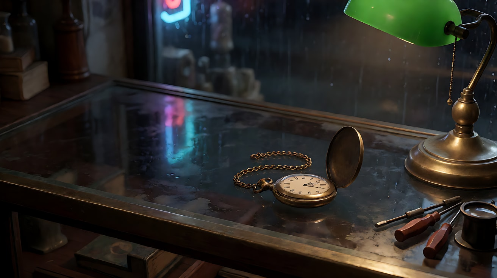
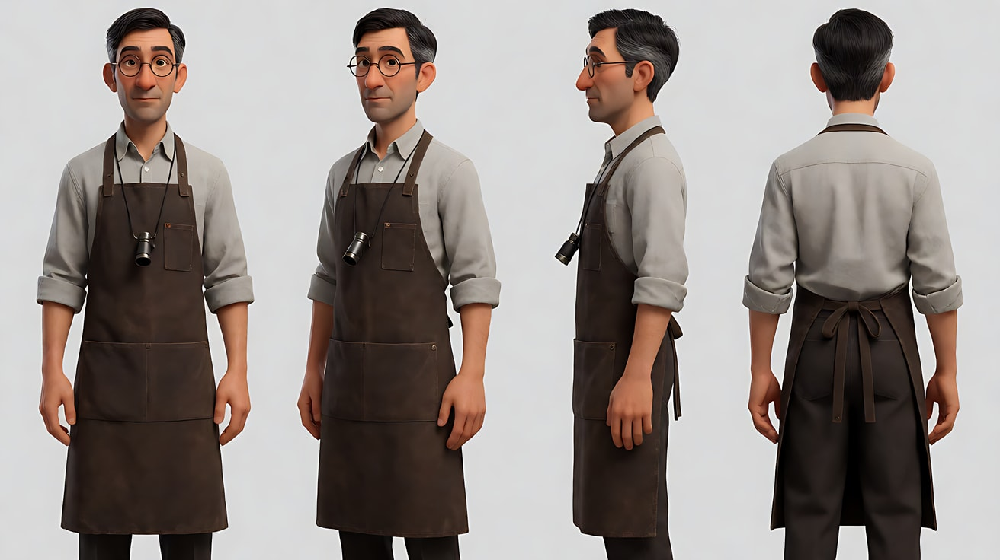
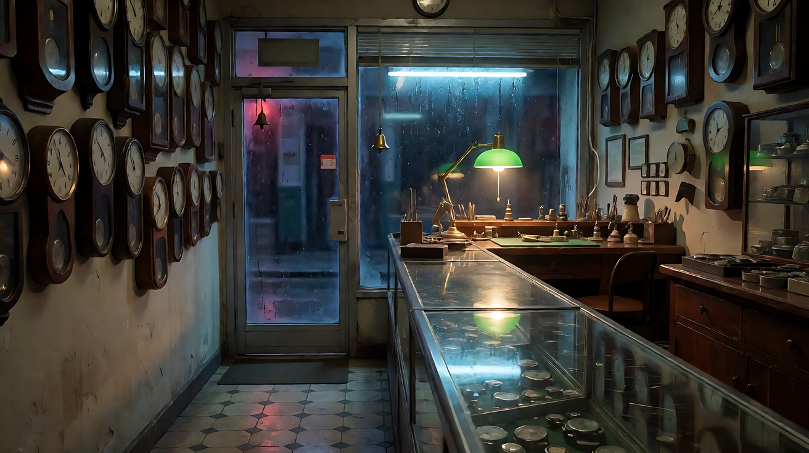
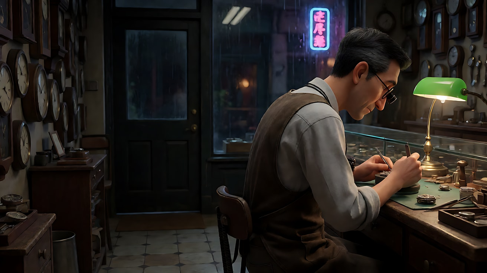
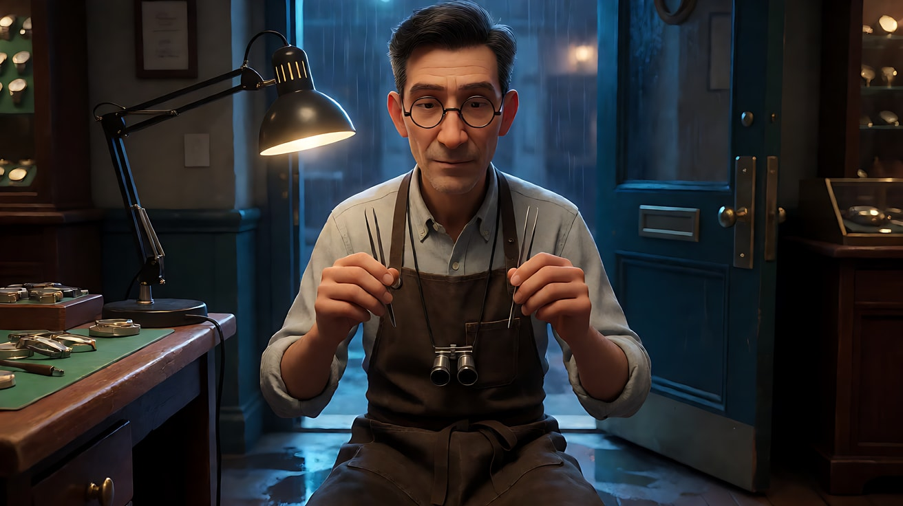
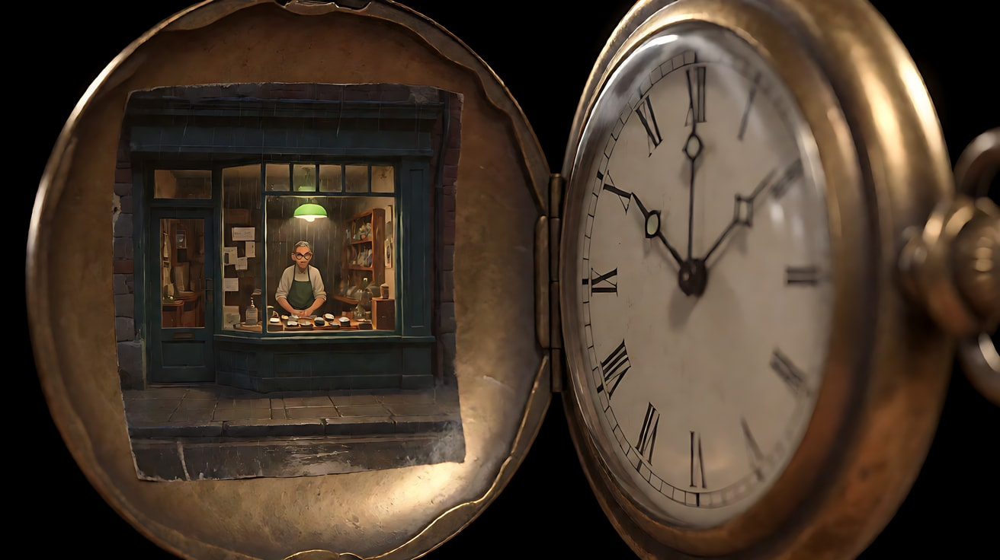
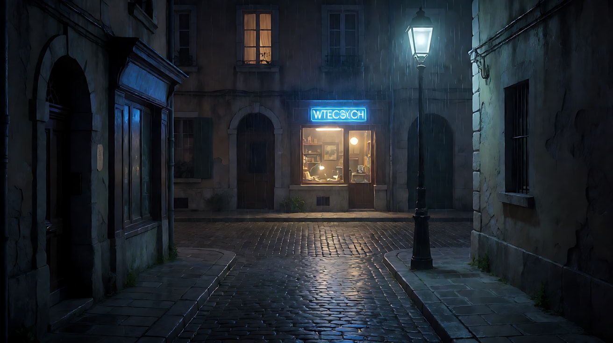
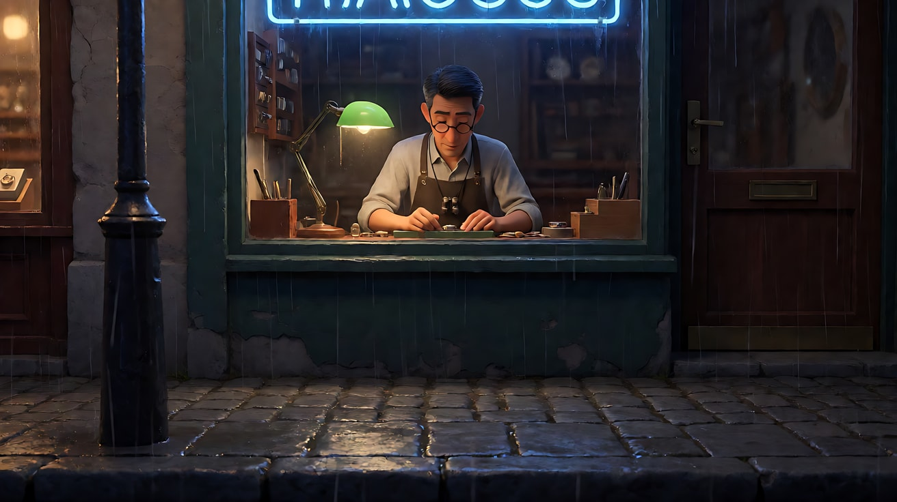

# L08-01 悬疑惊悚 · 提示词

> 本组练习：用一个原创故事"雨夜修表铺"练习信息控制——线索特写、观众先看到异常、延迟揭示、结尾悬置。｜ 配套教学：[L08-01-悬疑惊悚](../教学/L08-01-悬疑惊悚.md) ｜ 规范：[写作规范](../../模板/写作规范.md)
>
> 画风默认使用开关 A（风格化写实 CG）。如改用 2D 动画，删掉所有焦段、光圈、景深词。

**故事设定（全组共用）**：雨夜，老街上一家修表铺准备打烊。修表师林砚独自收拾柜台时，发现柜台上多了一只不属于他的怀表，表还在走。怀表盖里贴着一张小照片——照片拍的正是此刻的修表铺橱窗，以及橱窗里的他。

**一句话意图**：让观众感到"有人一直在外面看着他，而他刚刚才知道"。

---

### 练习1：线索特写——一只不该在这里的怀表（难度 ★）

**目标**：练习"插入特写"：一个物件自己讲出"不对劲"。不出现人物，只用光和声音让观众记住它。

**【生图 · Nano Banana】**

图1 关键帧（物件特写）：

```
Close-up of an old brass pocket watch lying closed on a worn glass shop counter at night,
its chain coiled loosely beside it, a few small screwdrivers and a jeweller's loupe pushed to the edge of the frame.
The watch sits slightly off-centre on the right third, with dark empty counter space on the left.
Camera at counter height, slightly high angle, 85mm lens, shallow depth of field, the shop behind melts into soft darkness.
Lighting: a single green-shaded desk lamp from frame right is the only light source, warm pool of light on the watch,
cool blue neon from the rainy street reflecting faintly on the glass. Rain streaks visible as blurred highlights in the background.
Stylized semi-realistic 3D CG rendering, feature-film animation quality. Aspect ratio 16:9.
```

中文释义：怀表特写，位于右三分之一，左侧是暗的空柜台；柜台高度略俯拍、85mm、浅景深，背景沉入黑暗；唯一主光是画右的绿罩台灯，玻璃上有微弱的街头冷色霓虹反光。



**【图生视频 · Seedance】**

```
【素材分工】@图片1 为首帧，锁定怀表外形、柜台陈设与灯光布局；不新增图中没有的物件或人物。
【画风】风格化写实三维CG质感，电影级布光。
深夜修表铺的柜台上，一只合着盖的黄铜怀表静静躺在台灯的暖光里，表链松松地盘在旁边。镜头从当前特写极慢地向怀表推近，结束在表盖和表冠充满画面中心的大特写。推近过程中，表冠旁的表链轻轻滑落一小段，停住。玻璃台面上的霓虹冷光随窗外雨水微微晃动，台灯暖光始终不变。
【声音】无配乐。怀表清晰的滴答声由弱变强，窗外细密的雨声，远处一声模糊的汽车驶过的水声。
【约束】怀表外形、颜色、表链样式保持不变；画面中不出现人物和手；不要字幕、水印、Logo。
时长：6秒
```

**参数**：时长 6 秒 ｜ 画幅 16:9

**【检查点】**
- 怀表是否从头到尾是画面视觉中心
- 滴答声是否压过雨声，成为"不对劲"的信号
- 光是否只有一个暖色主光加微弱冷色反光

**【常见问题与修复】**
| 现象 | 修复 |
|---|---|
| 表盖自己打开 | 写明"表盖始终合着"；开盖留给后面的练习 |
| 画面里冒出一只手 | 在【约束】里写"画面中不出现人物和手" |
| 推近过快变成冲镜 | 改成"极慢地推近，全程匀速" |

---

### 练习2：观众先看到——橱窗反光里的门（难度 ★★）

**目标**：用深焦和反光玻璃制造悬念：林砚在前景修表，观众在玻璃反光里看到身后的店门被推开了一条缝，他没有察觉。

**【生图 · Nano Banana】**

图1 角色定妆：

```
Character turnaround sheet of an original watchmaker in his mid-forties: lean build, short neat black hair greying at the temples,
round thin wire-rimmed glasses, a dark brown canvas work apron over a light grey collared shirt with sleeves rolled to the forearm,
a jeweller's loupe hanging on a black cord around his neck.
Front view, three-quarter view, side view and back view, full body, standing on a plain light-grey background.
Camera at eye level, 50mm lens, deep focus, even soft studio light from the front, no shadows on the backdrop.
Stylized semi-realistic 3D CG rendering, feature-film animation quality. Aspect ratio 16:9.
```



图2 场景（空修表铺，夜）：

```
Empty narrow old watch repair shop at night, no people. A long glass display counter runs along the right side,
a workbench with a green-shaded desk lamp at the back, dozens of wall clocks on the left wall,
the shop's glass front door with a small brass bell at the far end, rain-soaked street and a blue neon sign outside.
Wide shot from behind the counter, eye level, 28mm lens, deep focus so both the workbench and the door are sharp.
Lighting: the warm desk lamp from the back right is the main light, cool blue neon spill through the front door glass,
wet reflections on the floor tiles. Stylized semi-realistic 3D CG rendering, feature-film animation quality. Aspect ratio 16:9.
```

中文释义：图1 修表师林砚定妆：四十多岁、鬓角花白、圆框细金属眼镜、深棕帆布围裙、颈挂放大镜。图2 空修表铺：右侧长玻璃柜台，后方工作台和绿罩台灯，左墙挂满钟，远端是挂着铜铃的玻璃店门，门外雨夜蓝色霓虹；28mm 深焦，工作台和店门都清晰。



**【多图生视频 · Seedance】**

```
【素材分工】@图片1 锁定人物身份、眼镜、围裙与颈挂放大镜，不参考其灰色背景和站姿；@图片2 仅参考修表铺布局、台灯与店门位置，不复制其中的镜头角度。
【画风】风格化写实三维CG质感，低调光，冷暖对比。
林砚坐在工作台前，背对店门，低头用放大镜看手里一只拆开的表芯，手指捏着细小的镊子，动作很慢很稳。他面前立着一块竖放的玻璃展示板，玻璃里清楚地反射出他身后远处的店门。镜头固定在他侧后方，深焦，前景的他和玻璃反光里的店门同样清晰。反光中，店门被从外面缓缓推开一条缝，门外的蓝色霓虹光沿着地面斜着照进来一道窄窄的光带，门上的铜铃没有响。林砚没有察觉，继续低头工作。结尾停在玻璃反光里那道一直开着的门缝上，林砚仍在前景低头。
【声音】无配乐。墙上几十只钟此起彼伏的滴答声，门缝推开时雨声突然变大一点，随后又压低；镊子碰到金属的细微轻响。
【约束】保持人物脸型、发型、眼镜和围裙不变；林砚全程不回头；画面中不出现推门的人；不要字幕、水印、Logo。
时长：8秒
```

**参数**：时长 8 秒 ｜ 画幅 16:9

**【检查点】**
- 观众能否在反光里看清门缝变宽，而角色没有察觉——这就是"观众 > 角色"
- 前景和反光是否都在焦内（深焦）
- 铜铃没有响，这个"缺席的声音"是否让人更紧张

**【常见问题与修复】**
| 现象 | 修复 |
|---|---|
| 门口出现一个人影 | 加"门缝里只有雨和霓虹光，没有任何人影" |
| 林砚回头看门 | 写"他全程不回头，不抬头"，并把"没有察觉"写两次（正文和约束） |
| 反光太弱看不见门 | 回生图阶段，把玻璃展示板放进首帧，或改用"店内一面挂墙镜子" |
| 背景虚掉 | 写"深焦，前景人物和远处店门同样清晰"，并删除任何"浅景深"字样 |

---

### 练习3：延迟揭示——他终于抬头（难度 ★★★，首尾帧）

**目标**：用首尾帧锁定"不知道"与"知道"两个状态，只让模型生成中间那个慢慢转过身的过程。揭示靠运镜和光，不靠"突然出现"。

**【生图 · Nano Banana】**

沿用练习2的图1（角色定妆）、图2（场景）。

图3 首帧：

```
Using the character from image 1 and the shop from image 2:
medium shot of the watchmaker sitting at the workbench with his back half-turned to the camera, head bowed over a watch movement,
the loupe raised to his eye, tweezers in his right hand. He is placed on the right third of the frame;
the dark shop and the closed front door fill the left two-thirds behind him.
Camera at seated eye level from behind his left shoulder, 35mm lens, deep focus.
Lighting: the green-shaded desk lamp in front of him as the only warm key from frame right, his back in shadow,
faint cool neon spill from the door glass in the background.
Keep the face, hairstyle and outfit exactly as in image 1. Stylized semi-realistic 3D CG rendering, feature-film animation quality. Aspect ratio 16:9.
```



图4 尾帧：

```
Using the character from image 1 and the exact same shop, workbench and lighting as image 3:
medium close-up of the watchmaker now turned fully around on his stool, facing the front door,
the loupe lowered and hanging from its cord, the tweezers held still at chest height.
The front door at the far end is open a hand's width, a narrow band of blue neon light lies across the wet floor toward him,
rain blowing in at the threshold, no one in the doorway.
Camera has moved slightly closer, still at seated eye level, 35mm lens, deep focus so the door gap stays sharp.
Lighting: warm desk lamp now behind him as a rim on his shoulder and glasses, his face lit coolly by the neon band from the door.
Keep the face, hairstyle and outfit exactly as in image 1. Stylized semi-realistic 3D CG rendering, feature-film animation quality. Aspect ratio 16:9.
```

中文释义：首帧——他背对店门埋头修表，店门关着，冷暖光分明。尾帧——他整个转过身面对店门，放大镜垂下，镊子停在胸前；店门开了一掌宽，一条蓝色霓虹光带沿湿地面伸向他，门口没有人；台灯变成他肩头的轮廓光，脸被门口冷光照亮。



**【首尾帧生视频 · Seedance】**

```
【素材分工】@图片3 为首帧，锁定开场构图与灯光；@图片4 为尾帧，是最终画面目标；@图片1 锁定人物身份、眼镜与围裙，不参考其背景；@图片2 仅参考店铺布局，不复制其中镜头角度。只生成两帧之间的连续动作。
【画风】风格化写实三维CG质感，低调光，冷暖对比。
林砚低头修表，镊子在表芯上方停住。墙上的钟声里，身后传来一阵比雨声更大的风声。他慢慢放下放大镜，让它垂在胸前，没有立刻回头，先侧过一点脸，像在听。然后他坐着转动凳子，整个人转向店门。镜头随他转身的同时，缓慢向前推近一点，从中景收到中近景。店门那道开着的缝里，蓝色霓虹光带一点点铺到他脚边，光带爬上他的脸，台灯的暖光退到他肩后。结尾停在他面向门缝、镊子停在胸前的中近景上。
【声音】无配乐。钟表滴答声逐渐变弱直至听不见，雨声从门缝灌进来，最后只剩他一次放慢的呼吸。
【约束】保持人物脸型、发型、眼镜、围裙与放大镜不变；门口始终没有任何人；中间动作连续，不跳切；不要字幕、水印、Logo。
时长：8秒
```

**参数**：时长 8 秒 ｜ 画幅 16:9

**【检查点】**
- 转身是否分成"停手 → 侧耳 → 转身"三步，而不是一下子转过去
- 光是否随着转身从"暖光照脸"变成"冷光照脸"——光的变化就是信息的变化
- 钟声是否真的在结尾"消失"

**【常见问题与修复】**
| 现象 | 修复 |
|---|---|
| 他站起来走向门口 | 写"他始终坐在凳子上，只转动凳子，不起身" |
| 尾帧门缝的宽度不对 | 强调"以 @图片4 为最终画面目标，门只开一掌宽" |
| 转身太快像被吓到 | 把"慢慢""先侧过一点脸""像在听"保留，删掉其他形容词 |
| 光没有变化 | 正文写清"冷光爬上他的脸，暖光退到肩后"，尾帧里也要画出这个光位 |

---

### 练习4：照片里的自己——三镜头揭示（难度 ★★★★，多镜头）

**目标**：用三个镜头完成"拿起 → 打开 → 看见"，让揭示落在一个插入特写上，再用一个反应镜头告诉观众该怎么感受。

**【生图 · Nano Banana】**

沿用练习2的图1（角色定妆）、图2（场景）。

图3 道具（怀表打开状态）：

```
Extreme close-up of an old brass pocket watch held open, the inside of the lid facing the camera.
Glued inside the lid is a tiny faded photograph showing the front window of a small watch shop at night in the rain,
seen from across the street, with a lone man in an apron and glasses visible inside under a green desk lamp.
The watch face on the other half shows its hands moving. No text, no numbers on the photo.
Camera straight-on, macro 100mm lens, shallow depth of field, the photo sharp and the background black.
Lighting: warm desk-lamp light from frame right raking across the brass, a soft specular on the lid edge.
Stylized semi-realistic 3D CG rendering, feature-film animation quality. Aspect ratio 16:9.
```

中文释义：怀表打开的大特写，表盖内侧贴着一张褪色小照片：从街对面拍的雨夜修表铺橱窗，里面是系围裙、戴眼镜的男人在台灯下。100mm 微距、浅景深、背景全黑；台灯从画右斜照黄铜。照片上不写任何字。



**【多图生视频 · Seedance】**

```
【素材分工】@图片1 锁定人物身份、眼镜、围裙与放大镜，不参考其背景；@图片2 仅参考修表铺布局与台灯位置，不复制其中镜头角度；@图片3 仅参考怀表外形与表盖内照片内容，用于镜头2，不把照片中的街景当作当前场景。
【画风】风格化写实三维CG质感，低调光，冷暖对比。
镜头1：柜台正面中景，固定机位。林砚站在柜台后，伸手从玻璃台面上拿起一只陌生的黄铜怀表，举到台灯下，翻过来看了看表背，眉头微微收紧。台灯暖光从画右照在他脸上，窗外雨声不断。
镜头2：镜头切至怀表的大特写，正对表盖内侧。他的拇指把表盖按开，表盖里贴着一张褪色的小照片：雨夜的修表铺橱窗，橱窗里一个系围裙的男人站在台灯下。镜头极慢地向照片推近。打开表盖时一声清脆的咔哒。
镜头3：镜头切至林砚的近景，正面平视。他的视线从手里的照片慢慢抬起，越过镜头看向画外的橱窗方向，拿表的手停在胸前，喉结动了一下。窗外霓虹的蓝光映在他的眼镜片上。钟表滴答声在这一刻停了下来，只剩雨声。
【锁定】光线：绿罩台灯始终在画右，是唯一暖色主光，橱窗霓虹冷光来自画左；人物：林砚始终戴圆框眼镜、穿深棕围裙、颈挂放大镜，站在柜台后；机位始终在柜台外侧，不越到他背后。
【声音】无配乐。雨声贯穿；镜头1 表链轻响；镜头2 表盖咔哒一声；镜头3 所有钟表滴答声同时消失，只剩雨声和一次屏住的呼吸。
【约束】保持人物脸型、发型、服装不变；照片里不出现文字；画面中不出现第二个人；不要字幕、水印、Logo。
时长：12秒
```

**参数**：时长 12 秒 ｜ 画幅 16:9 ｜ 负载：3 个镜头，其中镜头2为插入特写，属于"稳妥"档

**【检查点】**
- 揭示是否落在镜头2的插入特写上，镜头3是否只是"反应"，没有新的信息
- 镜头3 的视线方向（看向画外橱窗）是否让观众自然想到"外面有人"
- 钟声消失是否发生在镜头3，而不是更早

**【常见问题与修复】**
| 现象 | 修复 |
|---|---|
| 三个镜头连成一个长镜头 | 每个镜头开头都写"镜头切至……"，并让三种景别（中景、大特写、近景）差异明显 |
| 照片内容乱了或出现文字 | 在【约束】写"照片里不出现文字"，并用 @图片3 锁定照片内容 |
| 镜头3 他转身走向窗口 | 写"他站在原地，只抬起视线"，结尾停在他的近景上 |
| 照片拍到的是别的店 | 回生图阶段，让照片里的橱窗和图2 场景的店门、霓虹颜色一致 |

---

### 练习5：雨夜修表铺——完整 15 秒悬疑片段（难度 ★★★★★）

**目标**：把前四组练习整合成一个完整片段：以"外面的视角"开场（观众 > 角色）→ 发现线索 → 揭示 → 反应 → 回到外面，揭示观看者已经离开，只留下一把撑开的伞。结尾悬置。

**【生图 · Nano Banana】**

沿用练习2的图1（角色定妆）、图2（场景），练习4的图3（怀表道具）。

图4 外景街道（空景）：

```
Empty narrow old street at night in steady rain, seen from the opposite pavement, no people.
Across the street, a small watch repair shop window glows with warm desk-lamp light, a blue neon sign above it,
wet cobblestones reflecting both colours. In the foreground on this side, a single streetlamp and an empty stretch of pavement.
Wide shot, eye level, 35mm lens, deep focus. Lighting: cool sodium-blue streetlamp from above in the foreground,
warm glow from the shop window in the background, rain streaks catching both lights.
Stylized semi-realistic 3D CG rendering, feature-film animation quality. Aspect ratio 16:9.
```



图5 镜头1 关键帧（从街对面看进店里）：

```
Using the character from image 1 and the street from image 4:
wide shot from across the rainy street looking into the watch shop window, the watchmaker small inside the warm window,
bent over his workbench under the green desk lamp, unaware. The foreground pavement and streetlamp frame the left edge,
rain falling between camera and window. Camera at standing eye level on the opposite pavement, 50mm lens,
moderate depth of field so the window and the man are sharp, foreground rain slightly soft.
Lighting: warm window glow as the focal light, cool streetlamp spill in the foreground, blue neon above the shop.
Keep the face, hairstyle and outfit exactly as in image 1. Stylized semi-realistic 3D CG rendering, feature-film animation quality. Aspect ratio 16:9.
```

中文释义：图4 街对面的空景：雨夜老街，对面修表铺橱窗透出暖光，近景一盏路灯和一段空人行道。图5 镜头1 首帧：从街对面看进橱窗，林砚在暖光里很小，低头工作，毫不知情；画左是近景路灯与人行道，雨丝在镜头和橱窗之间。



**【多图生视频 · Seedance】**

```
【素材分工】@图片5 为首帧，锁定镜头1 的街对面视角与构图；@图片1 锁定林砚的身份、眼镜、围裙与放大镜，不参考其背景；@图片2 仅参考店内布局与台灯，不复制其镜头角度；@图片3 仅参考怀表外形与表盖内照片，用于镜头3；@图片4 仅参考街道外景与路灯位置，用于镜头5，不改变其中店铺与街道的相对方位。
【画风】风格化写实三维CG质感，低调光，冷暖对比。
镜头1：固定机位，从街对面隔着雨幕看向修表铺橱窗。林砚在暖色橱窗里低头修表，在画面中很小。前景的路灯下是一段空的人行道，雨水不断落下。雨声浓密，远处一辆车驶过溅起水声。
镜头2：镜头切至店内柜台正面中景。林砚收拾工具时停住，伸手从玻璃台面上拿起一只不属于他的黄铜怀表，举到台灯下，表在他手里滴答作响。店内钟声此起彼伏。
镜头3：镜头切至怀表的大特写。他的拇指按开表盖，表盖内贴着一张小照片：雨夜里，从街对面拍到的这间橱窗和橱窗里的他。镜头极慢地推向照片。表盖咔哒一声。
镜头4：镜头切至林砚的近景，正面平视。他的视线从照片抬起，看向画外的橱窗，拿表的手停在胸前。窗外霓虹蓝光落在他的眼镜片上，台灯暖光在他右脸。所有钟表滴答声同时停住。
镜头5：硬切回与镜头1 相同的街对面机位，但镜头位置更靠近那盏路灯。路灯下的人行道上立着一把撑开的黑伞，伞柄着地，伞下空无一人，雨水顺着伞沿流下。对面橱窗里，林砚站在柜台后，正望向这边。镜头固定，停在这把空伞和远处望过来的他身上。
【锁定】光线：店内绿罩台灯是唯一暖色主光，始终在林砚画右；街上路灯为冷色顶光，霓虹为蓝色；人物：林砚全片戴圆框眼镜、穿深棕围裙、颈挂放大镜，始终在柜台后，不离开店铺；机位：店内镜头始终在柜台外侧，店外镜头始终在街对面同一侧人行道。
【声音】无配乐。镜头1 雨声浓密；镜头2 钟表滴答声与表链轻响；镜头3 表盖咔哒一声；镜头4 所有钟声骤停，只剩雨声；镜头5 雨打在伞面上的密集噼啪声，远处没有脚步声。
【约束】保持人物脸型、发型、服装不变；全片只出现林砚一个人，伞下和街上没有任何人影；照片里不出现文字；不要字幕、水印、Logo。
时长：15秒
```

**参数**：时长 15 秒 ｜ 画幅 16:9 ｜ 负载：5 个镜头（含 1 个插入特写和 1 个反应镜头，各占半拍），属于"有挑战"档；如果镜头被合并，拆成"镜头1–3"和"镜头4–5"两次生成，用第一次的尾帧作为第二次首帧

**【检查点】**
- 镜头1 是否建立了"有人在外面看"的视角：观众比林砚先知道
- 镜头3 的揭示与镜头1 的构图是否"对得上"——照片就是镜头1 的画面，线索是公平的
- 镜头5 的空伞是否成为一个可见的峰值画面，结尾悬置而不解释
- 声音是否形成"浓 → 细 → 骤停 → 伞上的雨"的曲线

**【常见问题与修复】**
| 现象 | 修复 |
|---|---|
| 镜头5 伞下出现一个人 | 正文写"伞下空无一人"，【约束】再写"伞下和街上没有任何人影" |
| 镜头5 和镜头1 机位差太多，观众认不出是同一个视点 | 写"与镜头1 相同的街对面机位"，必要时为镜头5 单独生成一张关键帧并加入素材 |
| 5 个镜头只生成了 3 个 | 负载过高，按参数里的方法拆成两次生成 |
| 林砚在镜头5 跑出店门 | 【锁定】写明"始终在柜台后，不离开店铺"；镜头5 写"正望向这边"，不写"追出来" |
| 片段被平台拦截 | 检查是否出现了"跟踪""偷拍"之类的词；本稿只写"照片""伞"和"望向这边"，保持中性 |
