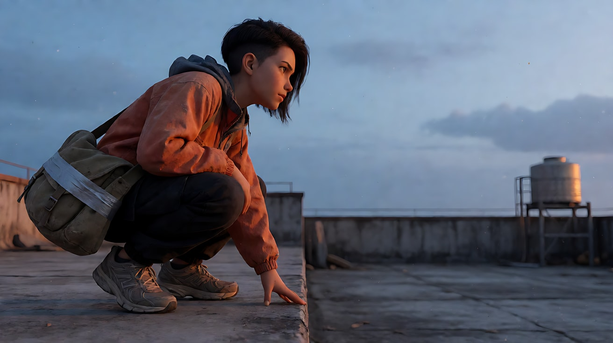
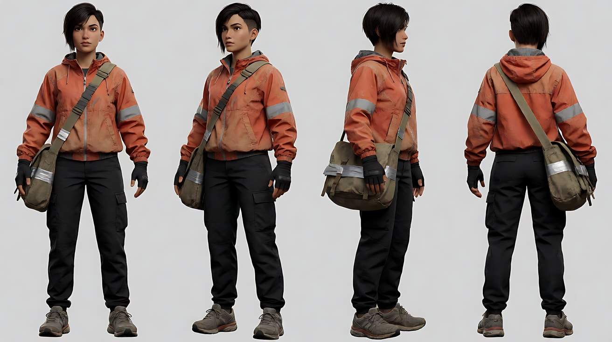
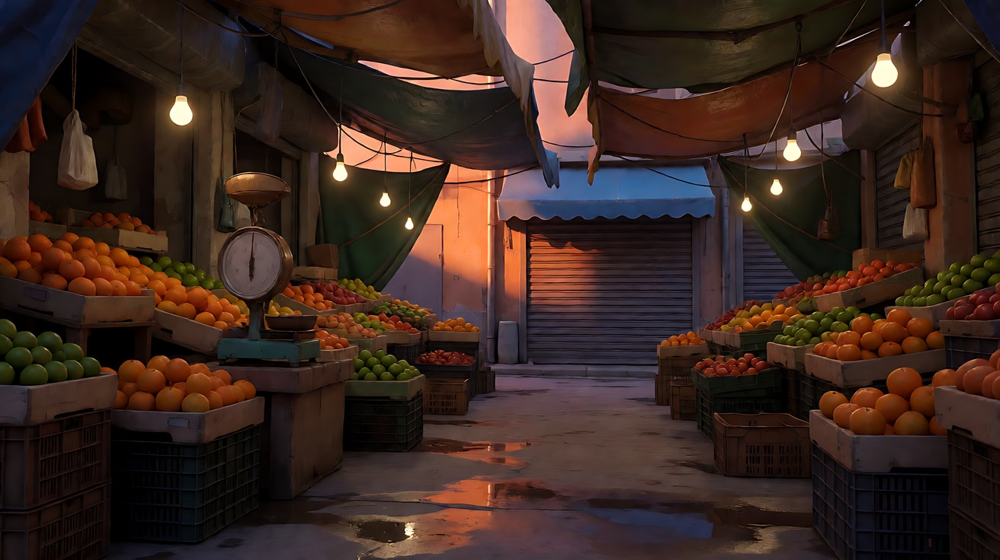
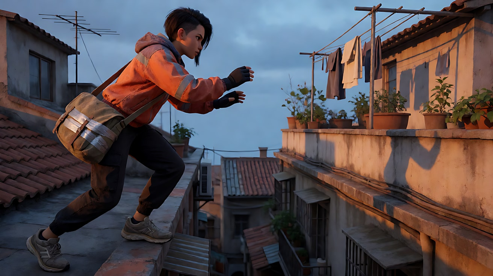
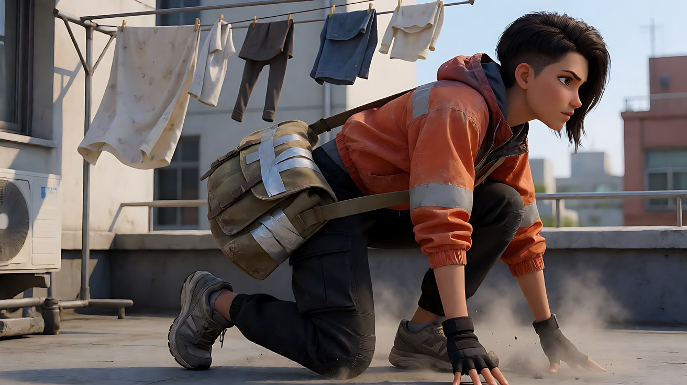
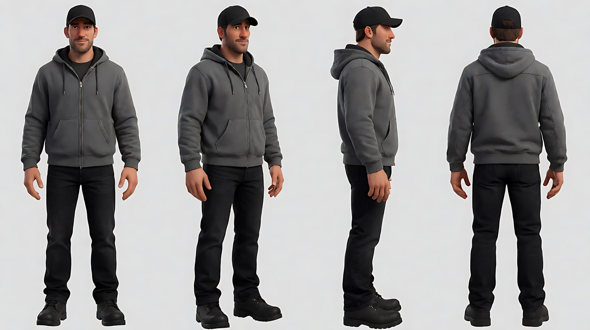
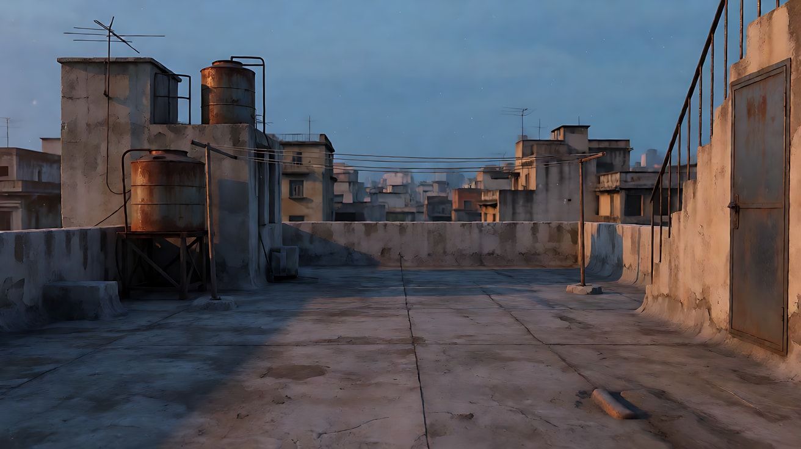
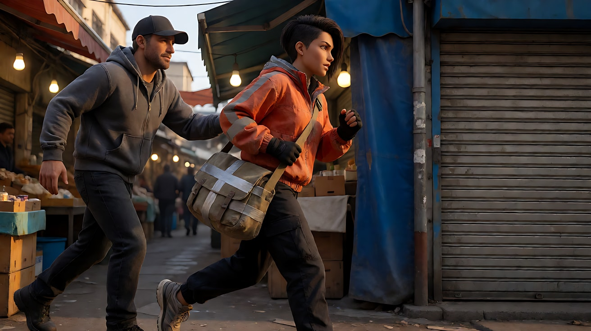
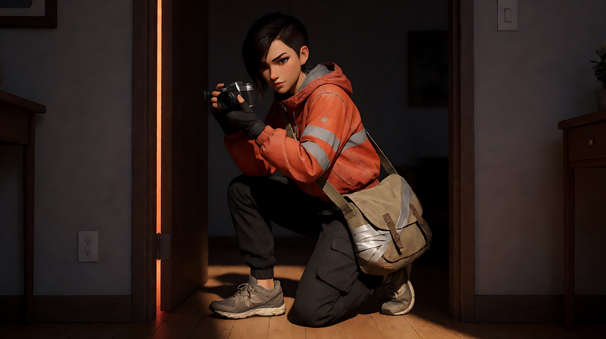

# L08-02 动作 · 提示词

> 本组练习：用一个原创追逐故事练习"预备 → 爆发 → 后果"、屏幕方向、单一接触和动作高潮。｜ 配套教学：[L08-02-动作](../教学/L08-02-动作.md) ｜ 规范：[写作规范](../../模板/写作规范.md)
>
> 画风默认使用开关 A（风格化写实 CG）。如改用 2D 动画，删掉所有焦段、光圈、景深词。

**故事设定（全组共用）**：老城区傍晚。快递员阿岚背着一只缠着胶带的旧邮差包，包里是一份必须在天黑前送到的东西。一个穿灰色连帽外套、戴黑色鸭舌帽的高个男人一直跟着她。她要在他追上之前，穿过菜市场，钻进尽头那扇半落的卷帘门。

**屏幕方向锁定**：阿岚和追她的人**全程从画左跑向画右**；所有机位在轴线同一侧。

**一句话意图**：让观众感到"距离每一步都在缩短，而她每一步都在想办法"。

---

### 练习1：起跑前的那一拍（难度 ★）

**目标**：只练"预备 → 爆发"：蓄力要看得见，起跑要有重量，镜头不动，让人物冲出画面。

**【生图 · Nano Banana】**

图1 关键帧：

```
Full shot of an original female courier in her late twenties crouched low at the edge of a flat concrete rooftop at dusk,
one hand touching the ground, weight on the balls of her feet, eyes locked on something off frame right.
She has a short dark undercut with a longer top tucked behind one ear, a faded orange windbreaker, black cargo pants,
worn grey running shoes, and an old canvas messenger bag wrapped with silver tape across her back.
She is placed on the left third of the frame, facing right, with open rooftop and distant water tanks on the right.
Camera low, almost at ground level, side-on, 35mm lens, moderate depth of field.
Lighting: hard low orange sun from frame left as backlight rim on her hair and jacket, cool blue sky fill, dust in the air.
Stylized semi-realistic 3D CG rendering, feature-film animation quality. Aspect ratio 16:9.
```

中文释义：全景，原创女快递员阿岚在黄昏屋顶边缘低身蹲伏，一手撑地，目光锁定画右；位于左三分之一，面朝右；低机位侧面、35mm、中等景深；画左低角度橙色硬光勾出轮廓，空气里有尘土。



**【图生视频 · Seedance】**

```
【素材分工】@图片1 为首帧，锁定人物身份、橙色风衣、缠胶带的邮差包和屋顶布局；不新增图中没有的人物。
【画风】风格化写实三维CG质感，硬光高反差。
阿岚蹲在屋顶边缘，深吸一口气，撑地的手指收紧，肩膀下沉。停一拍之后，她猛地蹬地起跑，从画左冲向画右，风衣下摆被带起，邮差包在背后甩动，脚下扬起一小团灰尘。镜头固定低机位侧面全景，不移动，她冲出画右，画面里只剩下扬起的灰尘在橙色逆光里慢慢落下。
【声音】无配乐。风声，一次清晰的吸气，起跑时鞋底摩擦水泥的声音，接着三下由近及远的脚步声。
【约束】保持人物脸型、发型、服装与邮差包不变；全程从画左向画右运动；不要字幕、水印、Logo。
时长：5秒
```

**参数**：时长 5 秒 ｜ 画幅 16:9

**【检查点】**
- 是否有明显的"停一拍"蓄力，而不是一开始就跑
- 起跑方向是否从左向右
- 结尾空画面里的灰尘是否成为"后果"

**【常见问题与修复】**
| 现象 | 修复 |
|---|---|
| 一开始就在跑，没有蓄力 | 把"深吸一口气、手指收紧、肩膀下沉、停一拍"放在最前面 |
| 镜头跟着她摇走 | 写"镜头固定，不移动，她冲出画右" |
| 跑向画左 | 正文和约束都写"从画左冲向画右" |

---

### 练习2：菜市场跟拍——用身体绕过障碍（难度 ★★）

**目标**：肩后跟拍，屏幕方向一致；一个障碍，一次身体应对（单手撑摊位转向），后果用环境表现。

**【生图 · Nano Banana】**

图1 角色定妆：

```
Character turnaround sheet of an original female courier in her late twenties: athletic build,
short dark undercut with a longer top tucked behind her left ear, a faded orange windbreaker with reflective strips on the sleeves,
black cargo pants, worn grey running shoes, fingerless black gloves,
an old canvas messenger bag wrapped with silver tape worn across the body from right shoulder to left hip.
Front view, three-quarter view, side view and back view, full body, plain light-grey background.
Camera at eye level, 50mm lens, deep focus, even soft studio light from the front.
Stylized semi-realistic 3D CG rendering, feature-film animation quality. Aspect ratio 16:9.
```



图2 场景（傍晚菜市场通道）：

```
Empty narrow covered street market lane at dusk, no people. Fruit and vegetable stalls on both sides with crates of oranges and green limes,
hanging bare bulbs strung overhead, tarpaulin awnings, wet concrete floor, a dented brass hanging scale at one stall.
At the far right end of the lane, a blue awning and a half-lowered metal roller shutter.
Wide shot looking down the lane from left to right, eye level, 28mm lens, deep focus.
Lighting: hard low orange sunlight cutting in from the left between the awnings, warm bare bulbs overhead, long shadows across the floor.
Stylized semi-realistic 3D CG rendering, feature-film animation quality. Aspect ratio 16:9.
```

中文释义：图1 阿岚定妆：橙色风衣带反光条、黑色工装裤、露指手套、斜挎缠胶带的邮差包。图2 傍晚菜市场通道：两侧水果蔬菜摊、头顶一串裸灯泡、湿水泥地、一杆凹痕铜秤；通道右端尽头是蓝色雨棚和半落的卷帘门。



**【多图生视频 · Seedance】**

```
【素材分工】@图片1 锁定阿岚的身份、橙色风衣、露指手套与斜挎邮差包，不参考其灰色背景和站姿；@图片2 仅参考菜市场通道布局、摊位与光线，不复制其镜头角度。
【画风】风格化写实三维CG质感，硬光高反差。
手持跟拍，镜头在阿岚右肩后方与她同速前进。她从画左向画右在菜市场通道里奔跑，左手紧紧按住胸前的邮差包带，没有回头。前方一个摆满青柠的摊位伸进通道，她右手掌撑住摊位边缘，借力一拧身绕了过去，几颗青柠从铜秤旁滚落到湿地面上。她继续向前跑，通道尽头的蓝色雨棚出现在画面深处。头顶的裸灯泡被她带起的风吹得轻轻摇晃，橙色斜阳一道一道从摊位缝隙间扫过她的身体。
【声音】急促的呼吸，脚步踏在湿地上的啪嗒声，手掌拍在木摊位上的一声闷响，青柠滚落的声音，远处摊贩模糊的吆喝声，无配乐。
【约束】保持人物脸型、发型、服装与邮差包不变；全程从画左向画右，不掉头；画面中不出现追她的人；不要字幕、水印、Logo。
时长：8秒
```

**参数**：时长 8 秒 ｜ 画幅 16:9

**【检查点】**
- 镜头是否始终在她右肩后方，屏幕方向是否一致
- "撑摊位 → 拧身 → 青柠滚落"这一组因果是否清楚
- 她按住包带的手是否一直在——这是"目标"的可见证据

**【常见问题与修复】**
| 现象 | 修复 |
|---|---|
| 她撞翻了整个摊位 | 写清"右手掌撑住摊位边缘，借力绕过"，后果只写"几颗青柠滚落" |
| 镜头晃得看不清 | 把"手持跟拍"改成"轻微手持感的跟拍，主体始终在画面中心附近" |
| 她回头看 | 写"没有回头，目光始终看向前方" |
| 手套或包消失 | 在约束里写"露指手套与邮差包全程可见" |

---

### 练习3：屋顶之间的一跳（难度 ★★★，首尾帧）

**目标**：首帧锁定"起跳"，尾帧锁定"落地后果"，只让模型生成中间的腾空。后果要有重量：单膝跪地、手掌撑地、喘气抬头。

**【生图 · Nano Banana】**

沿用练习2的图1（角色定妆）。

图2 首帧：

```
Using the character from image 1: wide shot of the courier mid-stride at the very edge of a concrete rooftop at dusk,
her rear foot pushing off the ledge, arms driving, body leaning forward toward a gap.
Across a two-metre gap on the right is a slightly lower neighbouring rooftop with laundry lines and potted plants.
She is on the left third, moving left to right. Camera side-on at rooftop height, 28mm lens, deep focus so both rooftops are sharp,
the narrow alley far below visible in the gap.
Lighting: hard low orange sun from frame left, long shadows pointing right, cool blue sky.
Keep the face, hairstyle and outfit exactly as in image 1. Stylized semi-realistic 3D CG rendering, feature-film animation quality. Aspect ratio 16:9.
```



图3 尾帧：

```
Using the character from image 1 and the exact same camera position, rooftops and lighting as image 2:
the courier has landed on the lower neighbouring rooftop on the right, down on one knee, one gloved palm flat on the concrete,
the messenger bag swung forward against her side, her head lifting, breathing hard, a small cloud of dust around her knee.
A laundry line behind her is still swinging. She is now on the right third of the frame, still facing right.
Keep the face, hairstyle and outfit exactly as in image 1. Stylized semi-realistic 3D CG rendering, feature-film animation quality. Aspect ratio 16:9.
```

中文释义：首帧——侧面全景，她在屋顶边缘蹬离，身体前倾，画右是两米外略低的邻楼屋顶，中间可见深巷。尾帧——同一机位，她已落在右侧屋顶，单膝跪地、手掌撑地、邮差包甩到身侧，抬头喘气，膝边一团尘土，身后晾衣绳还在晃。



**【首尾帧生视频 · Seedance】**

```
【素材分工】@图片2 为首帧，锁定起跳构图与光线；@图片3 为尾帧，是最终画面目标；@图片1 锁定人物身份、服装与邮差包，不参考其背景。只生成两帧之间的连续动作。
【画风】风格化写实三维CG质感，硬光高反差。
阿岚后脚蹬离屋顶边缘，整个人从画左向画右腾空越过两栋楼之间的缺口，双臂向前伸，风衣在身后鼓起，邮差包带勒在胸前。她落在略低的邻楼屋顶上，脚掌着地的同时身体前冲，单膝跪下，一只手掌撑住地面，膝边扬起一团灰尘，邮差包甩到身侧。她喘着气抬起头，看向前方。镜头固定侧面全景，不移动。身后的晾衣绳被她带起的风吹得来回摆动。
【声音】风声在腾空时突然变大，落地时一声沉重的闷响，鞋底摩擦水泥，粗重的喘息，晾衣夹轻轻碰撞，无配乐。
【约束】保持人物脸型、发型、服装与邮差包不变；全程从画左向画右；中间动作连续，不跳切，不慢动作；不要字幕、水印、Logo。
时长：6秒
```

**参数**：时长 6 秒 ｜ 画幅 16:9

**【检查点】**
- 腾空是否有抛物线和重量，而不是平飘过去
- 落地后果（单膝、撑地、尘土、喘气）是否全部出现
- 尾帧位置与图3 是否一致

**【常见问题与修复】**
| 现象 | 修复 |
|---|---|
| 她飘在空中像在飞 | 加"落地时身体前冲，膝盖弯曲吸收冲击"，强调重量 |
| 跳成慢动作 | 约束里写"正常速度，不慢动作" |
| 尾帧没落地就结束 | 强调"以 @图片3 为最终画面目标"，并把时长从 5 秒加到 6 秒 |
| 方向反了 | 首尾帧里人物都要面朝右；提示词写两次"从画左向画右" |

---

### 练习4：屋顶对峙——一次接触，一次脱身（难度 ★★★★，多镜头）

**目标**：三个镜头完成"对峙（预备）→ 抓包带与脱身（爆发，唯一一次接触）→ 他踉跄、她跑开（后果）"。接触只有一次，而且简单。

**【生图 · Nano Banana】**

沿用练习2的图1（阿岚定妆）。

图2 角色定妆（追她的人）：

```
Character turnaround sheet of an original tall man in his thirties: broad shoulders, stubble,
a grey hooded zip jacket with the hood down, a plain black baseball cap, dark jeans, black work boots.
Front view, three-quarter view, side view and back view, full body, plain light-grey background.
Camera at eye level, 50mm lens, deep focus, even soft studio light from the front.
Stylized semi-realistic 3D CG rendering, feature-film animation quality. Aspect ratio 16:9.
```



图3 场景（屋顶）：

```
Empty flat concrete rooftop at dusk, no people. Rusty water tanks on the left, a metal stair door on the right edge,
laundry lines across the middle, low parapet walls, the old city skyline behind.
Wide shot, eye level, 28mm lens, deep focus. Lighting: hard low orange sun from frame left, long shadows pointing right,
cool blue sky, a little dust in the air. Stylized semi-realistic 3D CG rendering, feature-film animation quality. Aspect ratio 16:9.
```

中文释义：图2 追她的高个男人：灰色连帽拉链外套、黑色鸭舌帽、深色牛仔裤、黑工靴。图3 黄昏屋顶空景：左侧生锈水箱，右侧铁皮楼梯门，中间晾衣绳，低矮女儿墙。



**【多图生视频 · Seedance】**

```
【素材分工】@图片1 锁定阿岚的身份、橙色风衣与邮差包，不参考其背景；@图片2 锁定灰外套男人的身份与服装，不参考其背景；@图片3 仅参考屋顶布局与光线，不复制其镜头角度。
【画风】风格化写实三维CG质感，硬光高反差。
镜头1：侧面全景，固定机位。阿岚背对画右的楼梯门站在屋顶中央，面朝画左；灰外套男人从画左的水箱后走出来，停在三步之外，两人对峙。她的手慢慢摸到胸前的包带攥紧，脚后跟往后挪了半步。他一动不动，只有外套下摆被风吹动。风声和远处的车流声。
镜头2：镜头切至两人的侧面中景。男人上前一步，伸手抓住她的邮差包带。阿岚顺着他拉的方向转身，肩膀一沉，包带从他手里滑脱，他向后踉跄两步，扶住晾衣绳的铁杆才站稳。布料摩擦声和他鞋底刮过地面的声音。
镜头3：镜头切至阿岚的正面近景，低机位，镜头随她起跑的动作向后快速拉开。她转身冲向画右的楼梯门，邮差包重新抱在胸前，喘着气回头看了一眼。铁皮门被她撞开的哐当声。
【锁定】光线：低角度橙色硬光始终来自画左，影子指向画右；人物：阿岚穿橙色风衣、斜挎缠胶带的邮差包，男人穿灰色连帽外套、戴黑色鸭舌帽；位置：男人始终在画左，阿岚在画右，楼梯门在画右；机位始终在两人连线的同一侧。
【声音】风声贯穿；镜头2 包带被扯紧的一声和鞋底刮地；镜头3 急促脚步和铁皮门的哐当声，无配乐。
【约束】保持两人脸型、发型、服装不变；全片只有镜头2 中一次接触（抓包带），不出现其他肢体冲突；不要字幕、水印、Logo。
时长：12秒
```

**参数**：时长 12 秒 ｜ 画幅 16:9 ｜ 负载：3 个镜头、1 次接触，属于"稳妥"档

**【检查点】**
- 镜头1 是否有足够的"预备"：攥包带、后挪半步、对方静止
- 镜头2 的接触是否只有一次，脱身是否靠"顺势转身"这个可读动作
- 男人的后果（踉跄、扶住铁杆）是否清楚
- 三个镜头里两人的左右位置是否没有互换

**【常见问题与修复】**
| 现象 | 修复 |
|---|---|
| 两人扭打成一团 | 把镜头2 只保留"抓包带 → 转身 → 滑脱 → 踉跄"四步，约束里写"只有一次接触" |
| 镜头2 两人左右换位 | 【锁定】里写"男人始终在画左，阿岚在画右"，并写"机位在同一侧" |
| 男人摔倒在地 | 写"向后踉跄两步，扶住铁杆站稳"，后果要小而清楚 |
| 面部或手变形 | 镜头2 改为侧面中景而不是近景，减少手部占画面比例 |

---

### 练习5：天黑之前——完整 15 秒追逐片段（难度 ★★★★★）

**目标**：完整的动作片段：赌注可见（包）→ 对手先行动 → 三级升级（跑、绕、钻）→ 一个峰值画面（她从内侧拉下卷帘门，门落地的一瞬）→ 一个反应 → 停在赢下来的人身上。

**【生图 · Nano Banana】**

沿用练习2的图1（阿岚定妆）、图2（菜市场场景），以及练习4的图2（灰外套男人定妆，本练习中上传为图3）。

图4 镜头1 关键帧（建立追逐关系）：

```
Using the courier from image 1, the man from image 3 and the market lane from image 2:
wide shot down the market lane from left to right, the courier running in the midground clutching her messenger bag to her chest,
the tall man in the grey hooded jacket and black cap pushing through the lane further back on the left, about ten metres behind her.
At the far right end, the blue awning and the half-lowered metal roller shutter. Both figures move left to right.
Camera at eye level from the side of the lane, 35mm lens, deep focus so both figures and the shutter are sharp.
Lighting: hard low orange sun cutting in from the left between awnings, warm bare bulbs overhead.
Keep the faces, hairstyles and outfits exactly as in image 1 and image 3. Stylized semi-realistic 3D CG rendering, feature-film animation quality. Aspect ratio 16:9.
```



图5 峰值画面关键帧（卷帘门内侧）：

```
Using the courier from image 1: medium shot from inside a dim storeroom behind a metal roller shutter,
the courier on one knee just inside, both hands pulling the shutter chain down hard, the shutter edge almost touching the floor,
a thin strip of orange dusk light and moving shadows of feet visible under the closing gap.
She faces the shutter, the messenger bag tight against her side. Camera low inside the room, 35mm lens, moderate depth of field.
Lighting: only the orange light leaking under the shutter from the bottom, dust floating in it, the room otherwise dark.
Keep the face, hairstyle and outfit exactly as in image 1. Stylized semi-realistic 3D CG rendering, feature-film animation quality. Aspect ratio 16:9.
```

中文释义：图4——从通道侧面拍的全景，阿岚抱着包在中景奔跑，灰外套男人在她左后方约十米推开人群追来，尽头是蓝雨棚和半落的卷帘门；深焦，三者都清楚。图5——从卷帘门内侧的暗仓库里低机位拍，阿岚单膝跪地双手猛拉卷帘链条，门沿即将落地，门缝下透进一条橙色光，光里有晃动的脚影。



**【多图生视频 · Seedance】**

```
【素材分工】@图片4 为首帧，锁定镜头1 的追逐构图与两人相对位置；@图片1 锁定阿岚的身份、橙色风衣与邮差包，不参考其背景；@图片3 锁定灰外套男人的身份与服装，不参考其背景；@图片2 仅参考菜市场通道布局与光线，不复制其镜头角度；@图片5 仅参考卷帘门内侧的构图与光线，用于镜头4。
【画风】风格化写实三维CG质感，硬光高反差。
镜头1：侧面全景，镜头跟随两人从画左向画右平移。阿岚抱紧胸前的邮差包在通道中段奔跑，灰外套男人在她身后约十米推开挡路的竹筐追上来。通道尽头的卷帘门半落着，门下只剩一道窄缝。喘息声、脚步声和摊贩的叫喊声混在一起。
镜头2：镜头切至阿岚右肩后方的跟拍中景。前方一辆装满纸箱的手推车横在路中，她右手撑住车把，借力一拧身绕过去，邮差包在胸前一甩，几只空纸箱从车上滑落。身后传来越来越近的沉重脚步声。
镜头3：镜头切至卷帘门前的低机位侧面全景，固定。阿岚俯身贴地一滑，从卷帘门下那道窄缝钻了进去，橙色斜阳把她的影子拉得很长。几步之外，男人的脚步正冲向门口。
镜头4：镜头切至卷帘门内侧的暗仓库，低机位。阿岚单膝跪地，双手抓住链条猛地往下一拉，卷帘门哐的一声落到地面，门缝下那道橙色光被一下切断，只剩一线细光。门外传来手掌拍在铁皮上的一声闷响。
镜头5：镜头切至她的正面近景，固定。黑暗里只有门缝透进的一线光照在她半张脸上，她背靠卷帘门滑坐下来，抱着邮差包大口喘气，然后低头看了一眼怀里的包，手掌在胶带上按了按。门外的脚步声停了，渐渐走远。
【锁定】光线：户外为画左低角度橙色硬光，仓库内只有卷帘门缝透进的橙色细光；人物：阿岚全程穿橙色风衣、斜挎缠胶带的邮差包，男人全程穿灰色连帽外套、戴黑色鸭舌帽；方向：户外镜头两人都从画左跑向画右，男人始终在阿岚身后；机位始终在通道同一侧。
【声音】镜头1 喘息、脚步和市场嘈杂声叠在一起；镜头2 手推车吱呀一声和纸箱落地；镜头3 鞋底和身体擦过地面的长长摩擦声；镜头4 卷帘门落地的巨大金属声，紧接着门外一声手掌拍铁皮的闷响；镜头5 所有市场声被门隔开，只剩她的喘息和门外渐远的脚步。无配乐。
【约束】保持两人脸型、发型、服装不变；男人与阿岚全片没有身体接触；不出现任何器械；正常速度，不慢动作；不要字幕、水印、Logo。
时长：15秒
```

**参数**：时长 15 秒 ｜ 画幅 16:9 ｜ 负载：5 个镜头（镜头5 为反应镜头），属于"有挑战"档；如镜头被合并，拆成"镜头1–3"和"镜头4–5"两次生成，第二次以图5 作为首帧

**【检查点】**
- 赌注（邮差包）是否在镜头1 就看得见，并在镜头5 回收
- 三级升级是否清楚：跑 → 绕过手推车 → 贴地钻过门缝
- 峰值画面是否是"卷帘门落地、橙光被切断"这一个画面，片段在它之后一拍内结束
- 声音是否在镜头4 从"嘈杂"骤然切成"门内的安静"

**【常见问题与修复】**
| 现象 | 修复 |
|---|---|
| 男人在镜头3 抓住了她 | 写"几步之外，男人的脚步正冲向门口"，并在约束里写"全片没有身体接触" |
| 卷帘门自己掉下来 | 必须写成"她双手抓住链条猛地往下一拉"——高潮是她做的事，不是意外 |
| 镜头4 光线太亮看不清门缝 | 写"仓库内只有门缝透进的橙色细光"，并用 @图片5 锁定光位 |
| 镜头2 手推车被撞飞 | 后果只写"几只空纸箱滑落"，动作写"撑住车把借力绕过" |
| 被平台拦截 | 检查是否出现了"打""抢""伤"等词；本稿只用"抓包带""拍铁皮""脚步"来承载威胁 |
