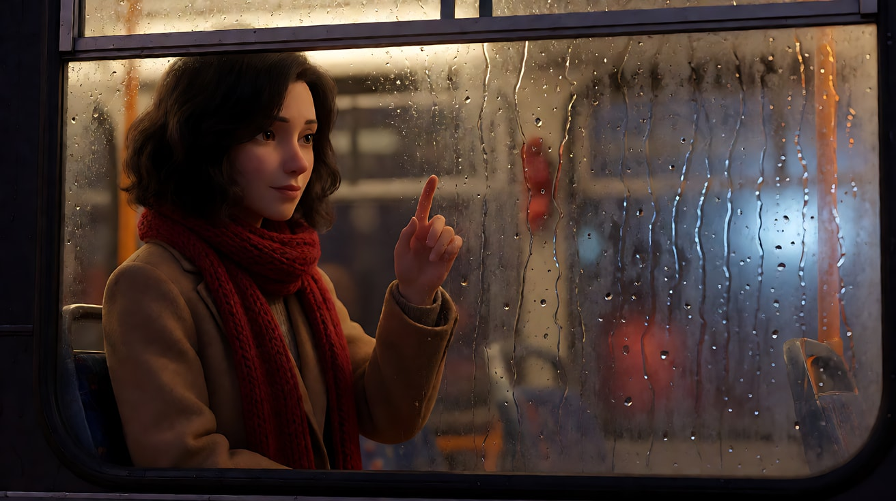
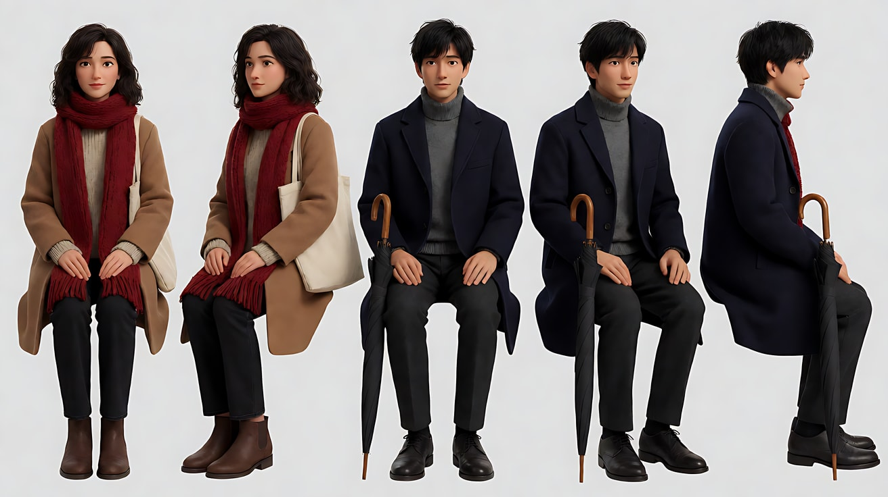
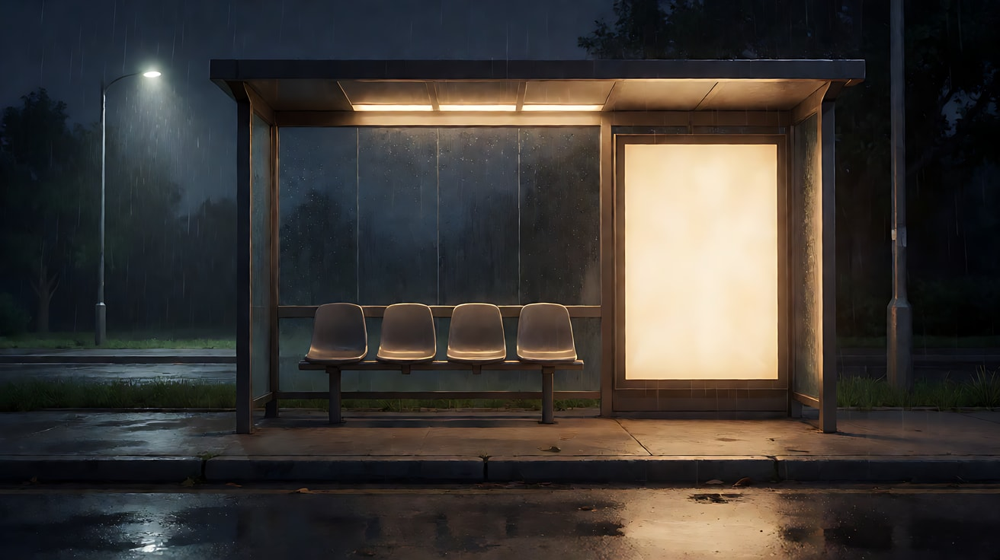
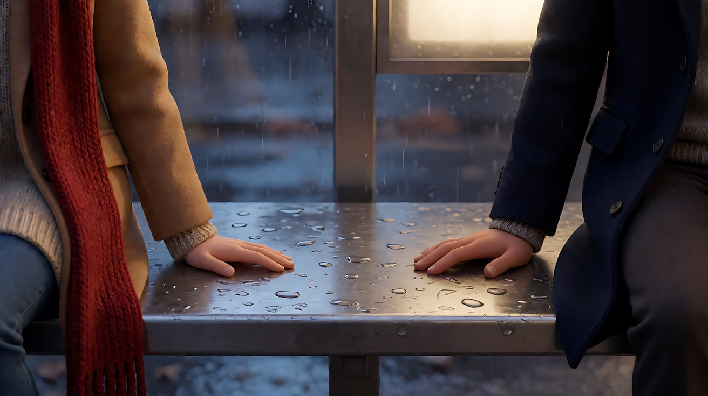
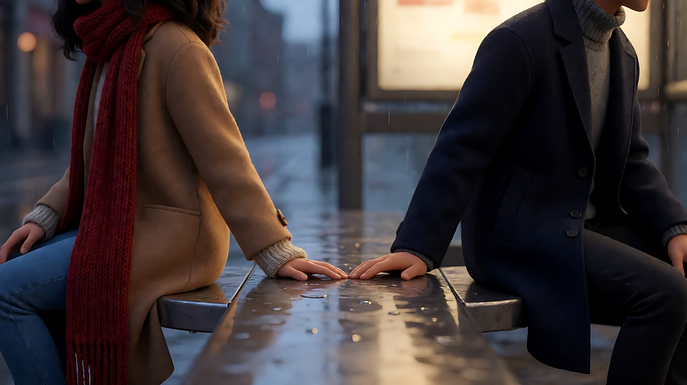
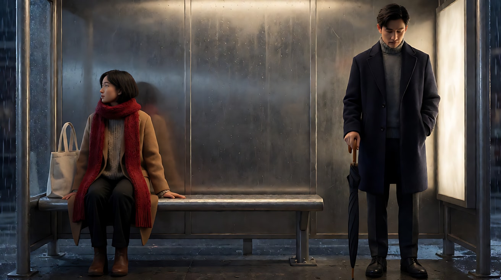
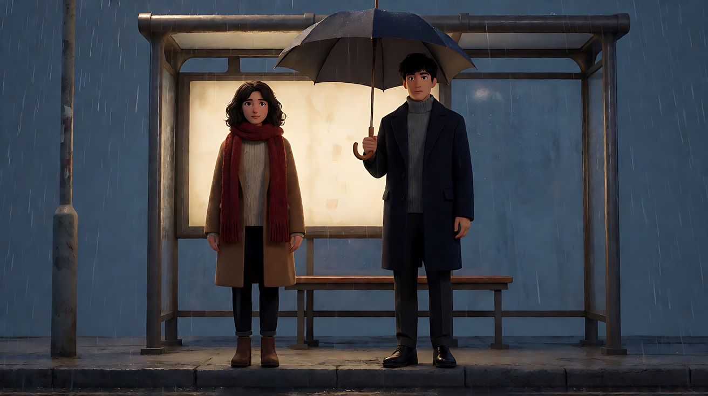
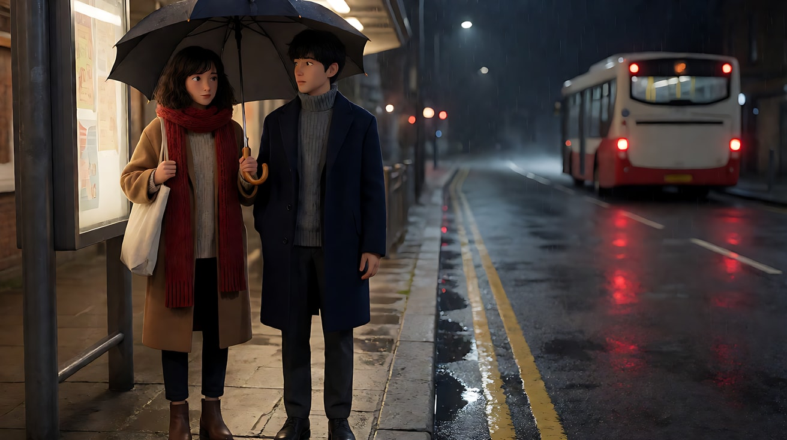

# L08-03 爱情文艺 · 提示词

> 本组练习：用一个原创故事"末班车站"练习两人之间的空隙、框中框、错开的视线、"差一点"和省略式的回报。｜ 配套教学：[L08-03-爱情文艺](../教学/L08-03-爱情文艺.md) ｜ 规范：[写作规范](../../模板/写作规范.md)
>
> 画风默认使用开关 A（风格化写实 CG）。如改用 2D 动画，删掉所有焦段、光圈、景深词。

**故事设定（全组共用）**：冬天的雨夜，城郊一个末班公交车站。沈遥和周屿在同一栋写字楼加班，几乎每晚都在这个站台等同一班末班车，却从没说过一句话。今晚下雨，周屿带了伞，沈遥没有。

**角色站位锁定**：沈遥始终在画左，周屿始终在画右（除非练习另有说明）。

**一句话意图**：让观众感到"两个人都在等对方先开口"，并在最后得到一个不说破的回报。

---

### 练习1：车窗上的一道线（难度 ★）

**目标**：单人、单动作、框中框。用雨痕车窗和暖色车内灯，拍一个人的心事。

**【生图 · Nano Banana】**

图1 关键帧：

```
Medium close-up of an original woman in her late twenties sitting by the window inside a nearly empty night bus,
shoulder-length wavy dark-brown hair, a long red knitted scarf over a camel wool coat, her temple almost touching the fogged glass,
her right index finger resting on the misted window. Seen from outside the bus through the rain-streaked window,
the window frame forms a frame within the frame; she is placed on the left third, the right side of the glass reflects blurred streetlights.
Camera at eye level outside the window, 85mm lens, shallow depth of field, raindrops on the glass in soft focus.
Lighting: warm tungsten bus interior light from above as key on her face, cool blue street light outside, rain streaks catching orange highlights.
Stylized semi-realistic 3D CG rendering, feature-film animation quality. Aspect ratio 16:9.
```

中文释义：从车外隔着雨痕车窗拍中近景，原创女主沈遥坐在几乎空着的夜班车窗边，额角快贴到起雾的玻璃，右手食指搭在雾气上；窗框形成框中框，她在左三分之一；85mm 浅景深；车内暖色顶灯照脸，车外冷蓝路灯。



**【图生视频 · Seedance】**

```
【素材分工】@图片1 为首帧，锁定人物身份、红围巾与驼色大衣、车窗构图；不新增图中没有的人物。
【画风】风格化写实三维CG质感，暖色车内光与冷色雨夜对比。
沈遥用食指在起雾的车窗上慢慢画了一道短短的横线，停住，又在横线旁边轻轻点了一个点，然后把手指收回来，藏进围巾里。她把额头轻轻靠在玻璃上，目光落在窗外画右的方向。镜头固定在车窗外，不移动。雨水沿着玻璃不断滑下，慢慢模糊掉她刚画的那道线。结尾停在她靠着车窗、线条被雨水晕开的画面上。
【声音】雨点密集地打在车身上，车内低沉的发动机声，一声模糊的报站提示音，无配乐。
【约束】保持人物脸型、发型、服装不变；车窗上不出现任何文字；不要字幕、水印、Logo。
时长：6秒
```

**参数**：时长 6 秒 ｜ 画幅 16:9

**【检查点】**
- 画线这个小动作是否清楚，有没有"停住、收回手"的犹豫
- 雨水是否慢慢模糊掉那道线——这是"说不出口"的画面化
- 车窗框是否始终把她框在里面

**【常见问题与修复】**
| 现象 | 修复 |
|---|---|
| 她在车窗上写出了字 | 改成"画一道短横线，再点一个点"，约束写"车窗上不出现任何文字" |
| 镜头穿过玻璃进到车里 | 写"镜头固定在车窗外，不移动" |
| 表情过度，像在哭 | 删除所有情绪词，只保留手指、额头、目光三个动作 |

---

### 练习2：隔着一个座位（难度 ★★）

**目标**：双人同框，用候车亭玻璃做框中框；两人之间的空座位是画面主体。一个人做主动作，另一个人保持小动作。

**【生图 · Nano Banana】**

图1 角色定妆（两位原创角色）：

```
Character turnaround sheet of two original characters.
The woman, late twenties: shoulder-length wavy dark-brown hair, a long red knitted scarf, an oatmeal knit sweater under a camel wool coat,
dark trousers, brown ankle boots, a canvas tote bag.
The man, early thirties: short slightly messy black hair, a navy wool overcoat over a grey turtleneck, charcoal trousers,
black leather shoes, carrying a long black umbrella with a wooden handle.
Front view, three-quarter view and side view of each, full body, plain light-grey background.
Camera at eye level, 50mm lens, deep focus, even soft studio light from the front.
Stylized semi-realistic 3D CG rendering, feature-film animation quality. Aspect ratio 16:9.
```



图2 场景（雨夜末班车站）：

```
Empty suburban bus shelter at night in the rain, no people. A glass-walled shelter with a long metal bench with three seats,
a warm lit advertising lightbox panel with no text glowing on the right side, a single streetlamp beyond,
wet asphalt road reflecting the lights, rain falling in the streetlamp beam, dark trees behind.
Wide shot from across the road, eye level, 35mm lens, deep focus.
Lighting: warm glow from the shelter's lightbox and ceiling strip as the main source, cool blue-grey night and streetlamp outside,
rain streaks on the shelter glass. Stylized semi-realistic 3D CG rendering, feature-film animation quality. Aspect ratio 16:9.
```

中文释义：图1 两位原创角色：沈遥（红围巾、燕麦色毛衣、驼色大衣、帆布包），周屿（藏蓝大衣、灰色高领毛衣、木柄黑色长伞）。图2 雨夜郊区候车亭空景：玻璃候车亭、三个座位的金属长椅、右侧一块不写字的暖色灯箱、湿漉漉的柏油路反光。



**【多图生视频 · Seedance】**

```
【素材分工】@图片1 锁定两位人物的身份与服装（女人戴红围巾，男人拿木柄黑伞），不参考其灰色背景和站姿；@图片2 仅参考候车亭布局、长椅与灯箱位置，不复制其镜头角度。
【画风】风格化写实三维CG质感，暖色候车亭光与冷色雨夜对比。
雨夜的候车亭，镜头在马路对面隔着雨幕和候车亭的玻璃墙看向两人，玻璃上的雨痕形成一层前景。沈遥坐在长椅最左边，周屿坐在最右边，中间空着一个座位，空座位位于画面正中。周屿把收拢的黑伞立在两人之间的空座位旁，伞尖还在滴水，他低头看着地面。沈遥搓了搓冻红的手指，把围巾往上拉了拉，侧过一点脸，看了一眼那把伞，又转回去看雨。周屿保持低头，只是轻轻呼出一口白气。镜头从全景极慢地向前推近，结束在两人与中间空座位同框的中景上。
【声音】雨打在候车亭顶棚上的密集声，灯箱的轻微电流嗡声，远处偶尔驶过的车轮溅水声，无配乐，无对白。
【约束】保持两人脸型、发型、服装不变；两人不交谈、不对视；中间座位始终空着；灯箱上不出现文字；不要字幕、水印、Logo。
时长：8秒
```

**参数**：时长 8 秒 ｜ 画幅 16:9

**【检查点】**
- 中间的空座位是否始终在画面正中
- 只有沈遥做主动作（看伞），周屿是否保持小动作而没有冻结
- 玻璃雨痕是否形成"隔着什么"的前景

**【常见问题与修复】**
| 现象 | 修复 |
|---|---|
| 两人坐到了一起 | 写"中间空着一个座位，空座位位于画面正中"，约束再写一次 |
| 两人开始聊天 | 写"两人不交谈、不对视"，声音栏写"无对白" |
| 周屿完全静止像雕像 | 给他一个小动作："轻轻呼出一口白气""手指在伞柄上动了一下" |
| 灯箱上出现乱码文字 | 在生图和视频约束里都写"灯箱上不出现文字" |

---

### 练习3：长椅上的两只手（难度 ★★★，首尾帧）

**目标**：只拍手。首帧两只手相隔很远，尾帧两只小指之间只剩一指宽——不接触。模型只负责中间的"一人先动 → 对方察觉 → 没有退开 → 停住"。

**【生图 · Nano Banana】**

沿用练习2的图1（角色定妆）。

图2 首帧：

```
Using the characters from image 1: close-up of the metal bus shelter bench seen from a low side angle,
the woman's left hand in a camel coat sleeve resting flat on the bench on the left, the man's right hand in a navy coat sleeve resting on the right,
a wide empty stretch of wet metal bench between them in the centre of the frame, a few raindrops on the bench.
Only hands and sleeves visible, no faces. Camera at bench height, 85mm lens, shallow depth of field focused on the gap between the hands.
Lighting: warm glow from the shelter lightbox above as soft key from the right, cool blue reflections from the street on the wet metal.
Keep the sleeves and outfits exactly as in image 1. Stylized semi-realistic 3D CG rendering, feature-film animation quality. Aspect ratio 16:9.
```



图3 尾帧：

```
Using the characters from image 1 and the exact same framing, bench and lighting as image 2:
the woman's left hand has moved closer to the centre, the man's right hand has moved a little closer too,
their little fingers now only one finger-width apart, not touching, both hands relaxed and still,
the tiny gap between the little fingers sharp in the centre of the frame, everything else soft.
Only hands and sleeves visible, no faces. Keep the sleeves and outfits exactly as in image 1.
Stylized semi-realistic 3D CG rendering, feature-film animation quality. Aspect ratio 16:9.
```

中文释义：首帧——长椅高度的侧面特写，只拍手和袖口：左边是她驼色袖口里的左手，右边是他藏蓝袖口里的右手，中间一大段湿漉漉的空长椅。尾帧——同一构图，两只小指之间只剩一指宽，不接触，焦点落在那道小小的缝隙上。



**【首尾帧生视频 · Seedance】**

```
【素材分工】@图片2 为首帧，锁定手部特写构图与灯光；@图片3 为尾帧，是最终画面目标；@图片1 锁定两人袖口与服装颜色，不参考其中人物全身构图。只生成两帧之间的连续动作。
【画风】风格化写实三维CG质感，暖色灯箱光与冷色雨夜反光。
长椅上，她的左手先动了，指尖在湿冷的金属上往中间挪了一小段，停住。过了一拍，他的右手食指轻轻抬起又落下，像是察觉到了。他的手没有退开，而是也往中间挪了一点，再停住。她的手没有收回。两只小指之间最后只剩一指宽的距离，都不再动。镜头固定在长椅高度，不移动；焦点始终在两只手之间的空隙上。几滴雨水落在两只手之间的长椅上。
【声音】候车亭顶棚的雨声逐渐变轻，只剩下近处一两滴水落在金属长椅上的清脆声，以及很轻的一次吸气，无配乐。
【约束】只出现两只手和袖口，不出现人脸；两只手始终不接触；手指数量和形状保持正常；中间动作连续，不跳切；不要字幕、水印、Logo。
时长：8秒
```

**参数**：时长 8 秒 ｜ 画幅 16:9

**【检查点】**
- 是否有清楚的四拍：她先动 → 他察觉 → 他也靠近 → 都停住
- 结尾两只手是否真的"不接触"
- 焦点是否始终落在空隙上，而不是某一只手

**【常见问题与修复】**
| 现象 | 修复 |
|---|---|
| 两只手握在了一起 | 正文写"最后只剩一指宽的距离"，约束写"两只手始终不接触"，并强调以 @图片3 为最终画面目标 |
| 手指变形或多出手指 | 减少动作：删掉"食指抬起又落下"，只保留"挪近、停住" |
| 镜头上摇露出脸 | 写"镜头固定在长椅高度，不移动；不出现人脸" |
| 两只手同时动，没有先后 | 用"她的左手先动了……过了一拍，他的右手……"写清先后顺序 |

---

### 练习4：错开的视线（难度 ★★★★，多镜头）

**目标**：三个镜头完成一次"错过"：双人镜头建立距离 → 他看她，她在看雨 → 她转过来看他，他已经低下头。观众比两个人都清楚：他们都在看对方。

**【生图 · Nano Banana】**

沿用练习2的图1（角色定妆）、图2（场景）。

图3 镜头1 关键帧：

```
Using the characters from image 1 and the bus shelter from image 2:
medium-wide two-shot from inside the shelter at a low angle, the woman sitting on the far left of the bench looking out at the rain to frame left,
the man on the far right with his closed black umbrella standing beside him, looking down at the ground,
one empty seat between them in the centre. Camera at seated eye level, 35mm lens, moderate depth of field.
Lighting: warm lightbox glow from frame right as key, cool blue rainy night behind them, rain curtain falling past the shelter edge.
Keep the faces, hairstyles and outfits exactly as in image 1. Stylized semi-realistic 3D CG rendering, feature-film animation quality. Aspect ratio 16:9.
```

中文释义：候车亭内低机位中全景双人镜头，沈遥在长椅最左看向画左的雨，周屿在最右低头看地，伞立在身边，中间一个空座位；画右暖色灯箱为主光，身后是冷蓝雨夜。



**【多图生视频 · Seedance】**

```
【素材分工】@图片3 为首帧，锁定镜头1 的双人构图与站位；@图片1 锁定两人身份与服装，不参考其背景；@图片2 仅参考候车亭布局与灯箱位置，不复制其镜头角度。
【画风】风格化写实三维CG质感，暖色灯箱光与冷色雨夜对比。
镜头1：固定中全景双人镜头。沈遥坐在长椅左端看向画左的雨幕，周屿坐在右端低头看着地面，中间空着一个座位。雨帘在候车亭边缘不断落下。雨声与远处车声。
镜头2：镜头切至周屿的单人近景，85mm 浅景深，他在画右，视线朝向画左。他慢慢抬起头，看向画左她的方向，看了很久，嘴唇动了一下，又抿住。背景里她的身影虚成一团红色的围巾。雨声变轻。
镜头3：镜头切至沈遥的单人近景，她在画左，原本看着画左的雨。她慢慢转过头来，视线朝向画右他的方向。镜头焦点从她的脸转移到背景里虚化的周屿身上——他已经重新低下了头。她看着他，把围巾往上拉了拉，遮住半张脸。只剩雨声。
【锁定】光线：暖色灯箱光始终来自画右，背景是冷蓝雨夜；人物：沈遥始终在画左，戴红围巾、穿驼色大衣；周屿始终在画右，穿藏蓝大衣，黑伞立在他身边；机位始终在长椅前方同一侧，视线方向不互换。
【声音】雨声贯穿并逐渐变轻；无对白、无配乐；镜头3 结尾只剩近处水滴声。
【约束】保持两人脸型、发型、服装不变；两人始终没有同时看向对方；两人不交谈、不起身；不要字幕、水印、Logo。
时长：12秒
```

**参数**：时长 12 秒 ｜ 画幅 16:9 ｜ 负载：3 个镜头、无对白，属于"稳妥"档

**【检查点】**
- 镜头2 中他看向画左、镜头3 中她看向画右，视线方向是否匹配
- 镜头3 的焦点转移是否落在"他已经低头"上——这是"错过"的揭示
- 两人是否始终没有同时对视

**【常见问题与修复】**
| 现象 | 修复 |
|---|---|
| 两人对视了 | 镜头3 写清"他已经重新低下了头"，约束写"两人始终没有同时看向对方" |
| 视线方向乱了，像在看别处 | 每个单人镜头都写"他在画右，视线朝向画左"这样的方位句 |
| 镜头3 没有焦点转移 | 改为"焦点从她的脸转移到背景里虚化的他身上"，并在镜头2、3 写 85mm 浅景深 |
| 他说出了台词 | 镜头2 只写"嘴唇动了一下，又抿住"，声音栏写"无对白" |

---

### 练习5：末班车开走以后——完整 15 秒爱情片段（难度 ★★★★★）

**目标**：完整片段，结构是"距离 → 试探 → 决定的一刻被省略 → 回报"。末班车来了，她上了一级台阶；切走；车开走后，站台上她站在他的伞下。观众没看到她怎么决定，只看到结果——省略本身就是回报。

**【生图 · Nano Banana】**

沿用练习2的图1（角色定妆）、图2（场景）。

图3 镜头1 关键帧：

```
Using the characters from image 1 and the bus shelter from image 2:
wide shot from across the wet road, the two standing at the kerb under the shelter edge, the man on the right holding his open black umbrella,
the woman on the left half a step outside it, rain falling on her shoulder and red scarf.
A clear gap of open rain between her shoulder and the umbrella's edge. Camera at eye level across the road, 50mm lens,
moderate depth of field, rain streaks in the foreground. Lighting: warm shelter lightbox glow behind them as backlight,
cool blue-grey night, rain lit by the streetlamp.
Keep the faces, hairstyles and outfits exactly as in image 1. Stylized semi-realistic 3D CG rendering, feature-film animation quality. Aspect ratio 16:9.
```



图4 结尾关键帧（回报画面）：

```
Using the characters from image 1 and the bus shelter from image 2:
wide shot from the same position across the road as before, the bus has gone, its red tail lights small and blurred far down the road on the right.
The woman and the man stand together at the empty kerb under his single open black umbrella, her shoulder now inside its edge,
both facing the road, not touching, not looking at each other. Camera at eye level, 50mm lens, moderate depth of field.
Lighting: warm shelter glow behind them, cool rainy night, the bus tail lights reflected in the wet road.
Keep the faces, hairstyles and outfits exactly as in image 1. Stylized semi-realistic 3D CG rendering, feature-film animation quality. Aspect ratio 16:9.
```

中文释义：图3——马路对面全景，两人站在候车亭边，周屿在画右撑着黑伞，沈遥在画左站在伞外半步，雨落在她肩头和红围巾上；她的肩和伞沿之间隔着一段雨。图4——同一机位，末班车已开远，红色尾灯在画右远处；两人站在同一把伞下，她的肩已经在伞里，并肩面朝马路，不接触、不对视。



**【多图生视频 · Seedance】**

```
【素材分工】@图片3 为首帧，锁定镜头1 的构图与站位；@图片4 仅参考镜头4 的构图与站位，作为结尾画面目标；@图片1 锁定两人身份与服装，不参考其背景；@图片2 仅参考候车亭布局与灯箱位置，不复制其镜头角度。
【画风】风格化写实三维CG质感，暖色候车亭光与冷色雨夜对比。
镜头1：马路对面的固定全景。周屿站在画右撑着黑伞，沈遥站在画左，在伞外半步淋着雨，红围巾上落满雨点。周屿看了一眼她的肩膀，把伞往她那边斜了一点点，伞沿的雨水落在两人之间。她没有动。雨声浓密。
镜头2：镜头切至两人的侧面中景。一束车灯从画左扫过来，照亮两人的脸，末班车停在路边，车门打开，车内暖光照到站台上。沈遥走到车门前，右脚踏上第一级台阶，手扶住门边的扶杆，停住。车门提示音响起。
镜头3：镜头切至周屿的单人近景，反应镜头。车内的暖光照在他半边脸上，他握伞的手指收紧，伞慢慢收拢了一半，又停住。他没有看车门，只是看着雨。发动机声变大。
镜头4：硬切回与镜头1 相同的马路对面全景，固定。末班车已经开远，红色尾灯在画右远处变小，倒映在湿漉漉的路面上。站台边，沈遥站在周屿的伞下，肩膀已经在伞沿里面，两人并肩面朝马路，没有说话，也没有看对方。周屿把伞重新撑开，往她那边又斜了一点。镜头停在两人同在一把伞下的远景上。
【锁定】光线：候车亭暖色灯箱光始终在两人身后，雨夜为冷蓝色，镜头2 车内暖光来自画左；人物：沈遥全程戴红围巾、穿驼色大衣，周屿全程穿藏蓝大衣、拿木柄黑伞；位置：沈遥始终在周屿的画左；机位：镜头1 和镜头4 为同一个马路对面机位。
【声音】雨声贯穿；镜头2 车门打开的气压声和一声车门提示音；镜头3 发动机声变大；镜头4 车声远去，雨打在伞面上的声音变得清晰，最后只剩伞上的雨声。无对白，无配乐。
【约束】保持两人脸型、发型、服装不变；全片两人没有身体接触、没有对白；不出现沈遥走下车的过程；车身和站牌上不出现文字；不要字幕、水印、Logo。
时长：15秒
```

**参数**：时长 15 秒 ｜ 画幅 16:9 ｜ 负载：4 个镜头（镜头3 为反应镜头），属于"有挑战"档；如果镜头4 没到位，把镜头1–3 和镜头4 拆成两次生成，镜头4 以图4 为首帧单独生成 5 秒

**【检查点】**
- 镜头1 中她肩膀和伞之间的"一段雨"，与镜头4 中"肩在伞沿里面"是否形成清楚的对照
- 决定的那一刻（她走下车）是否被省略——观众只看到结果
- 镜头3 的反应是否只靠"手指收紧、伞收拢一半又停住"来表达
- 声音是否以"伞上的雨声"收尾

**【常见问题与修复】**
| 现象 | 修复 |
|---|---|
| 生成了她走下车的过程 | 约束写"不出现沈遥走下车的过程"，镜头4 用"硬切回"开头 |
| 镜头4 两人拥抱 | 写"并肩面朝马路，没有看对方"，约束写"没有身体接触" |
| 镜头4 她不在画面里（真的上车了） | 把 @图片4 改为尾帧目标单独生成镜头4，或在镜头4 开头写"站台边，沈遥站在周屿的伞下" |
| 镜头1 与镜头4 机位不同 | 两个镜头都写"马路对面的固定全景"，并用图3、图4 锁定 |
| 车身出现乱码文字 | 约束写"车身和站牌上不出现文字" |
