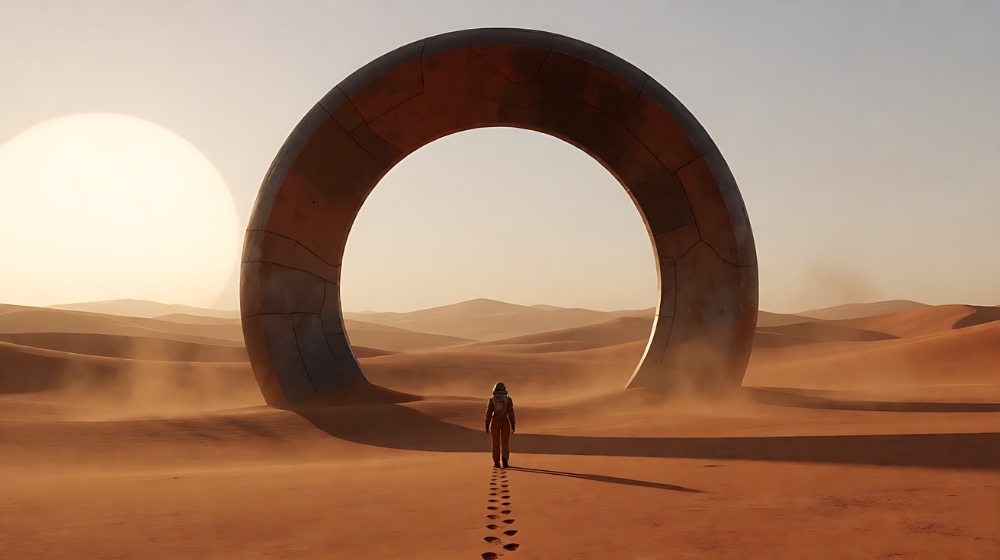
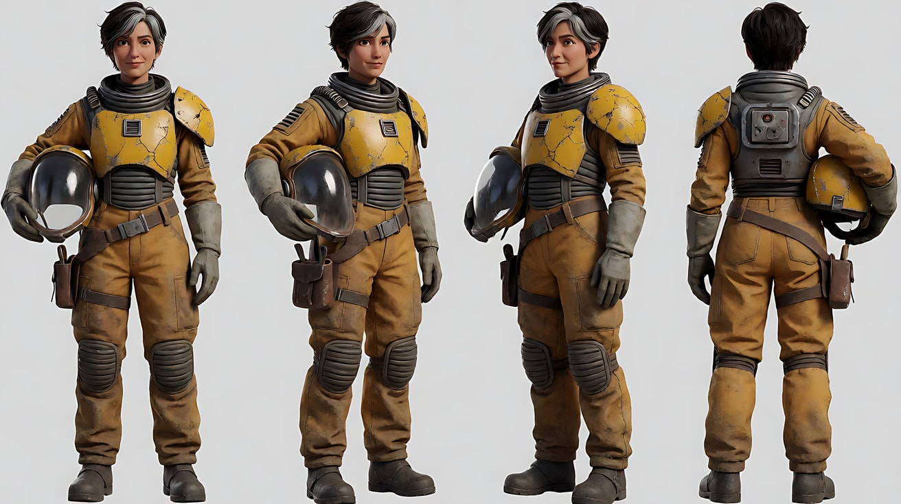
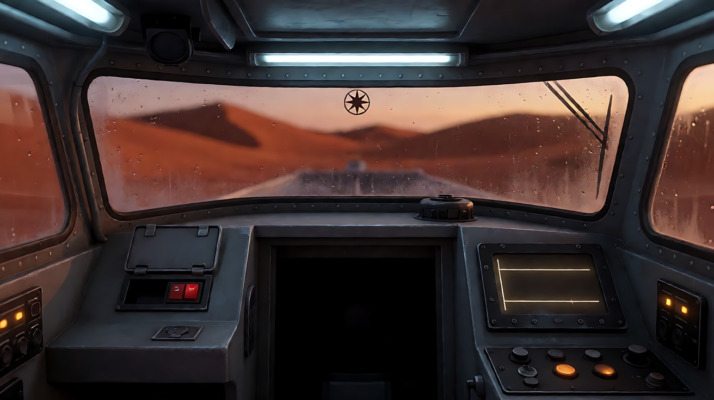
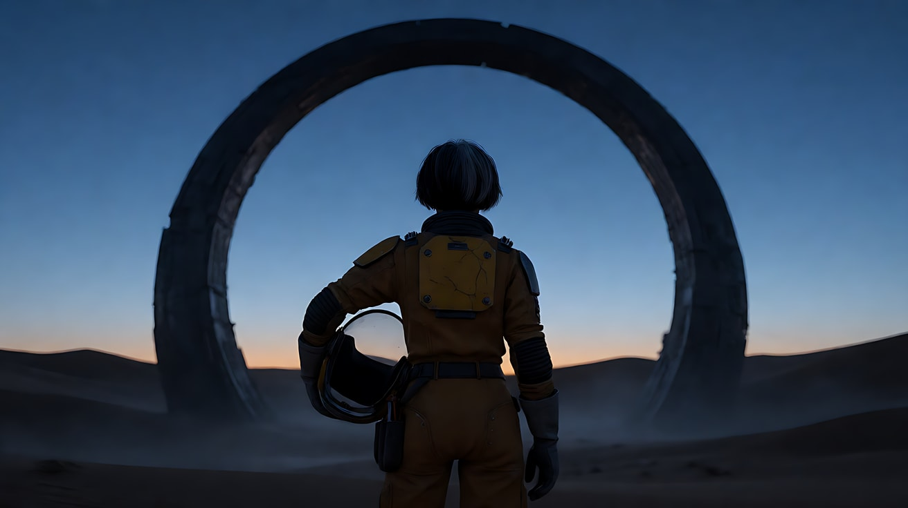
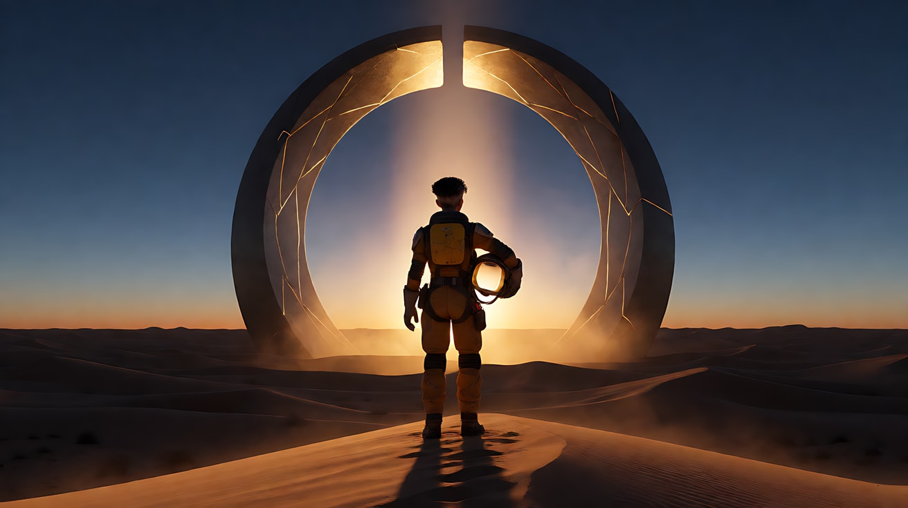
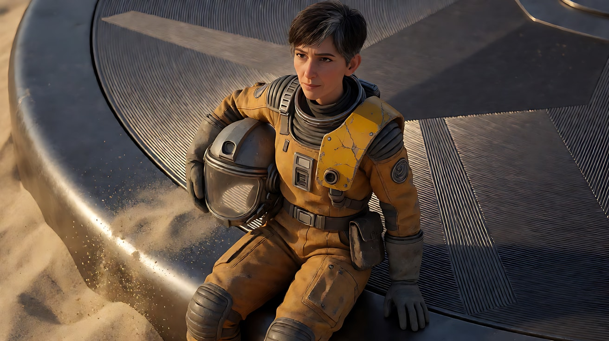
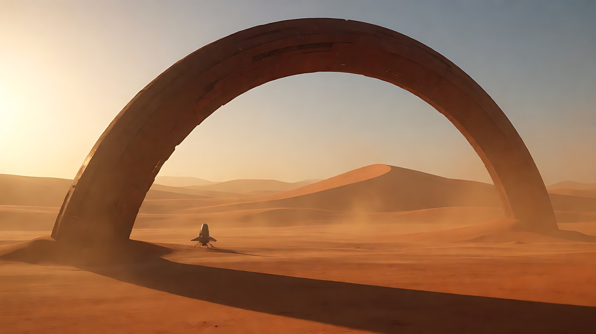
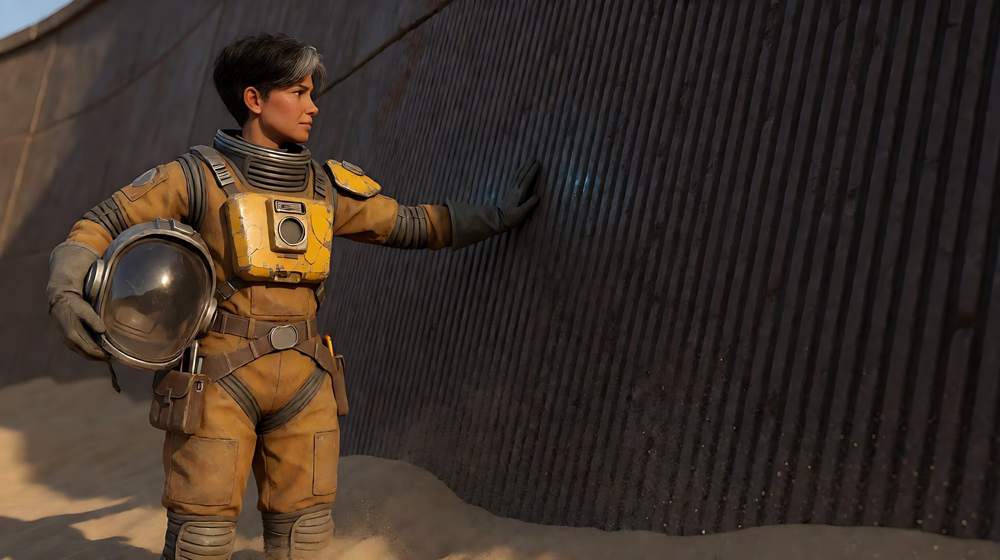
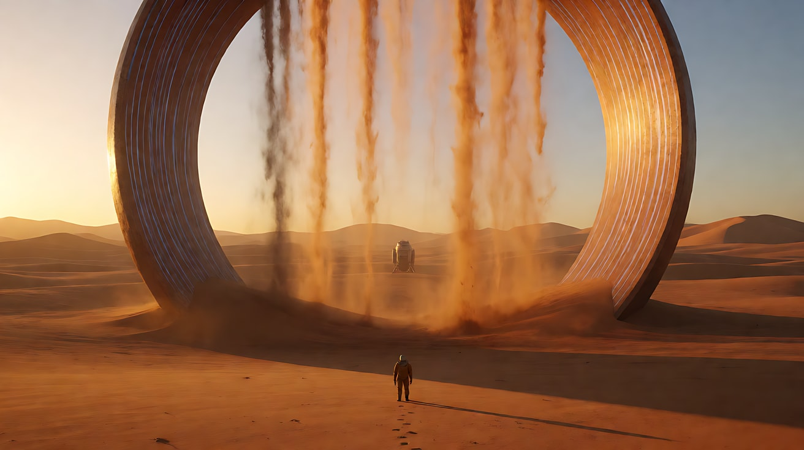

# L08-04 科幻史诗 · 提示词

> 本组练习：用一个原创故事"沙海巨环"练习尺度参照物、冷光中的暖色异常、光的揭示、跨尺度匹配剪辑与"规则用后果证明"。｜ 配套教学：[L08-04-科幻史诗](../教学/L08-04-科幻史诗.md) ｜ 规范：[写作规范](../../模板/写作规范.md)
>
> 画风默认使用开关 A（风格化写实 CG）。如改用 2D 动画，删掉所有焦段、光圈、景深词。

**故事设定（全组共用）**：一颗荒芜的沙漠行星。勘测员岑野独自驾驶小型着陆舱，来测绘一处信号源。她发现信号来自一座半埋在沙丘里的巨大圆环——直径有数百米，表面是暗色金属与石质交织的纹路。当她把手掌贴上圆环，这颗星球的规则显现：她脚边的沙粒开始离开地面，逆着重力流向圆环。

**一句话意图**：让观众感到"一个人站在一个比人类文明更古老的东西面前，并选择伸出手"。

---

### 练习1：一个人与一座环（难度 ★）

**目标**：只练尺度：人物占画面高度的极小比例，一串脚印作为参照，镜头极慢推进。

**【生图 · Nano Banana】**

图1 关键帧：

```
Extreme wide shot of a vast rust-orange desert at late afternoon on an alien planet.
In the middle distance, a colossal dark ring structure stands half-buried in the dunes, its upper arc rising high into a pale hazy sky,
its surface a mix of dark metal and weathered stone with faint geometric grooves.
A single small figure in an ochre pressure suit stands far in front of it, occupying less than one-thirtieth of the frame height,
a single line of footprints trailing behind her toward the camera. Symmetrical composition with the ring centred.
Camera at low eye level, 24mm lens, deep focus. Lighting: a huge pale sun low on the horizon to frame left,
long shadows across the dunes, layered haze and blowing dust separating foreground, midground and background.
Stylized semi-realistic 3D CG rendering, feature-film animation quality. Aspect ratio 16:9.
```

中文释义：异星沙漠大远景，半埋在沙丘中的巨大暗色圆环居中，上弧高耸入淡色天空；一个穿赭色压力服的小小人影站在环前，只占画面高度不到三十分之一，身后一串脚印伸向镜头；24mm 深焦；画左低悬的巨大苍白太阳，长影、层层薄雾与扬沙。



**【图生视频 · Seedance】**

```
【素材分工】@图片1 为首帧，锁定圆环外形、人物位置与沙漠光线；不新增图中没有的人物或飞行器。
【画风】风格化写实三维CG质感，低饱和沙漠色调，大气透视层次分明。
大远景，巨大的圆环半埋在沙丘中，环前一个很小的人影。人影迈步向圆环走去，一步一步，在沙地上留下新的脚印。风把沙丘顶上的细沙吹成一道道薄纱，从画左飘向画右。镜头从当前位置沿着脚印的方向极慢地向前推进，人物在画面中仍然很小，圆环的上弧逐渐占满画面上半部分。结尾停在人物与圆环的比例对照上。
【声音】低沉持续的风声，沙粒擦过地面的细碎声，极远处一声低频的嗡鸣，若有若无，无配乐。
【约束】保持圆环外形和人物服装颜色不变；人物始终很小，不出现特写；画面中只有一个人；不要字幕、水印、Logo。
时长：8秒
```

**参数**：时长 8 秒 ｜ 画幅 16:9

**【检查点】**
- 人物是否始终保持极小的比例，让圆环的尺寸可信
- 脚印是否成为"人从哪里来"的参照
- 推进是否极慢，不变成冲镜

**【常见问题与修复】**
| 现象 | 修复 |
|---|---|
| 人物越走越大，比例失真 | 写"人物在画面中始终很小，镜头推进不超过人物与圆环之间一半的距离" |
| 天空出现飞船 | 约束写"不新增图中没有的飞行器" |
| 圆环变成完整的环浮在空中 | 写"半埋在沙丘中，下半部分埋在沙里" |

---

### 练习2：观察窗里的暖光（难度 ★★）

**目标**：舱内冷光 + 窗外一点暖色异常；奇观不直接给，而是反射在观察窗和她的脸上。一个"差点按下又收回"的动作承载她的选择。

**【生图 · Nano Banana】**

图1 角色定妆：

```
Character turnaround sheet of an original female surveyor in her mid-forties: lean, cropped dark hair streaked with grey,
a weathered ochre pressure suit with a cracked yellow plate on the left shoulder, a small dented tool pouch on the right hip,
a helmet with a clear visor held under one arm, worn grey gloves.
Front view, three-quarter view, side view and back view, full body, plain light-grey background.
Camera at eye level, 50mm lens, deep focus, even soft studio light from the front.
Stylized semi-realistic 3D CG rendering, feature-film animation quality. Aspect ratio 16:9.
```



图2 场景（着陆舱内部）：

```
Empty cramped interior of a small landing craft cockpit at dusk, no people. A single seat facing a wide curved viewport,
condensation misting the lower edge of the glass, a small star-shaped decal with a hairline crack on the viewport rim,
a recessed red switch under a flip cover on the console, panels with plain glowing lines and amber indicator lights but no text or numbers.
Outside the viewport, blurred rust-orange dunes and a faint warm glow on the horizon.
Medium-wide shot from behind the seat, eye level, 28mm lens, deep focus.
Lighting: cool blue-white cabin light from overhead strips, a faint warm orange glow entering through the viewport.
Stylized semi-realistic 3D CG rendering, feature-film animation quality. Aspect ratio 16:9.
```

中文释义：图1 勘测员岑野定妆：四十多岁，灰白相间的短发，旧赭色压力服，左肩一块裂开的黄色护甲，右胯一个凹痕工具包，臂下夹着透明面罩头盔。图2 着陆舱内部：单人座椅面对宽弧形观察窗，玻璃下缘起雾，窗框上一枚有细裂纹的星形贴纸，控制台上一个带翻盖的红色凹陷开关，仪表只有发光线条和琥珀色指示灯、没有文字；舱内冷白顶光，窗外暖橙色微光。



**【多图生视频 · Seedance】**

```
【素材分工】@图片1 锁定人物身份、短发、赭色压力服与裂开的黄色肩甲，不参考其背景；@图片2 仅参考舱内布局、观察窗、红色开关与灯光，不复制其镜头角度。
【画风】风格化写实三维CG质感，舱内冷光与窗外暖光对比。
岑野坐在驾驶座上，面向观察窗。窗外远处的地平线上，一道暖橙色的光一明一暗地缓慢脉动。她伸出戴手套的手，在起雾的玻璃上擦开一道窄窄的弧，暖光透过这道弧照在她的脸上，她的脸和那道光同时映在观察窗玻璃里。她的右手慢慢移向控制台上的红色开关，食指停在翻盖上方，停了一拍，又慢慢收回来，握成拳放在膝上。镜头从她侧后方极慢地向前推近，结束在她映在玻璃上的脸与窗外暖光重叠的画面。
【声音】舱内低沉持续的设备嗡鸣，一声手套擦过玻璃的吱声，窗外那道光每脉动一次，舱内的嗡鸣就轻轻颤一下，无配乐。
【约束】保持人物脸型、发型、服装不变；仪表和屏幕上不出现文字或数字；不出现窗外光源的全貌；不要字幕、水印、Logo。
时长：8秒
```

**参数**：时长 8 秒 ｜ 画幅 16:9

**【检查点】**
- 奇观是否只以"暖光"和"反射"出现，而没有直接展示
- 手指停在开关上方又收回，是否清楚地表达"她决定先不通报"
- 冷暖两种光是否同时在她脸上

**【常见问题与修复】**
| 现象 | 修复 |
|---|---|
| 屏幕上出现乱码文字 | 约束写"仪表和屏幕上不出现文字或数字"，生图阶段也写 `no text or numbers` |
| 她按下了开关 | 写"食指停在翻盖上方，停了一拍，又慢慢收回来"，并写"开关没有被按下" |
| 窗外出现具体的怪物或飞船 | 写"窗外只有一道暖色的光在地平线上脉动"，约束写"不出现光源全貌" |
| 面罩反光让脸看不清 | 改为"她没有戴头盔，头盔放在旁边的座位上" |

---

### 练习3：光穿过圆环（难度 ★★★，首尾帧）

**目标**：用光的变化完成揭示：首帧圆环是暗的剪影，尾帧太阳升到环心，光柱穿过圆环落在她身上。光的变化就是"她被这个东西看见了"。

**【生图 · Nano Banana】**

沿用练习2的图1（角色定妆）。

图2 首帧：

```
Using the character from image 1: wide shot from behind the surveyor standing on a dune crest at pre-dawn,
the colossal half-buried ring structure ahead of her as a dark silhouette against a deep blue sky with a thin orange line on the horizon.
She is a small figure in the lower centre of the frame, her back to the camera, helmet on. Symmetrical composition, the ring centred.
Camera at low eye level behind her, 35mm lens, deep focus.
Lighting: cold blue pre-dawn ambient light only, the ring and the figure both silhouetted, faint mist in the hollows of the dunes.
Keep the suit, helmet and colours exactly as in image 1. Stylized semi-realistic 3D CG rendering, feature-film animation quality. Aspect ratio 16:9.
```



图3 尾帧：

```
Using the character from image 1 and the exact same framing, dune and ring as image 2:
the sun has risen exactly into the centre of the ring, a broad shaft of warm golden light passes through the ring's hollow
and falls directly onto the small figure on the dune crest, her long shadow stretching back toward the camera.
The ring's inner surface now glows faintly along its geometric grooves. Mist in the hollows lit gold.
Keep the suit, helmet and colours exactly as in image 1. Stylized semi-realistic 3D CG rendering, feature-film animation quality. Aspect ratio 16:9.
```

中文释义：首帧——黎明前，她背对镜头站在沙丘顶上，前方巨环是深蓝天空下的黑色剪影，地平线一线橙光。尾帧——同一构图，太阳正好升到环心，一道宽阔的金色光柱穿过圆环中空处，直直照在她身上，她的长影伸向镜头；圆环内壁的纹路微微发亮。



**【首尾帧生视频 · Seedance】**

```
【素材分工】@图片2 为首帧，锁定构图、沙丘与圆环位置；@图片3 为尾帧，是最终画面目标；@图片1 锁定人物压力服、头盔与颜色，不参考其背景。只生成两帧之间的连续变化。
【画风】风格化写实三维CG质感，低饱和沙漠色调，大气透视层次分明。
黎明前，岑野背对镜头站在沙丘顶上，一动不动，前方的巨环是一片黑色剪影。地平线的橙光慢慢变亮，太阳从圆环中空处的下方升起，光先照亮圆环内侧的边缘，然后一道金色光柱穿过圆环，越过沙丘，一点点爬到她的脚下，再爬上她的身体。圆环内壁的几何纹路沿着光照到的地方逐圈微微亮起。她的影子在身后被拉得很长。她抬起头，没有后退。镜头固定，不移动。
【声音】低沉的风声，光柱照到她身上的那一刻，一声极低沉的共鸣从圆环方向传来，持续不散，无配乐。
【约束】保持人物服装和头盔不变；镜头固定；太阳只有一个；中间变化连续，不跳切；不要字幕、水印、Logo。
时长：8秒
```

**参数**：时长 8 秒 ｜ 画幅 16:9

**【检查点】**
- 光是否按"环边 → 光柱 → 脚下 → 身体"的顺序逐步移动
- 圆环纹路亮起是否与光照同步——这是"它在回应"的可见证据
- 她"抬头、不后退"这个选择是否看得见

**【常见问题与修复】**
| 现象 | 修复 |
|---|---|
| 太阳一下子就亮了 | 写清光移动的四个阶段，并强调"一点点爬到" |
| 尾帧太阳不在环心 | 强调"以 @图片3 为最终画面目标"，生图阶段确认尾帧太阳位置 |
| 她转身面对镜头 | 写"她始终背对镜头，只抬起头" |
| 天空出现两个太阳 | 约束写"太阳只有一个" |

---

### 练习4：从手掌到地平线——跨尺度匹配剪辑（难度 ★★★★，多镜头）

**目标**：用"弧线"这一形状把两个尺度焊在一起：她手掌拂开沙子，露出一段弧形金属边缘 → 硬切到大远景，同一条弧线变成了巨环的上缘 → 低角度看她站起来。

**【生图 · Nano Banana】**

沿用练习2的图1（角色定妆）。

图2 镜头1 关键帧（微观弧线）：

```
Using the character from image 1: extreme close-up of the surveyor's grey gloved hand brushing rust-orange sand aside,
revealing a smooth curved edge of dark metal with fine geometric grooves, the curve arcing from the lower left to the upper right of the frame.
Camera directly above at a slight angle, macro 100mm lens, shallow depth of field, sand grains sharp near the curve.
Lighting: low warm sunlight raking from frame left, catching the grooves and the falling sand grains.
Keep the gloves and suit colours exactly as in image 1. Stylized semi-realistic 3D CG rendering, feature-film animation quality. Aspect ratio 16:9.
```



图3 镜头2 关键帧（宏观弧线）：

```
Extreme wide shot of a rust-orange alien desert, the upper arc of a colossal half-buried dark ring structure
curving from the lower left to the upper right of the frame, matching the shape of a small curved edge,
a tiny landing craft parked near its base for scale, layered haze across the dunes.
Camera at low angle, 24mm lens, deep focus. Lighting: low warm sun from frame left, long shadows, dust in the air.
Stylized semi-realistic 3D CG rendering, feature-film animation quality. Aspect ratio 16:9.
```

中文释义：图2——大特写，戴灰手套的手拂开沙子，露出一段光滑的弧形暗色金属边缘，弧线从画面左下延伸到右上；俯视微距、浅景深；画左低角度暖光掠过纹路。图3——大远景，巨环的上弧以同样的方向（左下到右上）横贯画面，环脚附近停着一架很小的着陆舱作为尺度参照。



**【多图生视频 · Seedance】**

```
【素材分工】@图片2 为首帧，锁定镜头1 的手掌与弧形边缘构图；@图片3 仅参考镜头2 的大远景构图与弧线方向，不额外添加人物或飞行器；@图片1 锁定人物手套与压力服颜色，不参考其背景。
【画风】风格化写实三维CG质感，低饱和沙漠色调，大气透视层次分明。
镜头1：俯视大特写，固定机位。岑野戴灰手套的手在沙地上缓慢地拂了三下，沙粒滑开，一段光滑的弧形暗色金属边缘露出来，从画面左下弯向右上。她的手指沿着弧线摸过去，停在一道细细的纹路上。沙粒滑落的细碎声和她隔着面罩的呼吸声。
镜头2：硬切到大远景，同样从左下弯向右上的弧线，此刻是巨环高耸的上缘，横贯整个画面，环脚边那架着陆舱小得像一粒砂。镜头固定，风把细沙从沙丘顶吹起。风声骤然变得空旷，加入一声极低沉、持续的嗡鸣。
镜头3：镜头切至低角度中景，从沙地高度仰拍。岑野从跪姿慢慢站起来，面罩上倒映出巨环的弧线，她抬头望向画右上方的巨环，镜头随她起身缓缓上摇，停在她仰望的侧身与身后的天空上。只剩呼吸声和那声嗡鸣。
【锁定】光线：低角度暖色阳光始终来自画左，影子指向画右；人物：岑野全程穿赭色压力服、戴透明面罩头盔、左肩黄色裂甲；弧线：镜头1 与镜头2 中的弧线方向一致，均为左下到右上；机位：镜头3 在她的左侧，与阳光同侧。
【声音】镜头1 沙粒声与面罩内呼吸；镜头2 空旷的风声与持续的低频嗡鸣；镜头3 呼吸声叠在嗡鸣上。无配乐。
【约束】保持人物服装和颜色不变；镜头2 中不出现人物；不出现文字界面；不要字幕、水印、Logo。
时长：12秒
```

**参数**：时长 12 秒 ｜ 画幅 16:9 ｜ 负载：3 个镜头，属于"稳妥"档

**【检查点】**
- 镜头1 和镜头2 的弧线方向是否一致——匹配剪辑成不成立就看这一点
- 镜头2 的着陆舱是否起到尺度参照的作用
- 声音是否在硬切的瞬间从"近"跳到"空旷"

**【常见问题与修复】**
| 现象 | 修复 |
|---|---|
| 两条弧线方向不同 | 生图阶段先对齐两张关键帧的弧线方向，提示词写"同样从左下弯向右上" |
| 镜头1 到镜头2 变成了拉镜头 | 镜头2 开头写"硬切到"，不写"镜头拉开" |
| 镜头3 面罩反光太强看不清脸 | 改为"面罩上倒映出巨环的一段弧线，透过面罩能看清她的眼睛" |
| 手部变形 | 镜头1 只保留"拂沙三下、沿弧线摸过去"，不写抓、握等动作 |

---

### 练习5：沙往天上流——完整 15 秒科幻片段（难度 ★★★★★）

**目标**：完整片段：常态（着陆、走近）→ 接触 → 规则显现（沙粒逆着重力流向圆环）→ 人的反应 → 尺度高潮（大远景中沙流像倒挂的瀑布，她站在下方很小）。峰值画面是最后的大远景。

**【生图 · Nano Banana】**

沿用练习2的图1（角色定妆），练习1的图1（巨环大远景，本练习中上传为图2）。

图3 镜头3 关键帧（接触）：

```
Using the character from image 1: medium shot of the surveyor standing at the base of the colossal ring,
her right hand, glove removed and tucked into her hip pouch, pressed palm-flat against its dark grooved surface, the curved wall towering out of frame above her.
Around her boots, fine sand grains are just beginning to lift off the ground. She is on the left third, facing right toward the wall.
Camera at eye level, 35mm lens, moderate depth of field. Lighting: low warm sun from frame left,
a faint cool glow starting to trace the grooves under her palm.
Keep the face, hairstyle and outfit exactly as in image 1. Stylized semi-realistic 3D CG rendering, feature-film animation quality. Aspect ratio 16:9.
```



图4 镜头5 关键帧（峰值大远景）：

```
Extreme wide shot of the rust-orange desert and the colossal half-buried ring at golden hour.
Long continuous streams of sand rise from the dunes and flow upward into the hollow of the ring like an inverted waterfall,
glowing gold in the low sun. A single tiny figure in an ochre suit stands at the foot of the ring, less than one-fortieth of the frame height,
a small landing craft further back. Symmetrical composition. Camera at low eye level, 24mm lens, deep focus.
Lighting: low warm sun from frame left, the ring's grooves glowing faint cool blue, layered haze and sand streams separating depth.
Stylized semi-realistic 3D CG rendering, feature-film animation quality. Aspect ratio 16:9.
```

中文释义：图3——她站在巨环脚下，摘下手套的右手掌平贴在带纹路的暗色环壁上，环壁高耸出画；她靴边的细沙刚开始离开地面；掌下的纹路开始泛起冷光。图4——黄金时刻大远景，一道道沙流从沙丘升起，像倒挂的瀑布流进圆环中空处，在低阳下发金；环脚下一个极小的赭色人影，不到画面高度的四十分之一。



**【多图生视频 · Seedance】**

```
【素材分工】@图片2 为首帧，锁定镜头1 的大远景构图与圆环外形；@图片1 锁定岑野的身份、短发、赭色压力服与黄色裂甲，不参考其背景；@图片3 仅参考镜头3 的构图与光线；@图片4 仅参考镜头5 的大远景构图，作为结尾画面目标。
【画风】风格化写实三维CG质感，低饱和沙漠色调，大气透视层次分明。
镜头1：大远景，固定机位。半埋在沙丘中的巨环居中，环前一个很小的人影迈步走向它，身后留下一串脚印。风把沙丘顶的细沙吹成薄纱。低沉的风声。
镜头2：镜头切至她的侧面中景跟拍，镜头与她同速向画右平移。她走在环脚下，环壁的弧形阴影从她头顶掠过，把她整个人罩进阴影里。她摘下右手的手套，塞进腰间的工具包。脚步踩在沙里的闷响，风声变小。
镜头3：镜头切至中景，固定。她把没戴手套的右手掌平贴在暗色的环壁上。掌心下的纹路亮起一道冷蓝色的细光，沿着沟槽一圈圈向外扩散。她脚边的细沙一粒一粒离开地面，向上飘起。一声低沉的共鸣从环壁深处传来。
镜头4：镜头切至她的面部近景，正面平视。面罩上倒映出无数向上飘起的沙粒，她的呼吸停了一拍，眼睛慢慢抬起，望向头顶。她没有把手拿开。共鸣声越来越低、越来越重。
镜头5：硬切到大远景，镜头极慢地向上升起。一道道沙流从四周的沙丘升起，像倒挂的瀑布一样流进圆环中空处，在低阳下泛着金光。环脚下她的身影极小，仍然把手贴在环壁上。镜头停在这幅尺度对照的画面上。
【锁定】光线：低角度暖色阳光始终来自画左，圆环纹路的光为冷蓝色；人物：岑野全程穿赭色压力服、戴透明面罩头盔、左肩黄色裂甲，镜头2 之后右手不戴手套；位置：她始终在圆环的画左一侧，面朝画右；机位：中景和近景机位始终在她的左侧。
【声音】镜头1 风声；镜头2 脚步与变弱的风；镜头3 一声低沉共鸣；镜头4 共鸣加重，面罩内呼吸停一拍；镜头5 所有声音收成一道持续的低频，夹着沙流摩擦的沙沙声。无配乐。
【约束】保持人物脸型、发型、服装不变；画面中只有一个人；不出现生物、飞船编队或文字界面；不要字幕、水印、Logo。
时长：15秒
```

**参数**：时长 15 秒 ｜ 画幅 16:9 ｜ 负载：5 个镜头（镜头4 为反应镜头），属于"有挑战"档；如沙流效果被压缩，拆成"镜头1–3"与"镜头4–5"两次生成，第二次以图4 为尾帧目标

**【检查点】**
- 规则（沙粒逆重力上升）是否以"从脚边几粒 → 天边无数道"的方式逐级放大
- 镜头4 的反应是否只是"呼吸停一拍、抬眼、手不拿开"
- 镜头5 的人物是否极小，沙流和圆环是否构成可信的尺度
- 声音是否从风声收成一道持续低频

**【常见问题与修复】**
| 现象 | 修复 |
|---|---|
| 沙粒像下雨一样往下落 | 写清方向："离开地面，向上飘起""流进圆环中空处" |
| 镜头5 她的身影变大 | 写"环脚下她的身影极小"，并以 @图片4 为结尾目标 |
| 圆环开始旋转或变形 | 约束加"圆环本身静止不动，外形不变" |
| 镜头2 摘手套失败或手变形 | 删掉摘手套，改为"她低头看了一眼自己的右手"，镜头3 写"戴手套的右手掌" |
| 规则显现太早 | 把沙粒上升只写在镜头3 之后，镜头1–2 写"风把细沙吹向画右"（正常方向） |
