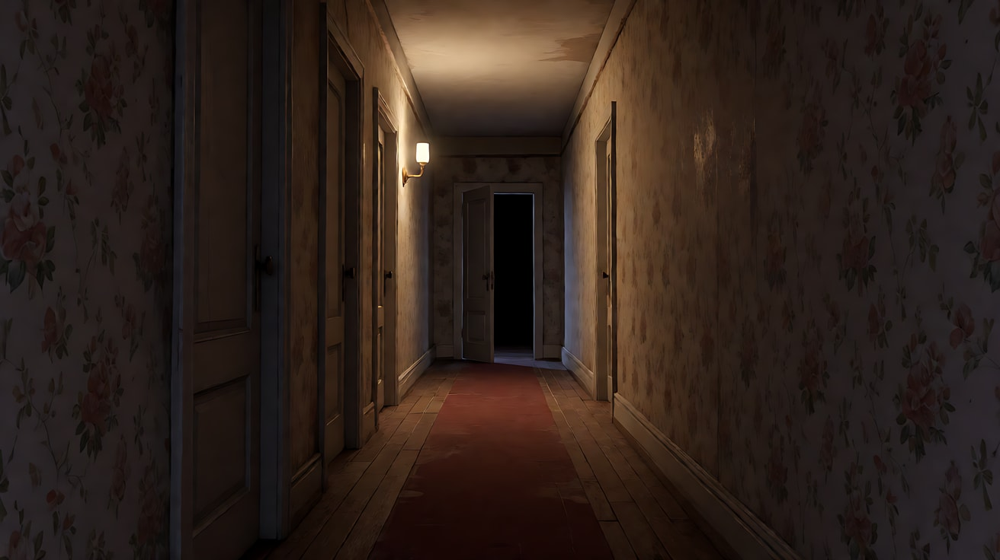
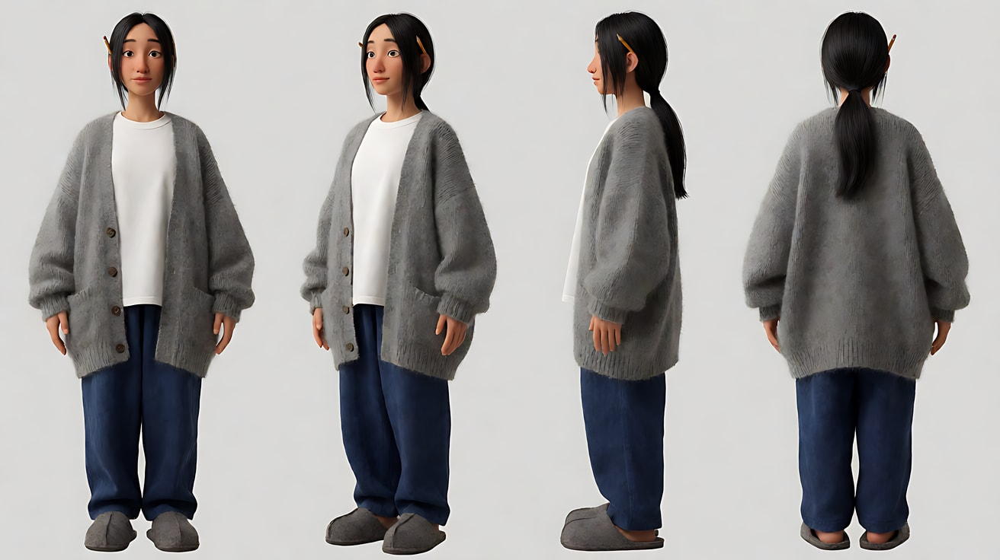
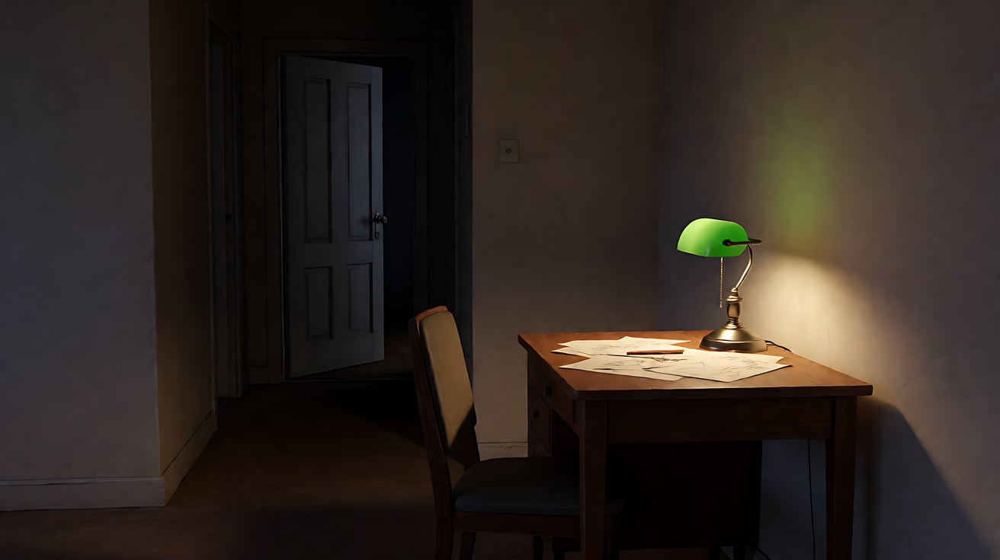
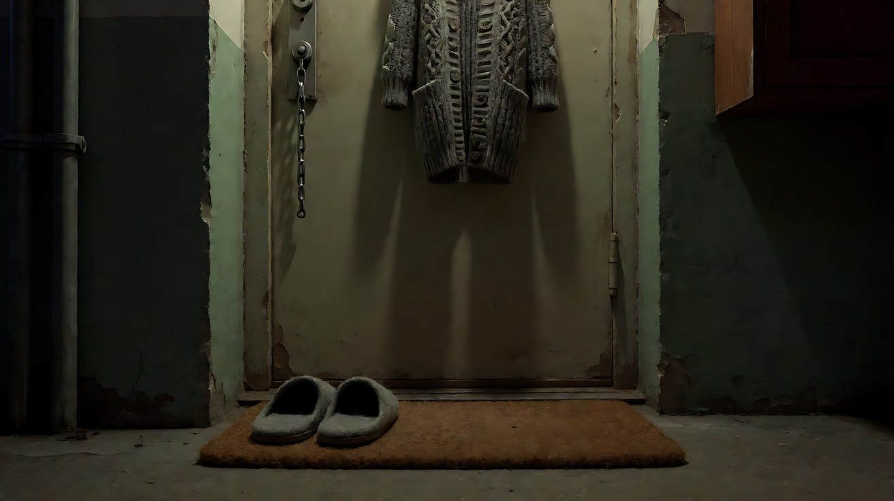
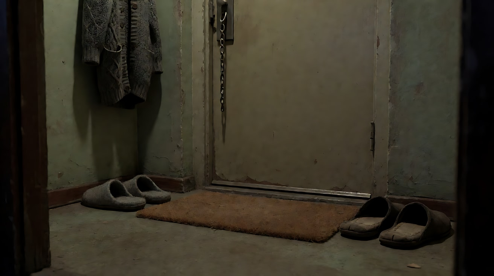
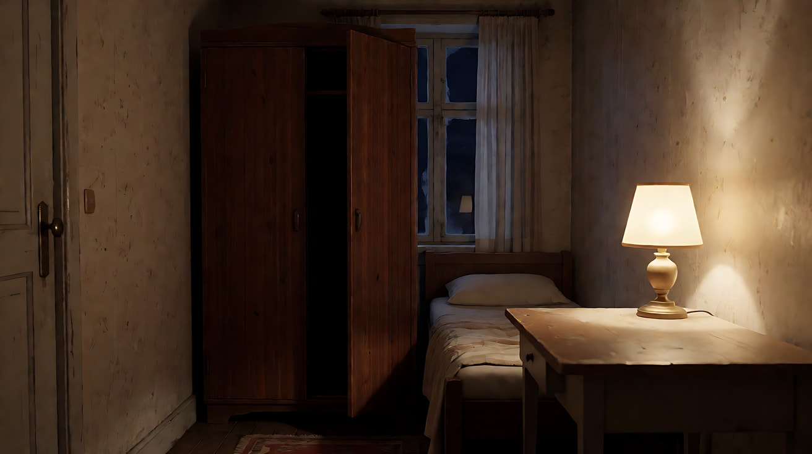
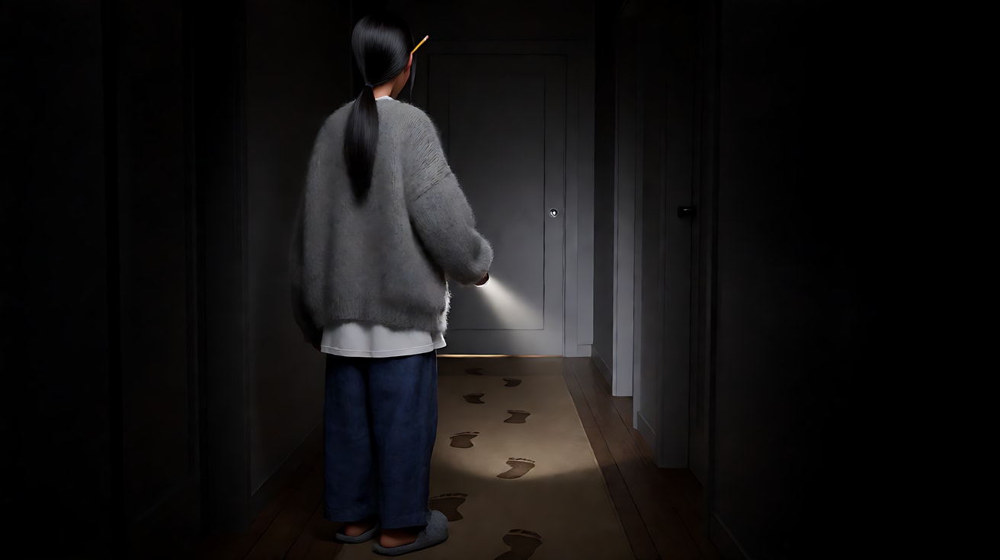
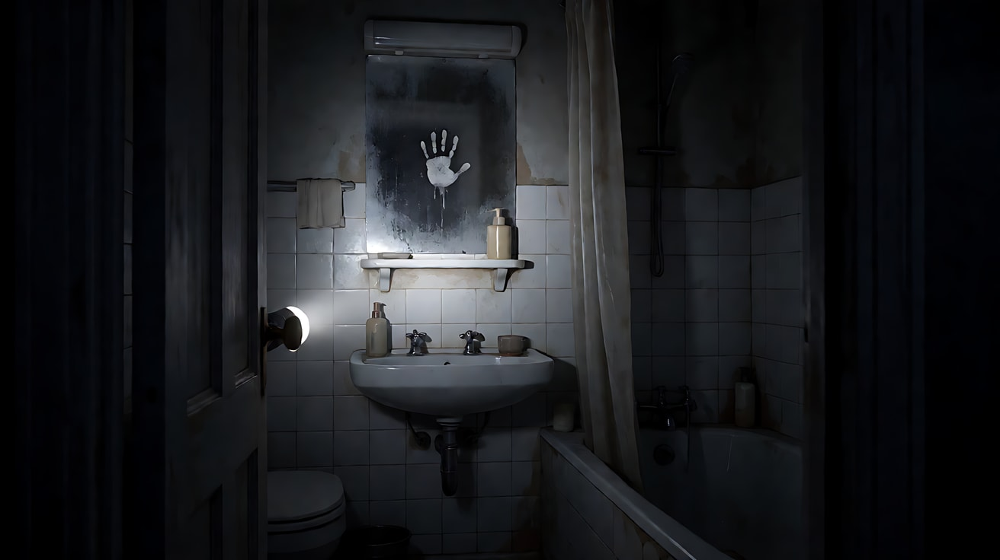

# L08-05 恐怖 · 提示词

> 本组练习：用一个原创故事"新租的旧公寓"练习缺席的恐怖：负空间、深焦背景异动、灯灭再亮的揭示、声音抽空和结尾悬置。全程不出现任何怪物、伤害和超自然名词。｜ 配套教学：[L08-05-恐怖](../教学/L08-05-恐怖.md) ｜ 规范：[写作规范](../../模板/写作规范.md)
>
> 画风默认使用开关 A（风格化写实 CG）。如改用 2D 动画，删掉所有焦段、光圈、景深词。

**故事设定（全组共用）**：三十出头的插画师许棠刚搬进一套租金便宜得出奇的旧公寓，独自居住。房东只交代了一句："晚上浴室的门，别关。"第一周，什么都没发生；直到这一晚，停电了。

**这个家的规则**：屋里只有她一个人，但总有东西比她"多一步"——多一双鞋、多一道门缝、多一个手印。

**一句话意图**：让观众感到"她不是一个人住，而她还不知道"。

---

### 练习1：走廊尽头的门缝（难度 ★）

**目标**：空镜恐怖：没有人，只用负空间、单一光源、极慢推进和一个离屏声音制造预期。

**【生图 · Nano Banana】**

图1 关键帧（空走廊）：

```
Empty narrow hallway of an old apartment at night, no people. Faded floral wallpaper, a worn wooden floor runner,
three closed doors along the left wall and one door at the far end standing open a few centimetres, pure black beyond the gap.
A single dim wall sconce halfway down the hall is the only light, its warm pool fading to near-black at both ends.
Symmetrical one-point perspective composition, the far door gap at the exact centre of the frame.
Camera at standing eye level at the near end of the hall, 28mm lens, deep focus so the far door gap is sharp.
Stylized semi-realistic 3D CG rendering, feature-film animation quality. Aspect ratio 16:9.
```

中文释义：旧公寓夜间空走廊，褪色碎花壁纸、旧木地板长地毯；左墙三扇关着的门，走廊尽头一扇门开着几厘米的缝，缝里一片漆黑。唯一光源是走廊中段一盏昏暗壁灯。严格对称一点透视，门缝在画面正中；28mm 深焦，远处门缝清晰。



**【图生视频 · Seedance】**

```
【素材分工】@图片1 为首帧，锁定走廊布局、壁灯位置与尽头门缝的位置；画面中不新增任何人物或身影。
【画风】风格化写实三维CG质感，低调光，单一光源。
空无一人的旧公寓走廊，中段一盏壁灯发出昏黄的光，两端几乎全黑。镜头从走廊这一端开始，沿着地毯中线极慢地、匀速地向尽头那道门缝推进。壁灯的光轻微闪烁了一次，又恢复。尽头的门缝始终是一片漆黑，门本身一动不动。结尾停在门缝占据画面中央的中景上。
【声音】无配乐。开始时能听到老冰箱的低鸣和远处楼下的车声；推进途中，这些声音一个一个消失；最后完全安静，门缝那边传来三下很轻、很慢的敲击声，像指节敲在木头上。
【约束】画面中不出现任何人、身影、面孔或手；门不打开也不关上；壁灯只闪一次；不要字幕、水印、Logo。
时长：8秒
```

**参数**：时长 8 秒 ｜ 画幅 16:9

**【检查点】**
- 推进是否极慢、匀速，没有突然加速
- 声音是否先"抽空"，再出现三下敲击——敲击声比任何画面都更可怕
- 门缝里是否始终什么都没有

**【常见问题与修复】**
| 现象 | 修复 |
|---|---|
| 门缝里出现一张脸或人影 | 约束写"画面中不出现任何人、身影、面孔或手"，正文写"门缝始终是一片漆黑" |
| 门自己打开了 | 写"门本身一动不动" |
| 灯一直闪，像故障画面 | 写"壁灯只闪一次，随后恢复" |
| 声音没有变化 | 把声音写成"先有什么 → 一个个消失 → 最后出现什么"三段 |

---

### 练习2：她身后那扇门（难度 ★★）

**目标**：观众比角色先知道：许棠在前景台灯下画画，深焦的背景里，卧室那扇原本敞开的门，正在慢慢合上。她没有察觉。

**【生图 · Nano Banana】**

图1 角色定妆：

```
Character turnaround sheet of an original woman in her early thirties: slim, long straight black hair tied in a low loose ponytail,
a few strands falling by her face, an oversized soft grey knitted cardigan over a white T-shirt, loose dark-blue linen trousers,
grey felt slippers, a pencil tucked behind her right ear.
Front view, three-quarter view, side view and back view, full body, plain light-grey background.
Camera at eye level, 50mm lens, deep focus, even soft studio light from the front.
Stylized semi-realistic 3D CG rendering, feature-film animation quality. Aspect ratio 16:9.
```



图2 场景（夜间客厅与卧室门）：

```
Empty small old apartment living room at night, no people. A wooden desk in the foreground right with a single green-glass desk lamp,
sketch papers and pencils scattered on it, a chair in front of it facing the camera side.
In the background on the left, a short dark corridor leads to a bedroom door standing wide open, the bedroom beyond in darkness.
Camera at seated eye level, 35mm lens, deep focus so both the desk and the far bedroom door are sharp.
Lighting: the desk lamp is the only light source, warm pool on the desk, the corridor and bedroom door falling into deep shadow
lit only faintly by the lamp's spill. Stylized semi-realistic 3D CG rendering, feature-film animation quality. Aspect ratio 16:9.
```

中文释义：图1 许棠定妆：三十出头，黑色长直发松松扎成低马尾，宽松浅灰针织开衫、白 T 恤、深蓝亚麻裤、灰色毛毡拖鞋，右耳夹着一支铅笔。图2 夜间客厅：前景画右是书桌和一盏绿玻璃台灯，背景画左一段短走廊通向一扇敞开的卧室门；35mm 深焦，书桌和远处的门都清晰；台灯是唯一光源。



**【多图生视频 · Seedance】**

```
【素材分工】@图片1 锁定人物身份、低马尾、灰色开衫与耳后铅笔，不参考其灰色背景和站姿；@图片2 仅参考客厅布局、台灯与卧室门的位置，不复制其镜头角度。
【画风】风格化写实三维CG质感，低调光，单一光源。
深夜，许棠坐在画右的书桌前，低头在台灯下画画，铅笔在纸上沙沙地移动，偶尔停下来，用指腹抹一下线条。镜头固定，深焦，前景的她和背景画左的卧室门同样清晰。背景里，那扇原本敞开的卧室门，正在极其缓慢地、无声地合上，从全开慢慢变成只剩一掌宽的缝。许棠没有察觉，始终低头画画，只是把滑落的一缕头发拨到耳后。结尾停在她低头画画、身后卧室门只剩一道窄缝的画面上。
【声音】无配乐。铅笔的沙沙声，台灯偶尔的电流轻响，墙上挂钟的滴答。卧室门合上的过程中完全没有声音——门轴没有响。
【约束】保持人物脸型、发型、服装不变；许棠全程不回头、不抬头；画面中只有许棠一个人，门后不出现任何身影或手；门不完全关上；不要字幕、水印、Logo。
时长：10秒
```

**参数**：时长 10 秒 ｜ 画幅 16:9

**【检查点】**
- 门的移动是否慢到"观众要盯着才能确认"——这是预期型恐惧的速度
- 前景和背景是否都在焦内
- 门合上时"没有声音"是否让人更不安

**【常见问题与修复】**
| 现象 | 修复 |
|---|---|
| 门被一只手推着关上 | 约束写"门后不出现任何身影或手"，正文写"无声地合上" |
| 门砰地关上 | 写"极其缓慢""从全开慢慢变成只剩一掌宽的缝""门轴没有响" |
| 许棠回头看 | 写"始终低头画画"，约束再写一次"不回头、不抬头" |
| 背景虚掉看不清门 | 删除所有浅景深词，写"深焦，前景的她和背景的门同样清晰" |

---

### 练习3：门口多了一双拖鞋（难度 ★★★，首尾帧）

**目标**："灯灭再亮"的揭示：首尾两帧构图完全相同，只差一个细节——门口的地垫上，她那双灰拖鞋旁边，多了一双湿的旧拖鞋，鞋尖朝屋里。

**【生图 · Nano Banana】**

沿用练习2的图1（角色定妆）。

图2 首帧：

```
Medium-wide shot of the entrance area of an old apartment at night, no people visible.
A worn front door with a door chain fastened, a small coir doormat in front of it,
one pair of grey felt slippers neatly placed on the mat on the left side, the right side of the mat empty.
A coat hook with a grey knitted cardigan hanging on it. Camera at low height near the floor, 35mm lens, deep focus.
Lighting: a single ceiling bulb in the entrance as the only light, hard and slightly greenish, deep shadows in the corners.
Stylized semi-realistic 3D CG rendering, feature-film animation quality. Aspect ratio 16:9.
```



图3 尾帧：

```
The exact same entrance, framing, camera position and lighting as image 2, no people visible.
The grey felt slippers are still on the left side of the doormat, and now a second pair of old dark-brown cloth slippers
sits on the right side of the mat, soaked and dripping, toes pointing into the apartment,
a small wet patch spreading on the floor beside them. The door chain is still fastened.
Stylized semi-realistic 3D CG rendering, feature-film animation quality. Aspect ratio 16:9.
```

中文释义：首帧——低机位拍入户门口，门链挂着，椰棕地垫左边整齐摆着一双灰色毛毡拖鞋，右边空着；顶上一盏偏绿的硬光灯泡。尾帧——完全相同的构图，只是地垫右边多了一双湿透的深棕色旧布拖鞋，鞋尖朝屋里，旁边一小滩水渍；门链仍然挂着。



**【首尾帧生视频 · Seedance】**

上传顺序：图片1 = 图2 首帧，图片2 = 图3 尾帧。

```
【素材分工】@图片1 为首帧，锁定入户门口的构图、门链与灯光；@图片2 为尾帧，是最终画面目标；两帧之间唯一的变化是地垫右侧多出的一双湿拖鞋。只生成两帧之间的连续变化。
【画风】风格化写实三维CG质感，低调光，单一光源。
入户门口，门链挂得好好的，地垫左边是一双灰拖鞋。头顶的灯泡发出轻微的电流声，闪了两下，完全熄灭，画面几乎全黑，只剩门缝下透进来的一线楼道微光。黑暗持续了一拍。灯泡重新亮起，构图不变，门链仍然挂着，地垫右边多了一双湿透的深棕色旧布拖鞋，鞋尖朝着屋里，水正从鞋底慢慢渗到地板上。镜头固定，不移动。结尾停在两双拖鞋并排的画面上。
【声音】无配乐。灯泡的电流嗡声；熄灭时一声轻微的啪；黑暗中完全安静；灯重新亮起后，只有水从拖鞋上滴落到地板的一下、又一下。
【约束】画面中不出现任何人、身影、脚或手；门始终关着，门链始终挂着；只多出一双拖鞋，其他物品不变；镜头固定，不跳切；不要字幕、水印、Logo。
时长：6秒
```

**参数**：时长 6 秒 ｜ 画幅 16:9

**【检查点】**
- 两帧之间是否只有"多一双拖鞋"这一个变化
- 门链始终挂着——这个细节让"它是怎么进来的"成为最可怕的问题
- 灯亮之后，水滴声是否成为唯一的声音

**【常见问题与修复】**
| 现象 | 修复 |
|---|---|
| 灯灭时画面里出现一双脚 | 约束写"不出现任何人、身影、脚或手"；尾帧也确认没有脚 |
| 门链被打开 | 正文和约束都写"门链始终挂着" |
| 灯亮后其他物品也变了 | 写"构图不变，只多出一双拖鞋，其他物品不变"，并以 @图片2 为最终画面目标 |
| 黑暗段太长或太短 | 只写"黑暗持续了一拍"，不写具体时长 |

---

### 练习4：衣柜的缝又开了（难度 ★★★★，多镜头）

**目标**：三个镜头建立并打破一个规则：她关好衣柜 → 插入特写确认"关紧了" → 她回到桌前，背景里衣柜门又开了一条缝。观众知道，她不知道。

**【生图 · Nano Banana】**

沿用练习2的图1（角色定妆）。

图2 场景（卧室）：

```
Empty small old bedroom at night, no people. A tall dark wooden wardrobe with two doors on the left wall,
one door standing open a hand's width with pure black inside, a narrow bed on the right,
a small desk with a warm bedside lamp in the right foreground. Faded wallpaper, a window with thin curtains.
Camera at seated eye level from beside the desk, 35mm lens, deep focus so the wardrobe gap is sharp.
Lighting: the warm bedside lamp from frame right is the only source, the wardrobe side falls into heavy shadow.
Stylized semi-realistic 3D CG rendering, feature-film animation quality. Aspect ratio 16:9.
```

中文释义：夜间旧卧室空景：左墙一个高大的深色双门木衣柜，一扇门开着一掌宽、里面漆黑；右边一张窄床，右前景一张小桌和暖色床头灯；35mm 深焦，衣柜缝清晰；床头灯是唯一光源，衣柜一侧沉在阴影里。



**【多图生视频 · Seedance】**

```
【素材分工】@图片1 锁定许棠的身份、低马尾与灰色开衫，不参考其背景；@图片2 仅参考卧室布局、衣柜位置与床头灯光线，不复制其镜头角度。
【画风】风格化写实三维CG质感，低调光，单一光源。
镜头1：固定中景，机位在书桌旁。许棠从画右走到画左的衣柜前，看了一眼那道漆黑的门缝，伸手把衣柜门推上，又用手掌按了一下，确认关紧。她转身走回画右的书桌前坐下。拖鞋擦过地板的声音，衣柜门合上时一声沉闷的木头轻响。
镜头2：镜头切至衣柜门缝的特写，固定。两扇门严丝合缝地关着，门把手上的旧铜环静静垂着。床头灯的暖光只照到门的边缘。完全安静，只有挂钟的滴答。
镜头3：镜头切至与镜头1 相同的机位，固定。许棠坐在画右的书桌前，背对衣柜，低头在纸上画画。背景画左的衣柜，那扇门已经又开了一掌宽的缝，缝里一片漆黑，铜环还在轻轻晃动。她没有察觉，继续画画。挂钟的滴答声停了。
【锁定】光线：床头灯是唯一光源，始终在画右，衣柜一侧沉在阴影里；人物：许棠全程扎低马尾、穿灰色开衫和灰拖鞋；位置：衣柜始终在画左，书桌始终在画右；机位：镜头1 和镜头3 为同一个书桌旁机位。
【声音】镜头1 拖鞋声与衣柜门合上的木头轻响；镜头2 只有挂钟滴答；镜头3 铅笔沙沙声，然后挂钟的滴答声突然停止。无配乐。
【约束】保持人物脸型、发型、服装不变；衣柜门缝里不出现任何眼睛、面孔、手或身影；许棠在镜头3 中不回头；不要字幕、水印、Logo。
时长：12秒
```

**参数**：时长 12 秒 ｜ 画幅 16:9 ｜ 负载：3 个镜头，属于"稳妥"档

**【检查点】**
- 镜头2 的插入特写是否清楚地"立下规则"：门关紧了
- 镜头3 的门缝和还在晃动的铜环是否清楚可见——晃动的铜环证明"刚刚才发生"
- 挂钟声停止是否发生在镜头3 末尾

**【常见问题与修复】**
| 现象 | 修复 |
|---|---|
| 门缝里出现眼睛 | 约束写"不出现任何眼睛、面孔、手或身影"，正文写"缝里一片漆黑" |
| 镜头3 门开得太大 | 写"又开了一掌宽的缝"，和镜头1 开始时一样宽 |
| 镜头1 和镜头3 机位不一致 | 镜头3 写"与镜头1 相同的机位"，【锁定】里再写一次 |
| 她在镜头3 回头 | 写"背对衣柜，低头画画，没有察觉"，约束再写一次 |

---

### 练习5：停电那一晚——完整 15 秒恐怖片段（难度 ★★★★★）

**目标**：完整片段：停电（常态被打破）→ 手电光找到一串湿脚印（异常）→ 她握住浴室门把手，里面的水声突然停了（抽空）→ 推开门，浴室空无一人，起雾的镜子上有一个手印（峰值）→ 她慢慢转头看向身后黑暗的走廊（悬置）。

**【生图 · Nano Banana】**

沿用练习2的图1（角色定妆），练习1的图1（空走廊，本练习中上传为图2）。

图3 镜头2 关键帧（湿脚印）：

```
Using the character from image 1 and the hallway from image 2, during a power cut:
medium shot from behind the woman's right shoulder, she holds a small flashlight pointing down the dark hallway,
the narrow beam is the only light, revealing a line of wet bare footprints on the wooden floor runner
leading from the front door direction to the closed bathroom door at the end, a thin line of light-grey steam seeping from under that door.
Camera at shoulder height, 35mm lens, deep focus. Everything outside the flashlight beam falls into near-black.
Keep the face, hairstyle and outfit exactly as in image 1. Stylized semi-realistic 3D CG rendering, feature-film animation quality. Aspect ratio 16:9.
```



图4 镜头4 关键帧（起雾的镜子）：

```
Small old tiled bathroom at night during a power cut, no people visible. A mirror above the sink completely fogged with steam,
a single adult handprint pressed into the fog in the middle of the mirror, a few drops running down from its fingers.
The bathtub curtain open, the tub empty, the tap no longer running, steam hanging in the air.
Camera at standing eye level from the doorway, 35mm lens, deep focus.
Lighting: a single flashlight beam entering from the doorway on the left as the only light, hitting the fogged mirror,
the rest of the room in deep shadow. Stylized semi-realistic 3D CG rendering, feature-film animation quality. Aspect ratio 16:9.
```

中文释义：图3——停电中，从她右肩后方拍，她拿着小手电照向走廊，窄窄的光束是唯一光源，照出地毯上一串湿的赤脚脚印，从大门方向一直延伸到走廊尽头关着的浴室门下，门缝里渗出一线白汽。图4——停电的旧浴室，空无一人，洗手台上方的镜子完全起雾，雾上正中按着一个成年人的手印，指尖有几道水痕流下；浴帘拉开，浴缸是空的，龙头已经停了，水汽悬在空中；唯一的光是从门口照进来的手电光。



**【多图生视频 · Seedance】**

```
【素材分工】@图片1 锁定许棠的身份、低马尾、灰色开衫与灰拖鞋，不参考其背景；@图片2 仅参考走廊布局与浴室门的位置，不复制其中的壁灯光线；@图片3 仅参考镜头2 的构图与手电光效果；@图片4 仅参考镜头4 的浴室构图与镜子上的手印，作为峰值画面目标。
【画风】风格化写实三维CG质感，低调光，唯一光源为手电。
镜头1：客厅中景，固定机位。许棠坐在台灯下画画，台灯啪地一声熄灭，整个屋子陷入黑暗。黑暗中，她摸索着打开一支小手电，一道窄窄的光束亮起来，照在她半张脸上。冰箱的低鸣同时停了。
镜头2：镜头切至她右肩后方的中景。她举着手电照向走廊，光束沿着地毯往前移，照出一串湿的赤脚脚印，从大门方向一直延伸到走廊尽头那扇关着的浴室门下，门缝里渗出一线白汽。浴室里传来哗哗的水声。她屏住呼吸，没有出声。
镜头3：镜头切至浴室门把手的特写。她的手握住冰凉的金属门把手，停住。门里的水声在这一刻突然停了，四周完全安静，只剩她自己的呼吸。
镜头4：镜头切至浴室门口的主观视角，门被缓缓推开，手电光照进去。浴室里空无一人，浴缸是空的，水汽悬在半空。光束停在洗手台上方起雾的镜子上，镜子正中有一个成年人的手印，指尖的水痕正慢慢往下流。镜头固定，不再前进。
镜头5：镜头切至许棠的半侧脸近景，手电光从下方映在她脸上。她没有动，只是眼睛慢慢转向左边，然后整个头极慢地转过去，看向身后那条完全黑暗的走廊。手电光没有跟过去，她身后什么也照不到。镜头停在她回头的半侧脸和身后的黑暗上。
【锁定】光线：停电后唯一光源是许棠手里的小手电，光束窄、偏冷白；人物：许棠全程扎低马尾、穿灰色开衫和灰拖鞋；位置：走廊尽头是浴室门，大门在她身后；机位：镜头2 和镜头5 都在她的右侧。
【声音】镜头1 台灯熄灭的啪声，冰箱低鸣停止；镜头2 浴室里的哗哗水声；镜头3 水声骤停，完全安静，只剩呼吸；镜头4 门轴一声很轻的吱呀，水珠滴落在洗手台上；镜头5 彻底静音，最后在她身后的黑暗里，远远地传来一声地板受力的轻响。无配乐。
【约束】保持人物脸型、发型、服装不变；全片只出现许棠一个人，镜子里、走廊里、浴室里都不出现任何其他人、身影、面孔或倒影；手印只有一个；不要字幕、水印、Logo。
时长：15秒
```

**参数**：时长 15 秒 ｜ 画幅 16:9 ｜ 负载：5 个镜头（镜头3 为插入特写、镜头5 为反应镜头），属于"有挑战"档；如镜头被合并，拆成"镜头1–3"与"镜头4–5"两次生成，第二次以图4 为首帧

**【检查点】**
- 恐惧是否逐级升级：停电 → 脚印 → 水声骤停 → 镜子手印 → 身后的地板声
- 镜头4 的浴室是否"空无一人"——缺席比出现更可怕
- 镜头5 的回头是否极慢，身后是否始终什么也照不到
- 整片是否没有一个超自然名词、伤害或怪物

**【常见问题与修复】**
| 现象 | 修复 |
|---|---|
| 镜子里出现人影或倒影 | 约束写"镜子里不出现任何倒影"，并用 @图片4 锁定镜子内容 |
| 镜头5 身后出现一个人形 | 写"手电光没有跟过去，她身后什么也照不到"，约束再写"走廊里不出现任何身影" |
| 被平台拦截 | 检查是否出现了超自然名词、伤害或危险物品；本稿只用"脚印、水声、手印、地板声"承载恐惧 |
| 手电光太亮，像开了灯 | 写"窄窄的光束""光束之外几乎全黑" |
| 5 个镜头被合并成 3 个 | 按参数说明拆成两次生成 |
