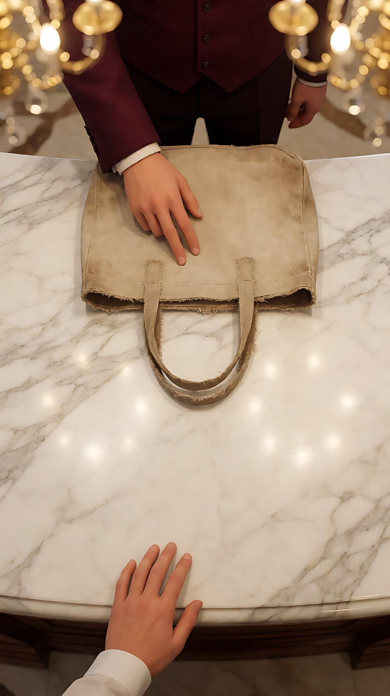
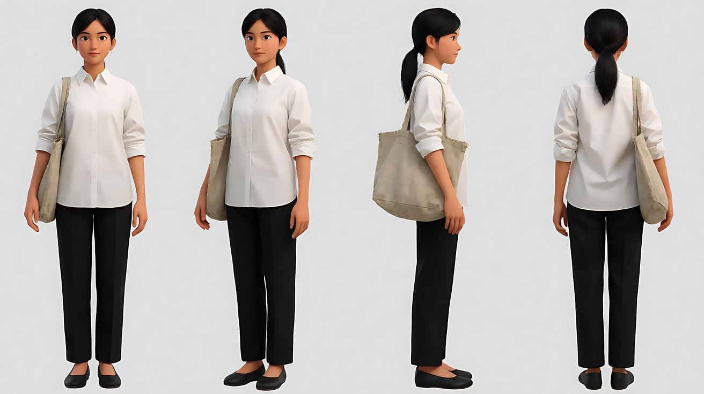
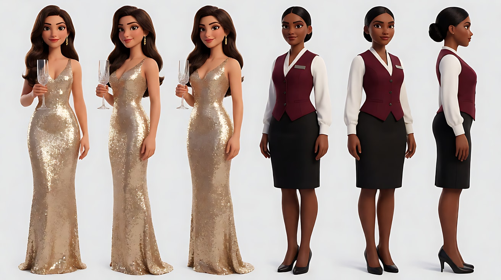
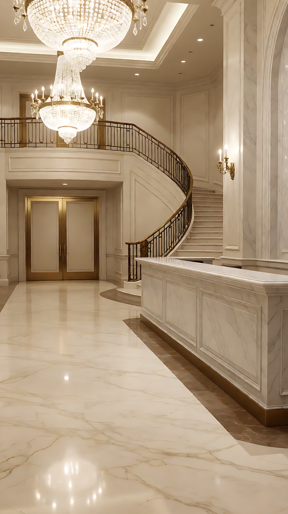
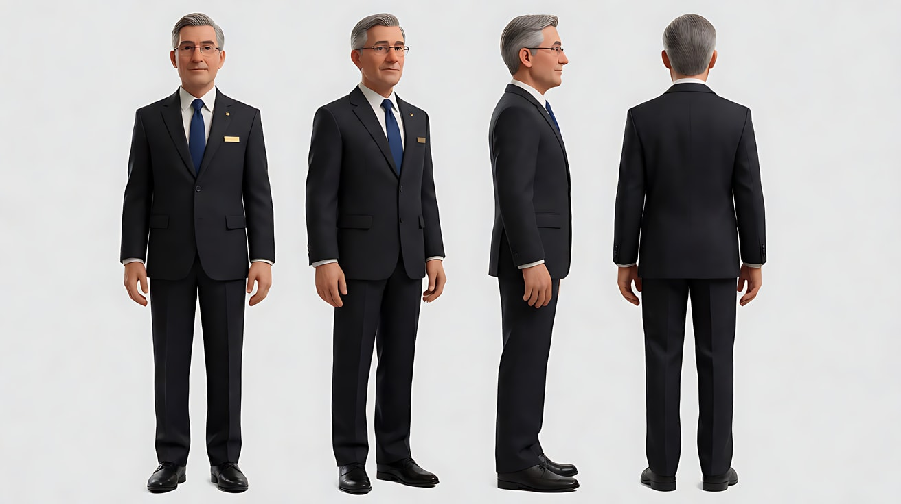
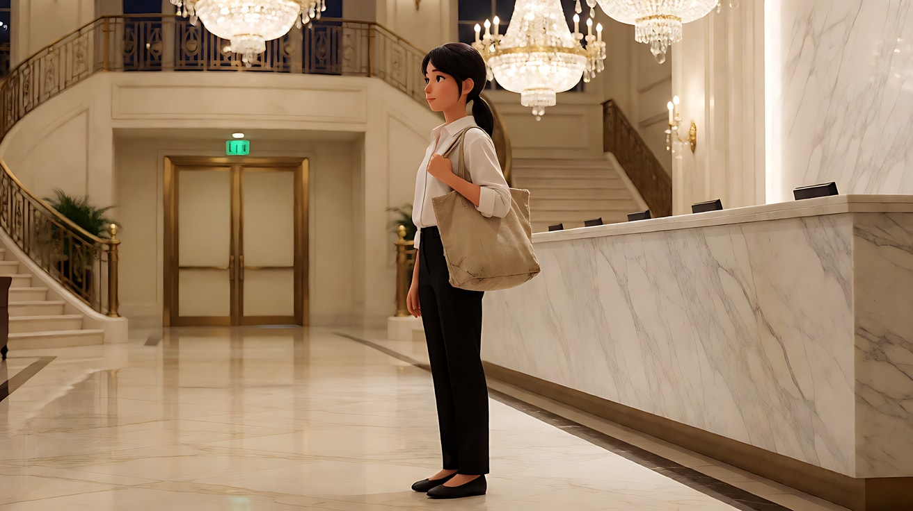
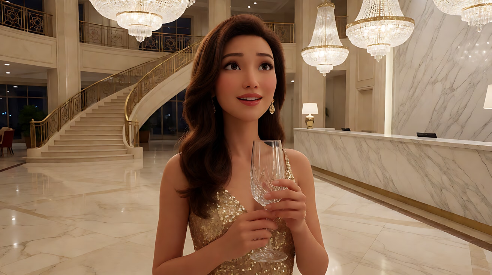
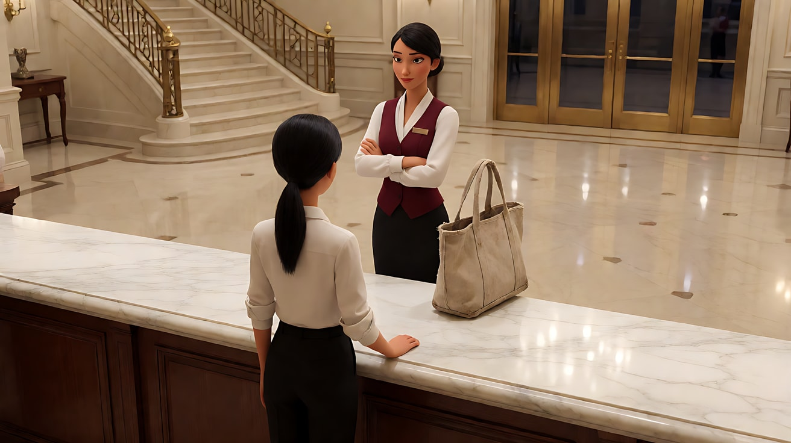
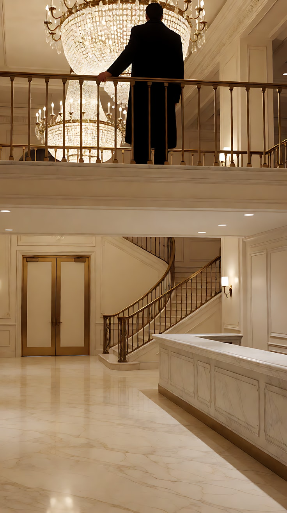

# L08-06 竖屏短剧爽点钩子 · 提示词

> 本组练习：用一个原创故事"寿宴包场"练习 9:16 竖屏的前三秒钩子、压、反转、爽点、反应镜头和结尾新钩子。｜ 配套教学：[L08-06-竖屏短剧爽点钩子](../教学/L08-06-竖屏短剧爽点钩子.md) ｜ 规范：[写作规范](../../模板/写作规范.md)
>
> 画风默认使用开关 A（风格化写实 CG）。如改用 2D 动画，删掉所有焦段、光圈、景深词。
>
> **本课所有画面均为竖屏 9:16**。人脸放在上三分之一到中线之间，画面下方约四分之一留给后期字幕；生成时画面里不出现任何文字。角色定妆图可以用 16:9 横版，方便并排展示多个角度。

**故事设定（全组共用）**：城里最高档的酒店今晚包场办寿宴。林知夏穿着一件素白衬衫、背着旧帆布包走进大堂，被前台主管拦下，又被表姐苏曼当众奚落。没有人知道，这家酒店上个月刚换了主人——就是她。

**角色**：
- 林知夏：主角，二十六岁，素白衬衫，低马尾，旧帆布包
- 苏曼：表姐，二十八岁，亮金色亮片礼服，大波浪卷发，手拿高脚水晶杯
- 前台主管：三十多岁女性，酒红色西装马甲，盘发
- 酒店经理：五十多岁男性，深灰色西装，无框眼镜，翻领上一枚无字金属胸牌

**一句话意图**：让观众在前三秒替她不平，在第二个反转里替她出气，在最后一个镜头想看下一集。

---

### 练习1：被推回来的帆布包——前三秒钩子（难度 ★）

**目标**：只练钩子：一个反常画面，零理解成本。不露脸，只拍台面上的两只手和一只旧帆布包。

**【生图 · Nano Banana】**

图1 关键帧：

```
Vertical close-up of a polished white marble hotel reception counter. An old faded canvas tote bag with frayed straps
sits in the centre of the counter. From the top of the frame, a manicured hand in a burgundy waistcoat sleeve
rests two fingers on the bag, about to push it away. From the bottom of the frame, a plain hand in a white shirt cuff rests on the counter edge.
The bag is placed in the upper-middle of the frame; the lower quarter of the frame is clean marble kept clear for subtitles.
Camera directly above at a slight angle, 50mm lens, shallow depth of field, the lobby's gold chandeliers blurred into warm bokeh at the top edge.
Lighting: bright warm overhead chandelier light, soft reflections on the marble.
Stylized semi-realistic 3D CG rendering, feature-film animation quality. Vertical 9:16 frame.
```

中文释义：竖屏特写，白色大理石前台台面中央放着一只褪色起毛边的旧帆布包；画面上方伸进一只穿酒红马甲袖口、做了美甲的手，两根手指搭在包上正要推开；画面下方是一只白衬衫袖口的素手搭在台沿。包在画面中上部，下方四分之一留给字幕；略俯拍、50mm 浅景深，顶部是虚化的金色吊灯。



**【图生视频 · Seedance】**

```
【素材分工】@图片1 为首帧，锁定台面构图、帆布包外形与两只手的袖口；画面中不出现人脸。
【画风】风格化写实三维CG质感，明亮暖色调。
大理石前台上，那只穿酒红马甲袖口的手用两根手指把旧帆布包往台面下方一推，帆布包滑过光滑的大理石，停在台沿边上，一根磨毛的包带垂了下去。画面下方那只白衬衫袖口的手没有去接，只是手指在台沿上轻轻收紧，按住不动。镜头固定俯拍，不移动。结尾停在帆布包悬在台沿、那只手按着台面的画面上。
【声音】大堂里低低的人声和钢琴背景声，帆布包滑过大理石的一声摩擦，一声低沉的鼓点重音落在包停住的瞬间。
【约束】画面中不出现人脸；帆布包不掉到地上；画面中不出现任何文字；不要字幕、水印、Logo。
时长：5秒
```

**参数**：时长 5 秒 ｜ 画幅 9:16

**【检查点】**
- 不看任何文字，观众能否在一眼之内读懂"她被看不起了"
- 白衬衫的手"按住不动"是否传达出"她不是好惹的"——这是给后面反转埋的底
- 鼓点重音是否落在包停住的那一刻

**【常见问题与修复】**
| 现象 | 修复 |
|---|---|
| 包被推到地上 | 写"停在台沿边上"，约束写"帆布包不掉到地上"——掉下去是下一个练习的戏 |
| 镜头上摇露出人脸 | 写"镜头固定俯拍，不移动"，约束写"画面中不出现人脸" |
| 两只手都在动 | 写清"白衬衫的手没有去接"，只给手指一个"收紧"的小动作 |

---

### 练习2：表姐的那两根手指——压（难度 ★★）

**目标**：竖屏纵深调度：林知夏在前景近景，苏曼在后景中景。苏曼做主动作（用两根手指拎起包带，丢到地上），林知夏只给一个小动作。一句台词交代关系。

**【生图 · Nano Banana】**

图1 角色定妆（主角）：

```
Character turnaround sheet of an original young woman, twenty-six: slim, black hair in a neat low ponytail, no jewellery,
a plain crisp white cotton shirt with sleeves folded once, straight black trousers, simple black flat shoes,
an old faded beige canvas tote bag with frayed straps on her shoulder. Calm, upright posture.
Front view, three-quarter view, side view and back view, full body, plain light-grey background.
Camera at eye level, 50mm lens, deep focus, even soft studio light from the front.
Stylized semi-realistic 3D CG rendering, feature-film animation quality. Aspect ratio 16:9.
```



图2 角色定妆（配角两人）：

```
Character turnaround sheet of two original women.
The cousin, twenty-eight: long glossy wavy brown hair, a shimmering gold sequin evening gown, gold drop earrings,
holding a tall crystal stemmed glass. The reception supervisor, mid-thirties: dark hair in a tight bun,
a fitted burgundy waistcoat over a white blouse, black pencil skirt, a plain metal name badge with no text.
Front view, three-quarter view and side view of each, full body, plain light-grey background.
Camera at eye level, 50mm lens, deep focus, even soft studio light from the front.
Stylized semi-realistic 3D CG rendering, feature-film animation quality. Aspect ratio 16:9.
```



图3 场景（酒店大堂）：

```
Empty grand hotel lobby at night, no people. A long white marble reception counter on the right,
a polished cream marble floor, a sweeping staircase with brass railings in the background leading up to a mezzanine balcony,
huge crystal chandeliers, tall closed gold-framed double doors to a banquet hall at the back left.
Vertical framing from the middle of the lobby, eye level, 35mm lens, deep focus.
Lighting: bright warm chandelier light from above, soft reflections on the marble floor.
Stylized semi-realistic 3D CG rendering, feature-film animation quality. Vertical 9:16 frame.
```

中文释义：图1 林知夏定妆：低马尾、素白棉衬衫、黑直筒裤、平底鞋、旧米色帆布包。图2 配角定妆：表姐苏曼（棕色大波浪、金色亮片礼服、金色耳坠、高脚水晶杯）；前台主管（盘发、酒红马甲、白衬衫、黑色铅笔裙、无字金属胸牌）。图3 酒店大堂竖屏空景：右侧白色大理石前台，背景是带铜扶手的弧形楼梯通往二楼回廊，巨大水晶吊灯，后方左侧一对关着的金框宴会厅大门。



**【多图生视频 · Seedance】**

```
【素材分工】@图片1 锁定林知夏的身份、低马尾、白衬衫与旧帆布包，不参考其灰色背景；@图片2 锁定苏曼的身份、金色礼服与高脚杯，前台主管不在本片段中出场，不参考其背景；@图片3 仅参考大堂布局、楼梯与吊灯光线，不复制其镜头角度。
【画风】风格化写实三维CG质感，明亮暖色调。
竖屏纵深构图。林知夏在前景，背对大堂站在前台边，肩部以上的近景位于画面中线偏上，脸朝向镜头偏右，旧帆布包放在她手边的台沿上。后景中景里，苏曼端着高脚水晶杯从楼梯方向款款走来，停在林知夏身后一步远，低头瞥了一眼台沿上的帆布包。苏曼用两根手指拎起磨毛的包带，手腕一松，帆布包掉在大理石地面上。
苏曼（拎着包带，嘴角带笑）："她呀，来蹭饭的。"
林知夏没有回头，只是垂下眼睛，下颌微微收紧。镜头从前景她的近景缓慢向前推近，后景的苏曼逐渐虚化。结尾停在林知夏垂眼、下颌收紧的近景上。
【锁定】光线：水晶吊灯暖光来自上方；人物：林知夏始终在前景、穿白衬衫、低马尾，苏曼始终在后景、穿金色礼服、拿高脚杯；机位始终在林知夏的正前方。
【声音】大堂钢琴背景声，高跟鞋走近的哒哒声，帆布包落地的一声闷响；苏曼说完台词后，背景人声里传来两三声低低的窃笑。
【约束】保持两人脸型、发型、服装不变；两人没有身体接触；全片只有苏曼一句台词，林知夏不说话、不回头；画面中不出现文字；人脸保持在画面上半部分，下方留出字幕区；不要字幕、水印、Logo。
时长：8秒
```

**参数**：时长 8 秒 ｜ 画幅 9:16

**【检查点】**
- 前后纵深是否清楚：前景是林知夏，后景是苏曼——而不是左右并排挤在画边
- 一句台词是否让观众明白"表姐看不起她"的关系
- 林知夏的反应是否只有"垂眼、下颌收紧"，克制而不委屈——克制的人翻身才爽

**【常见问题与修复】**
| 现象 | 修复 |
|---|---|
| 两人左右并排站，竖屏里挤成两条 | 写"竖屏纵深构图，林知夏在前景，苏曼在后景"，必要时先生成一张纵深关键帧作为首帧 |
| 苏曼推了林知夏 | 写清"用两根手指拎起包带，手腕一松"，约束写"两人没有身体接触" |
| 林知夏哭了 | 删掉所有情绪词，只写"垂下眼睛""下颌微微收紧" |
| 台词变成林知夏说的 | 写成"苏曼（拎着包带，嘴角带笑）："，并在约束写"林知夏不说话" |

---

### 练习3：一张黑色卡片——反转（难度 ★★★，首尾帧）

**目标**：反转用一个可见的动作完成：首帧，她把一张无字的黑色卡片放在台面上；尾帧，前台主管弯下腰，双手平放在卡片两侧，头低了下去。中间只有"看清卡片 → 笑容退下 → 弯腰"三步。

**【生图 · Nano Banana】**

沿用练习2的图1、图2、图3。

图4 首帧：

```
Using the young woman from image 1, the reception supervisor from image 2 and the lobby from image 3:
vertical medium shot across the marble counter. In the foreground lower part of the frame, the young woman's hand
lays a plain matte black card with no text or logo flat on the white marble. Behind the counter in the upper part of the frame,
the supervisor stands upright, arms folded, chin raised, looking down at the card with a thin polite smile.
The supervisor's face is in the upper third of the frame; the lower quarter is clear marble for subtitles.
Camera at counter height from the young woman's side, 50mm lens, moderate depth of field.
Lighting: bright warm chandelier light from above, a soft highlight on the black card.
Keep the faces, hairstyles and outfits exactly as in image 1 and image 2. Stylized semi-realistic 3D CG rendering, feature-film animation quality. Vertical 9:16 frame.
```


图5 尾帧：

```
Using the same characters, framing, counter and lighting as image 4:
the black card still lies on the marble in the foreground. Behind the counter, the supervisor is now bowing deeply from the waist,
both hands placed flat on the marble on either side of the card, her head lowered, her bun toward the camera,
her name badge hanging forward. The young woman's hand has withdrawn out of frame.
Keep the faces, hairstyles and outfits exactly as in image 1 and image 2. Stylized semi-realistic 3D CG rendering, feature-film animation quality. Vertical 9:16 frame.
```

中文释义：首帧——竖屏中景，前景下方林知夏的手把一张无字哑光黑卡平放在台面上；台后画面上方，主管双臂抱胸、下巴微抬、带着客气的冷笑低头看卡。尾帧——同一构图，黑卡仍在台面上，主管深深弯下腰，双手平放在卡片两侧，头低下去，露出盘发，胸牌垂向前；林知夏的手已收出画外。


**【首尾帧生视频 · Seedance】**

上传顺序：图片1 = 图1 主角定妆，图片2 = 图2 配角定妆，图片3 = 图4 首帧，图片4 = 图5 尾帧。

```
【素材分工】@图片3 为首帧，锁定台面构图与两人位置；@图片4 为尾帧，是最终画面目标；@图片2 锁定前台主管的身份、盘发与酒红马甲，不参考其背景；@图片1 锁定林知夏的袖口与手，不参考其背景。只生成两帧之间的连续动作。
【画风】风格化写实三维CG质感，明亮暖色调。
林知夏把黑色卡片放在大理石台面上，手指在卡片上停了一下，收回画外。前台主管抱着手臂低头看那张卡，嘴角的笑还挂着；她的目光在卡片上停住，抱着的手臂慢慢松开，笑容一点点从嘴角退下去。她双手平放在台面上卡片的两侧，腰慢慢弯了下去，头低到看不见脸。镜头固定，不移动。大堂的钢琴声在她弯腰的过程中停了。
【声音】卡片放在大理石上的一声轻响；钢琴声戛然而止；主管弯腰时制服布料细微的摩擦声；最后一声低沉的鼓点重音。无对白。
【约束】保持两人脸型、发型、服装不变；卡片上不出现任何文字或图案；中间动作连续，不跳切；不要字幕、水印、Logo。
时长：6秒
```

**参数**：时长 6 秒 ｜ 画幅 9:16

**【检查点】**
- "笑还挂着 → 目光停住 → 手臂松开 → 弯腰"四步是否连续可读
- 反转是否完全靠动作完成，没有一句台词
- 钢琴声骤停是否发生在弯腰过程中

**【常见问题与修复】**
| 现象 | 修复 |
|---|---|
| 卡片上出现文字或图案 | 生图和视频约束都写"卡片上不出现任何文字或图案"；需要的信息在后期字幕里给 |
| 主管直接跪下 | 写"腰慢慢弯了下去"，并以 @图片4 为最终画面目标 |
| 主管的手碰到了林知夏 | 正文写清林知夏放下卡片后"收回画外" |
| 表情变化太夸张，五官变形 | 表情只写"笑容一点点退下去"一处，其余交给手臂和腰 |

---

### 练习4：经理来了——反转与反应链（难度 ★★★★，多镜头）

**目标**：反转之后，用两个反应镜头告诉观众"该爽了"。经理一句台词亮出身份 → 苏曼的杯子停在半空 → 前台主管把地上的帆布包捡起来，双手递回。

**【生图 · Nano Banana】**

沿用练习2的图1、图2、图3。

图4 角色定妆（经理）：

```
Character turnaround sheet of an original hotel general manager in his fifties: short neatly combed grey hair,
rimless glasses, a well-tailored dark charcoal suit, a white shirt and a deep blue tie, a plain gold metal badge on the lapel with no text.
Front view, three-quarter view, side view and back view, full body, plain light-grey background.
Camera at eye level, 50mm lens, deep focus, even soft studio light from the front.
Stylized semi-realistic 3D CG rendering, feature-film animation quality. Aspect ratio 16:9.
```

中文释义：经理定妆：五十多岁，灰发梳得整齐，无框眼镜，剪裁合体的深炭灰西装，白衬衫配深蓝领带，翻领上一枚无字金色胸牌。



**【多图生视频 · Seedance】**

```
【素材分工】@图片1 锁定林知夏的身份、低马尾与白衬衫，不参考其背景；@图片2 锁定苏曼与前台主管的身份与服装，不参考其背景；@图片4 锁定经理的身份、眼镜与深灰西装，不参考其背景；@图片3 仅参考大堂布局与吊灯光线，不复制其镜头角度。
【画风】风格化写实三维CG质感，明亮暖色调。
镜头1：竖屏中景，低角度。经理从后景的楼梯快步走下来，穿过大堂，在林知夏面前一步远停下，微微欠身，双手交叠在身前。林知夏在前景，半侧背影占据画面下部。
经理（欠身，声音清楚）："林总，整层都给您留着。"
镜头2：镜头切至苏曼的单人近景，反应镜头。她刚把高脚水晶杯举到嘴边，杯子停在半空，嘴角的笑还没收回去，眼睛已经不笑了，目光慢慢移向画面下方林知夏的方向。背景人声在这一刻安静下来。
镜头3：镜头切至前台主管的中景，反应镜头。她快步从台后绕出来，弯腰从大理石地面上捡起那只旧帆布包，用手掌拍了拍包上的灰，双手捧着递向画面下方。她低着头，不敢抬眼。
【锁定】光线：水晶吊灯暖光来自上方；人物：林知夏白衬衫、低马尾，苏曼金色礼服、拿高脚杯，前台主管酒红马甲、盘发，经理深灰西装、无框眼镜；位置：林知夏站在大堂中央面朝楼梯，苏曼在她身后左侧，前台在她右侧；机位始终在林知夏前方同一侧。
【声音】镜头1 经理急促的皮鞋声和他的一句台词；镜头2 背景人声全部安静，只剩远处一声杯碟轻响；镜头3 帆布包被拍灰的两下轻响，一声低沉鼓点重音。无配乐。
【约束】保持所有人物脸型、发型、服装不变；全片只有经理一句台词；人物之间没有身体接触；画面中不出现文字；人脸保持在画面上半部分；不要字幕、水印、Logo。
时长：12秒
```

**参数**：时长 12 秒 ｜ 画幅 9:16 ｜ 负载：3 个镜头、1 句台词、2 个反应镜头，属于"稳妥"档

**【检查点】**
- 经理的台词是否一句话交代了"身份反转"——"林总"两个字就是底牌
- 镜头2 苏曼"杯子停在半空、眼睛不笑了"是否清楚——这是爽点的第一张脸
- 镜头3 捡包、拍灰、双手递回，是否与练习1、2 的"推包、丢包"形成回收

**【常见问题与修复】**
| 现象 | 修复 |
|---|---|
| 镜头2 苏曼也开口说话 | 写"她没有说话"，约束写"全片只有经理一句台词" |
| 经理的台词念错或口型崩 | 台词控制在 12 个字以内，单独给经理一个镜头说 |
| 主管扔包而不是递包 | 写清"双手捧着递向画面下方""低着头，不敢抬眼" |
| 人物站位每个镜头都在变 | 【锁定】里写清每个人在林知夏的哪一侧 |

---

### 练习5：一句话的爽点——正反打（难度 ★★★★，多镜头）

**目标**：爽点不靠吼，靠一句很轻的话。正反打一人一镜：苏曼想挽回 → 林知夏一句话 → 苏曼说不出话。低角度给翻身者，高角度给失势者。

**【生图 · Nano Banana】**

沿用练习2的图1、图2、图3。

图4 林知夏单人关键帧（略仰拍）：

```
Using the young woman from image 1 and the lobby from image 3: vertical medium close-up of the young woman from a slightly low angle,
standing upright, chin level, looking calmly toward frame left, her face in the upper third of the frame,
the crystal chandeliers glowing above and behind her head. Camera slightly below her eye line, 85mm lens, shallow depth of field.
Lighting: warm chandelier key from above front, a soft gold rim light on her hair from behind.
Keep the face, hairstyle and outfit exactly as in image 1. Stylized semi-realistic 3D CG rendering, feature-film animation quality. Vertical 9:16 frame.
```



图5 苏曼单人关键帧（略俯拍）：

```
Using the cousin from image 2 and the lobby from image 3: vertical medium close-up of the cousin from a slightly high angle,
holding the crystal glass against her chest with both hands, looking up toward frame right, her face in the upper third of the frame,
the marble floor visible behind her. Camera slightly above her eye line, 85mm lens, shallow depth of field.
Lighting: flatter, cooler fill from the side, the chandelier glow falling behind her rather than on her face.
Keep the face, hairstyle and outfit exactly as in image 2. Stylized semi-realistic 3D CG rendering, feature-film animation quality. Vertical 9:16 frame.
```

中文释义：图4——略仰拍的林知夏中近景，下巴平稳，平静地看向画左，吊灯在她头顶后方发光，头发有金色轮廓光。图5——略俯拍的苏曼中近景，双手把高脚杯抱在胸前，抬眼看向画右；光变平变冷，吊灯光落在她身后而不在她脸上。



**【多图生视频 · Seedance】**

```
【素材分工】@图片5 为首帧，锁定镜头1 苏曼的略俯拍构图与光线；@图片4 仅参考镜头2 林知夏的略仰拍构图与轮廓光；@图片1 锁定林知夏的身份与服装，@图片2 锁定苏曼的身份与服装，均不参考其背景；@图片3 仅参考大堂环境，不复制其镜头角度。
【画风】风格化写实三维CG质感，明亮暖色调。
镜头1：苏曼的单人中近景，略俯拍，固定机位。她双手把高脚杯抱在胸前，挤出一个笑，往画右走近半步。
苏曼（挤出笑，声音发紧）："知夏，咱们是一家人呀。"
镜头2：镜头切至林知夏的单人中近景，略仰拍，固定机位。她看着画左的苏曼，停了一拍，没有笑。
林知夏（平静，声音很轻）："包场的人，是我。"
镜头3：镜头切回苏曼的单人中近景，同一机位。她张了张嘴，什么也没说出来，抱着杯子的手指慢慢收紧，视线垂了下去。她身后的宴会厅大门缓缓打开，门后的暖光照进大堂，落在她身后的地面上，没有落在她身上。
【锁定】光线：林知夏头顶有吊灯的金色轮廓光，苏曼的光更平更冷；人物：林知夏白衬衫、低马尾，苏曼金色礼服、抱着高脚杯；视线：林知夏始终看向画左，苏曼始终看向画右；机位：两人的单人镜头都在两人连线同一侧。
【声音】大堂极安静；两句台词各在自己的镜头里；林知夏说完后留出一拍完全的沉默；镜头3 宴会厅大门打开时，门后传来隐约的欢声和音乐，一声低沉鼓点。
【约束】保持两人脸型、发型、服装不变；两人各说一句，不重叠；画面中不出现文字；人脸保持在画面上半部分；不要字幕、水印、Logo。
时长：10秒
```

**参数**：时长 10 秒 ｜ 画幅 9:16 ｜ 负载：3 个镜头、2 句短台词（一人一镜），属于"稳妥"档

**【检查点】**
- 低角度给林知夏、高角度给苏曼，角度是否传达了权力的翻转
- 林知夏那句台词后是否有一拍沉默——爽点要"落地"
- 宴会厅的暖光是否落在苏曼身后而不在她身上——光也在站队

**【常见问题与修复】**
| 现象 | 修复 |
|---|---|
| 两句台词串到同一个人嘴里 | 每句台词前写清角色名与动作，两人分别在各自的单人镜头里说 |
| 林知夏说完台词笑了 | 写"没有笑"，表演保持平静 |
| 两人视线方向乱了 | 【锁定】写"林知夏看向画左，苏曼看向画右" |
| 镜头3 苏曼哭了或激动 | 只写"张了张嘴""手指收紧""视线垂下" |

---

### 练习6：寿宴包场——完整 15 秒竖屏短剧片段（难度 ★★★★★）

**目标**：一条可以直接发布的完整爽点片段：钩子（包被推回 + 一句冷话）→ 压（包被丢在地上）→ 反转（经理一句话）→ 爽点（轻视者的反应链）→ 新钩子（二楼回廊上一个转身离开的人）。5 个镜头，2 句短台词。

**【生图 · Nano Banana】**

沿用练习2的图1、图2、图3，练习4的图4（经理定妆）。

图5 镜头1 关键帧（钩子）：

```
Using the young woman from image 1, the reception supervisor from image 2 and the lobby from image 3:
vertical medium shot across the marble reception counter. The supervisor behind the counter in the upper part of the frame,
arms folded, chin raised, pushing the old canvas tote bag back across the marble with two fingers.
The young woman in the foreground lower part of the frame, seen from behind her shoulder, standing still, one hand on the counter edge.
The supervisor's face in the upper third; the lower quarter clear for subtitles.
Camera at counter height behind the young woman's shoulder, 50mm lens, moderate depth of field.
Lighting: bright warm chandelier light from above.
Keep the faces, hairstyles and outfits exactly as in image 1 and image 2. Stylized semi-realistic 3D CG rendering, feature-film animation quality. Vertical 9:16 frame.
```



图6 镜头5 关键帧（新钩子）：

```
Using the lobby from image 3: vertical shot looking up from the lobby floor toward the mezzanine balcony with brass railings,
a tall man in a long black overcoat standing at the railing in shadow, one hand on the railing, his face hidden in darkness,
seen from below as a dark silhouette against the warm chandelier glow. He occupies the upper third of the frame.
Camera low, looking up, 50mm lens, moderate depth of field. Lighting: warm chandeliers behind him, his figure in silhouette.
Stylized semi-realistic 3D CG rendering, feature-film animation quality. Vertical 9:16 frame.
```

中文释义：图5——从林知夏肩后拍的竖屏中景，台后主管抱臂抬着下巴，用两根手指把旧帆布包推回来；林知夏在前景下部背身站着，一只手按在台沿。图6——从大堂地面仰望二楼铜扶手回廊，一个穿黑色长大衣的高个男人站在暗处扶着栏杆，被身后吊灯勾成剪影，看不清脸。



**【多图生视频 · Seedance】**

```
【素材分工】@图片5 为首帧，锁定镜头1 的前台构图与两人位置；@图片1 锁定林知夏的身份、低马尾、白衬衫与旧帆布包；@图片2 锁定苏曼与前台主管的身份与服装；@图片4 锁定经理的身份与深灰西装；以上定妆图均不参考其灰色背景；@图片3 仅参考大堂布局、楼梯与回廊，不复制其镜头角度；@图片6 仅参考镜头5 的回廊仰拍构图与剪影人物，不显示其面部。
【画风】风格化写实三维CG质感，明亮暖色调。
镜头1：竖屏中景，从林知夏肩后拍过去，固定机位。前台主管抱着手臂，用两根手指把旧帆布包推回台沿。
前台主管（抬着下巴，不看她）："今天包场，请回吧。"
林知夏站着没动，手按在台沿上。
镜头2：镜头切至纵深构图，林知夏在前景近景，苏曼端着高脚杯从后景走近，停在她身后，用两根手指拎起台沿上的包带，手一松，包掉在地上。苏曼嘴角带笑。林知夏垂下眼睛，没有回头。帆布包落地一声闷响，背景两三声窃笑。
镜头3：镜头切至低角度中景。经理从后景楼梯快步走下来，在林知夏面前停下，欠身，双手交叠。
经理（欠身，声音清楚）："林总，整层都给您留着。"
镜头4：镜头切至苏曼的单人近景，反应镜头。她举到嘴边的杯子停在半空，笑还挂在嘴角，眼睛已经不笑了。她身后的前台主管慌忙绕出柜台，弯腰捡起地上的帆布包，双手捧着，低着头不敢抬眼。大堂里所有人声都安静下来。
镜头5：镜头切至从大堂地面仰拍二楼回廊。一个穿黑色长大衣的高个男人站在栏杆后的暗处，被吊灯勾成剪影，看不清脸。他低头看了大堂一眼，转身走进回廊深处。镜头固定，停在他离开后空着的栏杆上。
【锁定】光线：水晶吊灯暖光始终来自上方；人物：林知夏白衬衫、低马尾，苏曼金色礼服、拿高脚杯，前台主管酒红马甲、盘发，经理深灰西装、无框眼镜，回廊上的男人只显示剪影；位置：前台在林知夏右侧，苏曼在她身后，楼梯在她前方；机位：镜头1–4 均在林知夏前方或肩后同一侧，镜头5 从大堂地面仰拍回廊。
【声音】镜头1 大堂钢琴声与主管一句台词；镜头2 高跟鞋声、帆布包落地闷响与窃笑；镜头3 急促皮鞋声与经理一句台词，钢琴声戛然而止；镜头4 全场安静，一声低沉鼓点重音；镜头5 回廊上远去的脚步声，一个悬而未决的低音长音收尾。
【约束】保持所有人物脸型、发型、服装不变；全片只有两句台词，各在各自的镜头里说；人物之间没有身体接触；回廊上的男人不露正脸；画面中不出现文字；人脸保持在画面上半部分；不要字幕、水印、Logo。
时长：15秒
```

**参数**：时长 15 秒 ｜ 画幅 9:16 ｜ 图片 6 张 ｜ 负载：5 个镜头、2 句台词（镜头4 为反应镜头），属于"有挑战"档；如果镜头被合并或台词串音，拆成"镜头1–2"（钩子与压）和"镜头3–5"（反转、爽点与新钩子）两次生成，第二次以第一次的尾帧为首帧

**【检查点】**
- 前三秒（镜头1）是否同时有反常画面和冲突台词
- 镜头2 结束时，观众是否已经知道"谁看不起她"
- 反转（镜头3）之后是否紧跟一个轻视者的反应镜头（镜头4）
- 镜头4 的"捡包、双手捧着"是否回收了镜头1、2 的"推包、丢包"
- 镜头5 是否抛出一个新问题："他是谁？"——观众想点下一集

**【常见问题与修复】**
| 现象 | 修复 |
|---|---|
| 镜头1、2 的两句话被一个人说了 | 拆成两次生成；或把镜头2 改为无台词，只保留动作与窃笑 |
| 镜头5 男人露出正脸 | 写"被吊灯勾成剪影，看不清脸"，约束写"不露正脸"，并用 @图片6 锁定剪影 |
| 镜头4 苏曼和主管同时做大动作 | 主动作给主管（捡包），苏曼只保留"杯子停在半空"的静止 |
| 人物在竖屏里被切掉半张脸 | 每个镜头写清"人脸在画面上半部分"，生图阶段先确认关键帧构图 |
| 节奏太慢，不像短剧 | 删掉每个镜头里的次要动作，只保留一个主动作和一个声音重音 |
