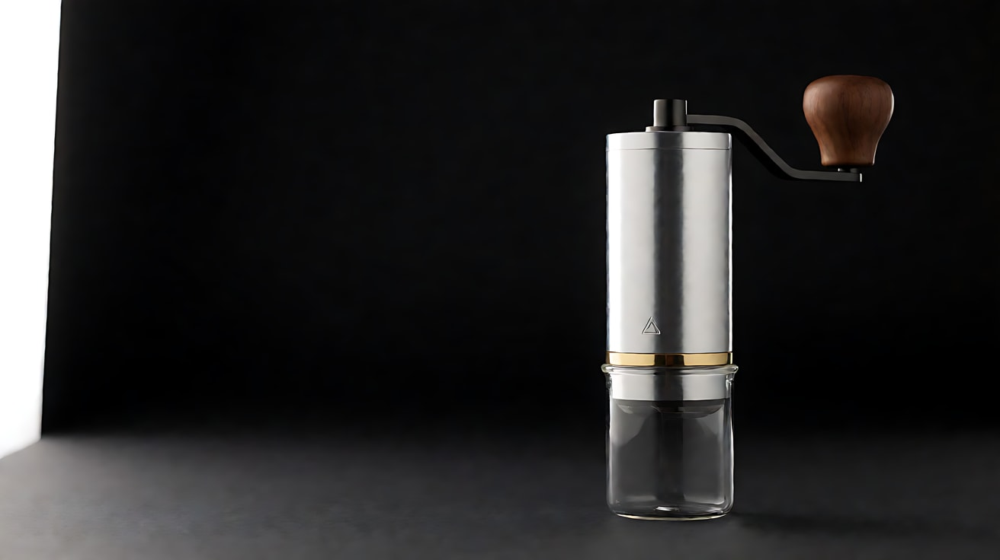
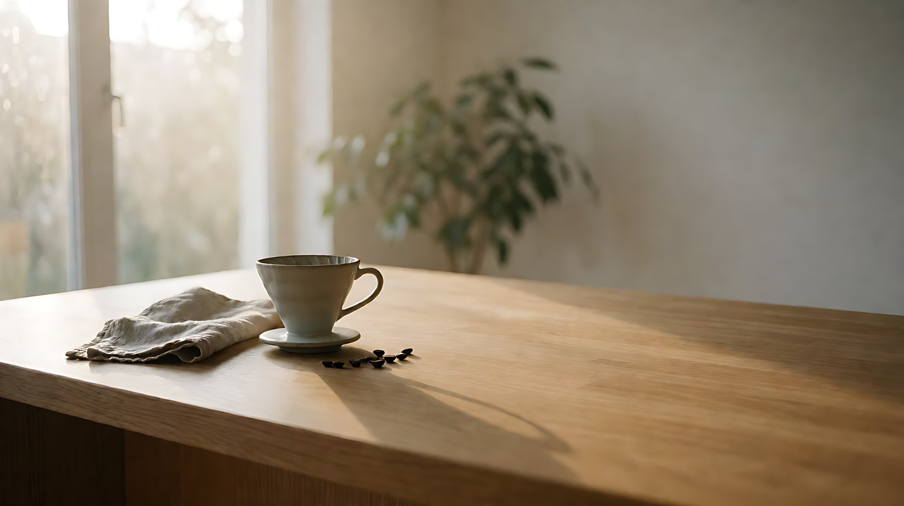
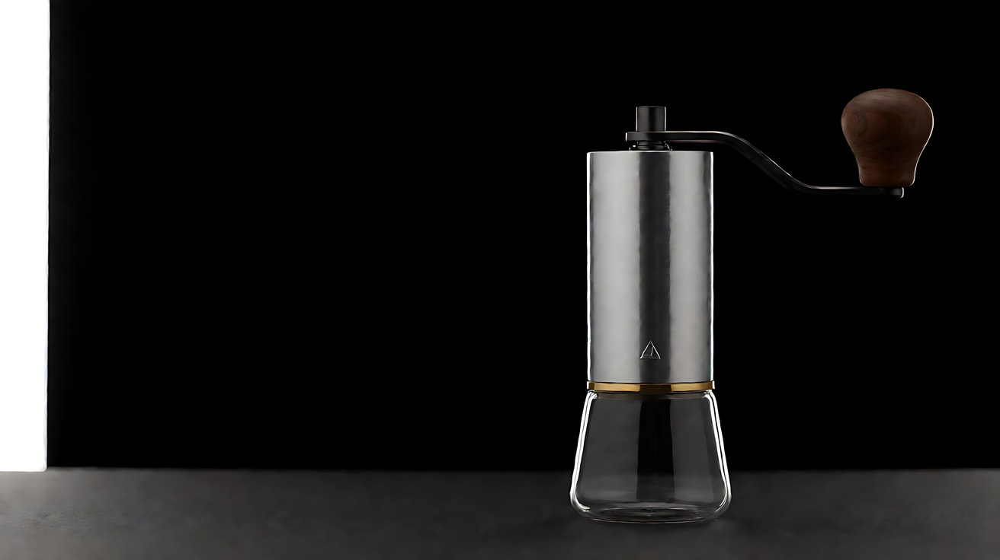
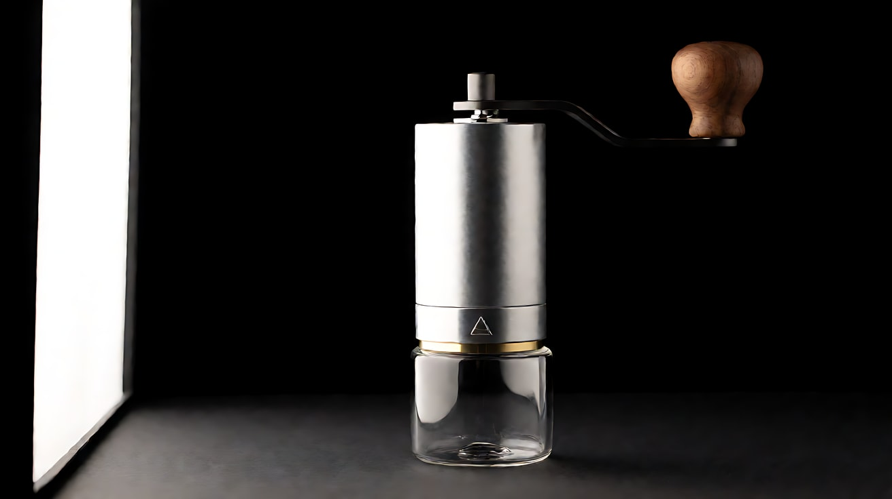
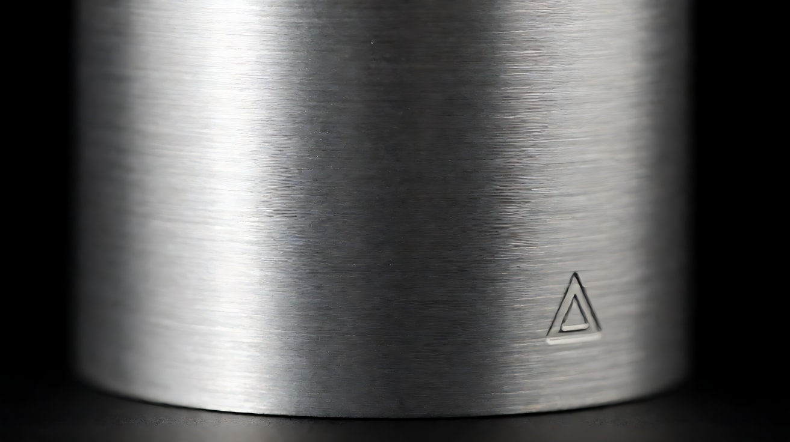
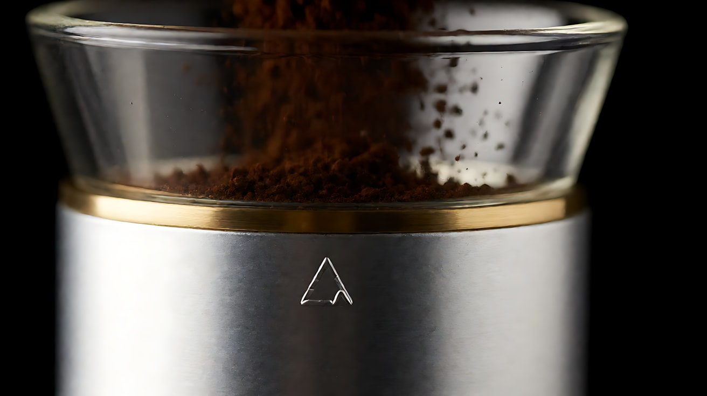
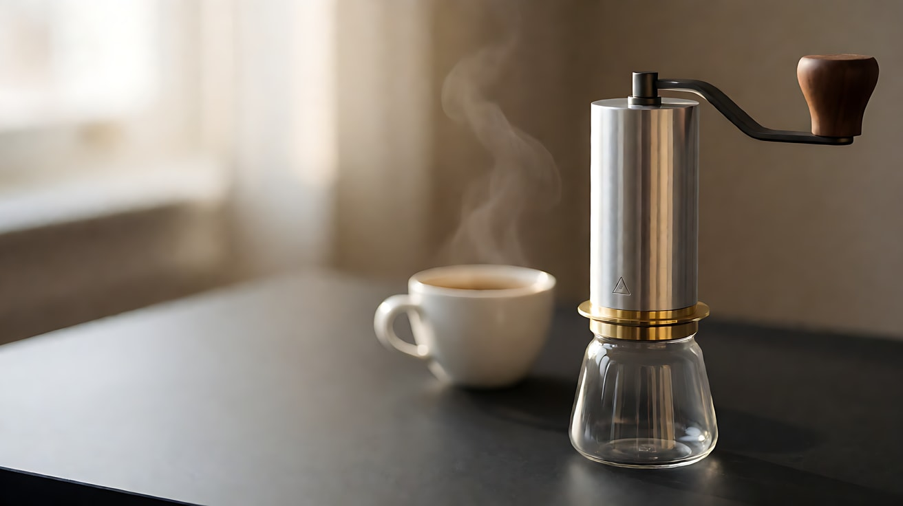

# L08-07 产品广告 · 提示词

> 本组练习：用一件原创产品"手摇磨豆机"练习产品身份锁定、材质光、剪影到英雄的揭示、真实的使用动作和英雄定格。｜ 配套教学：[L08-07-产品广告](../教学/L08-07-产品广告.md) ｜ 规范：[写作规范](../../模板/写作规范.md)
>
> 画风说明：本课的产品镜头没有人脸，使用画风开关 B（写实摄影：`photographic product still`）以获得更真实的材质；出现手部时同样适用。若想与其他课保持统一，也可以把 B 换回开关 A。

**产品身份卡（全组共用，每张图、每条提示词都要遵守）**：

| 项目 | 内容 |
|---|---|
| 外形 | 竖直圆柱形手摇磨豆机，高约一个手掌半；顶部一根可折叠的曲柄，曲柄末端一颗圆形木质把手；底部一只可旋下的透明玻璃粉杯 |
| 材质 | 机身：拉丝铝；曲柄：哑光黑色钢；把手：胡桃木；粉杯：透明玻璃；机身与粉杯之间一圈细黄铜环 |
| 颜色 | 机身银灰，曲柄黑，把手深棕，黄铜环暖金 |
| 标识 | 机身正面靠下处一枚极小的三角形压印，无任何文字 |

**一句话意图**：让观众感到"这台小机器的每一个部件都被认真做过"，并在片尾记住它的样子。

---

### 练习1：一道光扫过机身——英雄静帧动起来（难度 ★）

**目标**：产品不动，光动。用一道长条柔光从左向右扫过拉丝铝机身，练习"光的移动比产品的移动更安全"。

**【生图 · Nano Banana】**

图1 产品身份图（英雄静帧）：

```
Product hero shot of an original hand-crank coffee grinder standing upright on a matte black surface against a seamless black background.
A vertical cylindrical body of brushed aluminium, a folding matte black steel crank arm on top ending in a round walnut wood knob,
a thin polished brass ring where the body meets a clear glass catch cup screwed on at the bottom,
a tiny embossed triangle mark low on the front of the aluminium body, no text anywhere.
Front three-quarter view, the grinder placed on the right third of the frame, generous dark negative space on the left.
Camera at product mid-height, 100mm lens, moderate depth of field so the whole grinder is sharp.
Lighting: a long vertical strip softbox from frame left creating one clean specular line down the brushed aluminium,
a soft rim light from behind outlining the glass cup, a faint warm kicker on the walnut knob from the right.
Photographic product still, natural material texture. Aspect ratio 16:9.
```

中文释义：黑色无缝背景上的产品英雄图：竖直圆柱形拉丝铝机身，顶部哑光黑钢折叠曲柄与圆形胡桃木把手，底部透明玻璃粉杯，中间一圈细黄铜环，机身正面靠下一枚三角压印，无文字；正面 3/4 角度，产品在右三分线上，左侧大片负空间；产品半高机位、100mm、中等景深；画左竖条柔光在铝面上形成一道干净的反射线，背后轮廓光勾出玻璃杯，右侧一点暖色补光照在木把手上。



**【图生视频 · Seedance】**

```
【素材分工】@图片1 为首帧，也是产品身份参考：锁定磨豆机的外形、比例、拉丝铝机身、黑色曲柄、胡桃木把手、黄铜环、玻璃粉杯与三角压印，不改变形状，不新增任何文字。
【画风】写实产品摄影质感，暗背景，材质光。
黑色背景中，磨豆机静静立在哑光黑色台面上，完全不动。一道竖条形的柔光从画左缓慢地向画右扫过，光线在拉丝铝机身上形成的那道反射线随之从左边缘移到右边缘，拉丝纹理在光扫过时一道道亮起；经过黄铜环时闪出一线暖金色，经过玻璃粉杯时，杯壁的轮廓被勾成一圈亮线。镜头固定，不移动。结尾停在反射线落在机身右侧、产品完整静止的英雄画面上。
【声音】安静的低底噪，光扫过黄铜环时一声极轻的金属泛音，无配乐。
【约束】产品不旋转、不移动、不变形；曲柄与把手位置不变；机身上只有三角压印，不出现任何文字或其他标识；不要字幕、水印、Logo。
时长：5秒
```

**参数**：时长 5 秒 ｜ 画幅 16:9

**【检查点】**
- 产品从头到尾是否一动不动，外形是否完全没变
- 反射线是否连续地从左扫到右，拉丝纹理是否可见
- 黄铜环和玻璃杯是否各自"亮"了一下——光替每种材质说话

**【常见问题与修复】**
| 现象 | 修复 |
|---|---|
| 产品开始旋转 | 写"产品不旋转、不移动"，并把"光从左向右扫过"放在正文第一句 |
| 机身上出现文字 | 在素材分工和约束里都写"不新增任何文字"；文字一律后期合成 |
| 反射变成乱七八糟的小光点 | 写"竖条形的柔光""一道反射线"，不要写"闪耀""发光" |
| 曲柄位置变了 | 约束写"曲柄与把手位置不变" |

---

### 练习2：清晨厨房里的一圈——真实的使用动作（难度 ★★）

**目标**：产品身份图 + 场景图。一只手转动曲柄一圈，咖啡粉落进玻璃杯。使用动作只有一个，声音是最好的质感证据。

**【生图 · Nano Banana】**

图1 产品身份图：沿用练习1 的图1。

图2 场景（清晨厨房台面）：

```
Empty warm kitchen countertop in early morning, no people. A pale oak wooden counter by a large window,
a small linen cloth, a ceramic pour-over dripper and a few scattered coffee beans, a green plant softly out of focus,
the right half of the counter left clear. Medium shot at counter height, 50mm lens, shallow depth of field.
Lighting: soft low morning sunlight from a window on frame left, warm and diffused, gentle shadows falling to the right,
a faint haze of light in the air. Photographic still, natural texture. Aspect ratio 16:9.
```

中文释义：清晨的厨房台面空景：靠窗的浅色橡木台面，一块亚麻布、一只陶瓷手冲滤杯和几颗散落的咖啡豆，背景一盆虚化的绿植，台面右半边空着；台面高度、50mm 浅景深；画左窗户透进柔和的低角度晨光，阴影落向右边。



**【多图生视频 · Seedance】**

```
【素材分工】@图片1 是产品身份参考：锁定磨豆机的外形、比例、拉丝铝机身、黑色曲柄、胡桃木把手、黄铜环、玻璃粉杯与三角压印，不改变形状，不新增任何文字；@图片2 仅参考厨房台面、窗光方向与陈设，不复制其中的空台面构图。
【画风】写实产品摄影质感，清晨暖色自然光。
清晨的厨房台面上，磨豆机立在画面右侧的空台面上，正面 3/4 朝向镜头。画左的窗户透进柔和的晨光，在拉丝铝机身上形成一道暖色的反射线。一只手从画面上方伸进来，左手扶住机身，右手握住胡桃木把手，平稳地转动曲柄一整圈，停住。玻璃粉杯里，一小股深棕色的咖啡粉轻轻落下，堆成一个小尖。镜头固定中景，产品始终在画面右侧三分线上。结尾停在手松开把手、粉杯里一小堆咖啡粉的画面上。
【声音】清晨的鸟叫，转动曲柄时咖啡豆被研磨的清脆咯吱声，粉末落进玻璃杯的细微沙沙声，无配乐。
【约束】磨豆机外形、比例、材质与颜色保持不变；机身不移动、不倾倒；只转动一圈；画面中只出现手和手腕，不出现人脸；不出现任何文字；不要字幕、水印、Logo。
时长：6秒
```

**参数**：时长 6 秒 ｜ 画幅 16:9

**【检查点】**
- 产品外形是否与图1 完全一致，特别是曲柄长度与把手形状
- "扶住、转一圈、停住、松手"是否清楚，没有多余动作
- 研磨声是否清晰——这是让观众相信"它真的能用"的证据

**【常见问题与修复】**
| 现象 | 修复 |
|---|---|
| 曲柄转了很多圈、越转越快 | 写"平稳地转动曲柄一整圈，停住"，约束写"只转动一圈" |
| 产品被手带着移动 | 写"左手扶住机身"，约束写"机身不移动、不倾倒" |
| 手指变形 | 让手只握住把手，不写手指的精细动作 |
| 咖啡粉喷得到处都是 | 写"一小股""轻轻落下""堆成一个小尖" |

---

### 练习3：从剪影到英雄——揭示（难度 ★★★，首尾帧）

**目标**：首帧只有轮廓光勾出的剪影，尾帧是完整的英雄光；中间是主光慢慢亮起、产品一点点被揭开。产品全程不动。

**【生图 · Nano Banana】**

图1 产品身份图：沿用练习1 的图1。

图2 首帧（剪影）：

```
The original hand-crank coffee grinder from image 1 standing upright on a matte black surface against pure black,
almost completely in darkness, only a thin bright rim light from behind tracing its silhouette:
the cylinder edges, the curve of the crank arm and the round knob, and a glowing outline around the glass catch cup.
No front light at all. Same front three-quarter view, the grinder on the right third of the frame, large black negative space on the left.
Camera at product mid-height, 100mm lens, moderate depth of field.
Keep the product's shape, proportions, materials and markings exactly as in image 1. Photographic product still. Aspect ratio 16:9.
```



图3 尾帧（英雄）：

```
The exact same grinder, framing, camera and background as image 2, now fully revealed:
a long vertical strip softbox from frame left creates one clean specular line down the brushed aluminium,
the walnut knob glows warm with its grain visible, the brass ring catches a thin gold highlight,
the rim light from behind still outlines the glass cup. The left side of the frame remains clean dark negative space.
Keep the product's shape, proportions, materials and markings exactly as in image 1. Photographic product still. Aspect ratio 16:9.
```

中文释义：首帧——同一角度，产品几乎全黑，只有背后一道细亮的轮廓光勾出圆柱边缘、曲柄弧线、圆形把手和玻璃杯的外圈，完全没有正面光。尾帧——同一构图，画左竖条柔光亮起，在铝面上形成干净的反射线，胡桃木把手透出暖色木纹，黄铜环闪出一线金光，背后轮廓光仍勾着玻璃杯；左侧保留干净的深色负空间。



**【首尾帧生视频 · Seedance】**

```
【素材分工】@图片2 为首帧，锁定剪影构图；@图片3 为尾帧，是最终画面目标；@图片1 是产品身份参考：锁定外形、比例、材质与三角压印，不改变形状，不新增任何文字。只生成两帧之间的连续光线变化。
【画风】写实产品摄影质感，暗背景，材质光。
一片漆黑中，只有一道细亮的轮廓光勾出磨豆机的剪影：圆柱的边缘、曲柄的弧线、圆形把手、玻璃粉杯的外圈。停一拍。画左一道竖条形的柔光慢慢亮起，光先落在拉丝铝机身的左边缘，再一点点铺开，机身的拉丝纹理逐渐显现；接着胡桃木把手被一束暖光点亮，木纹浮现；最后黄铜环闪出一线暖金色。镜头固定，产品全程不动。结尾停在完整的英雄画面上，画面左侧是干净的深色负空间。
【声音】完全安静中，一声低沉的电子长音慢慢升起，主光亮到最满时，一声清脆的金属轻响，然后归于安静。
【约束】产品不旋转、不移动、不变形；背景始终为纯黑；中间变化连续，不跳切；机身上只有三角压印，不出现任何文字；不要字幕、水印、Logo。
时长：6秒
```

**参数**：时长 6 秒 ｜ 画幅 16:9

**【检查点】**
- 揭示是否按"铝 → 木 → 黄铜"的顺序逐一亮起，每种材质都有自己的高光时刻
- 尾帧是否与图3 一致，左侧负空间是否干净
- 产品在剪影和亮起后的轮廓是否完全一致

**【常见问题与修复】**
| 现象 | 修复 |
|---|---|
| 灯一下子全亮了 | 写清三个材质依次亮起的顺序，并写"慢慢亮起""一点点铺开" |
| 剪影阶段产品形状和亮起后不一样 | 生图阶段用图1 作为参考同时生成图2、图3；视频里写"以 @图片3 为最终画面目标" |
| 背景被照亮成灰色 | 约束写"背景始终为纯黑"，主光写成"竖条形柔光"而不是"灯光照亮" |
| 镜头自己推了进去 | 写"镜头固定" |

---

### 练习4：三种材质，三种光——微距三连（难度 ★★★★，多镜头）

**目标**：三个微距镜头，各给一种材质最合适的光：拉丝铝用条形反射、胡桃木用低角度掠射、玻璃用暗场逆光。每个镜头一个主运镜。

**【生图 · Nano Banana】**

图1 产品身份图：沿用练习1 的图1。

图2 镜头1 关键帧（拉丝铝微距）：

```
Extreme close-up macro of the brushed aluminium body of the grinder from image 1, the fine horizontal brushed texture filling the frame,
the tiny embossed triangle mark visible low on the right, a single clean vertical specular line from a strip softbox on the left side of the frame.
Camera very close, 100mm macro lens, shallow depth of field, the texture sharp in the centre and falling off at the edges.
Lighting: one long strip softbox from frame left, black surroundings.
Keep the product's materials and markings exactly as in image 1. Photographic product still. Aspect ratio 16:9.
```



图3 镜头3 关键帧（玻璃粉杯逆光）：

```
Extreme close-up macro of the clear glass catch cup of the grinder from image 1 against pure black,
fine dark-brown coffee grounds falling from the burr opening above into the cup, the glass edges glowing as bright rim lines,
the grounds and drifting fine dust lit from behind. Camera at cup height, 100mm macro lens, shallow depth of field.
Lighting: dark-field backlight from behind the cup, no front light.
Keep the product's shape and materials exactly as in image 1. Photographic product still. Aspect ratio 16:9.
```

中文释义：图2——拉丝铝机身的微距，水平拉丝纹理占满画面，右下方露出极小的三角压印，画左竖条柔光形成一道反射线。图3——玻璃粉杯的微距，纯黑背景，细细的深棕色咖啡粉从上方落进杯中，玻璃边缘被逆光勾成亮线，粉尘被背光照亮。



**【多图生视频 · Seedance】**

```
【素材分工】@图片1 是产品身份参考：锁定外形、比例、材质与三角压印，不改变形状，不新增任何文字；@图片2 为首帧，锁定镜头1 的拉丝铝微距构图与光线；@图片3 仅参考镜头3 的玻璃杯微距构图与逆光效果。
【画风】写实产品摄影质感，暗背景，材质光。
镜头1：拉丝铝机身的微距，镜头沿着机身表面从画左向画右缓慢横移。那道竖直的反射线在拉丝纹理上流动，横移结束时，机身右下方那枚极小的三角压印滑进画面，停住。一声极轻的金属泛音。
镜头2：镜头切至胡桃木把手的微距，固定机位。一道低角度的暖色侧光从画右缓缓掠过把手的弧面，木纹一道道浮现出来，光停在把手顶端，那里有一圈被手掌磨出的温润光泽。木头被手指轻敲的一声闷响。
镜头3：镜头切至玻璃粉杯的微距，纯黑背景，镜头极慢地向前推近。深棕色的咖啡粉从上方细细落进玻璃杯，在逆光下像一道细沙瀑布，细小的粉尘在杯口飘浮发亮，玻璃边缘是两道亮线。研磨的咯吱声和粉末落下的沙沙声。
【锁定】产品：始终是 @图片1 的磨豆机，拉丝铝机身、胡桃木把手、透明玻璃粉杯、黄铜环、三角压印不变；光线：镜头1 为画左竖条柔光，镜头2 为画右低角度暖色侧光，镜头3 为背后逆光；背景：全部为纯黑。
【声音】镜头1 金属泛音；镜头2 一声木头闷响；镜头3 研磨咯吱声和粉末沙沙声。底噪安静，无配乐。
【约束】产品各部件的形状和颜色不变；不出现手和人；机身上只有三角压印，不出现任何文字；不要字幕、水印、Logo。
时长：12秒
```

**参数**：时长 12 秒 ｜ 画幅 16:9 ｜ 负载：3 个镜头，属于"稳妥"档

**【检查点】**
- 三个镜头的光是否各不相同，并且各自适合那种材质
- 镜头1 结尾的三角压印是否清楚、没有变成文字
- 三个镜头切换时，观众能否认出是同一台机器的不同部位

**【常见问题与修复】**
| 现象 | 修复 |
|---|---|
| 镜头1 压印变成了一串字母 | 写"一枚极小的三角压印"，约束写"不出现任何文字"；必要时后期用设计稿替换 |
| 镜头2 木纹变成塑料感 | 写清"低角度侧光掠过弧面"，不要写正面光 |
| 镜头3 玻璃"消失"了 | 写"纯黑背景""背后逆光""玻璃边缘是两道亮线" |
| 三个镜头连成一个 | 每个镜头开头写"镜头切至……"，并让三个镜头的部位完全不同 |

---

### 练习5：一杯咖啡开始之前——完整 15 秒产品广告（难度 ★★★★★）

**目标**：完整的产品广告四拍：悬念（剪影）→ 细节（微距）→ 使用（一只手转一圈）→ 结果（粉杯被旋下，粉倒进滤杯）→ 英雄定格（3/4 角度静止，左侧留出广告语负空间）。产品身份全程不漂移。

**【生图 · Nano Banana】**

沿用练习1 的图1（产品身份图）、练习2 的图2（厨房台面）、练习3 的图2（剪影首帧，本练习中上传为图3）。

图4 镜头4 关键帧（使用结果）：

```
Using the grinder from image 1 and the kitchen counter from image 2: close-up at counter height of two hands
having unscrewed the glass catch cup from the grinder, tipping fresh dark-brown grounds from the cup into a white ceramic pour-over dripper,
a soft puff of fine coffee dust in the morning light. The aluminium grinder body stands upright in the soft-focus background on the right,
its brass ring and walnut knob visible. Only hands and wrists visible. Camera at counter height, 50mm lens, shallow depth of field.
Lighting: soft low morning sunlight from a window on frame left, warm backlight on the coffee dust.
Keep the product's shape, proportions, materials and markings exactly as in image 1. Photographic still, natural texture. Aspect ratio 16:9.
```


图5 镜头5 关键帧（英雄定格）：

```
Using the grinder from image 1 and the kitchen counter from image 2: product hero shot of the grinder standing upright on the oak counter,
glass catch cup screwed back on, front three-quarter view, placed on the right third of the frame,
the left two-thirds clean and softly lit with blurred window light, kept empty for a tagline.
A white ceramic cup of freshly brewed coffee with gentle steam sits small in the soft-focus background behind it.
Camera at product mid-height, 85mm lens, moderate depth of field so the whole grinder is sharp.
Lighting: soft morning window light from frame left creating a warm specular line on the aluminium, gentle rim on the glass cup.
Keep the product's shape, proportions, materials and markings exactly as in image 1. Photographic product still. Aspect ratio 16:9.
```

中文释义：图4——台面高度近景，两只手已把玻璃粉杯从机身上旋下，把新鲜的咖啡粉倒进白色陶瓷滤杯，晨光里扬起一小团细粉；磨豆机机身虚立在画右背景。图5——英雄画面：磨豆机装回粉杯，立在橡木台面上，正面 3/4 角度，位于右三分线；左侧三分之二干净、柔和、留给广告语；背景虚化处有一杯冒着热气的咖啡；窗光在铝面上形成暖色反射线。



**【多图生视频 · Seedance】**

```
【素材分工】@图片1 是产品身份参考：锁定磨豆机的外形、比例、拉丝铝机身、黑色曲柄、胡桃木把手、黄铜环、玻璃粉杯与三角压印，不改变形状，不新增任何文字；@图片3 为首帧，锁定镜头1 的剪影构图；@图片2 仅参考厨房台面与窗光方向，用于镜头3–5；@图片4 仅参考镜头4 的构图与动作；@图片5 仅参考镜头5 的英雄构图，作为结尾画面目标。
【画风】写实产品摄影质感，从暗背景过渡到清晨暖色自然光。
镜头1：纯黑背景，固定机位。一道细亮的轮廓光勾出磨豆机的剪影，画左一道竖条柔光慢慢亮起，在拉丝铝机身上划出一道反射线，黄铜环闪出一线暖金。一声低沉的长音升起。
镜头2：镜头切至胡桃木把手的微距，固定机位。一道低角度暖光从画右掠过把手，木纹一道道浮现。一声木头的轻响。
镜头3：镜头切至清晨厨房台面的中景，固定机位，磨豆机立在画右。一只手从画面上方伸进来，左手扶住机身，右手握住胡桃木把手，平稳地转动一整圈，停住。玻璃粉杯里落下一小股咖啡粉。鸟叫声和清脆的研磨咯吱声。
镜头4：镜头切至台面高度的近景，镜头缓慢向前推近。两只手把玻璃粉杯旋下，把咖啡粉倒进白色陶瓷滤杯，晨光里扬起一小团细粉。粉末落下的沙沙声。
镜头5：镜头切至英雄画面，镜头缓慢向右横移后停下。磨豆机装好粉杯，以正面 3/4 角度静止在画面右侧三分线上，窗光在铝面上划出一道暖色反射线，背景虚化处一杯咖啡冒着热气。画面左侧大面积干净、柔和。镜头完全停住，产品完全静止。一声清脆的金属轻响后，环境声渐弱。
【锁定】产品：全片始终是 @图片1 的同一台磨豆机，外形、比例、颜色、材质、三角压印位置不变，产品本身不旋转、不变形；光线：镜头1–2 为暗背景上的材质光，镜头3–5 为画左窗户的清晨暖光；画面：手只出现在镜头3、4，不出现人脸；机位：镜头3–5 均在台面前方同一侧。
【声音】镜头1 低沉长音；镜头2 木头轻响；镜头3 鸟叫和研磨咯吱声；镜头4 粉末沙沙声；镜头5 一声金属轻响，然后只留下很轻的清晨环境声。无旁白，不出现对白。
【约束】产品外形、比例、材质与颜色在每个镜头中保持一致；不出现任何文字、品牌名或其他标识；不出现人脸；不要字幕、水印、Logo。
时长：15秒
```

**参数**：时长 15 秒 ｜ 画幅 16:9 ｜ 图片 5 张 ｜ 负载：5 个镜头（镜头1、2 为短插入），属于"有挑战"档；如镜头5 的英雄定格太短，把镜头5 单独以图5 为首帧生成 5 秒，剪辑时替换

**【检查点】**
- 五个镜头里，产品是否始终是同一台：曲柄长度、把手形状、黄铜环位置、三角压印位置都不变
- 是否形成"悬念 → 细节 → 使用 → 结果 → 英雄"的完整结构
- 镜头5 的英雄定格是否真正"停住"：镜头停、产品停，左侧负空间干净
- 声音是否每个镜头都有一个对应材质或动作的声音，最后在定格上收住

**【常见问题与修复】**
| 现象 | 修复 |
|---|---|
| 镜头3 和镜头5 的产品不一样大或形状变了 | 每张关键帧都以图1 为参考生成，并在【锁定】写"同一台磨豆机，外形、比例不变" |
| 镜头5 产品还在动或转 | 写"镜头完全停住，产品完全静止"，并以 @图片5 为结尾画面目标 |
| 左侧负空间里出现了文字或杂物 | 约束写"不出现任何文字"，正文写"画面左侧大面积干净、柔和"；广告语后期加 |
| 镜头4 的手把玻璃杯弄碎了或变形 | 把动作简化为"把粉倒进滤杯"，删掉"旋下"，用镜头切换省略旋下的过程 |
| 镜头1 的剪影和镜头5 不像同一台 | 生图阶段用图1 同时生成图3 和图5；必要时把镜头1–2 与镜头3–5 拆成两次生成 |
