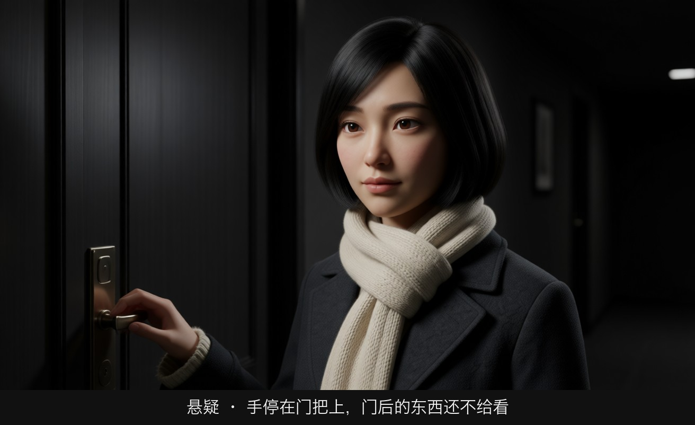
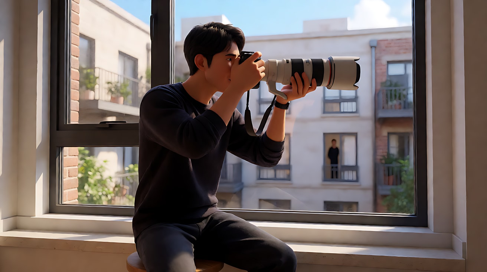
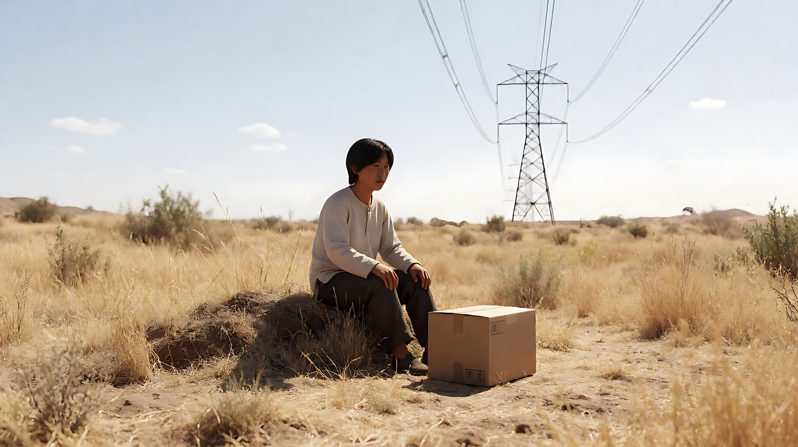

# L08-01 悬疑惊悚：导演手里握着的是信息

> 段位：大师 ｜ 建议用时：90 分钟 ｜ 配套提示词：[L08-01-悬疑惊悚-提示词](../提示词/L08-01-悬疑惊悚-提示词.md)

## 学习目标

- 能说出悬疑惊悚片和观众订下的"契约"是什么，以及违约会让观众有什么反应
- 能区分"谜（mystery）""惊吓（surprise）""悬念（suspense）"三种信息位置，并为一个场景选对其中一种
- 能把景别、景深、构图、光、运镜、剪辑、声音七件工具全部调到"控制信息"这一个方向上
- 能举出至少两部经典影片的具体段落，说清它们怎么分配信息
- 能写出一个 15 秒、多镜头、观众比角色先知道危险的悬疑片段提示词，并避开敏感词

## 一、概念讲解

### 1. 类型的观众契约

观众买票进悬疑片，心里有一份没说出口的合同：

> **"我允许你让我不安、让我猜错，但线索必须就在画面里。真相揭开时，我要能回头找到它。"**

这份契约有两个条款：

| 条款 | 观众期待 | 违约的后果 |
|---|---|---|
| 不安 | 每个镜头都让人觉得"有什么不对" | 平铺直叙，观众提前离场或划走 |
| 公平 | 线索在画面里出现过，答案能被回溯 | 结尾靠巧合或从没出现的人物解谜，观众觉得被耍 |

所以悬疑导演真正在调度的不是演员、不是镜头，而是**信息：谁在什么时候知道什么**。

### 2. 三种信息位置

希区柯克在与特吕弗的访谈录里讲过一个著名的"桌下炸弹"例子：两个人在桌边聊天，桌下有炸弹。如果观众不知道，炸弹一响，只换来十几秒的惊吓；如果先让观众看到炸弹和计时器，这场闲聊的每一秒都变成煎熬。这就是**惊吓**和**悬念**的区别。

```
              观众知道的  vs  角色知道的
┌──────────────┬──────────────────────┬──────────────────────┐
│   位置        │   信息关系            │   观众的身体反应      │
├──────────────┼──────────────────────┼──────────────────────┤
│ 谜 Mystery    │ 观众 < 角色           │ 好奇、猜测、往前凑    │
│              │ （角色藏着什么）       │                      │
├──────────────┼──────────────────────┼──────────────────────┤
│ 惊吓 Surprise │ 观众 = 角色           │ 一瞬间跳起来，然后松弛 │
│              │ （一起被吓到）         │                      │
├──────────────┼──────────────────────┼──────────────────────┤
│ 悬念 Suspense │ 观众 > 角色           │ 持续紧绷、想喊"别去"  │
│              │ （观众看见了危险）     │                      │
└──────────────┴──────────────────────┴──────────────────────┘
```

一部好的悬疑片会在三种位置之间切换：先用"谜"抓住好奇心，中段用"悬念"拉紧，最后用一次"揭示"兑现契约。**AI 短片里最划算的是悬念**：只需要一个"观众看到、角色没看到"的镜头，就能让后面所有镜头自动变紧。

### 3. 七件工具的惯例与反套路

| 工具 | 类型惯例（大家都这么拍） | 为什么有效 | 反套路（高手怎么打破） |
|---|---|---|---|
| 景别 | 插入特写给线索（钥匙、门把手、照片）；主观视角让观众"借角色的眼睛" | 特写等于导演指着说"记住这个" | 把真正的线索放在全景的角落，不给特写，观众回头才发现 |
| 景深 | 浅景深：背景模糊，让人疑心"后面有什么"；深焦：背景里有东西在动，而前景角色不知道 | 景深决定观众能不能先于角色看到威胁 | 焦点故意落在"错误的人"身上，真正的危险在虚焦里 |
| 构图 | 负空间、门框、前景遮挡；角色被挤到画边 | 空出来的那块地方让观众替角色害怕 | 完全对称、明亮、整洁的画面，靠"太完美"制造不安 |
| 光影 | 低调光、单一实用光源（台灯、路灯）、阴影吃掉半个画面 | 看不见的地方就是想象力的地方 | 大白天、高调光下的惊悚：没有地方可躲 |
| 运镜 | 极慢的推、固定长镜头、主观跟拍 | 慢推等于"观众在靠近一个发现" | 镜头比角色先到：先摇到门口，角色才走进来 |
| 剪辑 | 延迟揭示；交叉剪辑（两条线同时逼近）；不给反应镜头 | 剪辑点就是信息释放的时刻 | 该切的地方不切，长镜头逼观众自己去找 |
| 声音 | 环境声逐渐抽空；单一离屏声（脚步、门响、钟）；配乐只在关键处出现 | 耳朵比眼睛先感到危险 | 完全无配乐，只有一个日常声音不停重复 |

### 4. 悬疑场景的三段节拍


15 秒的 AI 片段装不下完整谜底，所以**结尾通常选择"悬置"**：揭开一层，留下更大的问题。

## 图解

> 这些示意图由多种生图模型分别生成（包括 Nano Banana、GPT Image 等），只用来说明镜头概念；不同模型的画面不能互相比较效果，也不能当作视频成片。




信息停在门打开之前。硬侧光只照见手和门把，门后是黑的。悬疑靠「还不给看」。

## 二、情绪与叙事功能

| 技法 | 观众的感受 | 常用场景 |
|---|---|---|
| 观众先看到危险（悬念） | 坐立不安，想提醒角色 | 角色独处、背对门口、夜间工作 |
| 插入特写线索 | "这个东西一定有用" | 开场种线索，结尾回收 |
| 主观视角 + 慢推 | 和角色一起屏住呼吸 | 推开门、走进暗处 |
| 深焦背景异动 | 后背发凉 | 前景人物忙碌，背景门缝变宽 |
| 环境声抽空 | 世界突然变得很近、很危险 | 揭示前的最后一拍 |
| 交叉剪辑 | 时间在倒数 | 两条线同时逼近一个地点 |
| 结尾悬置 | 想看下一集 | 片尾、短剧集尾 |

## 三、经典影片案例

### 《后窗》（1954，阿尔弗雷德·希区柯克）
- 场景：摄影记者杰弗瑞斯腿打石膏困在公寓里，用长焦镜头观察对面楼的邻居，逐渐怀疑一个推销员杀害了妻子。
- 怎么拍的：几乎所有镜头都限制在他公寓的视角里，对面楼的事件多以他的远距离视点呈现，观众和他一样只能"远远看着"。后段他的女友丽莎潜入嫌疑人公寓，嫌疑人回来，杰弗瑞斯只能隔着院子看着却无法出手；最终嫌疑人发现了他，朝这边看过来。
- 为什么这样拍：意图是"让观众感到偷看的代价"。视角限制让观众成为共犯，丽莎在对面冒险时，观众比她更早看到危险逼近——典型的"观众 > 角色"悬念。被对方回望的那一刻，偷看者变成被看者，权力反转。



### 《沉默的羔羊》（1991，乔纳森·戴米）
- 场景：FBI 学员克拉丽丝与关押中的汉尼拔·莱克特的数次对话；以及片尾的交叉剪辑。
- 怎么拍的：对话越往后，正反打越接近正面、视线越接近直视镜头，观众被迫与两人逐一"对视"。片尾，剧情把 FBI 大队包围一栋房子、按响门铃的画面，与屋内凶手听到门铃去开门的画面交叉剪辑，观众以为门外是 FBI——开门后站着的却是独自前来的克拉丽丝，而 FBI 包围的是一栋空屋。
- 为什么这样拍：正面直视让观众失去"安全的旁观位置"。片尾的交叉剪辑是一次刻意的"误导"：利用剪辑语法让观众得出错误结论，再用一个开门的画面反转——但所有信息都公平地在画面里，回头看并不作弊。


### 《七宗罪》（1995，大卫·芬奇）
- 场景：片尾荒野中，快递车送来一个纸箱。
- 怎么拍的：全片几乎都在阴雨、低调光的城市里拍摄；片尾突然转到烈日下空旷的荒野，高压电塔、干草、刺眼的阳光。打开纸箱的过程用远景和人物反应呈现，观众始终没有看到箱子里的东西。
- 为什么这样拍：意图是"让观众自己想象最坏的答案"。明亮空旷的环境是对全片低调光惯例的反套路——没有阴影可以藏，恐惧只能来自信息本身。不给观众看箱子，是把最可怕的画面交给观众的想象力。



## 四、在 AI 中怎么实现

- **生图阶段**：
  - 先决定这一镜的信息位置（谜 / 惊吓 / 悬念），再决定景深：要观众先看到威胁就用深焦（`deep focus, f/8`），要观众疑心背景就用浅景深（`shallow depth of field`）。
  - 线索做成**物件**，不要做成文字。信件内容、屏幕文字、门牌号在生图和视频阶段都容易变形；一张照片、一只怀表、一串钥匙比一行字可靠得多。
  - 低调光要写出唯一的光源和方向：`a single green-shaded desk lamp from frame right as the only light source`。
- **视频阶段**：
  - 悬念镜头的写法：在一个镜头里同时写出"角色在做什么"和"角色身后/画外正在发生什么"，并加一句"他没有察觉"。
  - 揭示用"运镜 + 光"完成：慢推到门缝、手电光扫到地面、灯闪一下后画面变了。不要写"突然出现一个人"。
  - 声音写成"逐渐抽空"：先列出环境声，再写"环境声逐渐消失，只剩……"。
- **模型擅长**：雨、雾、灯光闪烁、反光玻璃、长时间静止的张力、单人慢动作、空荡的空间。
- **要避开**：
  - 画面里的文字线索（会乱码）；多人同时行动；复杂的手部操作（开锁、翻文件）。
  - **敏感词**：悬疑常涉及犯罪，但提示词里不点名罪行。`凶手`→`穿深色雨衣的人`；`尸体`→不出现，改为"一只掉落的鞋""一把没人撑的伞"；`刀`→`一件金属物件`或干脆放在画外；`血迹`→`深红色痕迹`或改成"湿脚印"。恐惧来自"不该在那里的东西"，不来自伤害本身。
  - 把"意外"当高潮：模型会把"杯子被碰倒"演成故意的。高潮写成**被发现的状态**："桌上多了一只不属于他的怀表"。

## 五、练习作业

1. 选一个日常场景（例如"下班回家开门"），分别写出"谜""惊吓""悬念"三个版本的一句话意图，并各写一个关键镜头的景深选择。
2. 找一部你看过的悬疑片，挑一场戏，画出它的信息曲线：每个镜头后，观众知道的和角色知道的分别是什么。
3. 改写练习：把"凶手拿着刀躲在门后"改写成一个不含任何敏感词、但同样让人紧张的画面描述。
4. 完成配套提示词练习1–5，最后把练习5的 15 秒片段剪进一个 30 秒的预告片里，补一个片名卡。

## 六、自检清单

- [ ] 我能说出这一场戏里"观众知道的"和"角色知道的"分别是什么
- [ ] 至少有一个镜头让观众比角色先看到异常
- [ ] 线索是物件而不是文字
- [ ] 光有唯一明确的来源，阴影是设计出来的
- [ ] 声音写了"逐渐抽空"或一个单一离屏声
- [ ] 结尾是一个可见的状态（悬置），不是一次意外
- [ ] 提示词里没有点名罪行、凶器、伤口

## 七、配套提示词

→ [L08-01-悬疑惊悚-提示词](../提示词/L08-01-悬疑惊悚-提示词.md)

---

上一课：[L07-20 罗杰·迪金斯](../../07-世界导演风格/教学/L07-20-罗杰迪金斯.md) ｜ 下一课：[L08-02 动作](L08-02-动作.md) ｜ [返回总目录](../../README.md)
