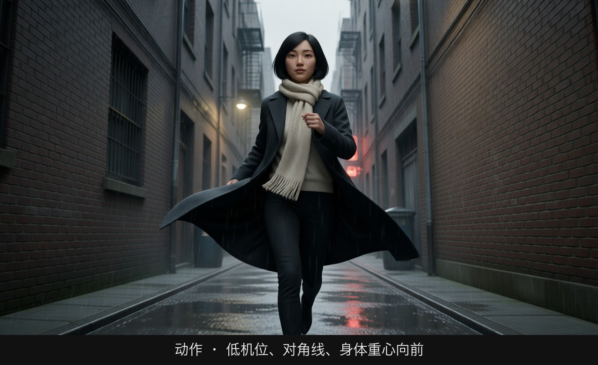
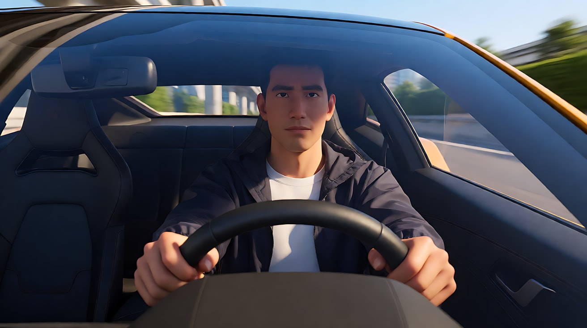
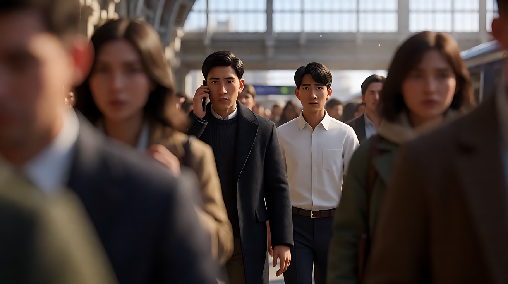
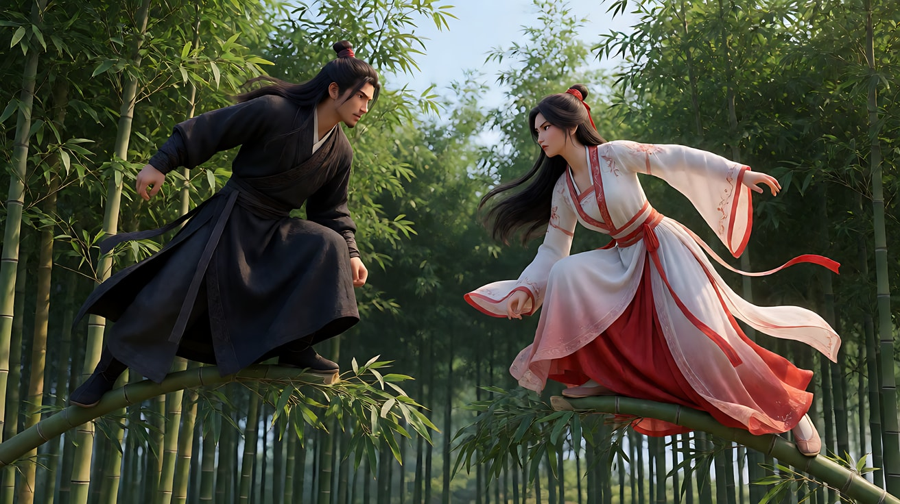
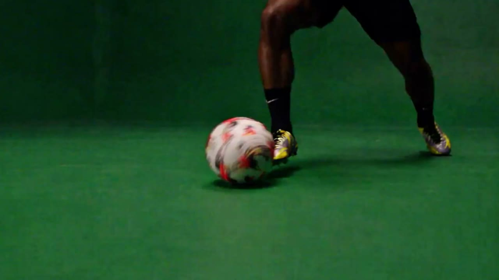

# L08-02 动作：让观众看清每一次用力

> 段位：大师 ｜ 建议用时：90 分钟 ｜ 配套提示词：[L08-02-动作-提示词](../提示词/L08-02-动作-提示词.md)

## 学习目标

- 能说出动作片的观众契约："看得清、有目标、有代价"
- 能用"预备 → 爆发 → 后果"三拍结构设计一个动作节拍
- 能守住屏幕方向和轴线，让追逐和对抗的空间关系清楚
- 能拆解至少两部经典动作片段的景别、剪辑和声音策略
- 能写出一个非血腥、单一接触、15 秒多镜头的入门追逐片段提示词

## 一、概念讲解

### 1. 类型的观众契约

> **"让我看清楚谁在做什么、为了什么、付出了什么代价。我要用身体感到那一下。"**

| 条款 | 观众期待 | 违约的后果 |
|---|---|---|
| 可读 | 知道谁在哪、往哪跑、离目标多远 | 快剪 + 乱晃 = 看不懂，观众只剩噪音 |
| 目标 | 每一段动作都有一个具体目的（抢到包、关上门、跳过去） | 动作变成杂技表演，没有紧张感 |
| 代价 | 用力有重量，失败有后果：喘气、踉跄、擦伤的衣袖 | 角色像没有体重的玩偶，观众不再担心 |

### 2. 动作节拍的三拍结构

每一个动作单元——一次跳跃、一次推开、一次滑铲——都由三拍组成：

```
   预备（蓄力）          爆发（动作）           后果（落地）
┌──────────────┐    ┌──────────────┐    ┌──────────────┐
│ 下蹲、吸气、    │ →  │ 起跳、推出、    │ →  │ 落地、踉跄、    │
│ 目光锁定目标    │    │ 一个清晰的接触  │    │ 喘气、回头看    │
│ 镜头相对稳定    │    │ 镜头跟随或切镜  │    │ 镜头停住、留白  │
└──────────────┘    └──────────────┘    └──────────────┘
    观众预测              观众验证              观众感到重量
```

**新手只拍中间那一拍**，所以动作显得没有重量。高手花一半时间拍预备和后果。

### 3. 屏幕方向：追逐的生命线

```
         轴线（追逐方向）
  ───────────────────────────────▶
  追的人 ●───────▶      ● 被追的人 ───▶ 目标（蓝色雨棚）

  机位始终在轴线同一侧（下方）
          [机位1]  [机位2]  [机位3]
```

规则：被追的人和追的人**都从画左跑向画右**，所有镜头的机位都在同一侧。一旦有一个镜头方向反了，观众会以为角色掉头了。

### 4. 七件工具的惯例与反套路

| 工具 | 类型惯例 | 为什么有效 | 反套路 |
|---|---|---|---|
| 景别 | 全景交代全身动作和空间；特写给力量（攥紧的手、脚踩地）和后果 | 全景证明"真的做到了"，特写让观众感到用力 | 整段只用一个全景长镜头，不切特写，靠完整的身体说服观众 |
| 景深 | 中等景深，让人物和障碍物同时清楚 | 观众要同时看到人和路线 | 极浅景深跟拍，只有角色清楚，环境化成色块——表现"隧道视野" |
| 构图 | 主体保持在画面中心附近；屏幕方向一致 | 快剪时眼睛不用重新找主体 | 把主体放在画边，让大面积的空间压过来，表现"无处可逃" |
| 光影 | 硬光、高反差，日光或强实用光 | 硬光让肌肉、汗水、尘土有质感 | 在几乎全黑中只靠一束移动的光看动作 |
| 运镜 | 跟拍、手持、低机位 | 观众的身体被带进速度里 | 动作最激烈时镜头反而固定，让动作自己穿过画面 |
| 剪辑 | 动作剪辑点（cut on action）；节拍越来越快 | 在动作进行中切镜，观众感觉不到剪辑 | 在最高点前突然静音、切到一个慢镜头 |
| 声音 | 拟音放大：脚步、呼吸、布料、撞击；配乐推动 | 声音的重量补足画面的重量 | 高潮瞬间抽空所有声音，只留心跳或呼吸 |

## 图解

> 这些示意图由多种生图模型分别生成（包括 Nano Banana、GPT Image 等），只用来说明镜头概念；不同模型的画面不能互相比较效果，也不能当作视频成片。




镜头放低，身体重心向前，巷子是一条对角线。动作镜头要让观众感到重量往前冲，而不只是人在跑。

## 二、情绪与叙事功能

| 技法 | 观众的感受 | 常用场景 |
|---|---|---|
| 预备拍（蓄力、对峙） | 屏住呼吸，预测下一步 | 打斗前的僵持、起跑前 |
| 跟拍（肩后手持） | 身体被卷入速度 | 追逐、逃跑 |
| 全景长镜头 | 相信"真的发生了" | 展示完整动作设计 |
| 后果特写（喘气、踉跄） | 感到代价和重量 | 每一个动作单元的结尾 |
| 屏幕方向一致 | 清楚"谁在追谁" | 所有追逐戏 |
| 静音瞬间 | 时间被拉长，冲击更强 | 最高点前的一拍 |

## 三、经典影片案例

### 《疯狂的麦克斯：狂暴之路》（2015，乔治·米勒）
- 场景：贯穿全片的公路追逐。
- 怎么拍的：剪辑节奏极快，但摄影指导约翰·西尔与导演刻意让每个镜头的视觉焦点落在画面中心附近（常被称为"中心构图 / 视线追踪"策略）。观众在快速切换中不需要重新寻找主体，眼睛始终停在画面中央。动作大量使用实拍车辆和特技。
- 为什么这样拍：意图是"让观众在极高速度里仍然看懂"。中心构图解决了"快剪看不清"的老问题——快的是剪辑，稳的是观众的视线。这是动作片"可读"条款的教科书解法。



### 《谍影重重3》（2007，保罗·格林格拉斯）
- 场景：伦敦滑铁卢车站，伯恩通过电话指挥一名记者在人群中躲避监视。
- 怎么拍的：大量手持摄影，长焦镜头隔着人群拍摄，前景常被路人遮挡；剪辑频繁，在伯恩、记者和监视者之间来回交叉。几乎没有配乐抢戏，声音以车站嘈杂声和电话对白为主。
- 为什么这样拍：意图是"让观众感到被人群包围、随时被看见"。手持和前景遮挡制造出纪录片式的临场感，交叉剪辑让观众掌握三方位置——观众知道监视者在哪，记者却不知道。这场戏的动作几乎都是"走"和"躲"，紧张感来自信息和空间，而不是打斗。



### 《卧虎藏龙》（2000，李安）
- 场景：李慕白与玉娇龙在竹林梢头的对决。
- 怎么拍的：以中远景和全景为主，完整展示两人在竹梢上起伏的身体；竹子的弯曲和回弹本身就是动作的"后果"，让轻功有了重量。节奏舒缓，风声和竹叶声取代激烈的打击声。
- 为什么这样拍：意图是"让观众感到一种近乎冥想的较量"。这是对快剪动作的反套路：用全景和慢节奏，让观众看清每一次借力与落点。竹子弯下去再弹起来，就是"预备—爆发—后果"的物理化呈现。



## 四、在 AI 中怎么实现

- **生图阶段**：
  - 为"预备"和"后果"各生成一张关键帧，让模型只负责中间的爆发。
  - 写清屏幕方向：`running from frame left to frame right`。所有关键帧方向一致。
  - 服装要有能动的部分（风衣下摆、背包带、围巾），它们是速度的证据。
- **视频阶段**：
  - **入门一个镜头先做一件主动作**：跑、跳、推开、滑过去，选一个。动作后面紧跟后果："她落地时单膝跪下，手掌撑住地面，喘着气抬头"。
  - **入门先练一次简单接触**：抓住包带、推开一扇门、拉下卷帘。不是模型无法处理连续动作，而是先降低诊断难度。
  - 写力和后果，不写招式名称："他伸手抓住她的包带，她顺势转身，包带从他手里滑脱，他向后踉跄两步"。
  - 速度靠环境表现：飞起的尘土、被带动的布料、晃动的吊灯、滚落的水果。
- **模型擅长**：奔跑、跳跃、翻越、布料与尘土、远处人群、单人的大幅度肢体动作、车辆在开阔路面行驶。
- **要避开**：
  - 多人缠斗、精确命中、手部与武器的精细交互——极易变形，也易触发审核。
  - 依赖敏感词替换来解决审核：先核对规则与授权，必要时真正改为非血腥动作或画外叙事，不使用暗语试探。
  - 把"撞翻摊子"写成高潮：模型会演成故意的。高潮写成一个由角色主动完成的动作：她拉下卷帘门。

### 运动参考与绿幕编辑的通用方法

2.5 官方指南建议动作先概括整段编排，只细写少数关键记忆点。例如先写“翻过障碍后继续跑”，再强调落脚位置，不把每个关节变化写成机械清单。若有精确参考，明确只借动作或摄影机，不复制参考中的人物外观。

[绿幕训练到赛场案例](../../附录/A-04-官方案例与版本差异.md#case-greenscreen)展示表演与环境分离。审片时检查脚底接触、障碍位置、衣服受力、阴影方向；绿幕换景不是只换背景。复杂运动的物理合理性仍需验证，不把官方样片当成成功率保证。



官方案例关键帧「绿幕训练到赛场」，媒体 00:00。先标出源素材的接触点，再检查换景后是否出现脚底滑动、球穿地面或阴影错位；这些动态问题不能只看一帧判断。来源：[官方发布文](https://seed.bytedance.com/zh/blog/one-take-creation-flexible-referencing-introducing-seedance-2-5)，[完整图组与引用说明](../../附录/A-04-官方案例与版本差异.md#case-greenscreen)。

## 五、练习作业

1. 选一个你喜欢的动作片段，逐镜头标出"预备 / 爆发 / 后果"，统计三者的镜头数比例。
2. 画一张追逐的俯视平面图：起点、障碍、目标、轴线、每个机位。检查所有机位是否在轴线同一侧。
3. 改写练习：把"他掏出枪对准她，她一脚踢飞，两人扭打在一起"真正改成非血腥、单一接触的逃离情节，例如她拉下卷帘门，隔开追赶者；不是给原武器换一个暗语。
4. 完成配套提示词练习1–5。

## 六、自检清单

- [ ] 每个动作节拍都有预备、爆发、后果三拍
- [ ] 角色有一个具体的物理目标（拿到、关上、跳过去）
- [ ] 所有镜头屏幕方向一致，机位在轴线同一侧
- [ ] 入门先完成一个主动作和一次简单接触；进阶连续动作有明确路径与接触点
- [ ] 后果可见：喘气、踉跄、布料、尘土
- [ ] 本课入门练习采用非血腥动作，素材已获许可，并核对实际入口规则
- [ ] 高潮是角色主动完成的动作，不是意外

## 七、配套提示词

→ [L08-02-动作-提示词](../提示词/L08-02-动作-提示词.md)

---

上一课：[L08-01 悬疑惊悚](L08-01-悬疑惊悚.md) ｜ 下一课：[L08-03 爱情文艺](L08-03-爱情文艺.md) ｜ [返回总目录](../../README.md)
