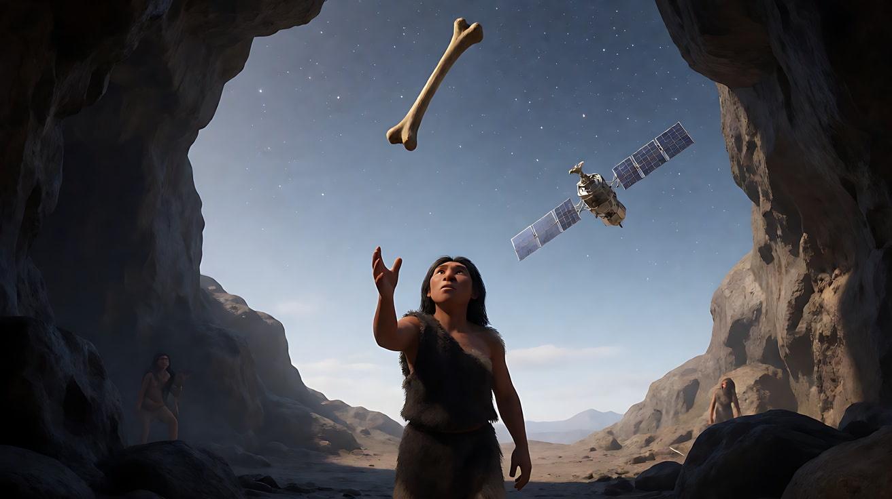
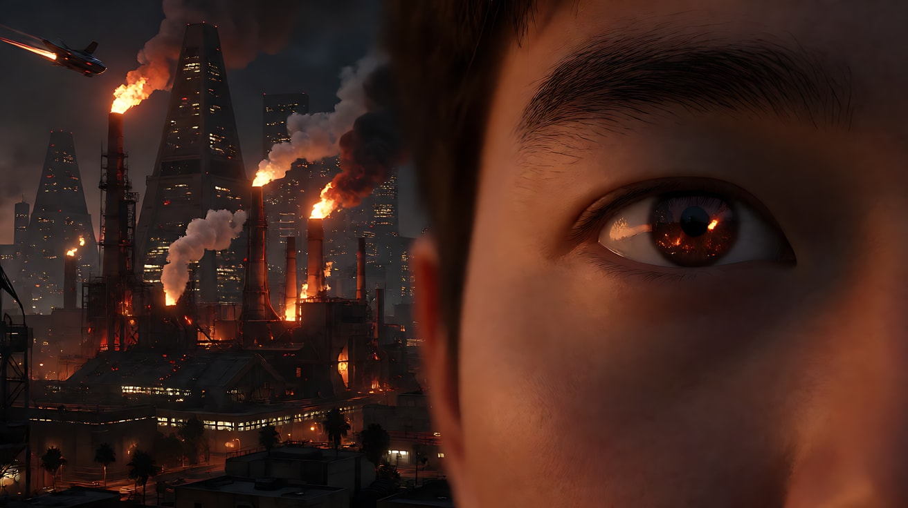
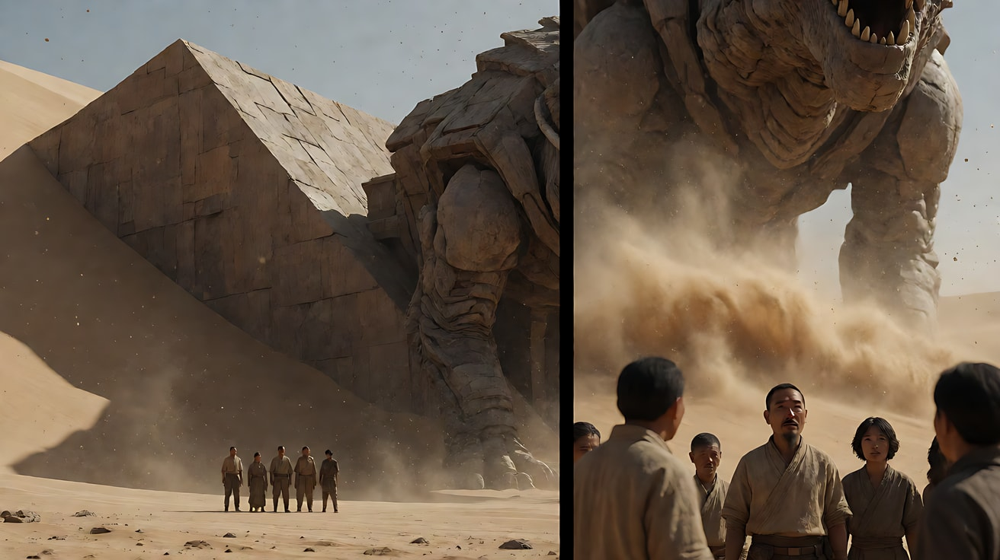

# L08-04 科幻史诗：尺度、规则与惊奇

> 段位：大师 ｜ 建议用时：90 分钟 ｜ 配套提示词：[L08-04-科幻史诗-提示词](../提示词/L08-04-科幻史诗-提示词.md)

## 学习目标

- 能说出科幻史诗片的观众契约："让我相信这个世界的规则，并在它面前感到渺小"
- 能用"人物参照物"制造尺度，而不是靠"史诗、宏大"这类空词
- 能用一个可见的物理后果表达"这个世界的规则不同"
- 能拆解至少两部经典科幻片的尺度、光和声音策略
- 能写出一个包含尺度对比和规则揭示的 15 秒多镜头片段提示词

## 一、概念讲解

### 1. 类型的观众契约

> **"带我去一个我从没去过的地方。让我相信它的规则是真的，让我在它面前感到自己有多小——然后让我看见一个人选择走向它。"**

| 条款 | 观众期待 | 违约的后果 |
|---|---|---|
| 惊奇 | 看到前所未见的尺度、形态或现象 | 只是把现代城市刷成蓝色，观众没有"哇" |
| 可信 | 世界有自己的物理规则，且前后一致 | 设定随剧情需要乱变，观众不再相信 |
| 人的位置 | 巨大的世界里有一个具体的人，有他的选择 | 只有奇观没有人，像一段屏保 |

### 2. 尺度是比出来的

"宏大"不是一个词，是一个比例。没有参照物，再大的东西也只是一张图。

```
  没有参照物：               有参照物：
┌──────────────────┐    ┌──────────────────┐
│     ◯ 一个环      │    │     ◯             │
│                  │    │    ╱ ╲  巨环       │
│  看不出多大        │    │   │   │           │
│                  │    │    ╲ ╱            │
│                  │    │  ·  ← 一个人        │
└──────────────────┘    └──────────────────┘
                         人物只占画面高度的 1/30
```

常用的尺度参照物：一个人、一辆车、一扇门、一串脚印、一只飞鸟。**参照物越熟悉，尺度越可信。**

### 3. 规则要用一个后果来证明

科幻世界的"不同"，最好用一个可见的物理后果证明，而不是用台词解释：

| 规则 | 可见的后果 |
|---|---|
| 这里重力很弱 | 她松开手，水壶慢慢飘起来 |
| 这个结构是活的 | 她靠近时，表面的纹路一圈圈亮起 |
| 时间流速不同 | 她身后的沙丘在几次呼吸之间移动了位置 |
| 声音在这里不传播 | 巨大的结构崩塌，画面里没有一点声音，只有她的呼吸 |

### 4. 七件工具的惯例与反套路

| 工具 | 类型惯例 | 为什么有效 | 反套路 |
|---|---|---|---|
| 景别 | 大远景建立尺度；面罩/眼睛特写反射奇观 | 远景给世界，特写给人的反应 | 整段不给奇观全貌，只拍人物脸上反射的光 |
| 景深 | 深焦 + 大气透视（雾、沙尘分出层次） | 层次让空间变深，深度变成尺度 | 极浅景深，奇观在背景里化成一团光，留给想象 |
| 构图 | 对称、几何、巨物占满画面，人物极小 | 几何感带来秩序和压迫 | 把巨物切出画外，只露出一角，暗示更大 |
| 光影 | 单一巨大光源（恒星、巨型结构发光）；舱内冷光 + 一点暖色异常 | 光源的尺度就是世界的尺度 | 在最黑暗的空间里只用人物的头灯照明 |
| 运镜 | 缓慢升降（crane）、极慢推、低角度仰拍 | 慢 = 重；升起 = 揭示 | 关键揭示用固定镜头，让奇观自己移入画面 |
| 剪辑 | 节奏缓慢；匹配剪辑跨越尺度或时空 | 慢节奏给观众"消化"的时间 | 用一个硬切从极小跳到极大 |
| 声音 | 低频轰鸣、寂静、呼吸声、机械声 | 低频让身体感到体积 | 在宏大画面里完全静音 |

### 5. 科幻片段的节拍


## 二、情绪与叙事功能

| 技法 | 观众的感受 | 常用场景 |
|---|---|---|
| 人物极小的大远景 | 敬畏、渺小 | 抵达新世界、面对巨物 |
| 面罩反射奇观 | 惊奇被"装进"一个人眼里 | 第一次看见 |
| 冷光中的一点暖色异常 | 美丽又不安 | 未知信号、外星现象 |
| 缓慢升镜揭示 | 世界一层层展开 | 开场、高潮 |
| 匹配剪辑跨尺度 | 时间和空间被一刀连通 | 文明跨越、从细节到全貌 |
| 寂静中的呼吸 | 孤独、真实的危险 | 太空、真空、未知环境 |

## 三、经典影片案例

### 《2001太空漫游》（1968，斯坦利·库布里克）
- 场景："人类的黎明"段落结尾，猿人把一根骨头抛向天空，画面硬切到一颗在太空中运行的人造卫星。
- 怎么拍的：骨头在空中翻转上升，下一帧直接匹配到形状相似的卫星，跨越了数百万年。太空段落里，外景大多保持寂静，配合古典音乐与宇航员的呼吸声。
- 为什么这样拍：意图是"让观众感到人类文明从工具到太空只是一次抛掷"。匹配剪辑用形状把两个时代焊在一起，不需要任何解释。太空的寂静是对物理规则的尊重——真空里没有声音——这种"可信"反而让画面更震撼。



### 《银翼杀手》（1982，雷德利·斯科特）
- 场景：开场，2019 年洛杉矶夜景：密集的工业烟囱喷出火焰，飞行器掠过，巨大的金字塔形建筑矗立；画面中插入一只眼睛的大特写，眼球里倒映着这片火光城市。
- 怎么拍的：大远景城市以微缩模型和特效合成实现，火焰和雾气分出层次；眼睛的大特写把整个城市"装进"一个观察者的瞳孔里。
- 为什么这样拍：意图是"让观众感到这个世界被人注视着，也让人迷失"。大远景给尺度，眼睛特写给视角——奇观必须被一个人看见，才有了情感。这是"远景 + 反应特写"组合的经典范例。



### 《沙丘》（2021，丹尼斯·维伦纽瓦）
- 场景：人物在厄拉科斯沙漠中第一次目睹沙虫；以及大量人物站在巨型野兽派建筑前的镜头。
- 怎么拍的：大量大远景让人物只占画面极小一部分，建筑和沙丘以粗粝的几何体占满画面；光线以沙漠的自然硬光和沙尘的散射为主，色调克制。声音设计以低频轰鸣、沙粒和呼吸为主。沙虫出现时，镜头多从人物的位置仰望，先看到沙浪和尘土，再看到它的尺度。
- 为什么这样拍：意图是"让观众感到人在这个世界面前不值一提"。不用快速运镜，不用炫目的色彩，而是用人和空间的比例、克制的光、身体能感到的低频，让"大"变得可信。沙虫先以它造成的后果（沙浪、震动）出场，是"规则用后果证明"的典型做法。



## 四、在 AI 中怎么实现

- **生图阶段**：
  - 尺度写成比例：`the figure occupies less than one-thirtieth of the frame height`、`a single line of footprints leading toward it`。
  - 大气层次：`layered haze, dust in the air separating foreground, midground and background`。
  - 光源写出位置和尺度：`a huge pale sun low on the horizon behind the ring structure, casting a long shadow across the dunes`。
- **视频阶段**：
  - 揭示用一个慢运镜：缓慢升镜、极慢后拉；不要同时环绕又推进。
  - 规则写成一个物理后果，并写清楚来源和方向："她脚边的细沙一粒粒离开地面，沿着一条直线飘向巨环"。
  - 每个奇观镜头后面紧跟一个人的反应镜头（面罩反光、呼吸、停步）。
- **模型擅长**：沙漠、雾、光束、粒子、星空、巨大的几何结构、天气变化、远处的光。
- **要避开**：
  - 带文字的全息界面和仪表盘：文字会乱码，改为"不带文字的发光线条""一盏闪烁的琥珀色指示灯"。
  - 复杂机械变形、多艘飞船编队、精确的物理碰撞：容易崩坏。
  - 外星生物全貌：容易显得廉价，也容易怪异变形；用影子、震动、沙浪、反光来暗示。
  - "史诗级、宏大、震撼"：全部换成"人物占画面高度的几分之一"和光源描述。

## 五、练习作业

1. 选一个科幻场景，写出三种尺度参照物，并比较哪种最可信。
2. 为你设计的世界写一条规则，再写出能证明它的一个可见后果（不能用台词）。
3. 找一部科幻片的开场，标出"远景尺度 → 人物反应"的组合出现了几次。
4. 完成配套提示词练习1–5。

## 六、自检清单

- [ ] 每个奇观镜头都有一个熟悉的尺度参照物
- [ ] 规则用一个可见的物理后果来证明
- [ ] 奇观之后有一个人的反应镜头
- [ ] 光源有位置和方向（恒星、结构发光、头灯）
- [ ] 画面里没有需要读的文字界面
- [ ] 提示词里没有"史诗、宏大、震撼"，只有比例和光

## 七、配套提示词

→ [L08-04-科幻史诗-提示词](../提示词/L08-04-科幻史诗-提示词.md)

---

上一课：[L08-03 爱情文艺](L08-03-爱情文艺.md) ｜ 下一课：[L08-05 恐怖](L08-05-恐怖.md) ｜ [返回总目录](../../README.md)
