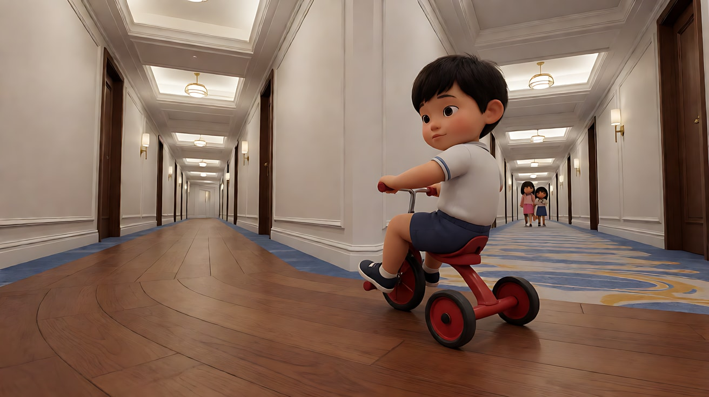
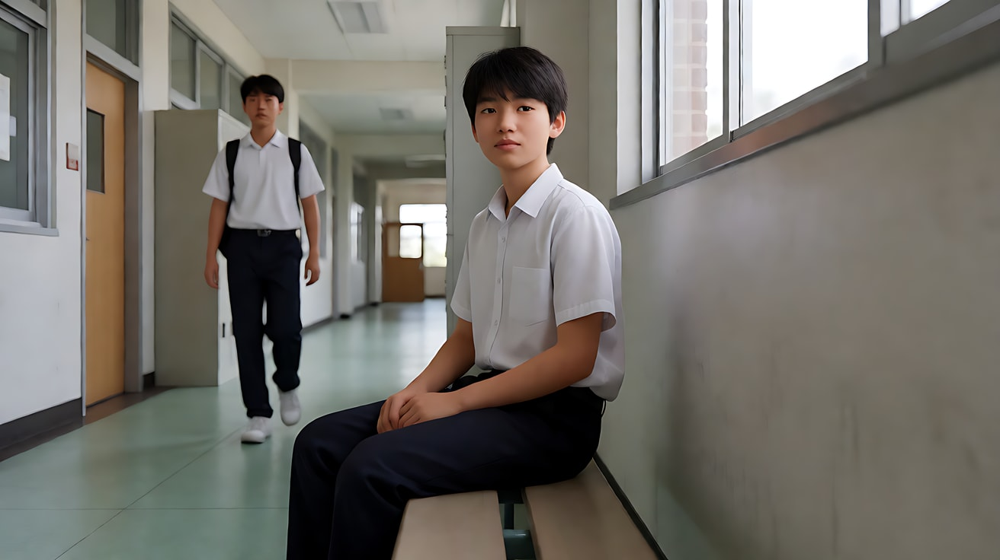
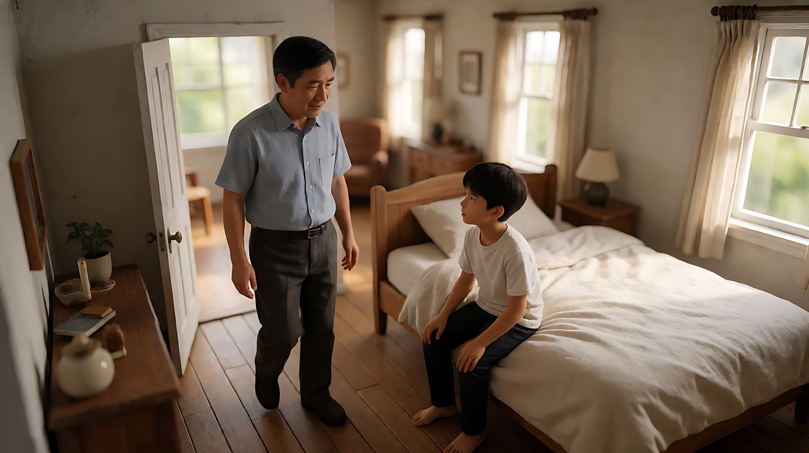

# L08-05 恐怖：最可怕的东西不在画面里

> 段位：大师 ｜ 建议用时：90 分钟 ｜ 配套提示词：[L08-05-恐怖-提示词](../提示词/L08-05-恐怖-提示词.md)

## 学习目标

- 能说出恐怖片的观众契约："让我害怕我想象出来的东西，并遵守你立下的规则"
- 能区分"预期型恐惧（dread）"和"跳吓（jump scare）"，并知道 AI 短片更适合哪一种
- 能用负空间、景深、低调光和声音抽空制造"缺席的恐怖"
- 能拆解至少两部经典恐怖片的关键段落
- 能写出一个不出现任何怪物、伤害、敏感词，却让人后背发凉的 15 秒多镜头片段

## 一、概念讲解

### 1. 类型的观众契约

> **"我是来害怕的。别让我看清它——让我自己去想。你立下的规矩，就别自己打破。"**

| 条款 | 观众期待 | 违约的后果 |
|---|---|---|
| 预期 | 恐惧在积累：知道会有事，不知道何时 | 一路跳吓，观众麻木或笑场 |
| 留白 | 威胁大多在画外、暗处、背景里 | 早早露出怪物全貌，恐惧立刻变成"特效好不好" |
| 规则 | 这个世界的恐怖有自己的规律（不能回头、不能开灯、它走得很慢） | 规则随剧情乱改，观众不再相信危险 |

### 2. 恐惧曲线：预期 vs 跳吓

```
 紧张
  ▲
  │                         ╱│
  │                      ╱   │  ← 跳吓：一次释放
  │                   ╱      │
  │       ╱‾‾‾‾‾‾‾‾‾╱        │
  │    ╱                     ╲___
  │ ╱   预期型恐惧（dread）：持续积累
  └────────────────────────────────▶ 时间
     建立常态  异常出现  靠近  抽空  释放/悬置
```

跳吓只需要一个剪辑点加一声巨响，但**释放之后观众会松一口气**。预期型恐惧不释放，或者只给一个很小的释放，让紧张感留在身上。**AI 短片最适合预期型恐惧**：模型擅长长时间的静止、黑暗、雾气和声音，不擅长准确地"在第几帧吓人"。

### 3. "缺席"的语法

恐怖不需要画出怪物，只需要画出**不该在那里的东西**，或者**本该在那里却不见了的东西**：

| 类型 | 可拍的画面 |
|---|---|
| 多了什么 | 门口多了一双湿拖鞋；镜子起雾后多了一个手印；第二组脚步声 |
| 少了什么 | 刚才还开着的门关上了；椅子上的外套不见了；水声突然停了 |
| 动了什么 | 衣柜门的缝变宽了一点；照片里的人换了位置；走廊尽头的灯亮了 |
| 规则被打破 | 屋里只有她一个人，可是隔壁房间传来她自己的声音 |

### 4. 七件工具的惯例与反套路

| 工具 | 类型惯例 | 为什么有效 | 反套路 |
|---|---|---|---|
| 景别 | 中景留出大片背景空间；主观镜头 | 空着的背景就是威胁可能出现的地方 | 极近的特写，观众完全看不到周围，只能听 |
| 景深 | 深焦让背景里有东西在动；浅景深让背景虚成一团可疑的暗影 | 观众会盯着虚焦处找东西 | 焦点始终在背景的空门口，前景人物反而是虚的 |
| 构图 | 角色偏在画边，大面积负空间；门框里的黑洞 | 负空间让观众不由自主地去"填满它" | 完全居中、对称、明亮——"过于整齐"本身就诡异 |
| 光影 | 低调光、单一光源（手电、烛光、走廊灯）、底光 | 光照不到的地方由想象力填充 | 正午阳光下的恐怖：无处可藏，也无处可逃 |
| 运镜 | 极慢推、固定长镜头、缓慢的主观移动 | 慢让时间变得难熬 | 镜头独立于人物移动，像有另一个"视角"在看 |
| 剪辑 | 拒绝剪辑：该切时不切；拒绝给反应镜头 | 观众无法通过剪辑"逃离"画面 | 一次规律的剪辑节奏突然被打破 |
| 声音 | 环境声抽空；单一离屏声；低频；静音 | 耳朵会在寂静中自己制造声音 | 用最日常的声音（洗衣机、电视、水滴）作为恐怖来源 |

## 二、情绪与叙事功能

| 技法 | 观众的感受 | 常用场景 |
|---|---|---|
| 负空间 + 深焦 | 一直在找背景里的东西 | 角色独处、夜里 |
| 声音抽空 | 世界变得"太安静"，预感要出事 | 揭示前一拍 |
| 单一离屏声 | 想知道声音从哪来 | 敲门、脚步、刮擦 |
| 灯灭再亮后画面变了 | 规则被打破，后背发凉 | 揭示"多了什么" |
| 拒绝反应镜头 | 观众替角色害怕 | 角色背对威胁 |
| 结尾悬置 | 恐惧带出影院 | 片尾、集尾 |

## 三、经典影片案例

### 《闪灵》（1980，斯坦利·库布里克）
- 场景：小男孩丹尼骑着三轮车在远望酒店的走廊里穿行；以及他在走廊尽头遇到一对双胞胎女孩。
- 怎么拍的：斯坦尼康以极低的高度紧跟三轮车，沿着长长的走廊转弯。车轮压过木地板时声音很响，压过地毯时突然变轻，响—静—响—静的节奏让观众越来越不安。走廊构图严格对称，转角之后会出现什么，观众永远看不到。
- 为什么这样拍：意图是"让观众感到这座建筑本身在等待"。镜头跟得越稳，走廊就越像一个迷宫；声音的交替是对"抽空"的巧妙运用——每次进入地毯，世界突然安静，观众就预感转角后有东西。对称构图的反套路效果：太整齐、太规则，反而像一个陷阱。



### 《它在身后》（2014，大卫·罗伯特·米切尔）
- 场景：片中有一个在学校走廊里缓慢旋转 360 度的长镜头；整部片的"它"永远是一个慢慢走向主角的人形。
- 怎么拍的：镜头在走廊里匀速转圈，背景里有一个人从远处缓慢地、笔直地走过来。观众每次转回那个方向，都会发现它又近了一点。大量广角镜头和深焦，让背景里的每一个行人都可能是"它"。
- 为什么这样拍：意图是"让观众自己去找威胁"。规则极其简单——它走得很慢，但永远不停——这个规则让每一个背景都变得可疑。360 度旋转把观众变成了警戒中的人，而深焦保证了线索公平地在画面里。



### 《遗传厄运》（2018，阿里·艾斯特）
- 场景：开场，镜头从工作室慢慢推进一个微缩模型房屋，模型里的一个房间逐渐"变成"真实的卧室，父亲走进来叫醒儿子。
- 怎么拍的：一个缓慢的推镜，没有明显的剪辑点，模型的边缘离开画面后，画面里就是真实的房间。全片多次用模型般的高角度、平稳、冷静的构图拍摄这个家。
- 为什么这样拍：意图是"让观众感到这家人是被摆弄的玩偶"。一个推镜就立下了全片的规则：有某种更大的力量在俯视、摆布他们。这种恐怖不靠任何跳吓，而是靠"视角"——观众从第一个镜头起就处在一个不安全的位置。



## 四、在 AI 中怎么实现

- **生图阶段**：
  - 构图先留出"可疑的空间"：`the woman on the far left third, a long dark hallway with an open doorway at the end occupying the rest of the frame`。
  - 光只写一个光源：`a single small flashlight beam is the only light, everything outside it falls into near-black`。
  - 为"灯灭再亮"类揭示准备首尾两帧：同一构图，只改一个细节（多一双鞋、门缝变宽）。
- **视频阶段**：
  - 威胁写成痕迹、声音或光的变化："地上有一串湿脚印，从门口一直延伸到浴室门下""水滴声停了"。
  - 写"她没有察觉"：观众看到、角色没看到，是最便宜也最有效的恐怖。
  - 声音写成三层：先写日常声音，再写它们逐一消失，最后写一个单一离屏声或彻底静音。
  - 结尾停在一个状态上，不写"突然冲出来"：例如"走廊尽头那扇原本关着的门，开了一条缝"。
- **模型擅长**：黑暗、雾、灯光闪烁、手电光束、雨窗、空房间、慢速推进、静止的长镜头。
- **要避开**：
  - 怪物、变形的人形、扭曲的面孔：模型容易画得滑稽或崩坏，也容易触发审核。
  - **敏感词**（恐怖片的高危区）：`鬼/幽灵/恶魔/僵尸/丧尸`→不点名，改写成"第二组脚步声""本该空着的椅子"；`尸体/死人`→不出现；`血/血迹`→"深色的水渍""湿脚印"；`刀/斧`→不出现；`杀/谋杀`→不出现；未成年人与危险、夜晚、黑暗同框也是高危组合——**恐怖片段的角色一律写成成年人**。几个中等风险词叠加在一起也会被拦截，写完后逐个名词检查。
  - 跳吓：模型很难精确控制"那一帧"，强行要求常常变成画面闪烁或崩坏。
  - 面部恐惧特写持续太久：五官会漂移，改为背影、半侧脸或手部。

## 五、练习作业

1. 选一个你住过的地方（走廊、楼梯、浴室），写出三个"多了什么 / 少了什么 / 动了什么"的恐怖细节，不出现任何人或怪物。
2. 看一部恐怖片的一场戏，标出它的声音曲线：哪里有日常声音，哪里抽空，哪里是单一离屏声。
3. 改写练习：把"一个满脸是血的鬼从柜子里冲出来"改写成一个不含任何敏感词、同样让人害怕的画面。
4. 完成配套提示词练习1–5。

## 六、自检清单

- [ ] 威胁始终在画外、暗处或背景里，没有出现怪物全貌
- [ ] 有一个清楚的"缺席"细节（多了 / 少了 / 动了）
- [ ] 光只有一个明确来源，暗处是设计出来的
- [ ] 声音有"日常 → 抽空 → 单一离屏声或静音"的曲线
- [ ] 角色是成年人，没有伤害、尸体、超自然名词
- [ ] 结尾是一个悬置的状态，不是跳吓

## 七、配套提示词

→ [L08-05-恐怖-提示词](../提示词/L08-05-恐怖-提示词.md)

---

上一课：[L08-04 科幻史诗](L08-04-科幻史诗.md) ｜ 下一课：[L08-06 竖屏短剧爽点钩子](L08-06-竖屏短剧爽点钩子.md) ｜ [返回总目录](../../README.md)
