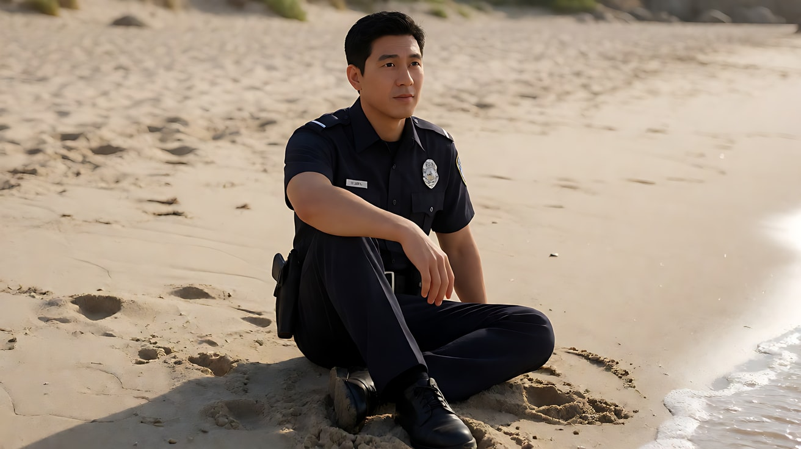

# L08-06 竖屏短剧爽点钩子：为划走的拇指导戏

> 段位：大师 ｜ 建议用时：100 分钟 ｜ 配套提示词：[L08-06-竖屏短剧爽点钩子-提示词](../提示词/L08-06-竖屏短剧爽点钩子-提示词.md)

## 学习目标

- 能说出竖屏短剧的观众契约："前三秒告诉我谁在受委屈，然后尽快让她赢"
- 能设计"钩子 → 压 → 反转 → 爽点 → 反应 → 新钩子"六拍结构
- 能为 9:16 画幅构图：纵深调度、字幕安全区、近景为主
- 能理解反应镜头为什么是短剧的"情绪说明书"，并用最少的生成成本拍出它
- 能写出一个 9:16、15 秒、包含钩子与反转的多镜头短剧片段提示词

## 一、概念讲解

### 1. 类型的观众契约

竖屏短剧的观众不是坐在影院里，而是拿着手机，拇指随时准备划走。

> **"三秒之内告诉我：谁被看不起了、她手里有什么底牌。然后别让我等太久——让看不起她的人当众难堪。每一集结尾，再给我一个划不走的理由。"**

| 条款 | 观众期待 | 违约的后果 |
|---|---|---|
| 钩子 | 前三秒就看到冲突或一个反常画面 | 慢热开场，观众直接划走 |
| 关系清楚 | 第二个镜头就知道谁和谁是什么关系、赌注是什么 | 观众看了十秒还不知道谁是谁，失去代入 |
| 回报密度 | 每一小段都有情绪回报（爽点） | 压得太久不翻身，观众憋屈弃剧 |
| 结尾钩子 | 每集结束在一个新问题上 | 话说完了，观众没有理由点下一集 |

### 2. 六拍结构


在一个 15 秒的片段里，六拍不可能全部展开。常见的压缩法：

| 15 秒片段 | 包含的节拍 |
|---|---|
| 开篇集 | 钩子 + 压 + 反转的苗头（结尾悬在底牌即将亮出） |
| 中段集 | 反转 + 爽点 + 反应 |
| 完整爽点片段 | 钩子（已压）→ 反转 → 爽点 → 反应 → 新钩子 |

### 3. 前三秒的钩子类型

| 钩子 | 画面写法 | 为什么抓人 |
|---|---|---|
| 反常画面 | 一只旧帆布包被推下大理石台面 | 观众想知道"她凭什么被这样对待" |
| 冲突台词 | 第一句就是"今天包场，请回吧" | 冲突直接说出口，零理解成本 |
| 身份落差 | 穿着朴素的人站在金碧辉煌的大堂里 | 落差本身就是问题 |
| 倒叙结果 | 先给结局画面（所有人低头），再回到开头 | 观众想知道"怎么走到这一步" |

### 4. 9:16 构图的特殊规则

```
┌───────────────┐
│  顶部安全区     │ ← 平台标题、头像、按钮会遮挡
│───────────────│
│               │
│   主体区       │ ← 人物的脸放在上三分之一到中线之间
│    ( 脸 )     │
│               │
│   纵深层       │ ← 第二个人放在后景，而不是左右并排
│               │
│───────────────│
│  字幕安全区     │ ← 台词字幕在后期加，下方约 1/4 别放关键内容
│  底部按钮区     │
└───────────────┘
```

- **左右窄、上下长**：双人对峙不适合横向并排（会被挤到画边），改成**前后纵深**：一个人在前景近景，另一个在后景中景。
- **近景为主**：手机屏幕小，脸要大。全景只在交代空间时用一次。
- **不在画面里写字**：字幕、片名、弹幕全部后期加，生成时画面里不出现文字。

### 5. 七件工具的惯例与反套路

| 工具 | 类型惯例 | 为什么有效 | 反套路 |
|---|---|---|---|
| 景别 | 近景、特写为主；反应镜头密集 | 小屏幕需要大脸，情绪必须一眼看懂 | 爽点时刻用一个全景：所有人都站着，只有她坐着 |
| 景深 | 浅景深把主角从背景里拎出来 | 观众瞬间知道该看谁 | 深焦让后景的轻视者也清楚可见，形成对照 |
| 构图 | 主体居中；纵深调度；低角度给翻身者，高角度给落难者 | 竖屏的中线就是视觉焦点 | 翻身之前，主角一直被挤在画面下方；翻身后第一次占据上方 |
| 光影 | 高调明亮为主；反转时光变（门开、灯亮） | 光的变化让反转"看得见" | 反转那一刻反而压暗，只给主角一束光 |
| 运镜 | 快推、甩镜、缓慢环绕 | 快推 = "注意这一刻" | 爽点时刻镜头完全不动，让台词自己落地 |
| 剪辑 | 快、密，每个镜头都短；反应镜头紧跟台词 | 节奏让拇指停下来 | 关键的一句话之后，多停一拍的沉默 |
| 声音 | 音效重音（"咚"）、BGM 卡点、台词清楚 | 声音告诉观众"这里该爽了" | 爽点不靠吼，靠一句很轻的话和之后的安静 |

### 6. 反应镜头：短剧的情绪说明书

一个反转是否"爽"，取决于观众看到了谁的反应。爽点最好的载体不是主角，而是**轻视过她的人**的脸：

- 端到半空的杯子停住
- 刚才指着她的手指慢慢放下
- 笑容还挂在脸上，眼睛已经不笑了

对 AI 来说，反应镜头非常"便宜"：一个人、一个动作、几乎不动的镜头，只占半拍。**宁可多给一个反应镜头，也不要多给一句台词。**

## 图解

> 这些示意图由多种生图模型分别生成（包括 Nano Banana、GPT Image 等），只用来说明镜头概念；不同模型的画面不能互相比较效果，也不能当作视频成片。


9:16。眼睛放在上三分，她回头看镜头。下方只留大衣和空，那一块是字幕和界面的安全区，不要把脸放在最底下。

## 二、情绪与叙事功能

| 技法 | 观众的感受 | 常用场景 |
|---|---|---|
| 前三秒反常画面 | "怎么回事？"——停下拇指 | 每集开头 |
| 压（轻视、刁难） | 憋屈、替主角不平 | 第一个三分之一 |
| 反转（底牌亮出） | "终于来了" | 中段 |
| 轻视者的反应镜头 | 爽，解气 | 反转之后立刻接上 |
| 低角度给翻身者 | 主角气场变强 | 爽点时刻 |
| 结尾新钩子 | "下一集呢？" | 每集结尾 |

## 三、经典影片案例

> 竖屏短剧是一种新兴形态，它的叙事技巧大多来自电影。下面三部影片分别示范了"爽点结构""反转钩子"和"反应镜头"。

### 《王牌特工：特工学院》（2014，马修·沃恩）
- 场景：酒吧里，绅士哈利被一群混混挑衅。
- 怎么拍的：先压——混混嘲笑他、威胁他；哈利不动声色地喝完酒，走到门口锁上门，说出那句"Manners maketh man（礼仪成就不凡）"，然后主要凭一把雨伞，在很短的时间里放倒了所有人。结束后，他回到桌前，对着目瞪口呆的年轻人收尾。
- 为什么这样拍：这是"压 → 立规矩 → 碾压 → 收尾一句"的教科书爽点结构。锁门这个动作是反转的信号——观众在动手之前就知道"要爽了"。爽点之后，年轻人的反应镜头告诉观众应该有多惊讶。短剧完全可以借用这个节奏：底牌亮出前，先给一个"主角要出手了"的可见动作。


### 《消失的爱人》（2014，大卫·芬奇）
- 场景：影片中段，失踪的妻子艾米出现在一辆行驶的车里，画外音开始讲述她如何策划了这一切。
- 怎么拍的：前半部分让观众怀疑丈夫；中段突然切到艾米本人，平静地开着车，一边吃东西一边用画外音揭示真相。没有惊吓式的音效，揭示用一个平静的画面完成。
- 为什么这样拍：意图是"让观众意识到自己一直被误导"。这是一次彻底改变观众立场的反转——之前同情谁、怀疑谁，全部翻转。短剧的"身份反转""真相反转"就是这种结构的高密度版本。值得学习的是：最强的反转往往不需要高声，只需要一个"不该出现的人平静地出现"。


### 《大白鲨》（1975，史蒂文·斯皮尔伯格）
- 场景：海滩上，警长布罗迪坐在岸边盯着海面，突然看到了袭击。
- 怎么拍的：用推轨与变焦相反运动的"滑动变焦"拍布罗迪的脸——他的脸大小不变，背景的海滩却在压缩或拉伸，形成眩晕感。观众主要是从他的反应里感到"出事了"。
- 为什么这样拍：反应镜头告诉观众应该有多震惊。导演没有正面展示鲨鱼，而是把冲击放在人物的脸上——这正是"反应镜头是情绪说明书"的经典例证。短剧里的反转同理：反转本身可以只是一句话，真正让人爽的是那张脸。



## 四、在 AI 中怎么实现

- **生图阶段**：
  - 所有关键帧都写 `Vertical 9:16 frame.`，并写 `the face placed in the upper third, the lower quarter kept clear for subtitles`。
  - 双人构图用纵深：`the protagonist in the foreground medium close-up, the antagonist in the background medium shot, both sharp`。
  - 人物定妆要有一眼可辨的"身份符号"：朴素的白衬衫和旧帆布包 vs 亮金色礼服——观众一眼就知道谁被看不起。
- **视频阶段**：
  - 第二个镜头必须让关系清楚：一句台词说出关系或赌注（"今天包场，请回吧"），或一个不需要解释的情境。
  - 台词要短，每人一句，各在自己的镜头里说；写法是"角色名 + 动作 + 冒号 + 引号台词"。
  - 反转写成一个看得见的动作或光的变化：她把一张黑色卡片放在台面上；大堂的门打开，一排人走进来。
  - 反应镜头写"一个人 + 一个动作 + 一个物理锚点"：表姐举到嘴边的杯子停在半空。
  - 每个镜头末尾都可以写站位，多镜头写【锁定】行：谁在前景、谁在后景、谁面朝哪边、光从哪来。
- **模型擅长**：近景表演、单人反应、光的突变、门开门关、物件的放下与拿起、明亮的室内空间。
- **要避开**：
  - 一句台词里塞太多字：模型的口型和语速会崩。每句控制在 12 个字以内。
  - 两个人在同一个镜头里先后说话：容易串音，改成正反打，一人一镜。
  - 肢体冲突（扇耳光、推搡）：会变形也容易被拦截；"打脸"写成当众难堪的状态。
  - 画面里出现文字（支票金额、公司名、屏幕字）：全部后期加。
  - **敏感词**：`律师、法院、警察、医院`等机构名叠加在一起容易被拦截，改为"穿深色西装的人""一份牛皮纸文件袋"；不写具体金额和真实品牌。

## 五、练习作业

1. 刷 10 条短剧开头，记录每条前三秒用的是哪种钩子（反常画面 / 冲突台词 / 身份落差 / 倒叙结果）。
2. 为一个原创故事写出六拍结构，每拍一句话，再把它压缩成一个 15 秒片段需要的 4–5 个镜头。
3. 画出 9:16 的分镜草图，标出每个镜头里人脸的位置和字幕安全区。
4. 完成配套提示词练习1–6，把练习6 的成片加上后期字幕，发给朋友测试：他们在第几秒决定继续看？

## 六、自检清单

- [ ] 前三秒有一个反常画面或冲突台词
- [ ] 第二个镜头结束时，观众已经知道人物关系和赌注
- [ ] 反转是一个可见的动作或光的变化
- [ ] 爽点之后紧跟至少一个轻视者的反应镜头
- [ ] 每句台词 12 字以内，一人一镜
- [ ] 所有关键帧为 9:16，脸在上三分之一，下方留出字幕区
- [ ] 结尾有一个新钩子
- [ ] 画面里没有文字，没有肢体冲突

## 七、配套提示词

→ [L08-06-竖屏短剧爽点钩子-提示词](../提示词/L08-06-竖屏短剧爽点钩子-提示词.md)

---

上一课：[L08-05 恐怖](L08-05-恐怖.md) ｜ 下一课：[L08-07 产品广告](L08-07-产品广告.md) ｜ [返回总目录](../../README.md)
