# L09-01 从剧本到成片 · 提示词

> 本组练习：用一个完整的原创短片项目「最后一盏手摇灯」（4 个片段，约 50 秒）走完全流程：项目设定 → 分镜表 → 定妆与场景 → 每段关键帧 → Seedance 生成 → 尾帧接续与重新锚定 → 剪辑与声音。｜ 配套教学：[L09-01-从剧本到成片](../教学/L09-01-从剧本到成片.md) ｜ 规范：[写作规范](../../模板/写作规范.md)
>
> 画风默认使用开关 A（风格化写实 CG）。如改用 2D 动画，删掉所有焦段、光圈、景深词。

---

## 项目设定

| 项目 | 内容 |
|---|---|
| 片名 | 最后一盏手摇灯（原创） |
| 一句话故事 | 海岛灯塔即将改为无人值守，老看守人老秦在最后一个风暴夜，把手摇点亮备用灯的方法教给每周来送补给的年轻船工阿澄，然后在黎明独自划船离开。 |
| 导演意图 | 让观众感到放手也是一种守护。 |
| 导演声音 | 古典构图派：稳重的机位，对称的灯塔与灯室，运镜有分寸；冷蓝灰的海与琥珀色的灯光两色对照；剪辑耐心。全片只在片段3 打破一次规则：唯一一次缓慢环绕、唯一一次暖光占满画面。 |
| 声音设计 | 每个片段生成同期环境声与动作音效（风、浪、铁梯回声、齿轮声），配乐在剪辑时统一铺设：片段1–2 无配乐，片段3 齿轮声成为节奏，片段4 出现唯一一段低沉的大提琴长音。 |
| 画幅 | 16:9 |

**项目锁定（每个片段的【锁定】行都要继承）**：
- 老秦：六十多岁，白色短寸头与白胡茬，藏蓝色粗毛线渔夫毛衣，深绿色油布防水外套，颈上挂一枚系皮绳的黄铜钥匙。
- 阿澄：二十四岁女性，被风吹乱的黑色短发，藏蓝色毛线帽，亮黄色油布雨衣，橙色雨靴，露指手套。
- 地理：灯塔在小岛最高处，码头在灯塔的画左下方；灯室的海面一侧永远在画右。
- 色彩：外景冷蓝灰，灯光琥珀暖色；片段3 之前暖光从不占满画面。

### 片段弧线记录

| 片段 | 弧线位置 | 片段意图 | 景别趋势 | 运镜趋势 | 光趋势 | 声音趋势 | 打破规则 |
|---|---|---|---|---|---|---|---|
| P1 码头黄昏 | 开端 | 平静里有一丝不安：灯要坏了，人要走了 | 宽 | 稳，固定或极慢推 | 黄昏冷暖平衡 | 风、浪、海鸥 | 否 |
| P2 螺旋楼梯 | 上升 | 风暴压上来，两个人往上走 | 收紧 | 唯一一次升镜 | 只有手电冷光 | 风暴声变浓，铁梯回声 | 否 |
| P3 灯室 | 转折 | 他把守了一辈子的东西交出去 | 最近 | 全片唯一一次缓慢环绕 | 从冷到暖光占满画面 | 风暴被关在门外，只剩齿轮声 | 是 |
| P4 黎明 | 收束 | 灯还亮着，守灯的人换了 | 最宽 | 静 | 黎明柔和冷光 + 一点灯光 | 风停，浪轻，大提琴长音（后期） | 否 |

### 分镜表

| 镜头 | 景别与机位 | 焦段/景深 | 运镜 | 动作 | 光 | 声音 | 素材 | 生成方式 |
|---|---|---|---|---|---|---|---|---|
| P0 | 大远景，海面低机位 | 24mm 深焦 | 固定 | 无人，灯塔与海 | 黄昏低阳在画左 | 风、浪、海鸥 | 图C | ★ 单图生视频（片头空镜） |
| P1 | 中全景，码头平视 | 35mm 中等景深 | 极慢推近 | 阿澄递上木箱，老秦接过放下；两人抬头，塔顶自动灯亮起又熄灭 | 黄昏低阳在画左，塔顶灯琥珀色 | 浪拍码头，木箱落地，灯熄灭时的电流啪声 | 图A、B、C、K1 | ★★ 多图参考，连续形态 |
| P2 | 螺旋楼梯，从底部到顶部 | 28mm 深焦 | 沿楼梯中心缓慢上升 | 老秦举手电在前，阿澄跟在后面，向上爬，老秦的手按上顶部舱门把手 | 只有手电冷白光，窗外闪电 | 铁梯脚步回声，风暴拍打塔身 | 图A、B、E、K2a、K2b | ★★★ 首尾帧 |
| P3-S1 | 中景，舱口内侧 | 35mm | 固定 | 老秦推开舱门走进漆黑灯室 | 手电冷光，雨打玻璃 | 风暴灌进来又被关在门外 | P2 尾帧、图A、B、D | ★★★★ 多镜头，接续深度 1 |
| P3-S2 | 中近景，曲柄旁 | 50mm 浅景深 | 固定 | 老秦握住黄铜曲柄摇动，透镜开始转，暖光亮起 | 暖光从透镜中心升起 | 齿轮咔哒声 | 图F | 同上 |
| P3-S3 | 中景双人 | 50mm | 全片唯一的缓慢环绕 | 老秦松手退开半步，阿澄接过曲柄继续摇 | 暖光占满画面 | 齿轮声成为节奏 | — | 同上 |
| P3-S4 | 大远景，海上看灯塔 | 24mm 深焦 | 固定 | 灯光扫过风暴中的海面 | 一道暖光束切开冷蓝风暴 | 风暴声回来，压过齿轮 | 图C | 同上 |
| P4-S1 | 大远景，黎明 | 24mm 深焦 | 固定 | 一条小划艇离开码头 | 黎明柔和冷光，灯仍在转 | 风停，轻浪 | 图A、B、G、K4 | ★★★★★ 多镜头，重新锚定 |
| P4-S2 | 中景，划艇上 | 50mm | 固定 | 老秦划桨，停下，回头望 | 黎明侧光 | 桨声、水声 | — | 同上 |
| P4-S3 | 中景，灯室外廊 | 50mm | 固定 | 阿澄站在栏杆边，抬起一只手 | 背后灯光与天光 | 风声、远处海鸥 | — | 同上 |
| P4-S4 | 大远景 | 24mm 深焦 | 极慢后拉 | 小船越来越小，灯光最后扫过一次 | 太阳从海平线升起 | 一切变得很轻 | — | 同上 |

### 图片清单（全项目）

| 编号 | 内容 | 用在 |
|---|---|---|
| 图A | 老秦定妆 | P1–P4 |
| 图B | 阿澄定妆 | P1–P4 |
| 图C | 灯塔外景·黄昏 | P0、P1、P3 |
| 图D | 灯室内景·风暴夜 | P3 |
| 图E | 螺旋楼梯·夜 | P2 |
| 图F | 道具：黄铜手摇曲柄 | P3 |
| 图G | 灯塔外景·黎明 | P4 |
| K1 | P1 首帧 | P1 |
| K2a / K2b | P2 首帧 / 尾帧 | P2 |
| K4 | P4 首帧 | P4 |

> 每次上传时，图片按"该片段的素材分工"重新编号为 @图片1、@图片2……，下面每个练习都写明了本次上传的编号。生图时同理：关键帧提示词里的 image 1、image 2……按该条提示词中出现的顺序上传（例如 K1 依次上传图A、图B、图C；K4 依次上传图A、图G）。

---

### 练习1：定稿全部资产 + 片头空镜（难度 ★）

**目标**：一次性生成并冻结全部定妆图、场景图和道具图；再用灯塔外景做一个片头空镜，测试画风、光和环境声是否符合项目设定。

**【生图 · Nano Banana】**

图A 老秦定妆：

```
Character turnaround sheet of an original lighthouse keeper in his late sixties: tall, slightly stooped, broad weathered hands,
a short white crew cut and white stubble, deep lines around the eyes, a thick navy cable-knit fisherman's sweater
under an open dark-green oilskin waterproof jacket, grey canvas trousers, black rubber boots,
a small brass key hanging on a leather cord around his neck.
Front view, three-quarter view, side view and back view, full body, plain light-grey background.
Camera at eye level, 50mm lens, deep focus, even soft studio light from the front.
Stylized semi-realistic 3D CG rendering, feature-film animation quality. Aspect ratio 16:9.
```

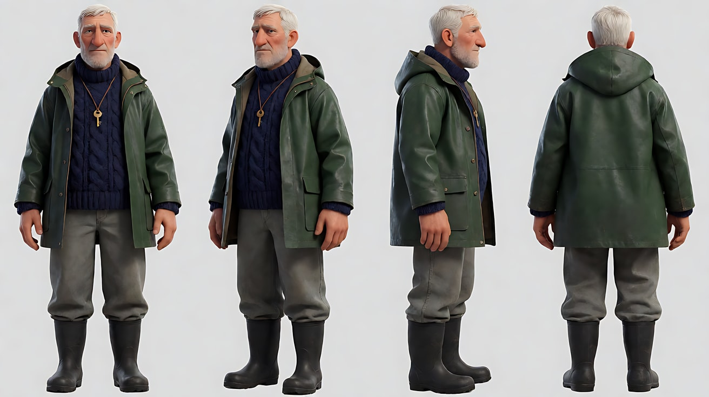

图B 阿澄定妆：

```
Character turnaround sheet of an original young female boat worker, twenty-four: athletic build, short wind-tousled black bob,
a navy knitted beanie, a bright yellow oilskin rain jacket over a grey hoodie, dark navy work trousers,
orange rubber boots, black fingerless gloves, a coil of rope hooked on her belt.
Front view, three-quarter view, side view and back view, full body, plain light-grey background.
Camera at eye level, 50mm lens, deep focus, even soft studio light from the front.
Stylized semi-realistic 3D CG rendering, feature-film animation quality. Aspect ratio 16:9.
```

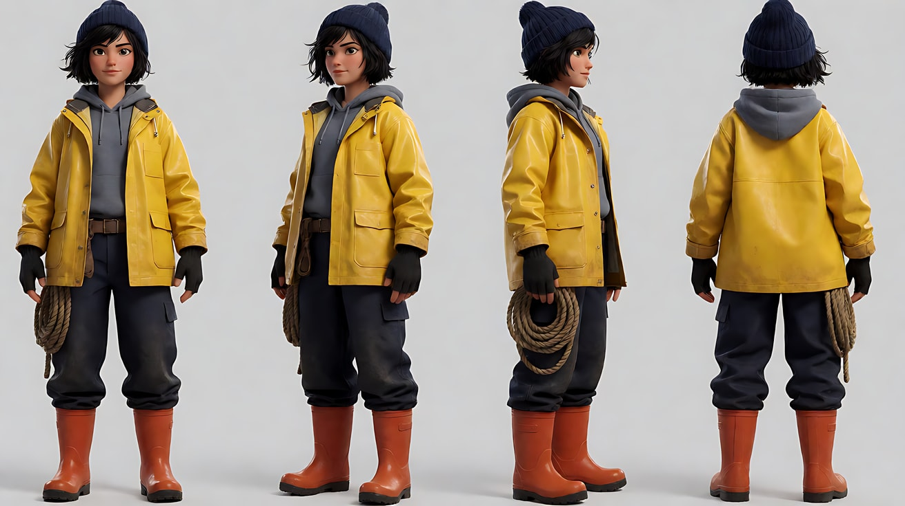

图C 灯塔外景·黄昏：

```
Empty small rocky island at dusk, no people. A tall white stone lighthouse tower with a black iron lantern room and an outer gallery railing
stands on the highest point, a small white keeper's cottage beside it, a narrow stone path winding down to a short concrete pier
at the lower left of the frame, dark grey-blue sea with white-capped waves, heavy clouds gathering on the horizon on the right.
Extreme wide shot from the sea at low height, 24mm lens, deep focus, the lighthouse on the right third.
Lighting: low cold sun breaking under the clouds from frame left, rim-lighting the tower, the lantern room dark, cool blue-grey sea.
Stylized semi-realistic 3D CG rendering, feature-film animation quality. Aspect ratio 16:9.
```

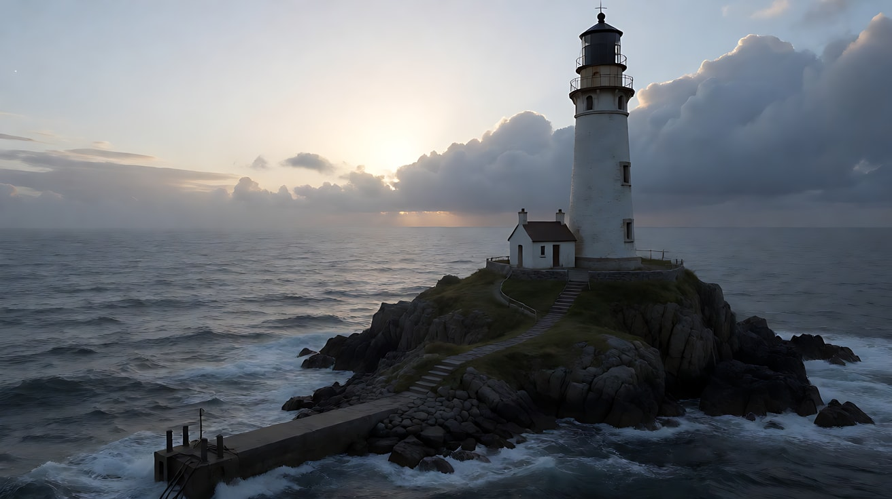

图D 灯室内景·风暴夜：

```
Empty lighthouse lantern room at night during a storm, no people. A large tiered glass lens at the centre on a cast-iron pedestal,
360-degree storm windows streaked with heavy rain, a small modern automatic lamp unit mounted beside the lens with one dead amber indicator,
a brass hand crank with a worn wooden handle mounted on a cast-iron gear box on the left side of the pedestal,
a round iron floor hatch near the left wall. The sea side of the windows is on frame right.
Medium-wide shot, eye level, 28mm lens, deep focus. Lighting: almost dark, only cold blue lightning glow through the rain-streaked windows,
the lens catching faint reflections. Stylized semi-realistic 3D CG rendering, feature-film animation quality. Aspect ratio 16:9.
```

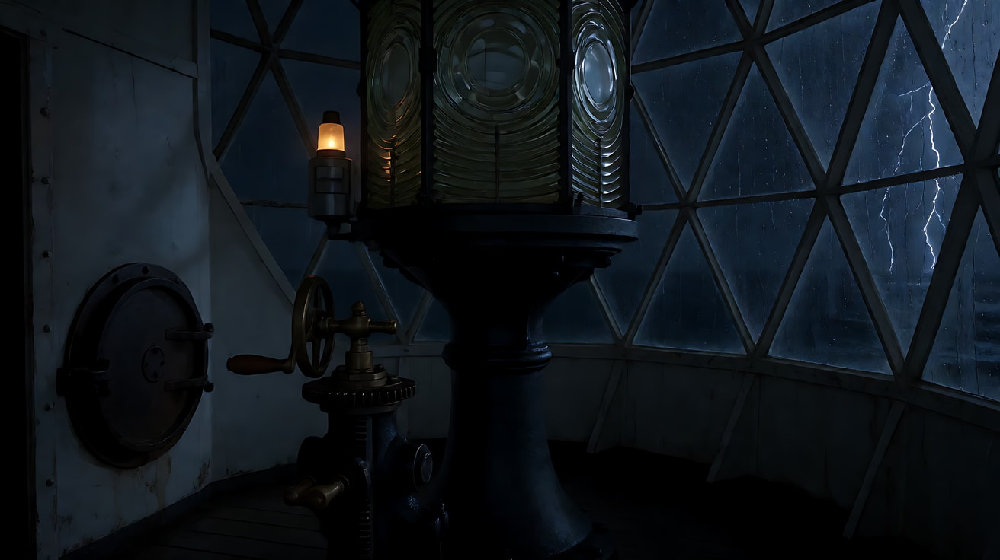

图E 螺旋楼梯·夜：

```
Empty interior of a lighthouse tower at night, no people. A narrow cast-iron spiral staircase winding up around a central column,
whitewashed curved stone walls, one small deep-set window on the left wall, a round hatch visible far above at the top.
Camera at the bottom of the stairwell looking up along the spiral, 28mm lens, deep focus.
Lighting: nearly dark, cold blue storm light through the small window, faint reflections on the iron steps.
Stylized semi-realistic 3D CG rendering, feature-film animation quality. Aspect ratio 16:9.
```

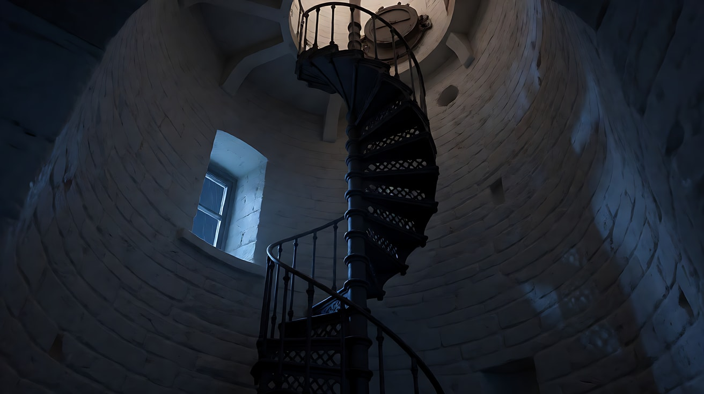

图F 道具：黄铜手摇曲柄：

```
Close-up product-style shot of an old lighthouse hand crank mechanism: a polished brass crank arm with a worn dark wooden handle,
mounted on a cast-iron gear box with visible brass cog teeth through a small open window, a few scratches and old grease marks,
on a plain dark-grey background. Front three-quarter view, the crank handle pointing to the upper right.
Camera at mechanism height, 85mm lens, moderate depth of field so the whole mechanism is sharp.
Lighting: warm soft key from frame left raking the brass, a cool rim from behind.
Stylized semi-realistic 3D CG rendering, feature-film animation quality. Aspect ratio 16:9.
```

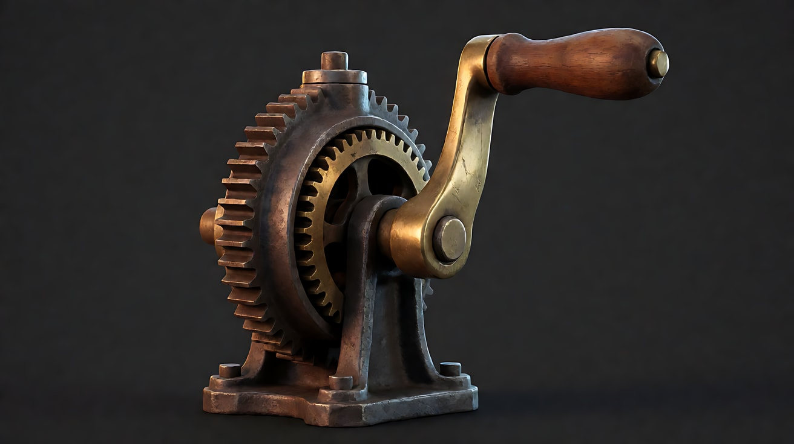

图G 灯塔外景·黎明：

```
The same small rocky island and white lighthouse as a dusk wide shot, now at dawn after a storm, no people.
Calm grey-blue sea with gentle swells, clouds breaking apart, the first pale gold light on the horizon on frame right,
the lantern room glowing with a soft warm light and a faint beam pointing out to sea,
a small wooden rowing boat tied at the concrete pier at the lower left. Extreme wide shot from the sea at low height,
24mm lens, deep focus, the lighthouse on the right third. Lighting: soft cool dawn ambient light, a thin warm glow from the lantern room.
Stylized semi-realistic 3D CG rendering, feature-film animation quality. Aspect ratio 16:9.
```

中文释义：图A 老秦：六十多岁，白寸头白胡茬，藏蓝粗毛线渔夫毛衣，深绿油布外套，黑胶靴，颈挂皮绳黄铜钥匙。图B 阿澄：二十四岁，黑色短发，藏蓝毛线帽，亮黄油布雨衣，橙色雨靴，露指手套，腰挂一卷绳。图C 黄昏海岛：白色石砌灯塔在右三分线，黑铁灯室，左下方小码头，右侧天边乌云聚集，画左冷色低阳。图D 风暴夜灯室：中央大型阶梯透镜，四周雨痕玻璃，透镜旁一台熄灭的自动灯（琥珀指示灯不亮），透镜底座左侧一台黄铜手摇曲柄，左墙边圆形铁舱口；海面一侧在画右。图E 螺旋楼梯：从底部仰望铸铁螺旋梯，顶部一个圆舱口。图F 黄铜曲柄道具。图G 黎明海岛：同一构图，风暴过后，海面平静，右侧天边第一道金光，灯室亮着柔和暖光，码头拴着一条小木划艇。

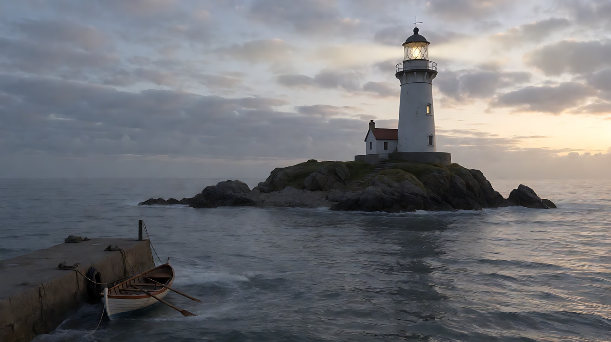

**【图生视频 · Seedance】片头空镜 P0**

```
【素材分工】@图片1（图C）为首帧，锁定海岛、灯塔、码头的位置与黄昏光线；画面中不新增任何人物或船只。
【画风】风格化写实三维CG质感，冷蓝灰海面，低饱和。
黄昏，从海面低处远望小岛，白色灯塔立在岛的最高处，灯室是黑的。灰蓝色的海浪一层层涌向礁石，碎成白沫。右侧天边的乌云缓慢地向灯塔方向压过来，画左低垂的冷色夕阳从云底透出，把塔身的边缘勾亮。镜头固定，不移动。结尾停在乌云压到灯塔上方、塔身仍被夕阳勾亮的画面上。
【声音】低沉持续的风声，海浪拍打礁石的轰响，远处两三声海鸥，无配乐。
【约束】灯塔外形与位置不变；灯室保持不亮；不出现人和船；不要字幕、水印、Logo。
时长：6秒
```

**参数**：时长 6 秒 ｜ 画幅 16:9 ｜ 本次上传：图C 一张

**【检查点】**
- 画风、色彩是否符合项目设定（冷蓝灰海 + 低饱和）——不符合就先调整画风开关，再做其他片段
- 灯塔、码头的位置是否与图C 一致：后面所有片段的地理都以此为准
- 定妆图和场景图是否已确认冻结

**【常见问题与修复】**
| 现象 | 修复 |
|---|---|
| 灯室亮了 | 约束写"灯室保持不亮"——灯亮是片段1 的戏 |
| 画面颜色太饱和 | 【画风】写"低饱和"，并在图C 生图时写 `muted, desaturated colours` |
| 定妆图里两人比例不协调 | 在生成任何片段之前修正定妆图，之后不再改动 |

---

### 练习2：片段1 开端·码头黄昏（难度 ★★）

**目标**：多图参考，连续形态。两个人的关系用一个"递与接"的动作建立；片段的"钩子"是塔顶的灯亮起又熄灭。结尾停在两人抬头看着熄灭的灯上，这一帧要能作为后面的情绪起点。

**【生图 · Nano Banana】**

K1 片段1 首帧：

```
Using the old keeper from image 1, the young boat worker from image 2 and the island from image 3:
medium-wide shot on the short concrete pier at dusk. The young woman in the yellow rain jacket stands in a small wooden supply boat
moored on the left, lifting a wooden crate up toward the pier. The old keeper in the dark-green oilskin jacket stands on the pier on the right,
bending slightly with both hands reaching for the crate. The white lighthouse tower rises in the background at the top right,
its lantern room still dark. Camera at pier height, eye level, 35mm lens, moderate depth of field.
Lighting: low cold sun from frame left rim-lighting both figures, cool blue-grey sea, heavy clouds on the right.
Keep the faces, hairstyles and outfits exactly as in image 1 and image 2. Stylized semi-realistic 3D CG rendering, feature-film animation quality. Aspect ratio 16:9.
```

中文释义：码头中全景，阿澄站在画左系在码头边的小木船上，把一只木箱往上递；老秦站在画右码头上，微微弯腰伸手去接；背景右上方是灯塔，灯室还黑着；码头高度平视，35mm；画左冷色低阳勾出两人轮廓。

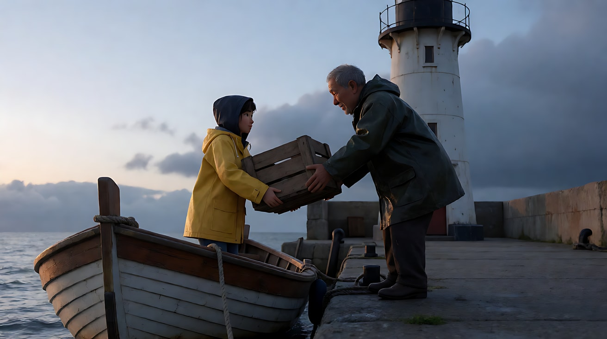

**【多图生视频 · Seedance】**

```
【素材分工】@图片4（K1）为首帧，锁定码头构图与两人位置；@图片1（图A）锁定老秦的身份、白寸头、深绿油布外套与颈上的黄铜钥匙，不参考其背景；@图片2（图B）锁定阿澄的身份、黄色雨衣与毛线帽，不参考其背景；@图片3（图C）仅参考海岛、灯塔与码头的地理和黄昏光线，不复制其镜头角度。
【画风】风格化写实三维CG质感，冷蓝灰海面，低饱和，灯光为琥珀暖色。
黄昏的码头上，阿澄站在随浪轻晃的小船里，把木箱举过头顶递上来。老秦弯腰接住，抱稳，转身把木箱放在码头上，木箱落地一声闷响。他直起腰，拍了拍手上的木屑。这时，他们身后塔顶的灯室亮起一圈琥珀色的灯光，亮了两下，闪烁，熄灭了。老秦抬起头，看着漆黑的灯室，手不自觉地摸了一下颈上的黄铜钥匙。阿澄扶着码头边的铁环，也抬头看过去。镜头从中全景极慢地向前推近，结尾停在两人抬头望向熄灭灯塔的画面上。
【声音】浪拍码头的声音，小船木板吱呀，木箱落地闷响；灯亮起时一声电流嗡鸣，熄灭时一声轻微的啪；之后只剩风声。无对白，无配乐。
【约束】保持两人脸型、发型、服装不变；两人之间只有递接木箱这一次接触；灯塔外形与位置不变；不要字幕、水印、Logo。
时长：10秒
```

**参数**：时长 10 秒 ｜ 画幅 16:9 ｜ 本次上传：图A、图B、图C、K1 共 4 张

**【检查点】**
- "递 → 接 → 放下 → 灯亮又灭 → 抬头"是否按顺序清楚发生
- 摸钥匙这个小动作是否被看见——它是"守护"的物件，会在片段3 回收
- 结尾两人的朝向与位置：老秦在画右、阿澄在画左，这一帧记录下来作为观察状态

**【常见问题与修复】**
| 现象 | 修复 |
|---|---|
| 灯一直亮着没有熄灭 | 写"亮了两下，闪烁，熄灭了"，并在声音里写熄灭的"啪" |
| 两人一起抬木箱，动作混乱 | 主动作给老秦（接、放），阿澄只"举过头顶递上来"后扶着铁环 |
| 阿澄上了码头 | 写"阿澄始终站在小船里" |
| 片段1 提前出现风暴 | 只写"乌云"，风暴留给片段2 |

---

### 练习3：片段2 上升·螺旋楼梯（难度 ★★★，首尾帧）

**目标**：首尾帧锁定"楼梯底部"和"楼梯顶部"，中间是全片唯一一次升镜。尾帧必须是一个清楚的完成态（老秦的手按在顶部舱门把手上），它将成为片段3 的首帧。

**【生图 · Nano Banana】**

K2a 片段2 首帧：

```
Using the old keeper from image 1, the young boat worker from image 2 and the stairwell from image 3:
wide shot at the bottom of the lighthouse spiral staircase at night during a storm. The old keeper stands on the first steps,
holding a heavy flashlight pointing up the stairs, looking up; the young woman in the yellow rain jacket stands one step below behind him,
rain dripping from her jacket. Camera low at the base of the stairwell, 28mm lens, deep focus so the spiral above is visible.
Lighting: the flashlight beam is the only warm-white light cutting upward, cold blue storm light through the small window on the left,
everything else dark. Keep the faces, hairstyles and outfits exactly as in image 1 and image 2.
Stylized semi-realistic 3D CG rendering, feature-film animation quality. Aspect ratio 16:9.
```

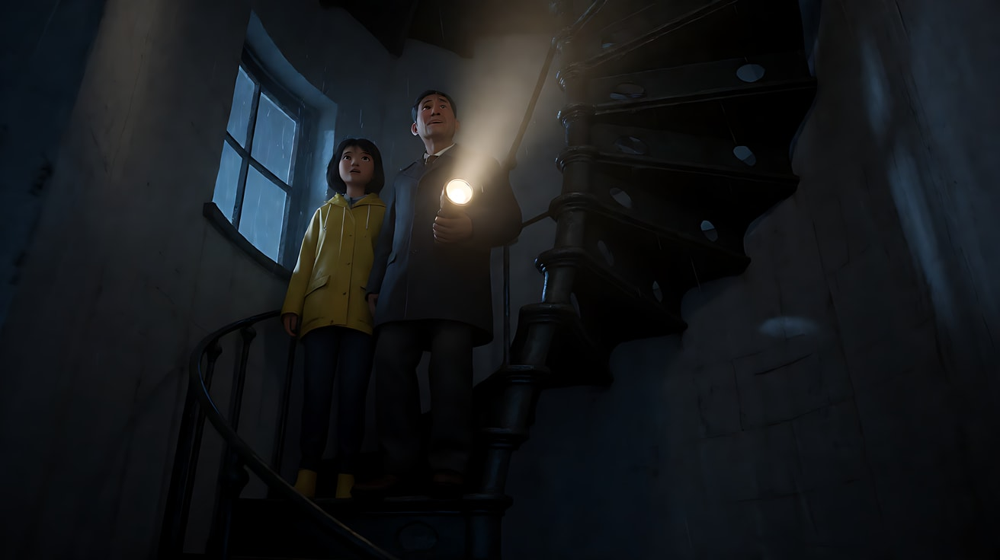

K2b 片段2 尾帧：

```
Using the old keeper from image 1, the young boat worker from image 2 and the stairwell from image 3:
high-angle shot from just below the top of the spiral staircase looking down. The old keeper is on the topmost step,
his right hand gripping the iron handle of the round hatch above him, the flashlight in his left hand pointing at the hatch;
the young woman is three steps below, looking up at him, one gloved hand on the rail. The spiral drops away into darkness below them.
Camera high near the hatch, 28mm lens, deep focus. Lighting: the flashlight beam on the hatch, cold blue lightning glow from the small window.
Keep the faces, hairstyles and outfits exactly as in image 1 and image 2. Stylized semi-realistic 3D CG rendering, feature-film animation quality. Aspect ratio 16:9.
```

中文释义：K2a——风暴夜的螺旋楼梯底部，老秦站在第一级台阶上举着沉重的手电向上照，抬头看；阿澄在他身后低一级，雨衣还在滴水；低机位、28mm 深焦。K2b——从楼梯顶部附近向下俯拍，老秦站在最高一级，右手握住头顶圆舱口的铁把手，左手手电照着舱口；阿澄在他下方三级，仰头看他，一只手扶着栏杆；螺旋梯在他们脚下没入黑暗。

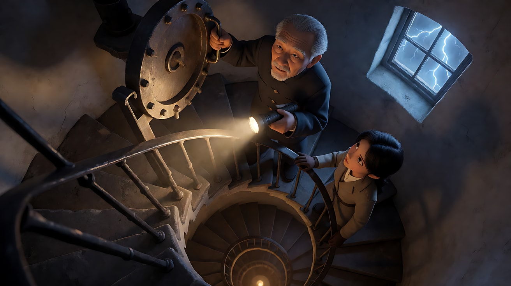

**【首尾帧生视频 · Seedance】**

```
【素材分工】@图片4（K2a）为首帧；@图片5（K2b）为尾帧，是最终画面目标；@图片1（图A）锁定老秦的身份与服装；@图片2（图B）锁定阿澄的身份与服装；以上定妆图均不参考其背景；@图片3（图E）仅参考螺旋楼梯的结构与小窗位置，不复制其镜头角度。只生成两帧之间的连续动作。
【画风】风格化写实三维CG质感，冷蓝灰低调光，唯一暖白光为手电。
风暴夜，老秦举着手电走上螺旋楼梯，一步一步向上，手电的光柱在弧形的白墙上来回扫动。阿澄跟在他身后，一只手扶着铁栏杆。镜头沿着螺旋楼梯的中心缓慢向上升起，始终保持两人在画面里，从仰拍逐渐变成俯拍。小窗外一道闪电，把楼梯照亮一瞬。老秦登上最高一级，伸出右手握住头顶舱门的铁把手，停住。阿澄停在他下面三级，仰头看他。结尾停在老秦手按舱门把手、阿澄仰头的俯拍画面上。
【声音】胶靴踩在铁梯上的空洞回声，一步一响；风暴拍打塔身的闷响；闪电后一声远雷；老秦停下时，只剩两人的喘息和塔外的风。无对白，无配乐。
【约束】保持两人脸型、发型、服装不变；两人始终在楼梯上，不进入舱门；手电始终在老秦手里；中间动作连续，不跳切；不要字幕、水印、Logo。
时长：10秒
```

**参数**：时长 10 秒 ｜ 画幅 16:9 ｜ 本次上传：图A、图B、图E、K2a、K2b 共 5 张

**【尾帧接续准备】**
审片保留后，截取本片段**实际生成结果的最后一帧**，记为"P2 实际尾帧"。记录观察状态：

| 观察项 | 记录（按实际结果填写） |
|---|---|
| 老秦位置与姿态 | 例：最高一级台阶，右手握舱门把手，左手持手电 |
| 阿澄位置与姿态 | 例：下方三级，仰头，左手扶栏杆 |
| 光 | 例：手电照舱口，窗外冷蓝 |
| 未完成的动作 | 例：舱门尚未推开 |
| 与计划的偏差 | 例：阿澄实际停在下方两级而非三级——片段3 以实际为准 |

**【检查点】**
- 升镜是否是这一段唯一的运镜，过程是否平稳
- 尾帧是否到达"手按舱门把手、尚未推开"——推开舱门是片段3 的第一个动作，不能提前发生
- 手电光是否始终是唯一的暖白光

**【常见问题与修复】**
| 现象 | 修复 |
|---|---|
| 老秦推开舱门进去了 | 约束写"不进入舱门"，并以 @图片5 为最终画面目标 |
| 镜头没有升起，只是在底部仰拍 | 写清"沿着螺旋楼梯的中心缓慢向上升起，从仰拍逐渐变成俯拍" |
| 阿澄跑到了老秦前面 | 写"阿澄跟在他身后"，尾帧里她在下方 |
| 楼梯结构变形 | 降低动作复杂度，删掉闪电；或缩短为 8 秒 |

---

### 练习4：片段3 转折·灯室（难度 ★★★★，多镜头 + 尾帧接续）

**目标**：全片的转折与"打破规则"的片段。以 P2 实际尾帧为首帧接续（接续深度 1），四个镜头完成"推开舱门 → 他摇亮灯 → 他退开、她接手 → 灯光切开风暴"。这是全片唯一一次环绕运镜、唯一一次暖光占满画面。

**【生图 · Nano Banana】**

本片段不新生成关键帧。上传：P2 实际尾帧（首帧）、图A、图B、图D、图F、图C。

> 如果 P2 实际尾帧中人物身份已经明显漂移，不要接续，改为用图A、图B、图D 重新生成一张"舱门下方仰拍、老秦手按舱门把手"的首帧，并在复盘表里记录原因。

**【多图生视频 · Seedance】**

```
【素材分工】@图片1（P2 实际尾帧）为首帧，承接上一片段的人物位置与光线，不重复已完成的爬楼梯动作；@图片2（图A）锁定老秦的身份、白寸头、深绿油布外套与颈上黄铜钥匙；@图片3（图B）锁定阿澄的身份、黄色雨衣与毛线帽；以上定妆图均不参考其背景；@图片4（图D）仅参考灯室布局、透镜、自动灯与曲柄的位置；@图片5（图F）仅参考黄铜曲柄的外形与材质；@图片6（图C）仅参考镜头4 的海岛外景地理，不复制其黄昏光线。
【画风】风格化写实三维CG质感，冷蓝灰低调光，本片段暖光逐渐占满画面。
镜头1：承接首帧，老秦用肩膀顶开头顶的圆舱门，风雨声一下子灌进来。他爬进漆黑的灯室，阿澄紧跟着爬上来，老秦用力把舱门压上。风雨声被关在门外，变成闷闷的轰响。手电光扫过巨大的透镜和熄灭的自动灯。
镜头2：镜头切至老秦的中近景，固定机位，他站在透镜底座左侧的黄铜曲柄旁。他把手电放在地上，从颈上取下黄铜钥匙，插进齿轮箱的锁孔拧了一下，然后双手握住曲柄的木把手，开始缓慢而有力地摇动。齿轮一齿一齿地咬合，透镜开始转动，透镜中心亮起一点琥珀色的光，越来越亮，照在他满是皱纹的脸上。
镜头3：镜头切至两人的双人中景，镜头开始围绕两人和曲柄缓慢环绕。老秦一边摇，一边侧过头看了阿澄一眼。他慢慢松开双手，退开半步。阿澄上前，双手握住还在转动的木把手，接着摇下去，节奏和他一样。老秦站在她身后，双手垂在身侧，看着她。旋转的透镜把暖光一圈圈扫过两人的脸，暖光占满了整个画面。
镜头4：硬切到大远景，从风暴中的海面远望小岛。灯塔顶端射出一道暖色的光束，缓缓扫过翻滚的黑色海面，切开冷蓝色的雨幕。镜头固定。
【锁定】光线：镜头1 只有手电冷白光与窗外冷蓝闪电，镜头2 起透镜暖光逐渐占满画面，镜头4 暖色光束在冷蓝风暴中；人物：老秦白寸头、藏蓝毛衣、深绿油布外套，阿澄黑短发、藏蓝毛线帽、亮黄雨衣；位置：曲柄始终在透镜底座左侧，海面一侧的窗户始终在画右；机位：镜头2、3 始终在曲柄一侧。
【声音】镜头1 风雨灌入又被舱门关住的闷响；镜头2 钥匙拧动的咔哒声，齿轮一齿一齿的咬合声；镜头3 齿轮声形成稳定的节奏，两人都不说话；镜头4 风暴声重新回来，压过齿轮声。无对白，无配乐。
【约束】保持两人脸型、发型、服装不变；两人之间没有身体接触，曲柄的交接靠"他松手、她握住"完成；曲柄与透镜外形不变；不出现任何文字或数字；不要字幕、水印、Logo。
时长：15秒
```

**参数**：时长 15 秒 ｜ 画幅 16:9 ｜ 本次上传：P2 实际尾帧、图A、图B、图D、图F、图C 共 6 张 ｜ 负载：4 个镜头、无身体接触，属于"有挑战"档；接续深度 1

**【检查点】**
- 镜头1 是否真正"承接"了 P2 尾帧：人物位置、手电、舱门，没有重新爬一遍楼梯
- 钥匙是否被使用——片段1 的"摸钥匙"在这里回收
- 镜头3 的"他松手 → 退开 → 她接手"是否清楚：这是整部片的转折动作
- 暖光是否在镜头3 第一次占满画面，环绕运镜是否只出现在镜头3

**【常见问题与修复】**
| 现象 | 修复 |
|---|---|
| 镜头1 重新出现爬楼梯 | 素材分工写"不重复已完成的爬楼梯动作"，正文从"顶开舱门"写起 |
| 老秦把着阿澄的手一起摇 | 写"他慢慢松开双手，退开半步。阿澄上前……"，约束写"两人之间没有身体接触" |
| 钥匙插锁这一步失败或手变形 | 删掉钥匙动作，改为"他摸了一下颈上的钥匙，然后双手握住曲柄" |
| 镜头3 的环绕让人物变形 | 把环绕改为"缓慢侧移"，并在复盘表里记录这次改动 |
| 4 个镜头被合并 | 拆成"镜头1–2"和"镜头3–4"两次生成；第二次以第一次的实际尾帧为首帧（此时接续深度变为 2，片段4 必须重新锚定） |

---

### 练习5：片段4 收束·黎明 + 全片剪辑（难度 ★★★★★）

**目标**：场景与时间都变了，**不接续，回到定妆图重新锚定**（接续深度归零）。四个镜头完成"小船离开 → 他回头 → 她在外廊抬手 → 船远去，灯光最后扫过一次"。之后完成全片的剪辑与声音。

**【生图 · Nano Banana】**

K4 片段4 首帧：

```
Using the old keeper from image 1 and the island at dawn from image 2:
extreme wide shot from the sea at low height at dawn after the storm. The small wooden rowing boat has just left the concrete pier
at the lower left, the old keeper in his dark-green oilskin jacket sitting in it with two oars, small in the frame, rowing away from the island.
The white lighthouse stands on the right third, its lantern room glowing softly, a faint warm beam pointing out to sea.
Calm grey-blue sea with gentle swells, clouds breaking apart, first pale gold light on the horizon on frame right.
Camera at low height over the water, 24mm lens, deep focus.
Lighting: soft cool dawn ambient light, a thin warm glow from the lantern room.
Keep the face, hairstyle and outfit exactly as in image 1. Stylized semi-realistic 3D CG rendering, feature-film animation quality. Aspect ratio 16:9.
```

中文释义：风暴后的黎明，从海面低处远望：小木划艇刚离开左下方的码头，老秦穿着深绿油布外套坐在船上划桨，在画面里很小；灯塔在右三分线，灯室发出柔和的光，一道淡淡的暖色光束指向海面；海面平静，云层散开，右侧天边第一道淡金色的光。

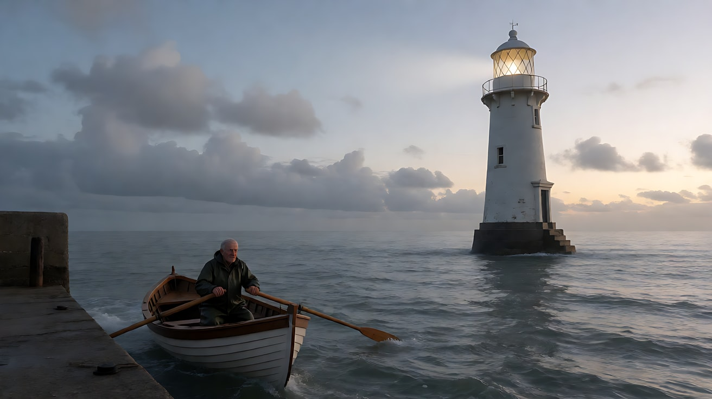

**【多图生视频 · Seedance】**

```
【素材分工】@图片4（K4）为首帧，锁定镜头1 的黎明大远景构图；@图片1（图A）锁定老秦的身份、白寸头与深绿油布外套；@图片2（图B）锁定阿澄的身份、黄色雨衣与毛线帽；以上定妆图均不参考其背景；@图片3（图G）仅参考黎明海岛的地理、灯塔与码头位置以及黎明光线，不复制其镜头角度。
【画风】风格化写实三维CG质感，黎明柔和冷光，灯光为琥珀暖色。
镜头1：黎明的大远景，固定机位。风暴已经过去，海面平静。一条小木划艇从左下方的码头离开，老秦坐在船上，一下一下地划桨，船尾拖出一道细细的水痕。灯塔顶端的光束在晨光里缓缓转动。轻柔的浪声。
镜头2：镜头切至划艇上的中景，固定机位，机位在船头。老秦划了几下，停住，双手搭在桨上，回头望向画面后方的灯塔。晨光从画右照在他的侧脸上，颈上已经没有那枚黄铜钥匙。桨尖滴下的水声。
镜头3：镜头切至灯室外廊的中景，固定机位。阿澄站在外廊的铁栏杆边，黄色雨衣被晨风吹动，身后的灯室里，透镜还在缓缓转动。她望着海面，慢慢抬起一只手，举在半空，没有挥动。风声和远处的海鸥。
镜头4：硬切回大远景，镜头极慢地向后拉开。小船在平静的海面上越来越小，太阳从右侧海平线上升起。灯塔的光束最后一次缓缓扫过海面，扫过那条小船。镜头停在小船、灯塔与初升的太阳同在一个画面里的远景上。
【锁定】光线：黎明柔和冷光，太阳在画右海平线，灯室暖光始终亮着；人物：老秦白寸头、藏蓝毛衣、深绿油布外套，本片段颈上没有钥匙；阿澄黑短发、藏蓝毛线帽、亮黄雨衣，始终在灯塔外廊上；地理：码头在左下，灯塔在右三分线；机位：外景机位始终在海面同一侧。
【声音】镜头1 轻柔的浪声和规律的桨声；镜头2 桨尖滴水声；镜头3 晨风和远处海鸥；镜头4 所有声音变得很轻，只剩浪声。无对白；配乐在后期加入。
【约束】保持两人脸型、发型、服装不变；两人不在同一个镜头中出现；老秦始终在船上，阿澄始终在外廊上；不要字幕、水印、Logo。
时长：14秒
```

**参数**：时长 14 秒 ｜ 画幅 16:9 ｜ 本次上传：图A、图B、图G、K4 共 4 张 ｜ 负载：4 个镜头，属于"有挑战"档；重新锚定，接续深度 0

**【全片剪辑与声音表】**

| 顺序 | 素材 | 剪辑点 | 声音处理 |
|---|---|---|---|
| 1 | P0 片头空镜 | 开场淡入，保留完整 | 风浪声作为全片底噪起点 |
| 2 | P1 码头 | 在灯熄灭后的"抬头"上多停一拍再切 | 灯熄灭的"啪"之后，风声 J-cut 进入 P2 |
| 3 | P2 楼梯 | 在老秦手按舱门把手时切 | 楼梯回声延续到 P3 开头（L-cut） |
| 4 | P3 灯室 | 镜头3 是全片最长的停留，不要剪短 | 齿轮声作为节奏，配乐在此之前保持空白 |
| 5 | P4 黎明 | 镜头4 后拉到底，停两拍后淡出 | 镜头2 起铺入唯一一段低沉的大提琴长音，至片尾 |
| 6 | 片尾字幕 | 黑场 | 只留浪声，渐弱 |

**【检查点】**
- P4 是否以定妆图重新锚定：两人的脸、发型、服装是否与图A、图B 一致
- 钥匙"不在他颈上"这一细节是否成立——这是"交出去了"的最终证据
- 全片的景别弧线是否是"宽 → 收紧 → 最近 → 最宽"
- 全片只有 P3 镜头3 一次环绕、一次暖光占满画面
- 剪辑后，片段之间是否听不到"缝"

**【常见问题与修复】**
| 现象 | 修复 |
|---|---|
| P4 的老秦颈上还有钥匙 | 正文和【锁定】都写"颈上没有钥匙"；仍出现时，在剪辑中保留镜头2 的侧脸角度，避开钥匙 |
| 阿澄挥手太用力，显得欢快 | 写"抬起一只手，举在半空，没有挥动" |
| 两人出现在同一个镜头里 | 约束写"两人不在同一个镜头中出现" |
| 镜头4 后拉时灯塔变形 | 改为固定大远景，只让光束转动 |
| 四个片段的色调不一致 | 在剪辑软件里统一调色；下一次项目在每个片段的【画风】里写同一句色彩描述 |
