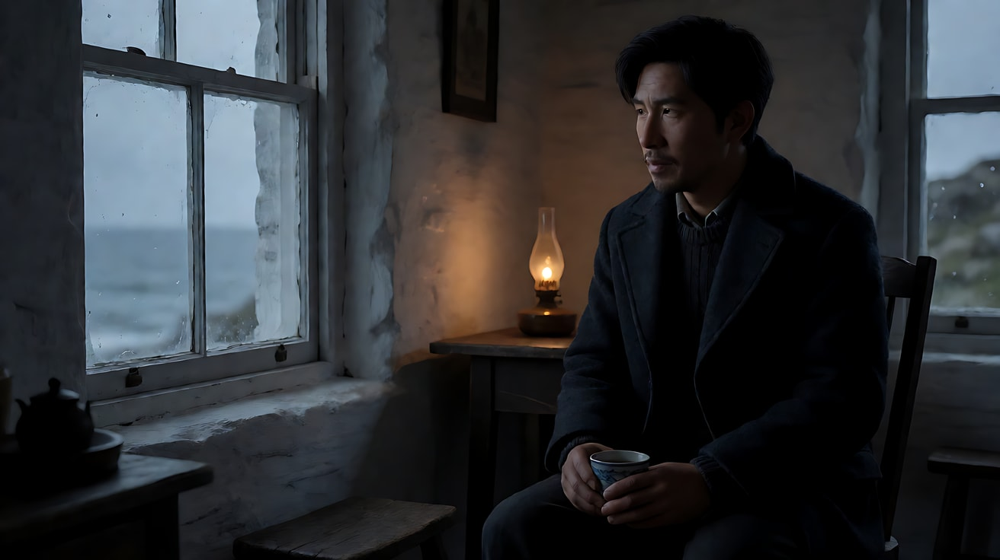
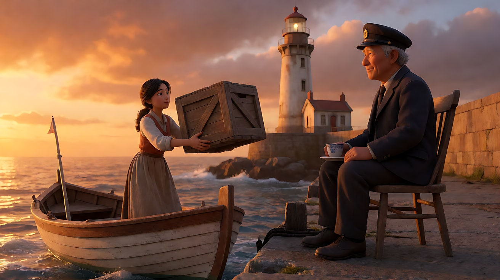
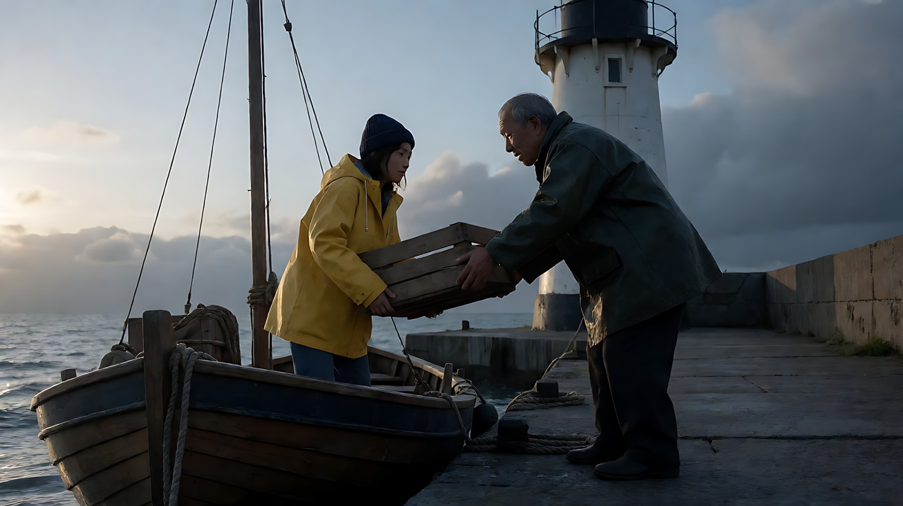
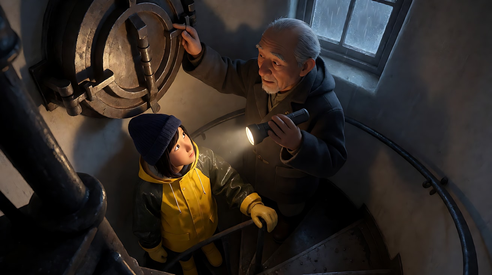
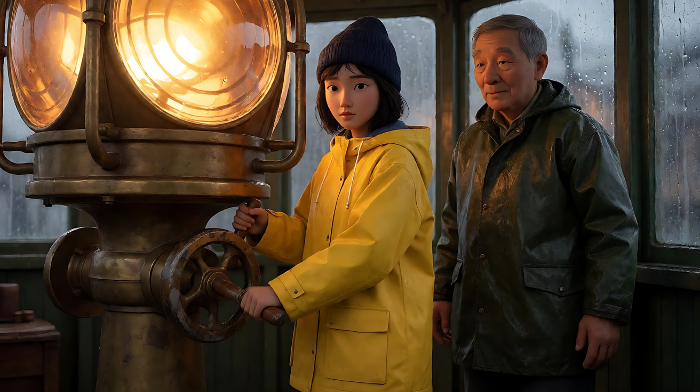
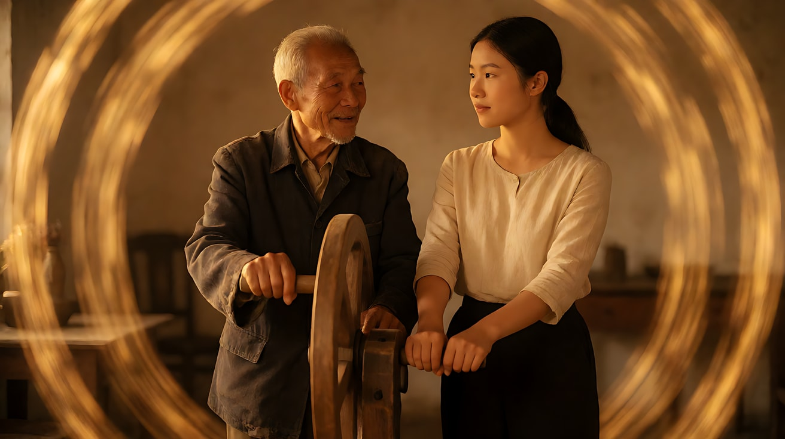
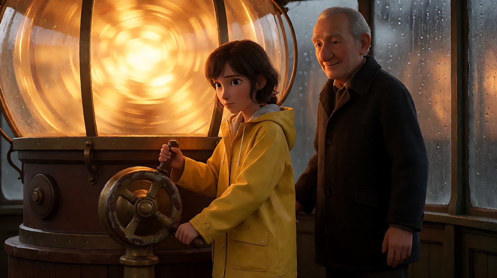
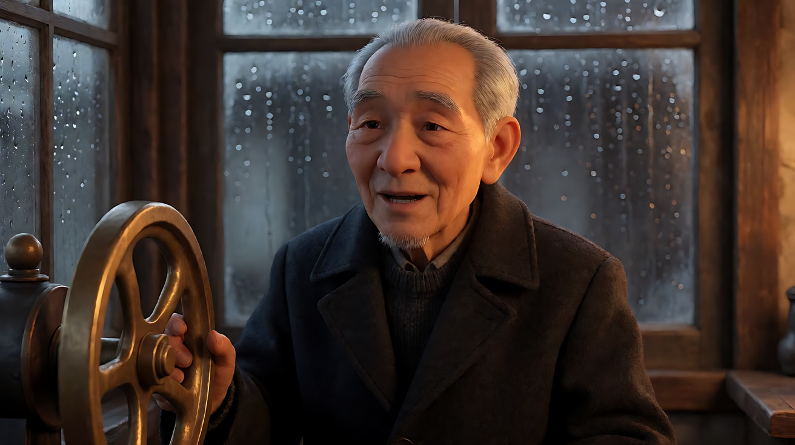
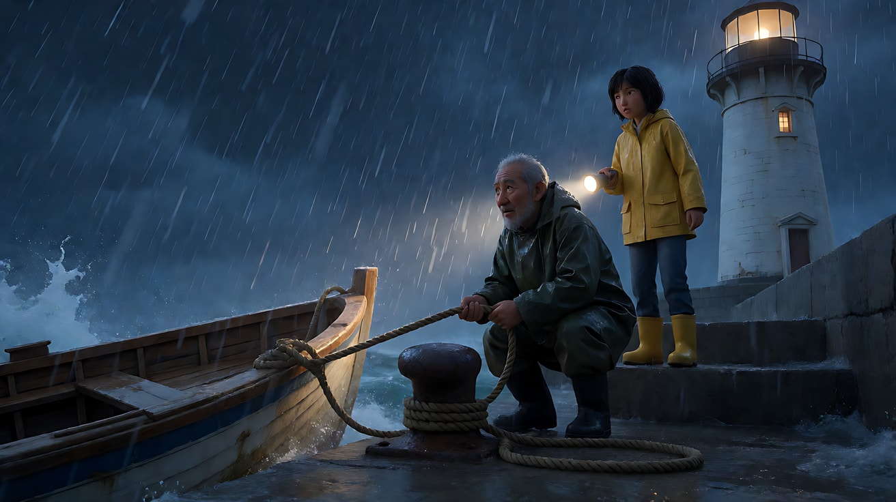

# L09-02 重拍判断与导演复盘 · 提示词

> 本组练习：以上一课的原创短片「最后一盏手摇灯」为素材，做六组"失败结果 → 五维审片 → 判决 → 最小修改"的对照练习。｜ 配套教学：[L09-02-重拍判断与导演复盘](../教学/L09-02-重拍判断与导演复盘.md) ｜ 规范：[写作规范](../../模板/写作规范.md)
>
> 画风默认使用开关 A（风格化写实 CG）。如改用 2D 动画，删掉所有焦段、光圈、景深词。
>
> **说明**：每组练习里的"失败结果"是为教学设计的典型情况，不是某一次真实生成的记录。你实际生成时遇到的失败可能不同——用同样的方法审片、判决、只改一处。

**人物与资产**：沿用 [L09-01 提示词](L09-01-从剧本到成片-提示词.md) 中的图A（老秦定妆）、图B（阿澄定妆）、图C（灯塔外景·黄昏）、图D（灯室内景）、图E（螺旋楼梯）、图F（黄铜曲柄）、图G（灯塔外景·黎明）。生图时默认按"图A → image 1、图B → image 2、所需场景图 → image 3、道具图 → image 4"的顺序上传，练习中另有说明的除外。

**每组练习的固定结构**：目标 → 生图 → 原提示词（失败版） → 失败结果 → 五维审片 → 判决 → 修订版提示词 → 参数 → 检查点 → 常见问题与修复。修订版中**改动的部分用【改】标出**，方便对照。

---

### 练习1：他站起来走掉了——补一个完成态（难度 ★）

**目标**：单图生视频最常见的失败：动作没有终点，模型自己"续写"了剧情。练习只加一句完成态，其他一字不动。

**【生图 · Nano Banana】**

图1 关键帧（小屋窗边）：

```
Using the old keeper from image 1: medium shot of the old lighthouse keeper sitting on a wooden chair by the small window
of his white keeper's cottage at dusk, a cup of tea in both hands resting on his knee, looking out of the window toward the sea on frame left.
He is placed on the right third of the frame, the window and the grey sea on the left.
Camera at seated eye level, 50mm lens, moderate depth of field.
Lighting: cold blue dusk light through the window from frame left as key, a small warm oil lamp on the table behind him as fill.
Keep the face, hairstyle and outfit exactly as in image 1. Stylized semi-realistic 3D CG rendering, feature-film animation quality. Aspect ratio 16:9.
```

中文释义：黄昏，老秦坐在小屋窗边的木椅上，双手捧着茶杯放在膝上，望向画左窗外的海；位于右三分之一；坐姿平视、50mm；窗外冷蓝光为主光，身后桌上一盏小油灯为暖色辅光。



**原提示词（失败版）**：

```
【素材分工】@图片1 为首帧，锁定人物身份、服装与小屋布局。
【画风】风格化写实三维CG质感，电影级布光。
黄昏，老秦坐在窗边，捧着茶杯望向窗外的海。他喝了一口茶，把杯子放在窗台上。镜头固定中景。窗外冷光，身后油灯暖光。
【声音】窗外的浪声，杯子放在木头窗台上的轻响，无配乐。
【约束】保持人物脸型、发型、服装不变；不要字幕、水印、Logo。
时长：8秒
```

**失败结果**：放下杯子之后，老秦站起来，走出了画面右侧，最后两秒是一把空椅子。

**【五维审片】**
| 维度 | 结论 | 证据 |
|---|---|---|
| 意图 | 不通过 | 计划是"他守着海"，结果变成"他离开了" |
| 身份一致 | 通过 | 脸、毛衣、外套一致 |
| 动作可读 | 不通过 | 放杯子之后多出了"起身、走出画面" |
| 光连续 | 通过 | 冷暖两种光都在 |
| 声音 | 通过 | 浪声与杯子轻响正确 |

**判决**：重拍·改写。原因：8 秒里只写了两个动作，剩下的时间没有被规定，模型续写了剧情。修改：只补一句完成态。

**【图生视频 · Seedance】修订版**

```
【素材分工】@图片1 为首帧，锁定人物身份、服装与小屋布局。
【画风】风格化写实三维CG质感，电影级布光。
黄昏，老秦坐在窗边，捧着茶杯望向窗外的海。他喝了一口茶，把杯子放在窗台上。【改】他的手没有离开杯子，就那样搭在杯沿上，继续望着窗外，始终坐在椅子上。结尾停在他手搭杯沿、望向海面的侧脸上。镜头固定中景。窗外冷光，身后油灯暖光。
【声音】窗外的浪声，杯子放在木头窗台上的轻响，无配乐。
【约束】保持人物脸型、发型、服装不变；不要字幕、水印、Logo。
时长：8秒
```

**参数**：时长 8 秒 ｜ 画幅 16:9 ｜ 与原版相比：只改了正文中的一句（完成态），其余不变

**【检查点】**
- 他是否始终坐着，结尾是否停在"手搭杯沿、望向海面"
- 原版中通过的维度（身份、光、声音）是否仍然通过

**【常见问题与修复】**
| 现象 | 修复 |
|---|---|
| 修订后仍然起身 | 下一次只改一处：在约束里加"他始终坐着，不起身，不离开画面" |
| 修订后画面完全静止 | 给一个小动作："手指在杯沿上轻轻摩挲一下" |
| 修订后光变了 | 说明这次结果有随机波动；保持提示词不变重抽一次，并在复盘表里记录 |

---

### 练习2：雨衣变成了橙色——问题出在参考图（难度 ★★）

**目标**：身份漂移不一定是视频提示词的错。这一组练习学会"往上游找原因"：问题出在首帧关键帧，修的是生图提示词，视频提示词一字不改。

**【生图 · Nano Banana】**

K1 原版首帧（失败的根源）：

```
Using the old keeper from image 1, the young boat worker from image 2 and the island from image 3:
medium-wide shot on the concrete pier at sunset, the young woman in a small boat lifting a wooden crate up to the old keeper on the pier,
the lighthouse in the background. Golden orange sunset light flooding the whole scene.
Camera at pier height, 35mm lens. Stylized semi-realistic 3D CG rendering, feature-film animation quality. Aspect ratio 16:9.
```



**原提示词（失败版，即 L09-01 练习2 的视频提示词）**：沿用 L09-01 练习2【多图生视频】中的提示词，不做改动。

**失败结果**：整段视频里，阿澄的亮黄色雨衣变成了橙色，毛线帽消失；老秦的深绿外套偏棕色。画面整体是金橙色，不像项目设定的冷蓝灰。

**【五维审片】**
| 维度 | 结论 | 证据 |
|---|---|---|
| 意图 | 部分通过 | 动作与灯熄灭都在，但温暖的金色让"不安"消失了 |
| 身份一致 | 不通过 | 雨衣变橙、帽子消失、外套偏棕 |
| 动作可读 | 通过 | 递箱、接箱、抬头都清楚 |
| 光连续 | 不通过 | 与片头空镜的冷色调不一致 |
| 声音 | 通过 | 浪声、木箱、灯熄灭的声音正确 |

**判决**：重拍·改写——但改的是**首帧关键帧**。检查 K1 原版发现：它写的是 `sunset`、`golden orange sunset light flooding the whole scene`，没有写 `Keep the face, hairstyle and outfit exactly as in image 1 and image 2`，也没有写景深和光源方向。视频模型忠实地继承了首帧的颜色。

**【生图 · Nano Banana】K1 修订版**

```
Using the old keeper from image 1, the young boat worker from image 2 and the island from image 3:
medium-wide shot on the short concrete pier at dusk. The young woman in the bright yellow rain jacket and navy beanie stands in a small wooden supply boat
moored on the left, lifting a wooden crate up toward the pier. The old keeper in the dark-green oilskin jacket stands on the pier on the right,
bending slightly with both hands reaching for the crate. The white lighthouse rises in the background at the top right, its lantern room still dark.
Camera at pier height, eye level, 35mm lens, moderate depth of field.
Lighting: low cold sun from frame left rim-lighting both figures, cool blue-grey sea, heavy clouds on the right, muted desaturated colours.
Keep the faces, hairstyles and outfits exactly as in image 1 and image 2. Stylized semi-realistic 3D CG rendering, feature-film animation quality. Aspect ratio 16:9.
```

中文释义：【改】把"金橙色日落光铺满全场"改为"画左冷色低阳 + 冷蓝灰海 + 低饱和"，写明黄色雨衣与藏蓝毛线帽，并补上"保持两人脸、发型、服装与定妆图一致"。



**【多图生视频 · Seedance】修订版**

```
【素材分工】@图片4（K1 修订版）为首帧，锁定码头构图与两人位置；@图片1（图A）锁定老秦的身份、白寸头、深绿油布外套与颈上的黄铜钥匙，不参考其背景；@图片2（图B）锁定阿澄的身份、黄色雨衣与毛线帽，不参考其背景；@图片3（图C）仅参考海岛、灯塔与码头的地理和黄昏光线，不复制其镜头角度。
【画风】风格化写实三维CG质感，冷蓝灰海面，低饱和，灯光为琥珀暖色。
黄昏的码头上，阿澄站在随浪轻晃的小船里，把木箱举过头顶递上来。老秦弯腰接住，抱稳，转身把木箱放在码头上，木箱落地一声闷响。他直起腰，拍了拍手上的木屑。这时，他们身后塔顶的灯室亮起一圈琥珀色的灯光，亮了两下，闪烁，熄灭了。老秦抬起头，看着漆黑的灯室，手不自觉地摸了一下颈上的黄铜钥匙。阿澄扶着码头边的铁环，也抬头看过去。镜头从中全景极慢地向前推近，结尾停在两人抬头望向熄灭灯塔的画面上。
【声音】浪拍码头的声音，小船木板吱呀，木箱落地闷响；灯亮起时一声电流嗡鸣，熄灭时一声轻微的啪；之后只剩风声。无对白，无配乐。
【约束】保持两人脸型、发型、服装不变；两人之间只有递接木箱这一次接触；灯塔外形与位置不变；不要字幕、水印、Logo。
时长：10秒
```

**参数**：时长 10 秒 ｜ 画幅 16:9 ｜ 与原版相比：视频提示词完全不变，只替换了首帧 K1

**【检查点】**
- 阿澄的雨衣是否恢复亮黄色，帽子是否回来
- 整体色调是否回到冷蓝灰，与片头空镜一致
- 视频提示词一字未改，说明问题确实出在首帧

**【常见问题与修复】**
| 现象 | 修复 |
|---|---|
| 换了首帧后仍然偏橙 | 下一次只改一处：【画风】加一句"整体冷色调，不出现金橙色日落光" |
| 帽子仍然消失 | 检查定妆图 B 的背面视角里帽子是否清楚；必要时重做定妆图（项目早期才这样做） |
| 不确定问题出在首帧还是提示词 | 用修订后的首帧 + 原提示词生成一次——这就是"一次只改一个变量" |

---

### 练习3：他停在了半路——时长与动作的单变量阶梯（难度 ★★★，首尾帧）

**目标**：首尾帧没到位时，按顺序一次只试一个变量，找出真正的原因。本组给出两步阶梯：先改时长，若仍失败，再删一个次要动作。

**【生图 · Nano Banana】**

K2a 首帧、K2b 尾帧：沿用 L09-01 练习3 的两张关键帧。下面是对尾帧的一处加强（只在第二步阶梯失败后才用）：

```
Using the old keeper from image 1, the young boat worker from image 2 and the stairwell from image 3:
high-angle shot from just below the top of the spiral staircase looking down. The old keeper is clearly standing on the topmost step,
his right hand gripping the iron handle of the closed round hatch directly above his head, the flashlight in his left hand pointing at the hatch;
the young woman is three steps below, looking up at him, one gloved hand on the rail. The hatch is shut.
Camera high near the hatch, 28mm lens, deep focus. Lighting: the flashlight beam on the hatch, cold blue storm light from the small window.
Keep the faces, hairstyles and outfits exactly as in image 1 and image 2. Stylized semi-realistic 3D CG rendering, feature-film animation quality. Aspect ratio 16:9.
```

中文释义：在原尾帧基础上强调"老秦明确站在最高一级""舱门是关着的"，让尾帧目标更清楚。



**原提示词（失败版）**：L09-01 练习3 的提示词，但当时选择的时长是 8 秒。

**失败结果**：两人只爬到楼梯中段，画面在第二个转弯处出现一次跳切，直接跳到了接近尾帧的画面；跳切后老秦的手电换到了右手。

**【五维审片】**
| 维度 | 结论 | 证据 |
|---|---|---|
| 意图 | 部分通过 | 风暴压迫感在，但"向上走"的过程被跳过 |
| 身份一致 | 部分通过 | 人物正确，但手电换手 |
| 动作可读 | 不通过 | 中段跳切，爬楼过程不连续 |
| 光连续 | 通过 | 手电冷白光与窗外冷蓝一致 |
| 声音 | 通过 | 铁梯回声正确 |

**判决**：重拍·改写。原因假设：8 秒装不下"爬一整段螺旋楼梯 + 升镜 + 闪电"，模型用跳切压缩了时间。按单变量阶梯处理。

**第一步：只改时长**

```
【素材分工】@图片4（K2a）为首帧；@图片5（K2b）为尾帧，是最终画面目标；@图片1（图A）锁定老秦的身份与服装；@图片2（图B）锁定阿澄的身份与服装；以上定妆图均不参考其背景；@图片3（图E）仅参考螺旋楼梯的结构与小窗位置，不复制其镜头角度。只生成两帧之间的连续动作。
【画风】风格化写实三维CG质感，冷蓝灰低调光，唯一暖白光为手电。
风暴夜，老秦举着手电走上螺旋楼梯，一步一步向上，手电的光柱在弧形的白墙上来回扫动。阿澄跟在他身后，一只手扶着铁栏杆。镜头沿着螺旋楼梯的中心缓慢向上升起，始终保持两人在画面里，从仰拍逐渐变成俯拍。小窗外一道闪电，把楼梯照亮一瞬。老秦登上最高一级，伸出右手握住头顶舱门的铁把手，停住。阿澄停在他下面三级，仰头看他。结尾停在老秦手按舱门把手、阿澄仰头的俯拍画面上。
【声音】胶靴踩在铁梯上的空洞回声，一步一响；风暴拍打塔身的闷响；闪电后一声远雷；老秦停下时，只剩两人的喘息和塔外的风。无对白，无配乐。
【约束】保持两人脸型、发型、服装不变；两人始终在楼梯上，不进入舱门；手电始终在老秦手里；中间动作连续，不跳切；不要字幕、水印、Logo。
时长：10秒
```

**参数（第一步）**：【改】时长 8 秒 → 10 秒 ｜ 其余全部不变

**第二步（仅当第一步仍跳切时）：保持 10 秒，只删掉闪电**

把第一步提示词中"小窗外一道闪电，把楼梯照亮一瞬。"整句删除，声音栏中的"闪电后一声远雷"同步删除，其余一字不动。

**【检查点】**
- 第一步成功：说明原因是负载过高，复盘表记录"螺旋楼梯整段攀爬至少需要 10 秒"
- 第一步失败、第二步成功：说明闪电这一光线突变诱发了剪辑感，记录"连续镜头中避免突发的强光变化"
- 两步都失败：判决改为"换方案"——拆成"楼梯下半段"和"楼梯上半段"两次生成，用第一次的实际尾帧接续

**【常见问题与修复】**
| 现象 | 修复 |
|---|---|
| 手电换到了另一只手 | 约束里已有"手电始终在老秦手里"；仍出现时，补充"手电始终在他的左手" |
| 第一步成功了但同时改了别的 | 不要这样做；如果改了，复盘表标注"组合修复"，不能把成功归于时长 |
| 尾帧人物位置与 K2b 不一致 | 换用上面的加强版尾帧；这是"改参考图"，算作单独的一步 |

---

### 练习4：两个人一起握着曲柄——交接动作要写清先后（难度 ★★★★，多镜头）

**目标**：整部片的转折动作失败了。诊断模型为什么把"他松手"和"她接手"同时演出来，只调整这两句的顺序并补一个完成态。

**【生图 · Nano Banana】**

本组的修订不改参考图。为方便对照，补一张镜头3 的参考关键帧（可选，仅当修订版仍失败时上传）：

```
Using the old keeper from image 1, the young boat worker from image 2, the lantern room from image 3 and the crank from image 4:
medium two-shot in the lantern room, the young woman in the yellow rain jacket standing at the brass crank on the left of the lens pedestal,
both her hands on the worn wooden handle, turning it; the old keeper half a step behind her on the right, both his hands hanging at his sides,
not touching the crank, watching her. The large lens glowing warm amber behind them, rain on the windows on frame right.
Camera at eye level, 50mm lens, moderate depth of field. Lighting: warm amber light from the rotating lens filling the frame.
Keep the faces, hairstyles and outfits exactly as in image 1 and image 2. Stylized semi-realistic 3D CG rendering, feature-film animation quality. Aspect ratio 16:9.
```

中文释义：灯室双人中景，阿澄站在透镜底座左侧的黄铜曲柄前，双手握住木把手在摇；老秦在她身后右侧半步，双手垂在身侧，不碰曲柄，看着她；透镜在他们身后发出琥珀暖光。



**原提示词（失败版）中的镜头3**：

```
镜头3：镜头切至两人的双人中景，镜头开始围绕两人和曲柄缓慢环绕。老秦一边摇，一边侧过头看了阿澄一眼。阿澄上前，双手握住还在转动的木把手，接着摇下去，节奏和他一样。他慢慢松开双手，退开半步，站在她身后看着她。旋转的透镜把暖光一圈圈扫过两人的脸，暖光占满了整个画面。
```



**失败结果**：镜头3 中阿澄握住把手时，老秦的手还在把手上，两人四只手叠在一起摇了几圈；老秦始终没有退开。暖光与环绕运镜都很好。

**【五维审片】**
| 维度 | 结论 | 证据 |
|---|---|---|
| 意图 | 不通过 | "交出去"变成了"一起摇"，转折没有发生 |
| 身份一致 | 通过 | 两人服装与外形一致 |
| 动作可读 | 不通过 | 四只手叠在一起，部分手指变形 |
| 光连续 | 通过 | 暖光占满画面，符合"打破规则"的设计 |
| 声音 | 通过 | 齿轮声节奏稳定 |

**判决**：重拍·改写。原因假设：原稿里"阿澄上前握住"写在"他松开双手"之前，模型按顺序先让她握住，再处理"松开"时已经来不及，于是两件事叠在一起。修改：把"他松手、退开"移到"她上前"之前，并补一个完成态。镜头1、2、4 以及【锁定】【声音】【约束】全部不动。

**【多图生视频 · Seedance】修订版（只列出改动的镜头3，其余与 L09-01 练习4 完全相同）**

```
镜头3：镜头切至两人的双人中景，镜头开始围绕两人和曲柄缓慢环绕。老秦一边摇，一边侧过头看了阿澄一眼。【改】他慢慢松开双手，退开半步，他的手已经离开曲柄，垂在身侧。曲柄靠惯性还在慢慢转。阿澄上前，双手握住木把手，接着摇下去，节奏和他一样。老秦站在她身后，看着她。旋转的透镜把暖光一圈圈扫过两人的脸，暖光占满了整个画面。
```

**参数**：时长 15 秒 ｜ 画幅 16:9 ｜ 与原版相比：只调整了镜头3 中两句话的顺序，并补了"他的手已经离开曲柄，垂在身侧"这一完成态

**【检查点】**
- 是否先看到老秦的手离开曲柄，再看到阿澄的手握上去
- 镜头3 原有的暖光与环绕是否被保留
- 镜头1、2、4 是否和上次一样好（若变差，说明有随机波动，记录下来）

**【常见问题与修复】**
| 现象 | 修复 |
|---|---|
| 修订后仍有四只手叠在一起 | 下一步只改一处：上传上面的镜头3 参考关键帧，素材分工写"仅参考镜头3 的站位与手的位置" |
| 曲柄在两人交接时停了 | 已写"曲柄靠惯性还在慢慢转"；若仍停，可以接受——在复盘表记为"可接受的偏差" |
| 环绕让手部变形 | 判决改为"换方案"：镜头3 改为固定中景，环绕运镜放弃；记录这是对"打破规则"设计的一次妥协 |

---

### 练习5：台词串到了另一个人嘴里——一人一镜（难度 ★★★★，多镜头）

**目标**：给转折加两句台词时最容易出现的失败：两个人在同一个镜头里先后说话，模型把两句都放进了一个人嘴里。修改方式是把一个镜头拆成两个单人镜头。

**【生图 · Nano Banana】**

老秦单人关键帧：

```
Using the old keeper from image 1 and the lantern room from image 2: medium close-up of the old keeper standing beside the brass crank,
turned slightly toward frame left, speaking quietly, warm amber light from the lens on the right side of his face,
rain-streaked windows behind him. Camera at eye level, 85mm lens, shallow depth of field.
Keep the face, hairstyle and outfit exactly as in image 1. Stylized semi-realistic 3D CG rendering, feature-film animation quality. Aspect ratio 16:9.
```



阿澄单人关键帧：

```
Using the young boat worker from image 1 and the lantern room from image 2: medium close-up of the young woman with both hands on the crank handle,
turned slightly toward frame right, looking at someone off screen, warm amber light from the lens on the left side of her face.
Camera at eye level, 85mm lens, shallow depth of field.
Keep the face, hairstyle and outfit exactly as in image 1. Stylized semi-realistic 3D CG rendering, feature-film animation quality. Aspect ratio 16:9.
```



上传说明：老秦关键帧上传图A（image 1）、图D（image 2）；阿澄关键帧上传图B（image 1）、图D（image 2）。

中文释义：两张单人中近景：老秦站在曲柄旁，略朝画左，低声说话，透镜暖光在他右脸；阿澄双手握曲柄，略朝画右看向画外的人，暖光在她左脸。两张图的视线方向相对，构成正反打。

**原提示词（失败版）**：

```
【素材分工】@图片1 锁定老秦的身份与服装；@图片2 锁定阿澄的身份与服装；@图片3 仅参考灯室布局与曲柄位置。
【画风】风格化写实三维CG质感，暖光占满画面。
双人中景，阿澄双手握着曲柄在摇，老秦站在她身后。
老秦（低声）："手要稳。"
阿澄（点头）："我记住了。"
暖光扫过两人的脸。
【声音】齿轮声，两句台词。
【约束】保持两人脸型、发型、服装不变；不要字幕、水印、Logo。
时长：8秒
```

**失败结果**：两句台词都由老秦说出，阿澄只是点头；第二句的口型和声音都错位。

**【五维审片】**
| 维度 | 结论 | 证据 |
|---|---|---|
| 意图 | 部分通过 | 交接的情绪在，但阿澄没有"接住"这句嘱咐 |
| 身份一致 | 通过 | — |
| 动作可读 | 通过 | 摇曲柄清楚 |
| 光连续 | 通过 | — |
| 声音 | 不通过 | 第二句台词被放进了老秦嘴里 |

**判决**：重拍·改写。原因假设：两人在同一个镜头里先后说话，模型难以把声音分配给正确的人。修改：只改"镜头结构"这一个变量——一个双人镜头拆成两个单人镜头，台词内容一字不改。

**【多图生视频 · Seedance】修订版**

```
【素材分工】@图片1（图A）锁定老秦的身份与服装，不参考其背景；@图片2（图B）锁定阿澄的身份与服装，不参考其背景；@图片3（图D）仅参考灯室布局与曲柄位置，不复制其镜头角度；@图片4（老秦单人关键帧）仅参考镜头1 的构图与光线；@图片5（阿澄单人关键帧）仅参考镜头2 的构图与光线。
【画风】风格化写实三维CG质感，暖光占满画面。
【改】镜头1：老秦的单人中近景，固定机位，他站在曲柄旁，略朝画左，看着画外摇曲柄的阿澄。
老秦（低声，没有笑）："手要稳。"
【改】镜头2：镜头切至阿澄的单人中近景，固定机位，她双手握着曲柄继续摇，略朝画右，看向画外的老秦，点了一下头。
阿澄（点头，声音很轻）："我记住了。"
暖光扫过她的脸。
【锁定】光线：透镜暖光在老秦的右脸、阿澄的左脸；视线：老秦看向画左，阿澄看向画右；机位：两个单人镜头在两人连线同一侧。
【声音】齿轮声贯穿；镜头1 只有老秦的台词；镜头2 只有阿澄的台词。无配乐。
【约束】保持两人脸型、发型、服装不变；每个镜头只有一个人说话；不要字幕、水印、Logo。
时长：8秒
```

**参数**：时长 8 秒 ｜ 画幅 16:9 ｜ 与原版相比：只改了镜头结构（一个双人镜头 → 两个单人镜头），台词与时长不变；为配合新结构新增了两张单人关键帧和【锁定】行

**【检查点】**
- 每句台词是否由正确的人说出
- 两人的视线方向是否相对（画左 ↔ 画右）
- 在复盘表里记录："两句以上台词，一人一镜"成为下一个项目的默认设置

**【常见问题与修复】**
| 现象 | 修复 |
|---|---|
| 镜头2 阿澄仍然没有开口 | 下一步只改一处：把她的台词前的动作写得更明确："她抬起头，开口说" |
| 两个镜头被合并成一个 | 在镜头2 开头写清"镜头切至"，并确认两张单人关键帧已上传 |
| 台词语气不对 | 只改括号里的表演提示，例如"（点头，声音很轻）"→"（点头，声音有一点哑）" |

---

### 练习6：新增片段被拦截，光还反了——组合修复与 15 秒完整重写（难度 ★★★★★）

**目标**：一个新增的 15 秒片段 P2.5（风暴中加固码头的小船）同时有两个独立的问题：提示词被平台拦截；修正拦截后的结果里，灯塔的光束方向与全片地理相反。这一组学习在"原稿有明显多处错误"时如何做标注清楚的组合修复。

**【生图 · Nano Banana】**

P2.5 首帧：

```
Using the old keeper from image 1, the young boat worker from image 2 and the island from image 3:
wide shot of the concrete pier at night in a heavy storm, the small wooden supply boat tossing against the pier on the lower left,
its mooring rope pulled tight and tangled around an iron bollard. The old keeper in his dark-green oilskin jacket is crouched at the bollard,
both hands on the rope; the young woman in the yellow rain jacket stands two steps behind him on the right holding a flashlight on the rope.
The white lighthouse rises in the background on the right third, its lantern room dark.
Camera low on the pier, 28mm lens, deep focus. Lighting: cold blue storm light and lightning glow, the flashlight beam as the only warm-white light,
rain sweeping across the frame from left to right.
Keep the faces, hairstyles and outfits exactly as in image 1 and image 2. Stylized semi-realistic 3D CG rendering, feature-film animation quality. Aspect ratio 16:9.
```

中文释义：风暴夜的码头全景：小补给船在画左下方撞着码头，缆绳绷紧、缠在铁桩上；老秦蹲在铁桩旁双手抓着缆绳，阿澄在他右后方两步，用手电照着缆绳；灯塔在背景右三分线，灯室是黑的；低机位、28mm 深焦；风暴冷蓝光，手电是唯一暖白光，雨从画左扫向画右。



**原稿的问题（不在此复现原文）**：
1. 原稿正文为了表现危险，点名了一件锋利的工具用来割断缆绳，并写了老秦的手掌受伤——这两处是平台的高风险触发词，提示词在生成前就被拒绝。
2. 去掉触发词后的第二稿生成成功，但镜头4 中灯塔的光束从画右向画左扫，而全片的地理是"海面一侧在画右"，光束应当扫向画右的海面。原稿没有写【锁定】行。

**【五维审片】（第二稿）**
| 维度 | 结论 | 证据 |
|---|---|---|
| 意图 | 通过 | 风暴的压力和两人合作的紧张感成立 |
| 身份一致 | 通过 | 两人服装正确 |
| 动作可读 | 通过 | 解缆绳、系牢都清楚 |
| 光连续 | 不通过 | 镜头4 光束方向与 P3 镜头4 相反 |
| 声音 | 通过 | 风暴、浪、缆绳吱嘎声正确 |

**判决**：重拍·改写，**组合修复**。两个问题互相独立且原因明确（一个是用词，一个是缺少锁定），一次性修正；复盘表中分别记录两项修改，不把结果归功于其中任何一项。

**【多图生视频 · Seedance】修订版**

```
【素材分工】@图片4（P2.5 首帧）为首帧，锁定码头构图、两人位置与风暴光线；@图片1（图A）锁定老秦的身份、白寸头、深绿油布外套与颈上的黄铜钥匙；@图片2（图B）锁定阿澄的身份、黄色雨衣与毛线帽；以上定妆图均不参考其背景；@图片3（图C）仅参考海岛、码头与灯塔的地理，不复制其黄昏光线。
【画风】风格化写实三维CG质感，冷蓝灰低调光，唯一暖白光为手电。
镜头1：低机位全景，固定。风暴夜，小补给船在画左下方一下一下撞着码头，缆绳绷得笔直，在铁桩上缠成一团。老秦蹲在铁桩旁，双手抓住缆绳。阿澄站在他右后方两步，举着手电照在缆绳上。雨从画左横扫向画右。浪砸在码头上的轰响。
镜头2：镜头切至铁桩与缆绳的特写，固定。【改】老秦的双手用力把缠住的缆绳一圈一圈解开，湿绳从他掌心勒过，他甩了一下手，又抓住绳头。手电的光在湿绳上反着光。缆绳摩擦铁桩的吱嘎声。
镜头3：镜头切至老秦的侧面中景，固定。他把绳头在铁桩上重新绕了三圈，打了一个结，用力一拉，绳子绷紧，小船不再乱撞。他把手掌在外套上按了按，抬头看向阿澄，点了一下头。风声中两人的喘息。
镜头4：硬切到大远景，从风暴中的海面远望小岛，固定。码头上手电的一点光在画左下方，灯塔立在右三分线上，灯室仍是黑的。【改】一道闪电从画右的海面上方劈下，照亮塔身一瞬。远处一声闷雷。
【改】【锁定】光线：风暴冷蓝光为主，手电是唯一暖白光，闪电与海面始终在画右；地理：码头在画左下方，灯塔在右三分线，海面一侧在画右；人物：老秦深绿油布外套、颈挂黄铜钥匙，阿澄亮黄雨衣、藏蓝毛线帽，阿澄始终在老秦的右后方；机位：码头镜头始终在铁桩靠陆地的一侧。
【声音】镜头1 浪砸码头的轰响；镜头2 缆绳摩擦铁桩的吱嘎声；镜头3 风声与喘息；镜头4 一声远处闷雷。无对白，无配乐。
【约束】保持两人脸型、发型、服装不变；两人之间没有身体接触；灯室保持不亮；不出现任何工具或器械；不要字幕、水印、Logo。
时长：15秒
```

**参数**：时长 15 秒 ｜ 画幅 16:9 ｜ 本次上传：图A、图B、图C、P2.5 首帧共 4 张 ｜ 负载：4 个镜头（镜头2 为插入特写），属于"有挑战"档 ｜ 修改记录：①镜头2 去掉利器与受伤，改为"湿绳勒过掌心、甩手、按在外套上"；②镜头4 删去灯塔光束（灯室在 P3 之前不该亮），改为画右的闪电；③新增【锁定】行，写明地理与光的方向

**【检查点】**
- 危险感是否仍然存在：缆绳勒手、甩手、按住外套——用后果承载代价，而不是伤口
- 镜头4 的光是否来自画右海面，与全片地理一致
- 【锁定】行是否覆盖了光线、地理、人物、机位四项
- 复盘表是否分两行记录了"用词修改"和"锁定修改"

**【复盘表（本组示例）】**

| 片段 / 次数 | 失败维度与证据 | 保留的优点 | 原因假设 | 本次修改 | 保持不变 | 判决 | 经验 |
|---|---|---|---|---|---|---|---|
| P2.5 / 第1次 | 未生成：提示词被拒绝 | — | 正文中点名利器与受伤 | 用"湿绳勒过掌心、甩手"替代 | 镜头结构、时长、素材 | 重拍·改写 | 危险写成后果与动作，不写工具与伤口 |
| P2.5 / 第2次 | 光连续：镜头4 光束方向反了 | 动作、身份、声音全部通过 | 没有【锁定】地理与光的方向；且灯室此时不该亮 | 删去光束改为闪电，新增【锁定】行 | 镜头1–3 正文 | 重拍·改写（组合修复） | 每个多镜头片段都写【锁定】，地理方向写进项目设定 |
| P2.5 / 第3次 | 按实际结果填写 | | | | | | |

**【常见问题与修复】**
| 现象 | 修复 |
|---|---|
| 修订后仍被拦截 | 不要反复尝试同义词；把整段正文逐词列出，检查是否还有伤害、器械、危险情境叠加的词，改写一次后再提交 |
| 镜头2 手部变形 | 只改一处：把特写改为"中景，看得到他双臂用力，看不清手指" |
| 镜头4 灯室亮了 | 约束里已有"灯室保持不亮"；仍出现时，可后期调暗灯室区域——判决为"后期修补" |
| 不知道该把 P2.5 放在哪里 | 放在 P1 与 P2 之间；它的结尾（两人在码头）与 P2 的开头（楼梯底部）不连续，用风暴声 J-cut 衔接 |

#### 练习6扩展：不重拍整段，只修改一个维度（2.5，待实测）

**目标**：学会填写编辑单，保护已成功部分。此题独立于上面的用词修订，不把审核问题当成视频编辑问题。

**素材准备**：视频1为你已保留的12秒片段，4–8秒是观察灯具的推近镜头，前后有清楚接点；光线、物件、动作和声音已可接受。优先选本项目自有素材；没有符合条件的源片时先填写纸面编辑单，不虚构结果。

**【视频局部编辑 · Seedance 2.5】**

```text
编辑 @视频1，仅修改4–8秒的摄影机运动：原本逐渐推近灯具，改为机位固定，保持该段开头的取景范围。
保留灯具与房间外观、人物动作、物体位置、灯光方向、原有台词、环境声和音效。
其余时段不修改；保持源视频画幅与整体时长。检查修改段与前后画面的衔接，不额外加入字幕或配乐。
```

**编辑单**：源版本写明文件名；目标4–8秒；推近改固定；保持所有非运镜内容；审看范围包括全片与两处接点。编辑不是生成新12秒剧情，不另列全片故事。

**单变量替代题**：可另选一条有对白的自有视频，只修改指定人物的一句台词，保留画面与其他声音。不要在同一次测试中又改运镜；先写清说话人、原句与新句，新句长度与原段落相称。

**【检查点】**：原版未被覆盖；4–8秒确实改为固定；0–4秒与8–12秒内容保留；两端没有机位跳变和断声；记录实际成功或失败，不把“其余不变”当成已验收。

**【常见问题与修复】**
| 现象 | 修复 |
|---|---|
| 修改了衣服或光线 | 回到原保留版本，缩小范围；仍失败就后期修补，不叠加在失败版上重试 |
| 新机位与相邻镜头接不上 | 原推近承担了接点构图；保留原运动或单独重拍该镜头，别只追求固定机位 |
| 改对白后口型或环境声受损 | 缩短新台词；必要时保留画面、后期配音，明确记录为后期方案 |
| 入口不支持编辑任务 | 保留编辑单作为诊断，采用后期或单镜头重拍，不假装普通参考就是编辑 |
