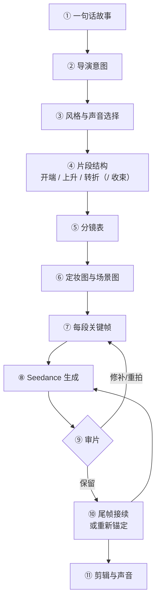
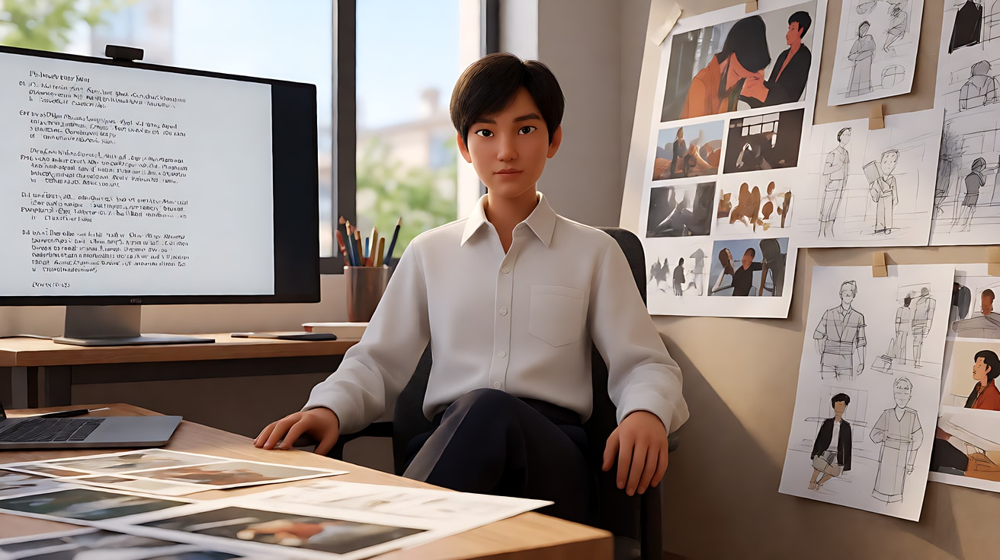
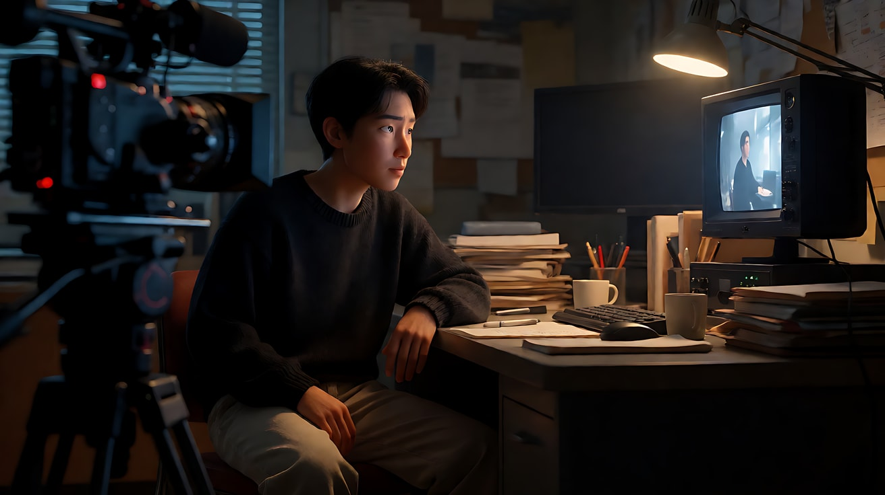

# L09-01 从剧本到成片：一个导演的完整流程

> 段位：大师 ｜ 建议用时：180 分钟（含实际生成） ｜ 配套提示词：[L09-01-从剧本到成片-提示词](../提示词/L09-01-从剧本到成片-提示词.md)

## 学习目标

- 能独立走完"一句话故事 → 导演意图 → 风格与声音 → 片段结构 → 分镜表 → 定妆与场景 → 关键帧 → 生成 → 接续 → 剪辑"的全流程
- 能为一个 40–60 秒的短片规划 3–4 个 Seedance 片段，并写出每个片段在整体弧线中的位置
- 能写一张可以直接执行的分镜表
- 能用尾帧接续让片段之间无缝衔接，并知道什么时候应该回到定妆图重新锚定
- 能在剪辑台上用声音把几个片段缝成一部完整的片子

## 一、概念讲解

### 1. 全流程总览



前五步全部在纸上完成，不花一分钱生成费用。**新手最大的浪费是从第⑧步开始。**

本课用配套提示词里的原创短片《最后一盏手摇灯》作为贯穿示例。

### 2. 第①步：一句话故事

公式：**谁 + 想要什么 + 遇到什么阻碍 + 最后发生了什么变化**。

| 差的一句话 | 好的一句话 |
|---|---|
| 一个关于灯塔的故事 | 灯塔即将改为无人值守，老看守人在最后一个风暴夜，把手摇点亮备用灯的方法教给每周来送补给的年轻船工，然后在黎明独自离开 |
| 一个女孩很伤心 | 一个女孩把分手信折好压平，决定不寄出 |

检验方法：把这句话念给朋友听，他能不能复述出"开头是什么样、结尾变成了什么样"。如果不能，故事还没有成形。

### 3. 第②步：导演意图

意图句把故事变成**观众的感受**："让观众感到 + 一个变化"。

> 《最后一盏手摇灯》的意图：**让观众感到放手也是一种守护。**

意图句是之后所有选择的裁判。景别、光、声音、节奏，每一个选择都要能回答"因为意图是……"。

### 4. 第③步：风格与声音选择

一部片子只能有**一种导演声音**。下表是六种常用的功能性"声音"，选一种，写进项目设定，之后每个片段都继承它：

| 导演声音 | 镜头 | 光 | 色彩 | 剪辑节奏 | 表演 | 适合 |
|---|---|---|---|---|---|---|
| 观察自然派 | 隐形、多为固定或轻微手持 | 自然、柔和 | 克制、真实 | 长镜头、迟切 | 克制、生活化 | 现实题材、纪实感 |
| 古典构图派 | 稳重、平衡、运镜有分寸 | 有动机但经过雕琢 | 和谐、受控 | 耐心、踩点 | 内敛、精准 | 厚重题材、高端广告 |
| 动感体感派 | 手持、跟拍、贴近 | 硬光、高反差 | 冲、去饱和 | 快、有打击感 | 用力 | 动作、运动 |
| 表现风格派 | 设计感强的运动、大胆构图 | 戏剧化 | 高饱和、标志性色板 | 音乐性 | 风格化 | MV、时尚、奇幻 |
| 亲密极简派 | 近景、小幅运动 | 单一柔光 | 温暖或克制 | 慢、少剪 | 微小、压抑 | 个人情感、孤独 |
| 图形形式派 | 固定或精确、几何 | 硬光、有形状 | 有限、刻意 | 精准、冷面 | 风格化或冷面 | 设计感品牌、冷面喜剧 |

> 《最后一盏手摇灯》选择**古典构图派**：稳重的机位、对称的灯塔与灯室、冷蓝灰的海与琥珀色的灯光两色对照、耐心的剪辑。**整部片只在"转折"那一段打破一次规则**——唯一一次让暖光占满画面。

**声音设计**也在这一步决定：环境声的主旋律（风、浪、铁梯的回声）、是否有配乐、配乐在后期统一铺还是让 Seedance 生成。建议：**每个片段让 Seedance 生成同期环境声和动作音效，配乐在剪辑时统一铺**，否则每段的音乐风格会不一致。

### 5. 第④步：片段结构

按故事段落、动作复杂度和局部修复成本拆片，而不是只按时长上限切块。2.5 单段最长30秒，旧版常按15秒以内规划，具体差异见 [A-04](../../附录/A-04-官方案例与版本差异.md)。本项目保留原有短片段练习，不必把每段翻倍。基本结构可以是开端、上升、转折，再加收束：

```
  开端 open           上升 rising          转折 turn           （收束 release）
┌────────────┐   ┌────────────┐   ┌────────────┐   ┌────────────┐
│ 建立人物、   │ → │ 阻碍出现、   │ → │ 选择发生、   │ → │ 新的平衡     │
│ 世界与关系   │   │ 压力升高     │   │ 价值翻转     │   │ 余韵         │
├────────────┤   ├────────────┤   ├────────────┤   ├────────────┤
│ 景别：宽     │   │ 景别：收紧   │   │ 景别：最近   │   │ 景别：最宽   │
│ 运镜：稳     │   │ 运镜：更多   │   │ 运镜：打破   │   │ 运镜：静     │
│ 光：平衡     │   │ 光：反差加大 │   │ 光：翻转     │   │ 光：柔和     │
│ 声音：环境   │   │ 声音：变浓   │   │ 声音：抽空   │   │ 声音：舒展   │
└────────────┘   └────────────┘   └────────────┘   └────────────┘
```

为每个片段写一行"弧线记录"，这是之后写提示词的依据：

| 字段 | 含义 | 例（片段3） |
|---|---|---|
| 弧线位置 | 开端 / 上升 / 转折 / 收束 | 转折 |
| 片段意图 | 这一段要观众感到什么 | 他把守了一辈子的东西交出去 |
| 景别趋势 | 变宽还是收紧 | 收到最近 |
| 运镜趋势 | 更动还是更静 | 全片唯一一次缓慢环绕 |
| 光趋势 | 反差、冷暖如何变化 | 从手电冷光到暖光占满 |
| 声音趋势 | 变浓还是变稀 | 风暴声被关在门外，只剩齿轮声 |
| 是否打破规则 | 是不是全片的"例外" | 是 |

### 6. 第⑤步：分镜表

分镜表是导演给自己（和模型）的施工图。每一行是一个镜头，至少包含以下字段：

| 字段 | 说明 |
|---|---|
| 片段 / 镜头号 | 例如 P3-S2 |
| 景别与机位 | 中近景，平视，机位在老人左侧 |
| 焦段与景深 | 50mm，浅景深 |
| 运镜 | 每个镜头一个主运镜：起点 → 方式 → 终点 |
| 动作 | 一个主动作，写成可见行为 |
| 光 | 光源与方向 |
| 声音 | 环境声、动作音效、台词 |
| 素材 | 需要哪几张图（定妆、场景、关键帧） |
| 生成方式 | 图像或视频参考 / 专门首尾帧 / 原视频延长 / 局部编辑；多镜头是叙事组织方式 |

### 7. 第⑥⑦步：定妆图、场景图与关键帧

- **定妆图**：每个角色一张多角度定妆图，是整个项目的"身份锚点"。项目中途不要改。
- **场景图**：每个地点一张空景，写清光源方向。同一地点的白天和夜晚，各做一张。
- **道具图**：反复出现的关键道具（本例中的手摇曲柄）单独做一张。
- **关键帧**：每个片段至少一张首帧；需要精确结尾的片段，再做一张尾帧。关键帧一律以定妆图和场景图为参考生成。

按"身份 → 地点 → 关键构图 → 道具"挑选必要素材；有复杂轨迹时加白模或运动参考。数量与音视频总长按当前版本、入口核对，不把旧版9张图当成通用限制。首尾帧如需专门约束，应在实际任务中指定，输入比例一致。

### 8. 第⑧⑨⑩步：生成、审片、接续

```
片段1 ──生成──▶ 审片 ──保留──▶ 截取尾帧
                                 │
                                 ▼
片段2 ◀── 以尾帧为首帧 + 定妆图锁身份（接续深度 1）
   │
   ▼
片段3 ◀── 以片段2 尾帧为首帧（接续深度 2，到上限）
   │
   ▼   场景切换 / 达到上限
片段4 ◀── 回到定妆图 + 新首帧重新锚定（深度归零）
```

- **尾帧接续**：当下一个片段在同一地点、同一时间连续进行时，用上一个片段**实际生成结果的最后一帧**作为下一个片段的首帧。提示词只写"接下来发生什么"，不重新描述首帧里已经有的东西。
- **以实际为准**：如果片段1 的结果和计划不同（例如人物还差两步才走到门口），**以实际结果为准**修改片段2，而不是假装计划实现了。
- **接续深度上限**：每次用生成结果做首帧，人物身份都会轻微漂移。连续接续两次左右，就应该在下一个场景切换时回到定妆图重新锚定。
- **审片**的方法在下一课 L09-02 详细展开。

### 9. 第⑪步：剪辑与声音

- **剪辑点**：在动作进行中切（cut on action）；转折之后给一个比其他镜头更长的停留。
- **声音缝合**：用 J-cut（下一段的声音先进来）和 L-cut（上一段的声音延续到下一段）把片段缝起来，观众就感觉不到"这是几次生成拼起来的"。
- **统一配乐**：配乐在剪辑时一次铺完，在转折处变化或停下。
- **房间底噪**：每个场景保留一段干净的环境声，用来填补片段之间的空隙。
- **字幕与片名**：全部后期添加。

## 二、情绪与叙事功能

| 环节 | 它决定了观众的什么感受 |
|---|---|
| 一句话故事 | 观众能不能说出"这部片讲了什么" |
| 导演意图 | 观众看完后留下的那一种感受 |
| 导演声音 | 观众是否觉得"这是一个人拍的" |
| 片段结构 | 观众是否感到情绪在上升、在转折 |
| 打破规则的那一段 | 观众记住的那个瞬间 |
| 尾帧接续 | 观众是否察觉不到片段之间的缝 |
| 声音缝合 | 观众是否感觉片子是"一口气"看完的 |

## 三、经典影片案例

### 《疯狂的麦克斯：狂暴之路》（2015，乔治·米勒）
- 场景：整部影片的前期筹备。
- 怎么做的：据多方报道，乔治·米勒在拥有传统剧本之前，先与分镜师一起画出了约三千五百格分镜，几乎整部片的动作戏都以分镜的形式"预演"过一遍。拍摄时，这套分镜是全剧组共同的施工图。
- 为什么这样做：一部几乎没有对白、以动作推进的电影，最可靠的"剧本"就是画面本身。分镜让导演在花钱之前就确认了每一个镜头的空间关系和节奏——这正是 AI 创作中"前五步在纸上完成"的道理：生成费用相当于胶片，分镜表就是省钱的地方。



### 《寄生虫》（2019，奉俊昊）
- 场景：影片的分镜与拍摄。
- 怎么做的：奉俊昊以亲手绘制详细分镜著称，《寄生虫》的分镜后来还被整理出版成书。他在拍摄前就确定了大部分镜头的构图和剪辑点，据说现场很少拍"多余"的覆盖镜头。
- 为什么这样做：他的影片对空间（半地下室与豪宅、楼梯的上下）有极强的设计，每个镜头的位置都承载着阶层关系的意义。分镜让这种空间语言在整部片中保持一致——这就是"一种导演声音贯穿全片"。对 AI 创作者而言，分镜表 + 【锁定】行就是保持一致的工具。


### 补充：希区柯克的"开拍前已完成"
希区柯克以极度依赖前期设计闻名，他常被引用的观点是：影片在开拍前就已经在他脑中完成，拍摄只是执行。这种工作方式和 AI 视频创作高度契合——模型就像一个执行力很强、但没有判断力的剧组，导演的判断必须在提示词之前做完。



## 四、在 AI 中怎么实现

- **生图阶段**：
  - 先做定妆图和场景图，确认后**冻结**，整个项目不再修改。
  - 每个关键帧都以定妆图为参考，并写 `Keep the face, hairstyle and outfit exactly as in image 1.`
  - 同一地点的不同时间（黄昏、风暴夜、黎明）分别做场景图，光源方向保持一致（例如灯塔窗户永远在画左）。
- **视频阶段**：
  - 每个片段的提示词里，【锁定】行要重复项目级的锁定内容：人物服装、光源方向、机位所在的一侧。
  - 接续片段的提示词只写"新发生的事"，并写"不重复首帧中已经完成的动作"。
  - 每个片段结尾都写成一个清楚的"完成态"，方便截取尾帧作为下一段的首帧。
- **模型擅长**：单个场景内的连续动作、天气与光的变化、稳定的构图、同期环境声。
- **要避开**：
  - 一个片段里塞进两个地点或两个时间。
  - 在片段3 的提示词里提前写片段4 才该发生的事（模型会把它演出来）。
  - 连续接续三次以上不回到定妆图。
  - 每段都让模型生成不同的配乐。

## 五、练习作业

1. 写出你自己的毕业短片的一句话故事和导演意图。
2. 从六种导演声音中选一种，写下它在你的片子里的镜头、光、色彩、剪辑、声音五项规则。
3. 把故事拆成 3–4 个片段，为每个片段写一行弧线记录，并标出"打破规则"的那一段。
4. 写出完整分镜表，列出需要的全部图片，然后再开始生成。
5. 参考配套提示词的《最后一盏手摇灯》，完成你自己的全套生图与视频提示词，生成并剪辑成片。

## 六、自检清单

- [ ] 一句话故事里有"谁、想要什么、阻碍、变化"
- [ ] 意图句以"让观众感到"开头，并包含一个变化
- [ ] 全片只有一种导演声音，只在一个片段里刻意打破
- [ ] 每个片段都有弧线记录（位置、意图、景别 / 运镜 / 光 / 声音趋势）
- [ ] 分镜表在生成前写完
- [ ] 定妆图与场景图在项目开始后没有修改
- [ ] 接续片段用的是实际生成结果的尾帧，并在场景切换时重新锚定
- [ ] 配乐在后期统一铺设，片段之间用环境声缝合

## 七、配套提示词

→ [L09-01-从剧本到成片-提示词](../提示词/L09-01-从剧本到成片-提示词.md)

---

上一课：[L08-07 产品广告](../../08-类型片实战/教学/L08-07-产品广告.md) ｜ 下一课：[L09-02 重拍判断与导演复盘](L09-02-重拍判断与导演复盘.md) ｜ [返回总目录](../../README.md)
