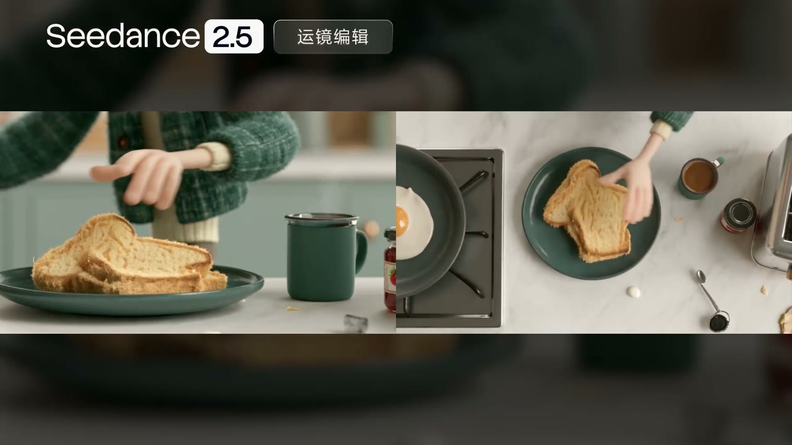
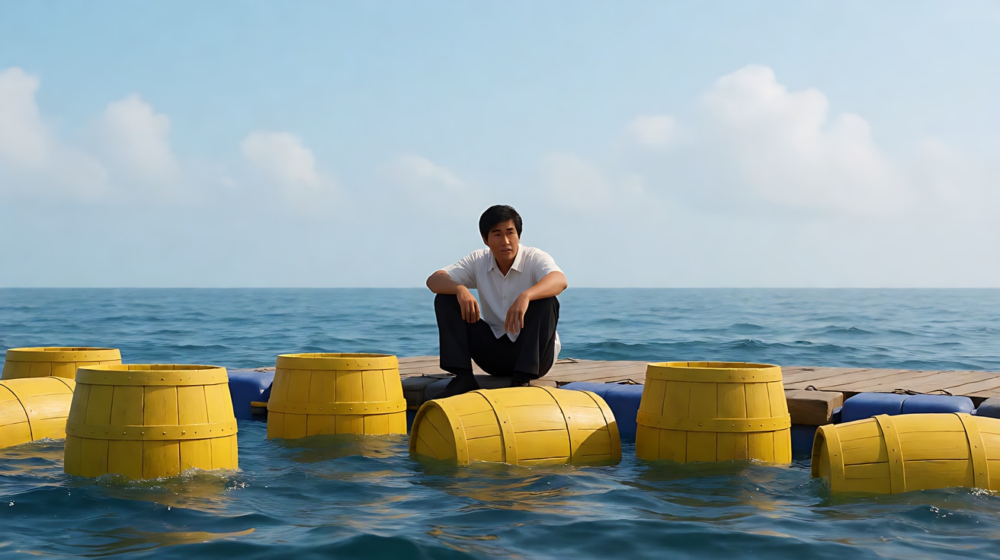
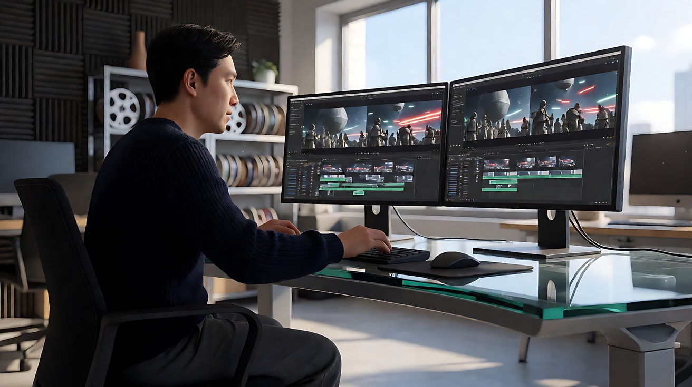
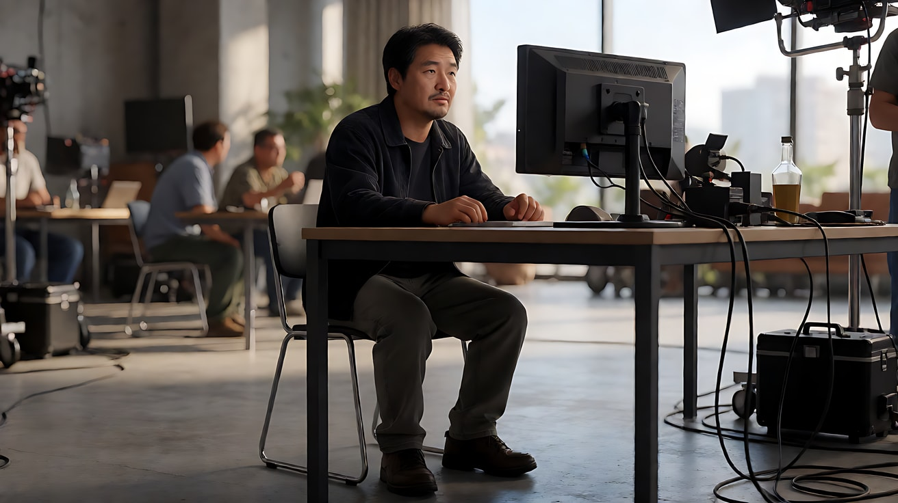

# L09-02 重拍判断与导演复盘：每一次生成都要换来一个答案

> 段位：大师 ｜ 建议用时：120 分钟 ｜ 配套提示词：[L09-02-重拍判断与导演复盘-提示词](../提示词/L09-02-重拍判断与导演复盘-提示词.md)

## 学习目标

- 能用五个维度审片：意图、身份一致、动作可读、光连续、声音
- 能对每一条生成结果做出"保留 / 修补 / 重拍 / 换方案"的判断，并说出理由
- 能遵守"最小修改原则"和"一次只改一个变量"，让每一次重拍都有诊断价值
- 能写出一份可复用的复盘表，把一次项目的经验变成下一次的默认设置
- 能把"失败结果"翻译成一句精准的提示词修改

## 一、概念讲解

### 1. 为什么重拍需要判断

AI 视频的每一次生成都要花钱、花时间。新手的习惯是"不满意就再抽一次"，结果花掉十次额度，第十次和第一次的问题还一样。

导演的习惯是：**先说清楚哪里不对、为什么不对，再决定要不要再拍，以及改什么。**

```
  生成结果
     │
     ▼
┌────────────┐
│  五维审片   │  意图 / 身份 / 动作 / 光 / 声音
└────────────┘
     │ 每一维：通过 or 不通过（附证据：哪个镜头、哪个时刻）
     ▼
┌────────────┐
│  判决       │
└────────────┘
     │
     ├── 保留 ────────▶ 记录实际结束状态，作为下一段的依据
     ├── 后期修补 ─────▶ 剪掉、调色、补音效、加字幕
     ├── 模型局部编辑 ─▶ 指定时间范围、改动与保持项，再全片复检
     ├── 重拍（重抽）──▶ 提示词不变，再生成一次
     ├── 重拍（改写）──▶ 改一个变量，再生成一次
     └── 换方案 ───────▶ 拆镜头、换生成方式、或放弃这个镜头
```

### 2. 五维审片

| 维度 | 问题 | 通过的标准 | 常见失败 |
|---|---|---|---|
| 意图 | 不看提示词，这个镜头让我感到了计划中的那个变化吗？ | 一个陌生观众能说出"这一刻发生了什么" | 画面好看但没有转折；情绪落点不对 |
| 身份一致 | 人物、服装、道具、产品是否和定妆图一致？ | 脸型、发型、服装、关键道具全程不变 | 换衣服、换发型、道具消失、产品标识漂移 |
| 动作可读 | 主动作是否清楚、完整、有先后？ | 动作从开始到完成态都能看清 | 动作被跳过、多做了动作、手部变形、两人同时乱动 |
| 光连续 | 光源方向、颜色、明暗是否和计划及前后片段一致？ | 光有来源，跨镜头不跳变 | 光源方向反了、冷暖互换、无来源的亮光 |
| 声音 | 环境声、音效、台词是否对、是否同步？ | 台词说对、人对、口型大致同步；音效与动作对应 | 台词串到别人嘴里、多出配乐、音效缺失 |

审片时要写**证据**：哪个镜头、哪一刻、看到了什么。"感觉不太对"不是审片结论。

### 3. 判决：保留、修补、重拍、换方案

| 判决 | 适用情况 | 注意 |
|---|---|---|
| **保留** | 所有"必须通过"的标准都达到了 | 不为一个说不清的"更好"花钱；记录下实际结束状态和可以接受的偏差 |
| **后期修补** | 问题是局部的：多了半秒、颜色偏了、少一个音效、需要字幕 | 剪辑能解决的问题，不要重新生成 |
| **模型局部编辑** | 想保留主体表演，只修改某段机位、外观或一句声音 | 2.5 支持；写明确范围和保持项，复检全片，不能保证范围外绝对不变 |
| **重拍·重抽** | 提示词本身合理，只是这一次结果偶然失败 | 设置保持不变；连续两三次同样失败，不能就此断定是"运气" |
| **重拍·改写** | 能找到一个具体的歧义、冲突或缺失 | 只改最小的那一处，写清改了什么、保留了什么 |
| **换方案** | 多次失败、预算用完，或这个镜头超出模型能力 | 拆成两次生成、换成首尾帧、改用空镜或反应镜头替代、或删掉 |

### 4. 最小修改原则与单变量原则

**最小修改原则**：只改导致失败的那一处，其余一字不动。已经成功的部分（光、构图、人物）是你的资产，改动越多，丢掉资产的风险越大。

**一次只改一个变量**：

```
  第1次：原提示词                          → 镜头2 和镜头3 被合并
  第2次：只在镜头3 开头加"镜头切至近景"     → 仍然合并        （排除了"缺少切镜描述"）
  第3次：保持第2次，只把时长从 10 秒改为 12 秒 → 三个镜头都出现  （定位到：负载过高）
```

如果第2次同时改了切镜描述、时长和光线，即使成功了，你也不知道是哪一项起了作用——下次遇到同样的问题，还得从头试。

**例外**：如果原提示词有明显的、多处的错误（比如同时写了"固定镜头"和"环绕镜头"，又漏写了声音），可以一次性修正，但要在复盘表里标注"组合修复"，不把成功归功于某一项。

### 5. 常见失败与第一修复

| 失败现象 | 最可能的原因 | 第一修复（只改这一处） |
|---|---|---|
| 人物站起来走掉 / 多做了动作 | 动作没写终点 | 写一个可见的完成态："停在她回头的半侧脸上" |
| 换了衣服或发型 | 参考图用途不清 | 素材分工写"@图片1 锁定人物身份与服装" |
| 多个镜头被合并成一个 | 缺少切镜描述，或负载过高 | 每个镜头写"镜头切至……"；仍失败再减镜头或加时长 |
| 尾帧没到位 | 时长不够或动作太多 | 删掉一个中间动作，或强调"以尾帧为最终画面目标" |
| 光源方向跳变 | 没有【锁定】光线 | 加【锁定】行写明光源方向 |
| 台词串到另一个人嘴里 | 两人同镜头先后说话 | 一人一镜，每句台词前写角色名和动作 |
| 手部变形 | 手部动作太精细 | 简化动作，或改为不露手的景别 |
| 被平台拦截 | 可能是内容、素材授权或入口规则 | 核对实际原因并真正调整内容，不靠暗语或同义词试探 |
| 身份越接续越漂移 | 连续用生成结果做首帧 | 回到定妆图重新锚定 |

### 6. 复盘表

每一次生成都记一行。一个项目做完，把复盘表里反复出现的问题，写成下一个项目的默认设置。

| 字段 | 例 |
|---|---|
| 片段 / 第几次 | P3 / 第2次 |
| 失败的维度与证据 | 动作可读：镜头3 中老秦没有松手，两人一起握着曲柄 |
| 保留下来的优点 | 暖光占满画面、环绕运镜平稳、齿轮声节奏好 |
| 原因假设 | "退开半步"写在"阿澄上前"之后，模型把两件事同时演了 |
| 本次修改（只改一处） | 把"他慢慢松开双手，退开半步"放到"阿澄上前"之前，并加一句"他的手已经离开曲柄" |
| 保持不变的设置 | 时长 15 秒、6 张图、画幅、其余文字 |
| 判决 | 重拍·改写 |
| 剩余额度 | 本片段还剩 1 次 |
| 经验（写给下一个项目） | 交接类动作必须写清先后，并写出"手已离开"的完成态 |

### 7. 以实际为准

被保留的生成结果就是"事实"。如果片段2 的结果和计划不同——人物停在了下方两级台阶而不是三级——下一个片段**按实际结果写**，而不是假装计划实现了。被判为重拍的结果不能成为下一段的依据，也不能截取它的尾帧。

### 8. 局部编辑：保护已经成功的部分

**官方说明**：2.5 支持通过时间戳指定视频画面编辑范围，也支持声音增删改。**课程建议**：优先选最小可验证改动，不同时更换动作、外观和机位。参考[早餐运镜编辑案例](../../附录/A-04-官方案例与版本差异.md#case-edit)。



官方案例关键帧「早餐运镜编辑」，媒体 00:10。机位变化让台面和手的空间关系重新呈现，因此“保留动作”仍需复检，不是写进提示词就算完成。来源：[官方发布文](https://seed.bytedance.com/zh/blog/one-take-creation-flexible-referencing-introducing-seedance-2-5)，[完整图组与引用说明](../../附录/A-04-官方案例与版本差异.md#case-edit)。此图为官方原有并排布局，非本项目实测。

| 编辑单字段 | 示例 |
|---|---|
| 源视频与版本 | P0 已保留的12秒版本，不覆盖原片 |
| 目标范围 | 4–8秒 |
| 改动前 → 改动后 | 推近到灯具 → 固定机位观察灯具 |
| 保持项 | 灯具与房间外观、人物动作、原有光线和全部声音 |
| 接点验收 | 4秒和8秒附近没有跳位、跳光或断声 |
| 全片复检 | 0–4秒和8–12秒是否被意外改写 |

编辑通常沿用源视频的画幅和时长属性，不同时要求任意改比例或加长。改变机位可能需要重建原片没拍到的空间，要特别检查物体背面、遮挡与反射；“只改运镜”不代表技术上没有其他风险。

缩小范围后仍然破坏已成功内容，就回到原保留版本，用后期修补或单独重拍该镜头，不把编辑失败继续传给后续片段。

## 二、情绪与叙事功能

| 环节 | 它保护了什么 |
|---|---|
| 意图维度 | 保护整部片的"那一个感受"，防止画面好看却没有意义 |
| 身份维度 | 保护观众对角色的信任 |
| 动作维度 | 保护故事的因果链 |
| 光与声音维度 | 保护片段之间的连续感 |
| 最小修改 | 保护已经成功的部分 |
| 复盘表 | 保护你下一个项目的时间和预算 |

## 三、经典影片案例

### 《大白鲨》（1975，史蒂文·斯皮尔伯格）
- 场景：整部影片的拍摄过程。
- 发生了什么：剧组造的机械鲨鱼在海上拍摄时频繁故障，无法按计划出镜。斯皮尔伯格没有无限期地等待修好、反复重拍，而是改变了方案：大量用浮在水面的黄色木桶、鲨鱼视角的水下主观镜头和人物的反应来暗示鲨鱼的存在，直到影片后段才让它完整露面。
- 为什么值得学习：这是"换方案"判决的经典案例。当一个镜头反复失败、超出了工具能力时，好的导演不会继续砸钱重抽，而是问："观众真正需要看到的是什么？"答案是恐惧，而不是鲨鱼。很多人认为，这次被迫的改变反而让影片更加紧张。在 AI 创作中，当模型反复画不好某个东西时，用空镜、影子、声音和反应镜头替代，常常是更好的选择。



### 《星球大战》（1977，乔治·卢卡斯）
- 场景：影片的后期剪辑。
- 发生了什么：据记载，影片的初剪效果不理想，卢卡斯更换了剪辑团队，由玛西亚·卢卡斯、保罗·赫希和理查德·周重新剪辑。结尾进攻死星的段落在剪辑台上被大量重组，用交叉剪辑把飞行员、指挥室和反派三条线编织在一起。三人后来获得了奥斯卡最佳剪辑奖。
- 为什么值得学习：这是"后期修补"判决的经典案例——素材已经拍好，问题出在组织方式上，解决办法不是重拍，而是在剪辑台上重新安排。AI 创作者常常低估剪辑的力量：一个"不完美"的片段，剪掉开头半秒、换个顺序、加上合适的声音，可能就完全成立了。



### 《闪灵》（1980，斯坦利·库布里克）
- 场景：拍摄过程中的大量重拍。
- 发生了什么：库布里克以要求极多次重拍著称，《闪灵》的部分镜头据报道拍了几十甚至上百条，拍摄周期远超计划。
- 为什么值得学习：这是一个关于"重拍成本"的反面参照。无限重拍或许能接近导演心中的完美，但代价是巨大的时间和金钱，以及演员和剧组的消耗。普通创作者没有这样的预算——AI 的每一次生成同样要花钱。重拍之前先问："这一次我要验证什么？"如果答不上来，就不要按下生成键。



## 四、在 AI 中怎么实现

- **审片阶段**：
  - 至少看三遍：第一遍只看意图（不看提示词，能不能感到那个变化）；第二遍逐镜头看身份、动作、光；第三遍闭上眼睛只听声音。
  - 截取问题时刻的画面，写进复盘表作为证据。
- **判决阶段**：
  - 先问"后期能不能修"，再比较局部编辑与重新生成哪一种更能保留已成功内容。
  - 重新生成之前，确认剩余额度，并写下"这一次要验证什么"。
- **修改阶段**：
  - 改一个变量：动作的先后顺序、一句完成态、一行【锁定】、一个镜头的切镜描述、时长、某张参考图的用途说明。
  - 修改后，把新旧两版并排保存，方便对比。
  - 如果问题出在参考图（例如首帧里人物的手已经变形），要修的是生图提示词，而不是视频提示词。
- **模型的不确定性**：同一个提示词两次生成结果可能不同；一次成功不代表提示词完美，一次失败也不代表提示词有错。用复盘表积累证据，而不是凭一次结果下结论。
- **要避开**：
  - 一次改五处，然后不知道哪一处起了作用。
  - 被拦截后反复试同义词：先核对内容与授权要求，必要时真正改变场景表现，不要试探审核。
  - 用被判为重拍的结果截取尾帧做下一段首帧。
  - 为了一个说不清楚的"更好"无限重抽。

## 五、练习作业

1. 拿出你在 L09-01 中生成的四个片段，按五个维度逐一审片，每一维写下"通过/不通过 + 证据"。
2. 为每个片段做出判决（保留 / 后期修补 / 重拍·重抽 / 重拍·改写 / 换方案），并写出理由。
3. 选一个需要改写的片段，只改一个变量，重新生成，填写复盘表。
4. 项目结束后，从复盘表中总结出三条"下一个项目的默认设置"。
5. 完成配套提示词的练习1–6，体会"失败结果 → 诊断 → 最小修改"的过程。
6. 完成练习6的局部编辑扩展，只修改一个维度，保存原版并检查修改区间以外的内容。

## 六、自检清单

- [ ] 每个片段都按五个维度审过，并写了证据
- [ ] 每个判决都有理由，先考虑了后期修补
- [ ] 每次重拍都只改了一个变量（组合修复已标注）
- [ ] 已成功的部分在修改后没有被破坏
- [ ] 局部编辑记录了源版本、范围、改动和保持项，并检查了接点及范围外片段
- [ ] 复盘表每一次生成都有记录
- [ ] 下一段的首帧来自被保留的结果
- [ ] 总结出了至少三条下一个项目的默认设置

## 七、配套提示词

→ [L09-02-重拍判断与导演复盘-提示词](../提示词/L09-02-重拍判断与导演复盘-提示词.md)

---

上一课：[L09-01 从剧本到成片](L09-01-从剧本到成片.md) ｜ 下一课：[A-01 术语中英对照表](../../附录/A-01-术语中英对照表.md) ｜ [返回总目录](../../README.md)
