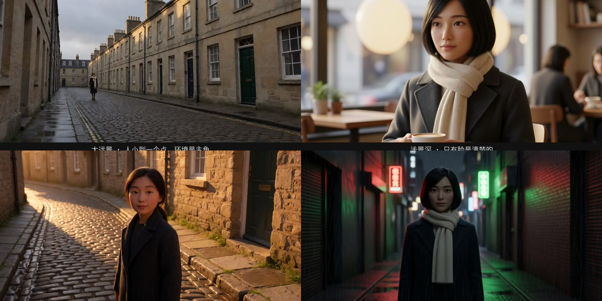
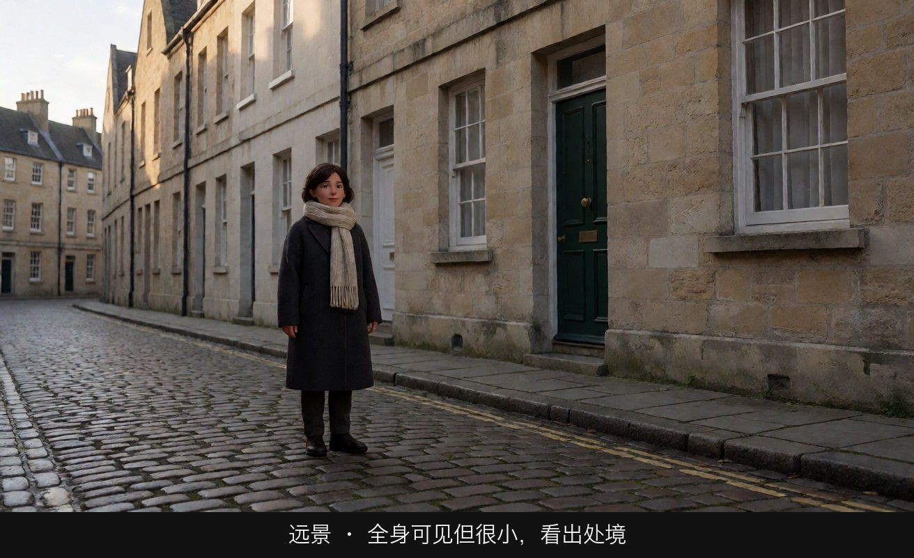
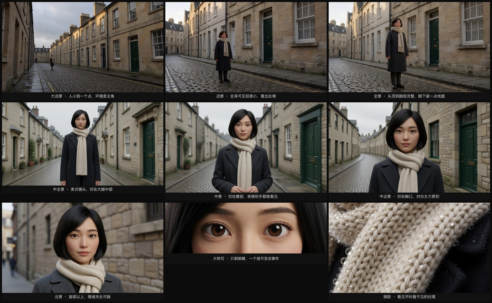

# AI 电影导演教程

本页是课程目录，链接相对 `course/`。仓库说明见 [README](../README.md)。

从小白到资深导演的镜头语言课，外加一个可安装的 **Seedance 2.5 导演技能**。方法可以迁移；Seedance 2.5 是当前的视频实践示例。

[在线阅读](https://susirial.github.io/seedance2.5-How-to-build/) · [从导演思维开始](00-导论与工作流/教学/L00-01-导演思维.md) · [安装技能](使用技能.md) · [署名](../NOTICE.md)



这些示意图由多种生图模型分别生成（包括 Nano Banana、GPT Image 等），只用来说明镜头概念；不同模型的画面不能互相比较效果，也不能当作视频成片。本仓库没有视频演示。静态图不能证明运镜稳定或音画同步。

## 两条路

**按课学。** 每个模块分成 `教学/` 和 `提示词/`。先读教学，再做提示词。练习按 ★ 到 ★★★★★ 由简到繁。

**把技能装进编辑器。** [安装说明](使用技能.md) 对应目录 [seedance-25-director](../skills/seedance-25-director)。它负责把文案写成导演方案和制作包，不调用生成服务。内置示例没有出过图，也没有出过视频。不要只复制 `SKILL.md`。在仓库根目录执行：

```bash
mkdir -p ~/.cursor/skills
cp -R skills/seedance-25-director ~/.cursor/skills/seedance-25-director
```

## 五个段位

| 段位 | 你能做到 | 对应模块 |
|---|---|---|
| 一段 · 入门 | 说清每个镜头拍多大、拍哪里、用什么光 | 00、01 |
| 二段 · 基础 | 用景深、焦段、构图控制观众看哪里 | 02、03 |
| 三段 · 进阶 | 用光和运镜表达情绪，每个选择都有动机 | 04、05 |
| 四段 · 高级 | 写分镜表，在一次生成里切出 3–5 个镜头并保持连续 | 06、07 |
| 五段 · 大师 | 形成自己的导演风格，独立完成类型短片 | 08、09 |


## 十个模块

00、06、09 没有单独的示意图目录。下面三张封面借用其他模块的课程静帧，只标明学习阶段。

<table>
<tr>
<td width="50%" valign="top">
<a href="00-导论与工作流/教学/L00-01-导演思维.md"></a>
<br><strong>00 导论与工作流</strong><br>用一个意图统领工具。封面来自景别课。
</td>
<td width="50%" valign="top">
<a href="01-景别/教学/L01-01-八种基本景别.md"></a>
<br><strong>01 景别</strong><br>从大远景到微距，先看切在身体的哪里。
</td>
</tr>
<tr>
<td width="50%" valign="top">
<a href="02-景深与焦段/教学/L02-01-景深三要素.md"></a>
<br><strong>02 景深与焦段</strong><br>决定观众只能看清哪一层。
</td>
<td width="50%" valign="top">
<a href="03-构图/教学/L03-01-三分法中心构图与黄金比例.md"></a>
<br><strong>03 构图</strong><br>三分、引导线、轴线和画幅。
</td>
</tr>
<tr>
<td width="50%" valign="top">
<a href="04-光影与色彩/教学/L04-01-光的基础.md"></a>
<br><strong>04 光影与色彩</strong><br>光要有来源，颜色要有理由。
</td>
<td width="50%" valign="top">
<a href="05-运镜/教学/L05-01-固定镜头.md"></a>
<br><strong>05 运镜</strong><br>固定、摇移、跟拍和长镜头。
</td>
</tr>
<tr>
<td width="50%" valign="top">
<a href="06-镜头语言综合与分镜/教学/L06-01-镜头合同.md"></a>
<br><strong>06 镜头语言与分镜</strong><br>一场戏怎么接得上。封面来自构图课。
</td>
<td width="50%" valign="top">
<a href="07-世界导演风格/教学/L07-00-风格拆解方法论.md"></a>
<br><strong>07 世界导演风格</strong><br>二十位导演与摄影师的风格指纹。
</td>
</tr>
<tr>
<td width="50%" valign="top">
<a href="08-类型片实战/教学/L08-01-悬疑惊悚.md"></a>
<br><strong>08 类型片实战</strong><br>悬疑、动作、爱情、科幻、恐怖、短剧和广告。
</td>
<td width="50%" valign="top">
<a href="09-毕业项目/教学/L09-01-从剧本到成片.md"></a>
<br><strong>09 毕业项目</strong><br>从剧本走到可复盘的成片计划。封面来自风格课。
</td>
</tr>
</table>

动手前先读 [写作规范](模板/写作规范.md)。生图提示词是英文，视频提示词是中文。

---

## 总目录

### 模板与规范
- [写作规范](模板/写作规范.md) · [教学文档模板](模板/教学文档模板.md) · [提示词文档模板](模板/提示词文档模板.md)

### 00 导论与工作流（入门）
| 课程 | 教学 | 提示词 |
|---|---|---|
| L00-01 导演思维：用一个意图统领所有工具 | [教学](00-导论与工作流/教学/L00-01-导演思维.md) | [提示词](00-导论与工作流/提示词/L00-01-导演思维-提示词.md) |
| L00-02 AI 影像工作流：Nano Banana + Seedance | [教学](00-导论与工作流/教学/L00-02-AI影像工作流.md) | [提示词](00-导论与工作流/提示词/L00-02-AI影像工作流-提示词.md) |
| L00-03 提示词公式与避坑 | [教学](00-导论与工作流/教学/L00-03-提示词公式与避坑.md) | [提示词](00-导论与工作流/提示词/L00-03-提示词公式与避坑-提示词.md) |
| L00-04 学习路线与五段位 | [教学](00-导论与工作流/教学/L00-04-学习路线与五段位.md) | [提示词](00-导论与工作流/提示词/L00-04-学习路线与五段位-提示词.md) |

### 01 景别（入门）
| 课程 | 教学 | 提示词 |
|---|---|---|
| L01-01 八种基本景别 | [教学](01-景别/教学/L01-01-八种基本景别.md) | [提示词](01-景别/提示词/L01-01-八种基本景别-提示词.md) |
| L01-02 景别与情绪距离 | [教学](01-景别/教学/L01-02-景别与情绪距离.md) | [提示词](01-景别/提示词/L01-02-景别与情绪距离-提示词.md) |
| L01-03 人物切点与画面空间 | [教学](01-景别/教学/L01-03-人物切点与画面空间.md) | [提示词](01-景别/提示词/L01-03-人物切点与画面空间-提示词.md) |
| L01-04 景别序列：建立、推进、揭示 | [教学](01-景别/教学/L01-04-景别序列.md) | [提示词](01-景别/提示词/L01-04-景别序列-提示词.md) |
| L01-05 景别反差叙事 | [教学](01-景别/教学/L01-05-景别反差叙事.md) | [提示词](01-景别/提示词/L01-05-景别反差叙事-提示词.md) |

### 02 景深与焦段（基础）
| 课程 | 教学 | 提示词 |
|---|---|---|
| L02-01 景深三要素 | [教学](02-景深与焦段/教学/L02-01-景深三要素.md) | [提示词](02-景深与焦段/提示词/L02-01-景深三要素-提示词.md) |
| L02-02 焦段性格：从 14mm 到微距 | [教学](02-景深与焦段/教学/L02-02-焦段性格.md) | [提示词](02-景深与焦段/提示词/L02-02-焦段性格-提示词.md) |
| L02-03 焦点转移与前景虚化 | [教学](02-景深与焦段/教学/L02-03-焦点转移与前景虚化.md) | [提示词](02-景深与焦段/提示词/L02-03-焦点转移与前景虚化-提示词.md) |
| L02-04 深焦与多层调度 | [教学](02-景深与焦段/教学/L02-04-深焦与多层调度.md) | [提示词](02-景深与焦段/提示词/L02-04-深焦与多层调度-提示词.md) |
| L02-05 移轴、分屈光镜与滑动变焦 | [教学](02-景深与焦段/教学/L02-05-移轴分屈光镜与滑动变焦.md) | [提示词](02-景深与焦段/提示词/L02-05-移轴分屈光镜与滑动变焦-提示词.md) |

### 03 构图（基础）
| 课程 | 教学 | 提示词 |
|---|---|---|
| L03-01 三分法、中心构图与黄金比例 | [教学](03-构图/教学/L03-01-三分法中心构图与黄金比例.md) | [提示词](03-构图/提示词/L03-01-三分法中心构图与黄金比例-提示词.md) |
| L03-02 引导线、框中框与前景遮挡 | [教学](03-构图/教学/L03-02-引导线框中框与前景遮挡.md) | [提示词](03-构图/提示词/L03-02-引导线框中框与前景遮挡-提示词.md) |
| L03-03 对称与一点透视 | [教学](03-构图/教学/L03-03-对称与一点透视.md) | [提示词](03-构图/提示词/L03-03-对称与一点透视-提示词.md) |
| L03-04 负空间与画面权力 | [教学](03-构图/教学/L03-04-负空间与画面权力.md) | [提示词](03-构图/提示词/L03-04-负空间与画面权力-提示词.md) |
| L03-05 画幅与构图 | [教学](03-构图/教学/L03-05-画幅与构图.md) | [提示词](03-构图/提示词/L03-05-画幅与构图-提示词.md) |
| L03-06 动态构图与 180 度轴线 | [教学](03-构图/教学/L03-06-动态构图与轴线.md) | [提示词](03-构图/提示词/L03-06-动态构图与轴线-提示词.md) |

### 04 光影与色彩（进阶）
| 课程 | 教学 | 提示词 |
|---|---|---|
| L04-01 光的基础：软硬、方向、色温 | [教学](04-光影与色彩/教学/L04-01-光的基础.md) | [提示词](04-光影与色彩/提示词/L04-01-光的基础-提示词.md) |
| L04-02 三点布光与人像光型 | [教学](04-光影与色彩/教学/L04-02-三点布光与人像光型.md) | [提示词](04-光影与色彩/提示词/L04-02-三点布光与人像光型-提示词.md) |
| L04-03 动机光与实用光源 | [教学](04-光影与色彩/教学/L04-03-动机光与实用光源.md) | [提示词](04-光影与色彩/提示词/L04-03-动机光与实用光源-提示词.md) |
| L04-04 自然光与时间 | [教学](04-光影与色彩/教学/L04-04-自然光与时间.md) | [提示词](04-光影与色彩/提示词/L04-04-自然光与时间-提示词.md) |
| L04-05 高调、低调与明暗对照 | [教学](04-光影与色彩/教学/L04-05-高调低调与明暗对照.md) | [提示词](04-光影与色彩/提示词/L04-05-高调低调与明暗对照-提示词.md) |
| L04-06 色彩心理与调色风格 | [教学](04-光影与色彩/教学/L04-06-色彩心理与调色风格.md) | [提示词](04-光影与色彩/提示词/L04-06-色彩心理与调色风格-提示词.md) |
| L04-07 光随剧情变化 | [教学](04-光影与色彩/教学/L04-07-光随剧情变化.md) | [提示词](04-光影与色彩/提示词/L04-07-光随剧情变化-提示词.md) |

### 05 运镜（进阶）
| 课程 | 教学 | 提示词 |
|---|---|---|
| L05-01 固定镜头的力量 | [教学](05-运镜/教学/L05-01-固定镜头.md) | [提示词](05-运镜/提示词/L05-01-固定镜头-提示词.md) |
| L05-02 摇镜与移镜 | [教学](05-运镜/教学/L05-02-摇镜与移镜.md) | [提示词](05-运镜/提示词/L05-02-摇镜与移镜-提示词.md) |
| L05-03 推拉镜头 | [教学](05-运镜/教学/L05-03-推拉镜头.md) | [提示词](05-运镜/提示词/L05-03-推拉镜头-提示词.md) |
| L05-04 跟拍与前导 | [教学](05-运镜/教学/L05-04-跟拍与前导.md) | [提示词](05-运镜/提示词/L05-04-跟拍与前导-提示词.md) |
| L05-05 环绕、升降与航拍 | [教学](05-运镜/教学/L05-05-环绕升降与航拍.md) | [提示词](05-运镜/提示词/L05-05-环绕升降与航拍-提示词.md) |
| L05-06 手持与斯坦尼康 | [教学](05-运镜/教学/L05-06-手持与斯坦尼康.md) | [提示词](05-运镜/提示词/L05-06-手持与斯坦尼康-提示词.md) |
| L05-07 特殊运镜 | [教学](05-运镜/教学/L05-07-特殊运镜.md) | [提示词](05-运镜/提示词/L05-07-特殊运镜-提示词.md) |
| L05-08 一镜到底与长镜头调度 | [教学](05-运镜/教学/L05-08-一镜到底与长镜头调度.md) | [提示词](05-运镜/提示词/L05-08-一镜到底与长镜头调度-提示词.md) |

### 06 镜头语言综合与分镜（高级）
| 课程 | 教学 | 提示词 |
|---|---|---|
| L06-01 镜头合同：五要素合一 | [教学](06-镜头语言综合与分镜/教学/L06-01-镜头合同.md) | [提示词](06-镜头语言综合与分镜/提示词/L06-01-镜头合同-提示词.md) |
| L06-02 正反打与对话覆盖 | [教学](06-镜头语言综合与分镜/教学/L06-02-正反打与对话覆盖.md) | [提示词](06-镜头语言综合与分镜/提示词/L06-02-正反打与对话覆盖-提示词.md) |
| L06-03 剪辑语法 | [教学](06-镜头语言综合与分镜/教学/L06-03-剪辑语法.md) | [提示词](06-镜头语言综合与分镜/提示词/L06-03-剪辑语法-提示词.md) |
| L06-04 分镜表与场面调度 | [教学](06-镜头语言综合与分镜/教学/L06-04-分镜表与场面调度.md) | [提示词](06-镜头语言综合与分镜/提示词/L06-04-分镜表与场面调度-提示词.md) |
| L06-05 单次生成多镜头 | [教学](06-镜头语言综合与分镜/教学/L06-05-单次生成多镜头.md) | [提示词](06-镜头语言综合与分镜/提示词/L06-05-单次生成多镜头-提示词.md) |
| L06-06 连续性与首尾帧链 | [教学](06-镜头语言综合与分镜/教学/L06-06-连续性与首尾帧链.md) | [提示词](06-镜头语言综合与分镜/提示词/L06-06-连续性与首尾帧链-提示词.md) |

### 07 世界导演风格（高级）
| 课程 | 教学 | 提示词 |
|---|---|---|
| L07-00 风格拆解方法论：六维风格指纹 | [教学](07-世界导演风格/教学/L07-00-风格拆解方法论.md) | [提示词](07-世界导演风格/提示词/L07-00-风格拆解方法论-提示词.md) |
| L07-01 希区柯克：悬念机器 | [教学](07-世界导演风格/教学/L07-01-希区柯克.md) | [提示词](07-世界导演风格/提示词/L07-01-希区柯克-提示词.md) |
| L07-02 库布里克：对称与一点透视 | [教学](07-世界导演风格/教学/L07-02-库布里克.md) | [提示词](07-世界导演风格/提示词/L07-02-库布里克-提示词.md) |
| L07-03 奥逊·威尔斯：深焦与低角度 | [教学](07-世界导演风格/教学/L07-03-奥逊威尔斯.md) | [提示词](07-世界导演风格/提示词/L07-03-奥逊威尔斯-提示词.md) |
| L07-04 黑泽明：天气、长焦与动势 | [教学](07-世界导演风格/教学/L07-04-黑泽明.md) | [提示词](07-世界导演风格/提示词/L07-04-黑泽明-提示词.md) |
| L07-05 小津安二郎：低机位与空镜 | [教学](07-世界导演风格/教学/L07-05-小津安二郎.md) | [提示词](07-世界导演风格/提示词/L07-05-小津安二郎-提示词.md) |
| L07-06 塔可夫斯基：时间雕刻 | [教学](07-世界导演风格/教学/L07-06-塔可夫斯基.md) | [提示词](07-世界导演风格/提示词/L07-06-塔可夫斯基-提示词.md) |
| L07-07 塞尔乔·莱昂内：大远景与大特写 | [教学](07-世界导演风格/教学/L07-07-塞尔乔莱昂内.md) | [提示词](07-世界导演风格/提示词/L07-07-塞尔乔莱昂内-提示词.md) |
| L07-08 韦斯·安德森：平面对称与色板 | [教学](07-世界导演风格/教学/L07-08-韦斯安德森.md) | [提示词](07-世界导演风格/提示词/L07-08-韦斯安德森-提示词.md) |
| L07-09 诺兰：实景尺度与时间结构 | [教学](07-世界导演风格/教学/L07-09-诺兰.md) | [提示词](07-世界导演风格/提示词/L07-09-诺兰-提示词.md) |
| L07-10 维伦纽瓦：巨物、剪影与沉默 | [教学](07-世界导演风格/教学/L07-10-维伦纽瓦.md) | [提示词](07-世界导演风格/提示词/L07-10-维伦纽瓦-提示词.md) |
| L07-11 大卫·芬奇：精准与冷调 | [教学](07-世界导演风格/教学/L07-11-大卫芬奇.md) | [提示词](07-世界导演风格/提示词/L07-11-大卫芬奇-提示词.md) |
| L07-12 斯皮尔伯格：凝视与调度 | [教学](07-世界导演风格/教学/L07-12-斯皮尔伯格.md) | [提示词](07-世界导演风格/提示词/L07-12-斯皮尔伯格-提示词.md) |
| L07-13 阿方索·卡隆：沉浸式长镜头 | [教学](07-世界导演风格/教学/L07-13-阿方索卡隆.md) | [提示词](07-世界导演风格/提示词/L07-13-阿方索卡隆-提示词.md) |
| L07-14 泰伦斯·马力克：魔幻时刻与漂浮 | [教学](07-世界导演风格/教学/L07-14-泰伦斯马力克.md) | [提示词](07-世界导演风格/提示词/L07-14-泰伦斯马力克-提示词.md) |
| L07-15 王家卫：抽帧、霓虹与暧昧 | [教学](07-世界导演风格/教学/L07-15-王家卫.md) | [提示词](07-世界导演风格/提示词/L07-15-王家卫-提示词.md) |
| L07-16 张艺谋：色块与群像 | [教学](07-世界导演风格/教学/L07-16-张艺谋.md) | [提示词](07-世界导演风格/提示词/L07-16-张艺谋-提示词.md) |
| L07-17 侯孝贤：远观长镜 | [教学](07-世界导演风格/教学/L07-17-侯孝贤.md) | [提示词](07-世界导演风格/提示词/L07-17-侯孝贤-提示词.md) |
| L07-18 奉俊昊：垂直空间与阶级 | [教学](07-世界导演风格/教学/L07-18-奉俊昊.md) | [提示词](07-世界导演风格/提示词/L07-18-奉俊昊-提示词.md) |
| L07-19 朴赞郁：几何、对称与暴烈之美 | [教学](07-世界导演风格/教学/L07-19-朴赞郁.md) | [提示词](07-世界导演风格/提示词/L07-19-朴赞郁-提示词.md) |
| L07-20 罗杰·迪金斯：剪影与单一光源 | [教学](07-世界导演风格/教学/L07-20-罗杰迪金斯.md) | [提示词](07-世界导演风格/提示词/L07-20-罗杰迪金斯-提示词.md) |

### 08 类型片实战（大师）
| 课程 | 教学 | 提示词 |
|---|---|---|
| L08-01 悬疑惊悚 | [教学](08-类型片实战/教学/L08-01-悬疑惊悚.md) | [提示词](08-类型片实战/提示词/L08-01-悬疑惊悚-提示词.md) |
| L08-02 动作 | [教学](08-类型片实战/教学/L08-02-动作.md) | [提示词](08-类型片实战/提示词/L08-02-动作-提示词.md) |
| L08-03 爱情文艺 | [教学](08-类型片实战/教学/L08-03-爱情文艺.md) | [提示词](08-类型片实战/提示词/L08-03-爱情文艺-提示词.md) |
| L08-04 科幻史诗 | [教学](08-类型片实战/教学/L08-04-科幻史诗.md) | [提示词](08-类型片实战/提示词/L08-04-科幻史诗-提示词.md) |
| L08-05 恐怖 | [教学](08-类型片实战/教学/L08-05-恐怖.md) | [提示词](08-类型片实战/提示词/L08-05-恐怖-提示词.md) |
| L08-06 竖屏短剧爽点钩子 | [教学](08-类型片实战/教学/L08-06-竖屏短剧爽点钩子.md) | [提示词](08-类型片实战/提示词/L08-06-竖屏短剧爽点钩子-提示词.md) |
| L08-07 产品广告 | [教学](08-类型片实战/教学/L08-07-产品广告.md) | [提示词](08-类型片实战/提示词/L08-07-产品广告-提示词.md) |

### 09 毕业项目（大师）
| 课程 | 教学 | 提示词 |
|---|---|---|
| L09-01 从剧本到成片 | [教学](09-毕业项目/教学/L09-01-从剧本到成片.md) | [提示词](09-毕业项目/提示词/L09-01-从剧本到成片-提示词.md) |
| L09-02 重拍判断与导演复盘 | [教学](09-毕业项目/教学/L09-02-重拍判断与导演复盘.md) | [提示词](09-毕业项目/提示词/L09-02-重拍判断与导演复盘-提示词.md) |

### 附录
- [A-01 术语中英对照表](附录/A-01-术语中英对照表.md)
- [A-02 一页速查卡](附录/A-02-一页速查卡.md)
- [A-03 常见失败与修复](附录/A-03-常见失败与修复.md)
- [A-04 官方案例与版本差异](附录/A-04-官方案例与版本差异.md)

---

## 依据

- 2.5 官方资料（核查于 2026-10-04）：[模型主页](https://seed.bytedance.com/zh/seedance2_5)、[官方发布说明与案例](https://seed.bytedance.com/zh/blog/one-take-creation-flexible-referencing-introducing-seedance-2-5)、[提示词指南](https://www.volcengine.com/docs/82379/2607689)。能力说明、课程建议与待实测练习分开标注，实际入口参数与权限仍需确认。
- 业界方法：美国电影摄影师协会（ASC）通行术语、经典影片镜头分析、主流分镜与场面调度实践

官方关键帧按维护者确认的公开教学引用授权使用；未独立审核授权书，不包含完整视频再分发或转授权许可。详见 [引用说明](附录/A-04-官方案例与版本差异.md#五引用与实测说明)及[素材清单](meta/official-frames.json)。原有生成示意图仍记录于[原生图清单](meta/images-manifest.json)。
