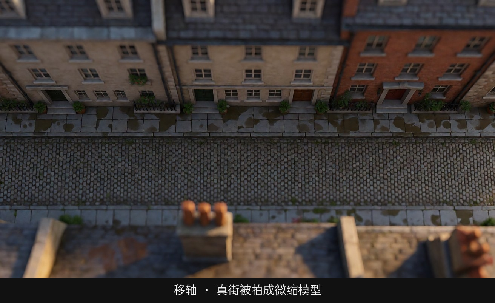
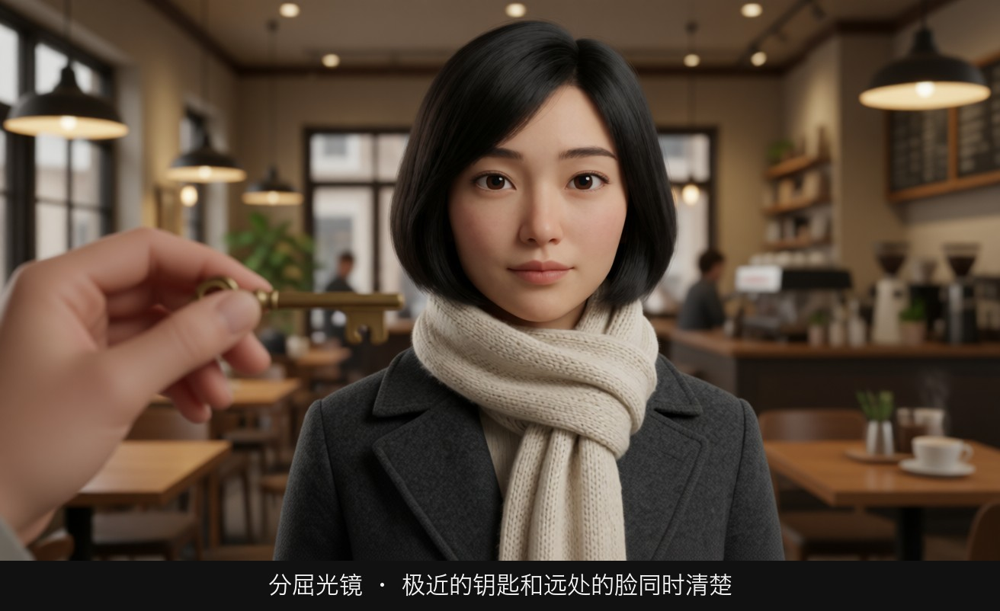

# 图库

这些示意图由多种生图模型分别生成（包括 Nano Banana、GPT Image 等），只用来说明镜头概念；不同模型的画面不能互相比较效果，也不能当作视频成片。

下面先是课程示意图，按模块排列。官方案例关键帧在页面后部单独成组，它们不是本项目生成的。

构图课里的白线是后加的三分线或中轴线。人物服装在基础课之间大体一致，是为了只比较景别、构图、光和机位。

## 01-景别

远景 · 全身可见但很小，看出处境

大远景 · 人小到一个点，环境是主角

全景 · 头顶到脚底完整，上下各留余量

中全景 · 美式镜头，切在大腿中部

中景 · 切在腰部，表情和手都能看见

近景 · 肩部以上，情绪无处可躲

大特写 · 只剩眼睛，一个细节变成事件

中近景 · 切在胸口，对白主力景别

远景的情绪 · 世界很大，人很小

近景的情绪 · 观众被迫进入她的内心

正确切点 · 切在两个关节之间的躯干上

错误切点 · 切在膝盖关节上，像被截断

微距 · 看见平时看不见的纹理

## 02-景深与焦段

浅景深 · 只有脸是清楚的

深焦 · 前景、人物、远处同时清楚

24mm · 空间被撑开，环境包住人物

85mm · 人像压缩，背景贴上来

135mm · 空间被压扁，背景像贴在脸上

前景虚化 · 隔着一层东西看她

焦点在前景杯子 · 观众先看物

移轴 · 真街被拍成微缩模型

焦点转到脸上 · 观众改看人

分屈光镜 · 极近的钥匙和远处的脸同时清楚

## 03-构图

三分法 · 左三分线 · 视线方向留白

地平线在下三分线 · 天空压过来

故意违反 · 鼻子撞墙，前方没有出路

中心构图 · 正面直视，观众无处可逃

黄金比例的用法 · 大块安静区把眼睛送到一个亮点

地平线在上三分线 · 大地又重又近

视觉重心 · 左边大而暗，右边小而亮，互相平衡

汇聚引导线 · 所有线把眼睛送到她身上

S 形曲线 · 眼睛慢慢绕进深处

框中框 · 聚焦：框内亮，框外暗

对角线 · 眼睛从一角斜穿到另一角

框中框 · 窥视：机位躲在暗处看她

框中框 · 困住：框很窄，人被关在里面

前景遮挡 · 隔着门边和植物看进去

对称 · 秩序与仪式，世界配合这个中心

对称 · 压迫：人很小，建筑在控制她

一点透视 · 消失点上什么都没有，眼睛停在空处

对称 · 刻板与喜剧：像摆在橱窗里

一点透视 · 消失点放人，她变成命运的焦点

负空间 · 孤独：人被大片空白包围

打破对称 · 唯一不对称的椅子就是事件

负空间 · 威胁：空白在她身后，而且是暗的

负空间 · 隔阂：两个人贴在画框两端

负空间 · 等待：视线前方是一大片空

画面权力 · 他更高、更大、更亮

4:3 · 接近方形，人被画框围住

画面权力反转 · 她站起来之后，位置变了

16:9 · 两人各占一条三分线

9:16 · 竖屏用上下分层，不用左右并排

21:9 · 横向距离被放大，中间的空变成关系

双人镜头 · 她在画左，他在画右

过她的肩拍他 · 他仍在画右，看向画左

过他的肩拍她 · 她仍在画左，看向画右

正打 · 她在画左，视线朝右

反打 · 他在画右，视线朝左，高度对齐

越轴错误 · 左右对调，观众会以为两人换了位置

## 04-光影与色彩

硬光 · 影子边缘清楚，像被刀切过

软光 · 影子发虚，脸被慢慢包住

三点布光 · 主光、辅光、轮廓光同时看得见

低调 · 画面大部分是黑的，只留一只眼睛

高调 · 亮部占满画面，阴影很少

冷色温 · 月光把同一张脸变成蓝灰色

暖色温 · 钨丝灯把皮肤和围巾染成琥珀色

黄金时刻 · 太阳很低，影子被拉长

动机光 · 脸上的光来自画面里那盏灯

蓝调时刻 · 天是冷的，窗户里的灯是暖的

逆光 · 脸在暗处，头发有一圈亮边

色彩重心 · 全场只有一条围巾是红的

## 05-运镜

荷兰角 · 地平线倾斜，站立感被拆掉

仰拍 · 从下往上看，人被抬高

俯拍 · 从上往下看，人被压低

主观镜头 · 观众用她的眼睛看这扇门

## 07-世界导演风格

低机位空镜 · 镜头放在坐着的人的眼睛高度

低机位 + 深焦 · 近处的人和远处的人都清楚

窄巷、雨、高饱和霓虹 · 空间是挤出来的

大色块 · 红墙和黄田把人衬成一个小点

## 08-类型片实战

悬疑 · 手停在门把上，门后的东西还不给看

动作 · 低机位、对角线、身体重心向前

竖屏钩子 · 眼睛偏上，下方留给字幕

## 官方案例关键帧

这 12 张图是 Seedance 2.5 官方发布文视频的取帧，不是本项目的生成结果，也不纳入课程的 CC BY 许可。静态图不能证明运动质量。完整视频只留在官方页面，本仓库不提供视频文件。

来源：[Seedance 2.5 官方发布文](https://seed.bytedance.com/zh/blog/one-take-creation-flexible-referencing-introducing-seedance-2-5)

官方案例关键帧，媒体00:02。镜框与帘幕包围镜前歌手。 媒体 00:02。先建立演出前的私人空间。

官方案例关键帧，媒体00:14。工作人员在后台通道递麦。 媒体 00:14。空间移动同时带来具体任务与人物关系。

官方案例关键帧，媒体00:29。歌手背后的舞台与观众全场。 媒体 00:29。画面尺度与人物面对的关系一起扩大。

官方案例关键帧，媒体00:02。保留官方片头布局的几何体白模展示。 媒体 00:02。粗几何体即可预演主体与空间，不需先制作精细场景。

官方案例关键帧，媒体00:17。左侧几何结构与右侧水下幻想场景的官方并排展示。 媒体 00:17。比较主体与大型遮挡物的关系；静态图不验证运动轨迹。

官方案例关键帧，媒体00:25。简化人形与星空角色伸手节点的官方并排展示。 媒体 00:25。白模交代目标位置，外观参考补充角色、服装与环境。

官方案例关键帧，媒体00:00。绿幕上的脚、足球与地面。 媒体 00:00。换景前先标出接触点，动态合理性须观看视频。

官方案例关键帧，媒体00:06。官方绿幕编辑指令卡，不是生成画面。 媒体 00:06。环境、障碍、服装和配角分阶段安排；卡内时间不等于媒体时间。

官方案例关键帧，媒体00:12。运动员在休息室中的换景结果。 媒体 00:12。观察人物姿态与环境光照；与00:00不是同一动作的前后对照。

官方案例关键帧，媒体00:05。双人厨房构图与近距离机位的官方并排展示。 媒体 00:05。机位变化改变观众的注意力分配。

官方案例关键帧，媒体00:10。餐盘的侧面与顶视机位官方并排展示。 媒体 00:10。新机位需要补出不可见空间，保持项仍需复检。

官方案例关键帧，媒体00:13。双人视角与锅的顶视画面的官方并排展示。 媒体 00:13。动作相位与时序需回看视频，不能靠单帧宣称完全一致。
