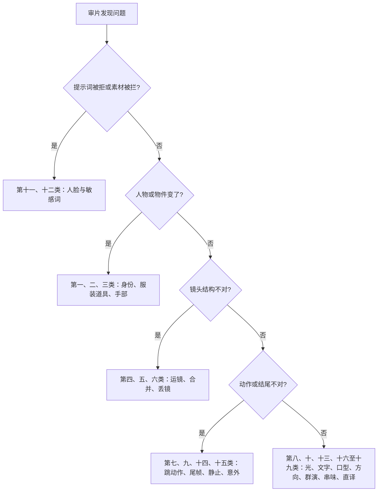

# A-03 常见失败与修复

> 上一篇：[A-02 一页速查卡](A-02-一页速查卡.md) ｜ [返回总目录](../README.md)
>
> 审片发现问题时，先在这里按"现象"找到对应条目，再做**最小修复**：一次只改一个变量，改完重新生成，对比前后两版。重拍判断的完整方法见 [L09-02 重拍判断与导演复盘](../09-毕业项目/教学/L09-02-重拍判断与导演复盘.md)。

## 怎么用这份文档



**三条总原则**

1. **一次只改一个变量。** 同时改运镜、光和动作，下一版好了也不知道是哪一处起作用。
2. **先删再加。** 大多数失败来自"写多了"：运镜叠加、动作堆叠、外貌重复描写。删掉比加约束更有效。
3. **保留已经成功的部分。** 只有尾部坏了，就只修尾部（`只修复尾部漂移，不改前半段`），或者把成功的部分剪下来，从它的真实结尾接续。

本文示例统一使用三位原创角色：**林夏**（二十多岁女性，齐耳短黑发，芥末黄雨衣）、**老周**（六十多岁钟表匠，花白短发，深灰工装背心，圆框眼镜）、**阿岩**（二十多岁男性快递员，寸头，深蓝工装夹克）。

## 总览

| 分类 | 条目 | 首选修复 |
|---|---|---|
| 一、身份漂移 | 1.1、1.2 | 删外貌描写，每个镜头重复锁定 |
| 二、服装道具变化 | 2.1、2.2 | 写道具的归属、位置、数量、状态 |
| 三、手部变形 | 3.1 | 简化手部动作，握住大物件 |
| 四、运镜混乱 | 4.1、4.2 | 一个主运镜，写起点和终点 |
| 五、多镜头合并成一镜 | 5.1 | 每个镜头写"镜头切至"，拉开景别差 |
| 六、镜头丢失 | 6.1 | 按负载阶梯减镜头或拆两次 |
| 七、动作被跳过 | 7.1、7.2 | 一镜一动作，关键动作给足节拍 |
| 八、光线闪烁 | 8.1 | 光写来源，【锁定】重复光线 |
| 九、尾帧没到位 | 9.1、9.2 | 确认专门任务与真实输入，写出到达路径 |
| 十、出现字幕水印 | 10.1 | 约束写死，参考图去文字 |
| 十一、人脸被拦截 | 11.1、11.2 | 核对入口规则与素材授权，不承诺换画风即可通过 |
| 十二、敏感词被拒 | 12.1 | 核对原因并真正调整内容，不用暗语替换 |
| 十三、口型不同步 | 13.1 | 固定中近景，台词短，不转头 |
| 十四、画面静止 | 14.1 | 加一个物理动作和环境微动 |
| 十五、意外被演成故意 | 15.1 | 写主动动作，后果留在画外或下一镜 |
| 十六、方向翻转（越轴） | 16.1 | 【锁定】写站位和朝向 |
| 十七、群演冻结 | 17.1 | 次要人物给一个持续的小动作 |
| 十八、参考串味 | 18.1 | 每张图写"不转移什么" |
| 十九、比喻被直译 | 19.1 | 情绪用直白词 + 一个身体锚点 |
| 二十、参考与编辑任务选错 | 任务诊断表 | 区分语义参考、专门首尾帧、编辑与延长 |

表中的单动作、单主运镜和短对白是故障排查时的降复杂度建议，不是全版本能力上限。

---

## 一、身份漂移

### 1.1 图生视频中，人物的脸越来越不像首帧

- **现象**：开头和首帧一样，后半段脸型变圆、眼睛变大，像换了一个人；转头之后最明显。
- **可能原因**：提示词又重新描述了一遍外貌（"大眼睛、瓜子脸"），和首帧打架；动作太大，人物大幅转身后模型失去参照。
- **最小修复**：删掉所有外貌描写，图里已有的不要再写；只写动作、运镜、光和声音；把大转身改成小幅转头；约束里写"保持脸型、发型、服装与 @图片1 一致"。

修订前：

```
@图片1 为首帧。林夏是一个大眼睛、瓜子脸、皮肤白皙的漂亮女孩，穿黄色雨衣，她在雨中转身跑向街对面，回头看了一眼，然后又转回去继续跑。
```

修订后：

```
【素材分工】@图片1 为首帧，锁定林夏的身份、发型与雨衣，不改变其背景街道布局。
【画风】风格化写实三维CG质感，电影级布光。
林夏站在公交站牌下，雨水顺着雨衣帽檐滴落。她把头微微转向画右，看向街对面，停住。镜头固定中近景，不移动。左侧便利店的暖色灯光照亮她的侧脸，背景街道是冷蓝色的雨夜。结尾停在她看向画右的四分之三侧脸上。
【声音】密集雨声打在站牌顶棚上，远处车轮碾过积水，无配乐。
【约束】保持林夏的脸型、发型、服装与 @图片1 一致；她不转身、不离开画面；不要字幕、水印、Logo。
时长：6秒
```

### 1.2 多镜头切镜后，人物换了一张脸

- **现象**：镜头1是对的，镜头2切到特写后脸变了，镜头3又像另一个人。
- **可能原因**：只在开头写了一次锁定，后面的镜头没有重复；没有上传定妆图，只用了首帧；不同镜头对人物的称呼不一致（"她""女孩""林夏"混用）。
- **最小修复**：加上定妆图并在【素材分工】里锁定；每个镜头都用同一个名字；【锁定】行写一次，并在每个镜头末尾用同样的措辞重复"林夏：齐耳短黑发，芥末黄雨衣"。

修订前：

```
@图片1 为首帧。镜头1：女孩走进便利店。镜头2：切到她的脸部特写。镜头3：她拿起一瓶水。
```

修订后：

```
【素材分工】@图片1 锁定林夏的身份与服装，不参考其灰色背景；@图片2 仅参考便利店布局与灯光，不复制其中人物；@图片3 为首帧。
【画风】风格化写实三维CG质感，电影级布光。
镜头1：固定全景，林夏推开玻璃门走进便利店，门上的风铃轻响。林夏：齐耳短黑发，芥末黄雨衣。
镜头2：镜头切至林夏的面部特写，她抬眼看向货架上方，眨了一下眼。林夏：齐耳短黑发，芥末黄雨衣。
镜头3：镜头切至中景，林夏从冷柜里拿出一瓶水，握在手里，停住。林夏：齐耳短黑发，芥末黄雨衣。
【锁定】光线：顶部白色日光灯管均匀照明，冷柜里透出淡蓝光；林夏：齐耳短黑发，芥末黄雨衣，全程同一人。
【声音】冷柜压缩机低鸣，雨声从门外隐约传来，无配乐。
【约束】保持林夏的脸型、发型、服装不变；不要字幕、水印、Logo。
时长：10秒
```

---

## 二、服装道具变化

### 2.1 衣服颜色或款式在中途变了

- **现象**：雨衣从芥末黄变成橙色，帽子一会儿戴着一会儿没了；工装背心的口袋数量变化。
- **可能原因**：场景图里的光色太强，把服装"染"了；提示词里写了"橙色路灯照在她身上"却没锁服装颜色；动作需要摘帽但没写清楚。
- **最小修复**：在约束里写"雨衣始终是芥末黄色，帽子全程戴在头上"；有色光时写成"橙色路灯照亮她的侧脸"，不写"把她照成橙色"。

修订前：

```
@图片1 为首帧。橙色的路灯把林夏整个人照成橙色，她在路灯下等车。
```

修订后：

```
【素材分工】@图片1 为首帧，锁定林夏的身份与芥末黄雨衣，不改变街道布局。
【画风】风格化写实三维CG质感，电影级布光。
林夏站在路灯下等车，双手插在雨衣口袋里，呼出的白气慢慢散开。头顶的钠灯从上方照亮她的帽檐和鼻尖，身后街道是冷蓝色的夜。镜头固定中景。结尾停在她低头看表的动作上。
【声音】低沉的风声，远处一辆车驶过，无配乐。
【约束】雨衣始终是芥末黄色，帽子全程戴在头上；保持脸型、发型不变；不要字幕、水印、Logo。
时长：6秒
```

### 2.2 道具出现、消失或数量变化

- **现象**：桌上的怀表从一只变成两只；老周手里的镊子切镜后不见了；信封的颜色变了。
- **可能原因**：道具只在开头提了一次，没写归属、位置和状态；多镜头之间没有交接道具状态。
- **最小修复**：给关键道具单独一张道具图并锁定；在【锁定】里写"谁拿着、在哪、几个、什么状态"。

修订前：

```
镜头1：老周修表。镜头2：切到他的手。镜头3：他把表放下。
```

修订后：

```
【素材分工】@图片1 锁定老周的身份与服装，不参考其背景；@图片2 锁定黄铜怀表的外形与表盘，不参考其背景；@图片3 为首帧。
【画风】风格化写实三维CG质感，电影级布光。
镜头1：固定中景，老周坐在工作台前，左手托着怀表，右手用镊子拨动表芯，表芯发出细小的咔哒声。
镜头2：镜头切至手部微距特写，镊子尖夹起一枚细小的齿轮，放进表芯，停住。
镜头3：镜头切至中景，老周把怀表平放在工作台中央的绒布上，摘下眼镜，靠回椅背。
【锁定】光线：画左一盏暖黄台灯低角度照亮工作台；道具：全程只有一只黄铜怀表，表盖打开；镊子在镜头1、2中拿在老周右手，镜头3放在怀表右侧；老周：花白短发，深灰工装背心，圆框眼镜。
【声音】怀表滴答声贯穿全片，镊子碰到金属的细响，窗外隐约的街声，无配乐。
【约束】保持老周与怀表外形不变；桌上始终只有一只怀表；不要字幕、水印、Logo。
时长：12秒
```

---

## 三、手部变形

### 3.1 手指融合、多出手指、手和物体粘在一起

- **现象**：手指数量不对；系鞋带、数钱、弹琴时手指糊成一团；手穿进杯子里。
- **可能原因**：要求手做精细、快速、多指独立的动作；手在画面中心特写且大幅运动；双手同时做不同动作。
- **最小修复**：把精细动作换成"握住一个大物件"或"手掌平放"；动作放慢、只写一个手部动作；不需要看手时，让手离开主动作或出画。

修订前：

```
@图片1 为首帧。阿岩快速地数着一叠零钱，手指飞快翻动，同时另一只手在手机上打字。
```

修订后：

```
【素材分工】@图片1 为首帧，锁定阿岩的身份与工装夹克，不改变背景。
【画风】风格化写实三维CG质感，电影级布光。
阿岩坐在电动车座上，右手握着一个快递纸箱放在膝盖上，左手把手机慢慢举到眼前，看了一眼屏幕，停住。镜头固定中景，手部动作缓慢。头顶的路灯从上方照亮他的肩膀。结尾停在他看手机的侧脸上。
【声音】远处车流声，手机一声短促的提示音，无配乐。
【约束】双手动作缓慢简单，手指形态自然；保持阿岩的脸型、发型、服装不变；不要字幕、水印、Logo。
时长：6秒
```

---

## 四、运镜混乱

### 4.1 一个镜头里叠了多个运镜，画面乱飘

- **现象**：镜头一边推一边摇一边转，最后停在莫名其妙的位置；观众看不出镜头在跟什么。
- **可能原因**：一个镜头里写了两个以上运镜；"固定"和"环绕"同时出现，指令冲突。
- **最小修复**：只保留一个主运镜，写成"起始构图 → 运动方式与速度 → 终点画面"；其余运镜拆到下一个镜头。

修订前：

```
@图片1 为首帧。镜头推近林夏然后环绕她一圈，再拉远升起航拍，同时快速摇向街道。
```

修订后：

```
【素材分工】@图片1 为首帧，锁定林夏的身份与雨衣，不改变街道布局。
【画风】风格化写实三维CG质感，电影级布光。
林夏站在十字路口中央，雨停了，她慢慢摘下雨衣帽子。镜头从她头顶上方的中景开始，缓慢平稳地升高，终点是俯瞰整个十字路口的大远景，她成为画面中央一个黄色的小点。潮湿路面倒映着四周的红绿灯光。
【声音】雨后滴水声，远处一声汽车喇叭，无配乐。
【约束】只有一个上升运镜，不旋转、不摇移；保持林夏的服装不变；不要字幕、水印、Logo。
时长：8秒
```

### 4.2 没写运镜，镜头自己乱晃

- **现象**：明明想要安静的固定镜头，结果画面缓慢漂移或轻微晃动。
- **可能原因**：提示词没写运镜，模型自己加了运动；写了"动态""有张力"之类的词。
- **最小修复**：明确写"固定机位，镜头全程不动"，删掉"动态"类词。

修订前：

```
@图片1 为首帧。老周坐在工作台前，画面动态有张力。
```

修订后：

```
【素材分工】@图片1 为首帧，锁定老周的身份、服装与工作台布局。
【画风】风格化写实三维CG质感，电影级布光。
老周坐在工作台前，用放大镜凑近怀表，呼吸放慢，手指轻轻转动表冠。固定机位，镜头全程不动，中景。台灯暖光从画左照亮他的眼镜片和手背。结尾停在他凝视表盘的侧脸上。
【声音】怀表滴答声，台灯电流的轻微嗡声，无配乐。
【约束】镜头不推、不摇、不晃；保持老周的脸型、发型、服装不变；不要字幕、水印、Logo。
时长：6秒
```

---

## 五、多镜头合并成一镜

### 5.1 写了镜头1/2/3，出来却是一个连续镜头

- **现象**：提示词写了三个镜头，成片没有任何切换，镜头像一镜到底一样慢慢移动过去。
- **可能原因**：只写了编号，没写"镜头切至"；相邻镜头景别、机位差不多（中景接中景）；提示词里出现了"连贯""一气呵成""流畅过渡"之类的词。
- **最小修复**：从镜头2开始，每个镜头开头写"镜头切至 + 新机位 + 新景别"；相邻镜头至少差两级景别或换角度；删掉暗示连续的词。

修订前：

```
@图片1 为首帧，@图片2 参考场景。镜头1：林夏在站台上等车，中景。镜头2：林夏看向远处，中景。镜头3：列车进站，画面流畅过渡。
```

修订后：

```
【素材分工】@图片1 锁定林夏的身份与雨衣，不参考其背景；@图片2 仅参考站台布局与灯光，不复制其中人物；@图片3 为首帧。
【画风】风格化写实三维CG质感，电影级布光。
镜头1：固定远景，空旷的站台上只有林夏一人站在黄线后，头顶灯箱发出冷白光，站台广播声在空间里回响。
镜头2：镜头切至林夏的面部特写，侧面机位，她转头看向画左的隧道口，瞳孔里映出一点远处的灯光。
镜头3：镜头切至隧道口的全景，低机位，列车车头灯从黑暗中亮起，越来越近，停在车灯占满画面的时刻，轰鸣声逐渐变大。
【锁定】光线：站台顶部冷白灯箱，隧道内全黑；林夏：齐耳短黑发，芥末黄雨衣，站在黄线后。
【声音】站台空间回响，远处列车由弱渐强的轰鸣，无配乐。
【约束】保持林夏的脸型、发型、服装不变；不要字幕、水印、Logo。
时长：10秒
```

---

## 六、镜头丢失

### 6.1 写了 4 个镜头，只出来 2 个

- **现象**：中间的镜头不见了，或者两个镜头被压成一个半秒的闪切。
- **可能原因**：镜头数超出时长负载（5 秒写 4 个镜头）；含对白、肢体接触、换地点的镜头占用了更多时间；描述最长的镜头把别的镜头"挤"掉了。
- **最小修复**：查负载阶梯——5 秒 1 个、10 秒 2 个、15 秒 3 个最稳；要么减镜头，要么拉长时长，要么拆成两次生成再剪辑。

修订前（时长 5 秒）：

```
@图片1 为首帧。镜头1：阿岩停车。镜头2：切至他拿起包裹。镜头3：切至他敲门。镜头4：切至门打开，老周探出头说："谁啊？"
时长：5秒
```

修订后（拆成两次生成，这是第一次）：

```
【素材分工】@图片1 锁定阿岩的身份与工装夹克，不参考其背景；@图片2 仅参考老旧楼道的布局与灯光，不复制其中人物；@图片3 为首帧。
【画风】风格化写实三维CG质感，电影级布光。
镜头1：固定中景，阿岩抱着纸箱走上最后一级台阶，停在一扇绿色铁门前，楼道声控灯随脚步声亮起。
镜头2：镜头切至铁门的近景，越过阿岩肩膀，他抬起右手敲了三下门，停住等待。
【锁定】光线：楼道顶部一盏昏黄声控灯；阿岩：寸头，深蓝工装夹克，双手抱着同一个纸箱，站在门的右侧。
【声音】脚步声在楼道里回响，三下清脆的敲门声，无配乐。
【约束】保持阿岩的脸型、发型、服装不变；门在本段不打开；不要字幕、水印、Logo。
时长：8秒
```

---

## 七、动作被跳过

### 7.1 一个镜头里堆了三个动作，只出现一个

- **现象**：写了"她放下包、脱下雨衣、坐下来倒茶"，成片里她直接坐着倒茶，前两个动作没了。
- **可能原因**：一个镜头块里堆了多个动作，模型只挑了一个最显眼的。
- **最小修复**：一个镜头只写一个动作；必须都要的，拆成多个镜头，或删掉不重要的。

修订前：

```
@图片1 为首帧。林夏进门后放下包，脱下雨衣挂起来，换上拖鞋，坐到桌边给自己倒了一杯茶，喝了一口。
```

修订后：

```
【素材分工】@图片1 锁定林夏的身份与服装，不参考其背景；@图片2 仅参考小公寓客厅的布局与灯光，不复制其中人物；@图片3 为首帧。
【画风】风格化写实三维CG质感，电影级布光。
镜头1：固定全景，林夏推门进屋，把雨衣脱下挂到门边的挂钩上，雨衣上的水珠滴到地板上。
镜头2：镜头切至桌边的中近景，林夏双手捧着一杯冒热气的茶，低头吹了一口，停住。
【锁定】光线：屋内一盏暖黄落地灯在画右，窗外是冷蓝夜色；林夏：齐耳短黑发，镜头1穿芥末黄雨衣，镜头2只穿灰色毛衣。
【声音】门轴吱呀声，水珠滴落声，茶杯轻放在桌上的声音，无配乐。
【约束】保持林夏的脸型、发型不变；不要字幕、水印、Logo。
时长：10秒
```

### 7.2 关键动作一闪而过，直接跳到结果

- **现象**：想拍老周"认出照片里的人"的过程，成片里他前一帧还平静，后一帧已经在掉眼泪，中间像跳帧。
- **可能原因**：情绪转变只写了起点和终点；情绪写成了形容词，没有分拍；镜头里还塞了其他动作，时间不够。
- **最小修复**：把一个情绪展开成两三个看得见的小节拍（先停住 → 再凑近 → 最后放下），并给它留出整段时长；这个镜头不做别的事。

修订前：

```
@图片1 为首帧。老周看到照片，突然很激动，哭了。
```

修订后：

```
【素材分工】@图片1 为首帧，锁定老周的身份、服装与工作台布局。
【画风】风格化写实三维CG质感，电影级布光。
老周从怀表的表盖内侧取出一张褪色的小照片。他的手停在半空，先是没动；然后他把照片慢慢凑近台灯，摘下眼镜；最后他用拇指轻轻擦过照片的边缘，嘴唇抿紧，眼眶泛红，没有抬头。镜头从中景极缓慢地推到他的面部特写，停在他低垂的眼睛上。台灯暖光从画左照亮照片和他的手指。
【声音】怀表滴答声，他一次压抑的长呼吸，无配乐。
【约束】保持老周的脸型、发型、服装不变；只有这一个动作过程，不加其他事件；不要字幕、水印、Logo。
时长：10秒
```

---

## 八、光线闪烁

### 8.1 画面忽明忽暗，色温在镜头之间跳变

- **现象**：同一场戏，镜头1暖、镜头2冷、镜头3又暖；或者单镜头内亮度一闪一闪。
- **可能原因**：光没写来源，模型每个镜头自己打光；首帧和尾帧的光不一致；【锁定】里没有光线，或只写了一次。
- **最小修复**：写清"什么光源、在哪个方向、什么色温"；多镜头在【锁定】里写光线，并在每个镜头末尾重复同一句；首尾帧用同一盏灯、同一个方向重新生成。

修订前：

```
@图片1 为首帧。镜头1：林夏在房间里看书，氛围温馨。镜头2：切至她的脸。镜头3：切至窗外。
```

修订后：

```
【素材分工】@图片1 锁定林夏的身份与服装，不参考其背景；@图片2 为首帧，锁定卧室布局。
【画风】风格化写实三维CG质感，电影级布光。
镜头1：固定中景，林夏靠在床头翻过一页书，床头台灯在画左发出暖黄光。光线：画左暖黄台灯，窗外冷蓝夜色。
镜头2：镜头切至林夏的面部特写，她的目光停在书页的某一行，嘴角微微动了一下。光线：画左暖黄台灯，窗外冷蓝夜色。
镜头3：镜头切至窗户的中景，窗玻璃上有雨痕，玻璃里映着台灯的暖色倒影。光线：画左暖黄台灯，窗外冷蓝夜色。
【锁定】光线：画左暖黄台灯是唯一室内光源，亮度全程不变；窗外冷蓝夜色；林夏：齐耳短黑发，灰色毛衣。
【声音】雨点轻打玻璃，翻书的纸张声，无配乐。
【约束】光线亮度与色温全程稳定，不闪烁；保持林夏的脸型、发型、服装不变；不要字幕、水印、Logo。
时长：12秒
```

---

## 九、尾帧没到位

### 9.1 首尾帧模式下，结尾没有落到尾帧

- **现象**：视频结束时人物还在半路，或者最后一刻突然"瞬移"到尾帧姿势。
- **可能原因**：尾帧只被当成氛围参考；首帧和尾帧差距太大（换机位、换景别、换光）；没写中间的动作路径。
- **最小修复**：写明"以 @图片2 为最终画面目标"；写出一条具体的动作路径；首尾帧保持同机位、同光；差距太大时生成一张中间帧，拆成两段首尾帧。

修订前：

```
@图片1 为首帧，@图片2 为尾帧。林夏从门口到窗边。
```

修订后：

```
【素材分工】@图片1 为首帧，首帧保持不变；@图片2 为尾帧，以尾帧为最终画面目标，不只是氛围参考。
【画风】风格化写实三维CG质感，电影级布光。
只生成两帧之间的连续动作：林夏从门口出发，沿着沙发背后走过客厅，脚步放慢，停在窗前，左手扶住窗框，看向窗外。镜头固定全景，不移动。窗外冷蓝天光从画右照进来，亮度保持不变。中间动作连续，不跳切，最后一刻与 @图片2 的姿势和位置完全一致。
【声音】拖鞋踩在木地板上的轻响，窗外隐约的鸟叫，无配乐。
【约束】保持同一人物、服装与客厅布局；不要字幕、水印、Logo。
时长：6秒
```

### 9.2 没有尾帧时，结尾停不到想要的画面

- **现象**：想让结尾停在"门牌号特写"，结果镜头还停在人物中景上。
- **可能原因**：目标终点在当前构图之外，又没写运镜去到那里，也没写切镜。
- **最小修复**：写出到达终点的那个运镜（"镜头向下摇到门牌"），或者干脆另起一个镜头切过去。

修订前：

```
@图片1 为首帧。阿岩站在门口，结尾停在门牌号特写。
```

修订后：

```
【素材分工】@图片1 为首帧，锁定阿岩的身份、工装夹克与楼道布局。
【画风】风格化写实三维CG质感，电影级布光。
阿岩站在绿色铁门前，低头核对手里纸箱上的面单。镜头从他的中景开始，缓慢向右平移并略微推近，越过他的肩膀，终点是门框上方的铜色门牌特写，门牌占画面中央。楼道顶部昏黄的声控灯照亮门牌的金属反光。
【声音】楼道安静的底噪，纸箱被轻轻翻动的摩擦声，无配乐。
【约束】只有一个平移推近的运镜；门牌上不生成可读文字；保持阿岩的脸型、发型、服装不变；不要字幕、水印、Logo。
时长：6秒
```

---

## 十、出现字幕水印

### 10.1 画面里冒出乱码字幕、水印、Logo 或招牌文字

- **现象**：底部出现一行乱码字幕；角落有类似平台水印的标记；墙上出现扭曲的文字招牌。
- **可能原因**：写了对白但没说"不要字幕"；提示词里有"标题""海报""招牌写着……"；参考图上本来就有文字或水印。
- **最小修复**：【约束】写"不要字幕、水印、Logo，画面保持无文字，字幕后期添加"；参考图重新生成时加 `no text, no watermark, no logo`；需要的文字一律在剪辑里加。

修订前：

```
@图片1 为首帧。林夏走进书店，门口招牌写着"夏日书房"四个大字，她说："终于找到了。"
```

修订后：

```
【素材分工】@图片1 为首帧，锁定林夏的身份与雨衣，不改变其街道背景；@图片2 仅参考书店门面的布局与灯光，不复制其中人物与文字。
【画风】风格化写实三维CG质感，电影级布光。
林夏站在一家小书店门口，抬头看了一眼门楣上方空白的木质招牌，然后推门走进去。镜头固定中景。书店里透出暖黄灯光，照亮她的半边脸和雨衣。
林夏（推门前，轻声）："终于找到了。"
【声音】门上风铃一声轻响，门外细雨声，无配乐。
【约束】画面保持无文字，招牌空白，字幕后期添加；不要字幕、水印、Logo；保持林夏的脸型、发型、服装不变。
时长：6秒
```

---

## 十一、人脸被拦截

### 11.1 上传的人像参考图被系统拦截

- **现象**：上传首帧或定妆图后提示"包含真人面部"，无法生成。
- **可能原因**：当前入口的人脸规则、素材授权或内容审核要求；旧版部分入口限制写实人脸，不能推广为全版本禁令。
- **最小修复**：先核对实际拒绝原因和授权。允许原创风格化人物的场景可用开关 A 重新设计；也可因叙事需要改拍背影、剪影或局部。任何画风都不保证通过。

修订前（生图）：

```
A photorealistic portrait of a young woman with short black hair in a yellow raincoat, natural skin pores, DSLR photo, studio lighting.
```

修订后（生图）：

```
Character turnaround sheet of an original character: a woman in her twenties with a chin-length black bob,
a mustard-yellow hooded raincoat over a grey sweater, dark jeans and white canvas shoes.
Front view, three-quarter view, side view and back view, full body, standing on a plain light-grey background,
even soft studio light, no shadows on the backdrop, no text, no watermark.
Stylized semi-realistic 3D CG rendering, feature-film animation quality. Aspect ratio 16:9.
```

中文释义：原创角色定妆图，二十多岁女性，齐耳短黑发、芥末黄连帽雨衣；正、四分之三侧、侧、背四视角全身；浅灰纯色背景、均匀柔光；画风开关 A，16:9。

### 11.2 想要写实质感，但正脸总被拦

- **现象**：用画风开关 B 生成的关键帧，只要露正脸就被拦截。
- **可能原因**：当前入口可能限制这类素材，或素材不符合授权要求；不要仅凭一次拒绝判断全模型能力。
- **最小修复**：保留开关 B，但重新设计镜头——背影、逆光剪影、手部特写、大远景，让脸不可辨认；需要表情时，切回开关 A 的特写。

修订前（生图）：

```
Photographic film still, close-up of the woman's face crying at the window, natural skin texture.
```

修订后（生图）：

```
Photographic film still, natural texture. Medium shot from behind of a woman with a chin-length black bob in a mustard-yellow raincoat,
standing at a rain-streaked window, her face not visible, her right hand resting flat on the glass.
Camera at shoulder height behind her, 50mm lens, shallow depth of field, the city lights outside softly blurred.
Lighting: cool blue dusk light from the window in front of her, her silhouette rimmed with a thin edge of light,
the room behind her dark. No text, no watermark. Aspect ratio 16:9.
```

中文释义：写实质感，但改成背后中景，看不见脸；她的右手平放在雨痕玻璃上；肩高机位、50mm、浅景深；窗外冷蓝暮光勾出她的轮廓，屋内暗。

---

## 十二、敏感词被拒

### 12.1 提示词因为危险描写被拒

- **现象**：提交后提示内容违规，或生成前就被拦下。
- **可能原因**：内容不符合当前入口规则，或存在素材授权问题；不能只根据某个词判断。
- **最小修复**：阅读拒绝原因，真正改变表现内容，例如取消武器与伤害描写，改为陌生访客带来的紧张；不靠暗语替换或反复试同义词绕过审核。

修订前：

```
@图片1 为首帧。一个蒙面人拿枪冲进钟表店，开枪打伤了老周，地上全是血，警察赶到。
```

修订后：

```
【素材分工】@图片1 锁定老周的身份与服装，不参考其背景；@图片2 仅参考钟表店的布局与灯光，不复制其中人物；@图片3 为首帧。
【画风】风格化写实三维CG质感，电影级布光。
镜头1：固定中景，老周在柜台后抬起头，看向画右的店门，手里的怀表停在半空。
镜头2：镜头切至店门的全景，门口站着一个穿深色长外套的陌生访客，手里拿着一封旧信，门外的路灯在他身后拉出长影。
镜头3：镜头切至老周的面部特写，他慢慢把怀表放回柜台，双手平放在玻璃上，没有移开视线。
【锁定】光线：店内一盏暖黄吊灯，门外冷蓝路灯；老周：花白短发，深灰工装背心，圆框眼镜，站在柜台后。
【声音】满墙钟表的滴答声，门上铃铛一声轻响后，所有声音只剩滴答声，无配乐。
【约束】不出现伤害画面；保持老周的脸型、发型、服装不变；不要字幕、水印、Logo。
时长：12秒
```

---

## 十三、口型不同步

### 13.1 嘴型和台词对不上，或者台词说了一半

- **现象**：嘴在动但不像在说这句话；台词被吞字；说话的人和嘴动的人不是同一个。
- **可能原因**：台词太长；说话时镜头在推拉或环绕；人物边说边转头走动；一个镜头里两个人都在说话；台词格式不清楚。
- **最小修复**：固定中近景；台词控制在一句短话；对白期间镜头固定、人物不转头；一个镜头只有一个人说话；用"角色名（动作）：'台词'"的格式。

修订前：

```
@图片1 为首帧。镜头环绕林夏和阿岩，两人一边走一边聊天，林夏说今天下雨所以她迟到了很抱歉让你等了很久，阿岩说没关系他也刚到然后笑着接过她的伞。
```

修订后：

```
【素材分工】@图片1 锁定林夏的身份与雨衣，不参考其背景；@图片2 锁定阿岩的身份与工装夹克，不参考其背景；@图片3 为首帧，锁定咖啡馆门口布局。
【画风】风格化写实三维CG质感，电影级布光。
镜头1：固定中近景，林夏站在咖啡馆门口的雨棚下，收起雨伞，抬眼看向画右的阿岩，说完话后抿了一下嘴。
林夏（收伞，略带歉意）："抱歉，我来晚了。"
镜头2：镜头切至阿岩的中近景反打，他面朝画左，说完后笑了一下，伸手去接她的伞。
阿岩（轻松地）："我也刚到。"
【锁定】光线：咖啡馆橱窗透出的暖黄光从侧面照亮两人；林夏位于画左面朝右，阿岩位于画右面朝左；机位始终在两人连线同一侧。
【声音】雨打雨棚的密集声，咖啡馆里隐约的杯碟声，无配乐。
【约束】对白期间镜头固定，人物不转头不走动；每个镜头只有一个人说话；保持两人的脸型、发型、服装不变；不要字幕、水印、Logo。
时长：10秒
```

---

## 十四、画面静止

### 14.1 图生视频几乎不动，像一张照片

- **现象**：整段视频只有极轻微的呼吸起伏，甚至完全静止。
- **可能原因**：提示词只写了"保持不变"的锁定，没有写任何动作；"不要动""静止"写太多；描述的是一个状态（"她坐在窗边"）而不是一个动作。
- **最小修复**：加一个物理动作 + 一个环境微动（风、光、蒸汽、灰尘）；想要"定格感"时，用三四个微动作（眨眼、呼吸、发丝飘动、视线移动），锁住的只写"她始终坐着，不起身"。

修订前：

```
@图片1 为首帧。林夏坐在窗边，保持不动，画面静止，安静的氛围。
```

修订后：

```
【素材分工】@图片1 为首帧，锁定林夏的身份、服装与窗边布局。
【画风】风格化写实三维CG质感，电影级布光。
林夏坐在窗边，手里的茶杯冒着热气。她眨了一下眼，视线从窗外慢慢移到杯子上，额前的碎发被窗缝的风轻轻吹动，杯口的蒸汽向画右飘散。镜头极缓慢地向前推进。窗外冷蓝天光从画左照在她的侧脸上，屋里暖色台灯在画右。结尾停在她低头看茶的侧脸上。
【声音】窗外细雨声，室内安静的底噪，无配乐。
【约束】她始终坐着，不起身，不离开画面；保持林夏的脸型、发型、服装不变；不要字幕、水印、Logo。
时长：8秒
```

---

## 十五、意外被演成故意

### 15.1 "不小心碰倒"被演成"故意推倒"

- **现象**：想拍阿岩不小心碰倒了桌上的杯子，成片里他像是伸手把杯子推了下去。
- **可能原因**：把一个"非自愿结果"写成了镜头的终点，模型会让人物主动去完成它。
- **最小修复**：只写人物的主动动作（"他转身去拿纸箱"），后果留在画外用声音表现，或在下一个镜头直接写结果状态（"地上一摊水和杯子碎片"）。

修订前：

```
@图片1 为首帧。阿岩转身时不小心把桌上的水杯碰倒了，水洒了一桌。
```

修订后：

```
【素材分工】@图片1 锁定阿岩的身份与工装夹克，不参考其背景；@图片2 为首帧，锁定办公室前台布局。
【画风】风格化写实三维CG质感，电影级布光。
镜头1：固定中景，阿岩把纸箱放在前台上，快速转身去拿身后地上的另一个纸箱，夹克下摆扫过台面边缘。画外传来一声玻璃杯落地的脆响。
镜头2：镜头切至前台台面的近景，一只倒下的水杯横在台面上，水沿着台面边缘滴落。
镜头3：镜头切至阿岩的中近景，他回过头，愣了一下，看向台面。
【锁定】光线：顶部白色灯带均匀照明，窗外日光从画左进来；阿岩：寸头，深蓝工装夹克，站在前台右侧。
【声音】纸箱放下的闷响，画外一声玻璃杯落地的脆响，水滴落在地上的声音，无配乐。
【约束】保持阿岩的脸型、发型、服装不变；不要字幕、水印、Logo。
时长：10秒
```

---

## 十六、方向翻转（越轴）

### 16.1 切镜后人物左右位置互换

- **现象**：镜头1林夏在画左、阿岩在画右，切到镜头2后两人位置对调，观众以为他们换了位置。
- **可能原因**：没写站位和朝向；机位绕到了两人连线的另一侧。
- **最小修复**：【锁定】写"谁在画左、面朝哪边；机位始终在两人连线同一侧"，并在每个镜头里重复站位。

修订前：

```
镜头1：林夏和阿岩面对面说话。镜头2：切到阿岩。镜头3：切到林夏。
```

修订后：

```
【素材分工】@图片1 锁定林夏的身份与雨衣，不参考其背景；@图片2 锁定阿岩的身份与工装夹克，不参考其背景；@图片3 为首帧，锁定公交站布局。
【画风】风格化写实三维CG质感，电影级布光。
镜头1：固定中景双人镜头，林夏站在画左面朝右，阿岩站在画右面朝左，两人隔着一个快递纸箱。
镜头2：镜头切至过肩镜头，越过林夏的左肩拍向阿岩，阿岩在画右面朝左，他把纸箱递过去。
镜头3：镜头切至反打过肩镜头，越过阿岩的右肩拍向林夏，林夏在画左面朝右，她伸手接住纸箱，点了一下头。
【锁定】光线：站台顶棚下的冷白灯管，背景是雨夜街道；林夏始终在画左面朝右，阿岩始终在画右面朝左；机位始终在两人连线同一侧。
【声音】雨声，纸箱交接时的摩擦声，无配乐。
【约束】保持两人的脸型、发型、服装不变；不要字幕、水印、Logo。
时长：10秒
```

---

## 十七、群演冻结

### 17.1 背景人物或对手像蜡像一样一动不动

- **现象**：主角在说话，旁边的人完全僵住，像一屋子人体模型。
- **可能原因**：写了"其他人保持不动""安静站着"；完全没提次要人物，模型就让他们冻结。
- **最小修复**：给次要人物各写一个持续进行的小动作（搅咖啡、翻报纸、看手机、轻轻点头）；只有物件可以静止。

修订前：

```
@图片1 为首帧。老周在店里给客人讲解怀表，其他客人安静地站着不动。
```

修订后：

```
【素材分工】@图片1 为首帧，锁定老周的身份、服装与钟表店布局，不改变墙上钟表的位置。
【画风】风格化写实三维CG质感，电影级布光。
老周站在柜台后，举起一只怀表，打开表盖给柜台前的年轻女顾客看，嘴里低声讲解。女顾客微微俯身凑近，偶尔点头；画面后方一位老先生背着手慢慢踱步，抬头看墙上的挂钟。镜头固定中景。暖黄吊灯从上方照亮柜台玻璃，墙上的钟表反着微光。结尾停在老周合上表盖的动作上。
老周（举着怀表，平和地）："这块表，走了五十年。"
【声音】满墙钟表的滴答声，老先生缓慢的脚步声，无配乐。
【约束】只有老周在做主动作，其他人的小动作持续进行，不冻结；保持老周的脸型、发型、服装不变；不要字幕、水印、Logo。
时长：8秒
```

---

## 十八、参考串味

### 18.1 场景图里的人物、风格或元素被复制进视频

- **现象**：场景参考图里有个路人，结果他也出现在视频里；服装参考图里模特的脸被换到了主角身上。
- **可能原因**：引用只写了"参考 @图片2"，没写参考什么、不参考什么；场景图生成时没写 `no people`。
- **最小修复**：每张图写清用途和不转移的内容；场景图重新生成时加 `no people`；服装参考图裁掉脸或改用无头人台。

修订前：

```
@图片1 是林夏，@图片2 参考场景，@图片3 参考衣服。林夏穿着新外套走在街上。
```

修订后：

```
【素材分工】@图片1 锁定林夏的身份与发型，不参考其服装与背景；@图片2 仅参考街道布局与灯光，不复制其中人物与招牌；@图片3 仅参考外套的款式与驼色，不参考模特的脸和发型。
【画风】风格化写实三维CG质感，电影级布光。
林夏穿着驼色长外套，沿着人行道从画左走向画右，步伐轻快，外套下摆随步子摆动。镜头横向稳定跟拍，与她保持同样距离，背景店铺橱窗依次划过。午后低角度阳光从画右前方照来，在她身后拉出长影。结尾停在她走到街角、停下回头的半侧脸上。
【声音】鞋跟敲在石板路上的声音，街上隐约的人声和自行车铃声，无配乐。
【约束】画面中只有林夏一位主角；保持林夏的脸型、发型不变；不要字幕、水印、Logo。
时长：8秒
```

---

## 十九、比喻被直译

### 19.1 "脸沉下来""心都碎了"被拍成字面意思

- **现象**：写"他的脸沉了下来"，成片里他的脸变暗变灰；写"心碎"，画面出现碎裂的心形特效。
- **可能原因**：比喻和成语被模型当成了画面指令。
- **最小修复**：情绪用一个直白的词，再加一个看得见的身体动作作为锚点；颜色只写在材质和光上，不写在脸上。

修订前：

```
@图片1 为首帧。听到消息后，老周的脸一下子沉了下来，心都碎了。
```

修订后：

```
【素材分工】@图片1 为首帧，锁定老周的身份、服装与工作台布局。
【画风】风格化写实三维CG质感，电影级布光。
老周把电话听筒贴在耳边，听着。他的表情从平静变得失落：嘴角慢慢放下，目光垂到工作台上，空着的那只手松开了握着的镊子，镊子轻轻落在绒布上。镜头固定中近景。台灯暖光从画左照亮他半边脸，另一半在阴影里。结尾停在他垂下的目光上。
【声音】听筒里模糊的说话声，镊子落在绒布上的轻响，怀表滴答声，无配乐。
【约束】不出现任何特效与颜色变化；保持老周的脸型、发型、服装不变；不要字幕、水印、Logo。
时长：8秒
```

---

## 二十、参考与编辑任务选错

> 以下依据 [2.5 官方指南](https://www.volcengine.com/docs/82379/2607689)归纳，修复写法为课程建议，待实测。相关案例见 [A-04](A-04-官方案例与版本差异.md)。

| 现象 | 先查什么 | 最小修复 | 验收 |
|---|---|---|---|
| 动作参考把原人物或服装带了进来 | 是否只写了“参考视频1” | 按对象和维度列映射：图片1管身份，视频1只管动作 | 看衣服、脸和主动作，不只看第一帧 |
| 宫格故事板没有逐格复现 | 是否把剧情参考当成画面锁定 | 保留宫格讲顺序，把必须对齐的画面拆成独立关键帧 | 检查关键节点是否出现，不要求所有格子像素相同 |
| 写了“首帧”但开场仍有偏差 | 实际选的是普通参考还是专门首帧任务 | 在支持的入口指定专门首帧；无此任务时明确接受参考偏差 | 开始画面的比例、人物位置与构图 |
| 白模里的角色互换，灰色材质也被带入 | 几何体、外观图有没有一一对应 | 写明红模型对应图片1、蓝模型对应图片2；仅参考结构和轨迹 | 每个节点的人物身份、站位与运动 |
| 局部编辑改变了其他镜头 | 范围、改动和保留项是否明确 | 从原保留版本重试更小范围，只改一个变量 | 看目标区间、两端接缝和范围外全片 |
| 改音色时原台词被替换 | 是否混淆音色参考与台词内容 | 写“音频1只参考音色，台词以正文为准” | 说话人、完整台词、口型、原环境声 |
| 尾帧接续动作停顿或声音重启 | 是否只提供了静态帧 | 支持时用原视频延长；否则写明运动方向与阶段，声音在后期接续 | 接缝附近速度、朝向、声场和已完成动作 |
| 绿幕换景后脚底漂浮或穿过障碍 | 新环境接触点是否匹配原表演 | 保留动作轨迹，先简化地面与障碍，再处理复杂环境 | 脚底、接触面、影子与服装运动 |

**不要把“其余不变”当成已经通过验收。** 编辑版与原版并排检查，若改动外溢，保留原版，改用更小范围编辑或后期修补；不让失败编辑成为下一段依据。

## 审片记录模板（单变量比较）

每次重拍前，复制下面这张表填一行，能帮你避免"改了五处、不知道哪处有效"：

| 版本 | 现象 | 判断原因 | 只改了什么 | 结果 |
|---|---|---|---|---|
| v1 | 镜头2脸变了 | 锁定只写了一次 | — | — |
| v2 | — | — | 每个镜头末尾重复人物锁定 | 脸稳定，但光变冷 |
| v3 | — | — | 【锁定】加入光线 | 通过 |

---

上一篇：[A-02 一页速查卡](A-02-一页速查卡.md) ｜ 下一篇：[A-04 官方案例与版本差异](A-04-官方案例与版本差异.md)

[返回总目录](../README.md)
