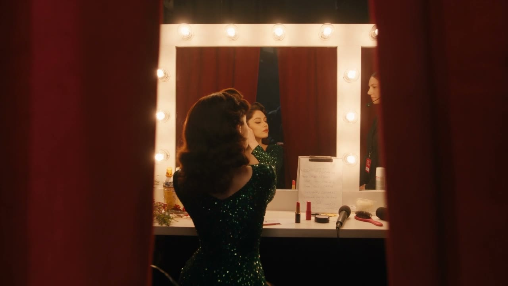
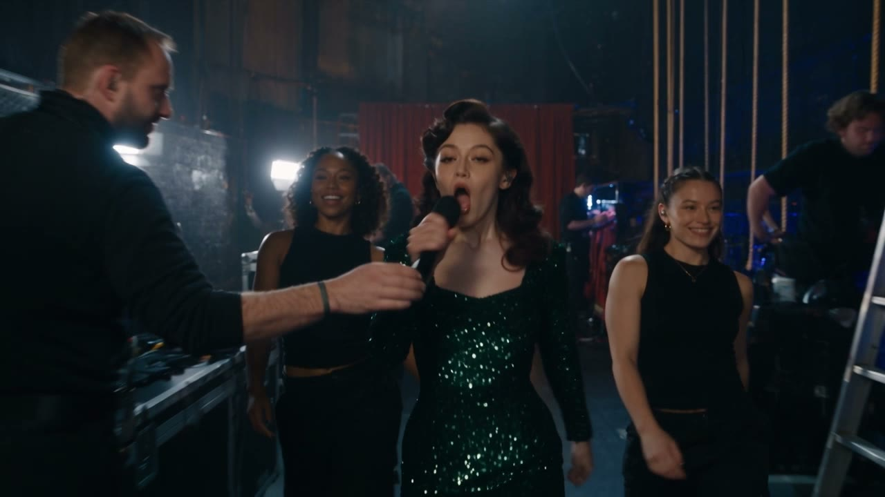
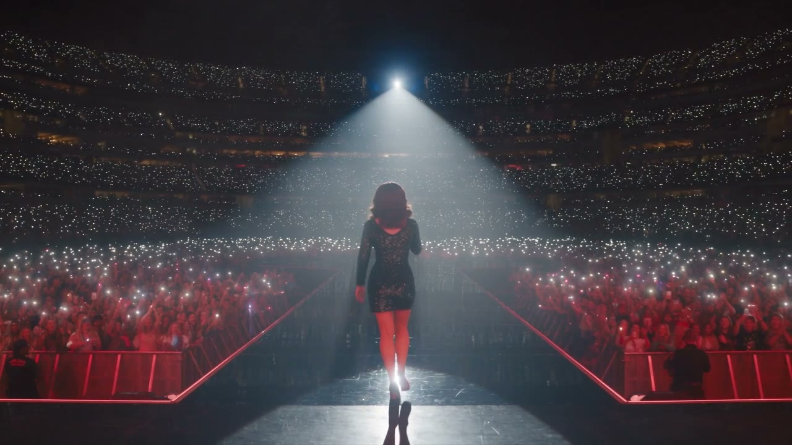
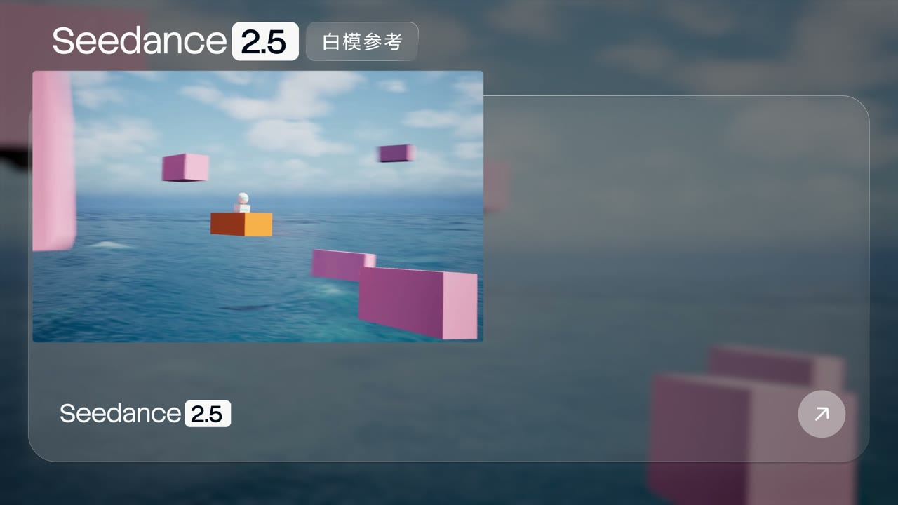
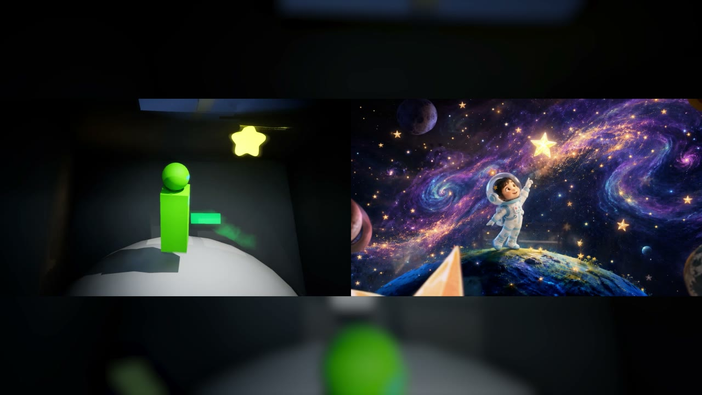
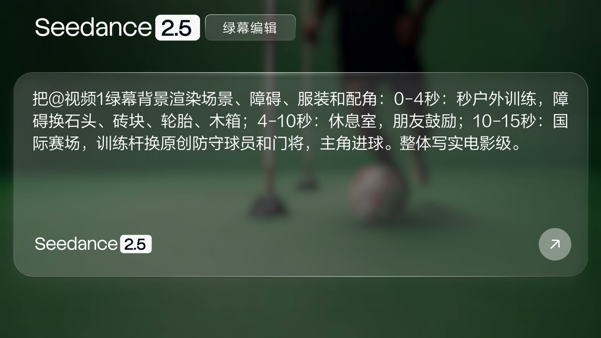
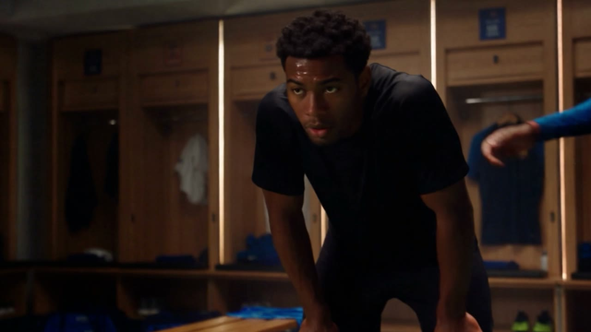
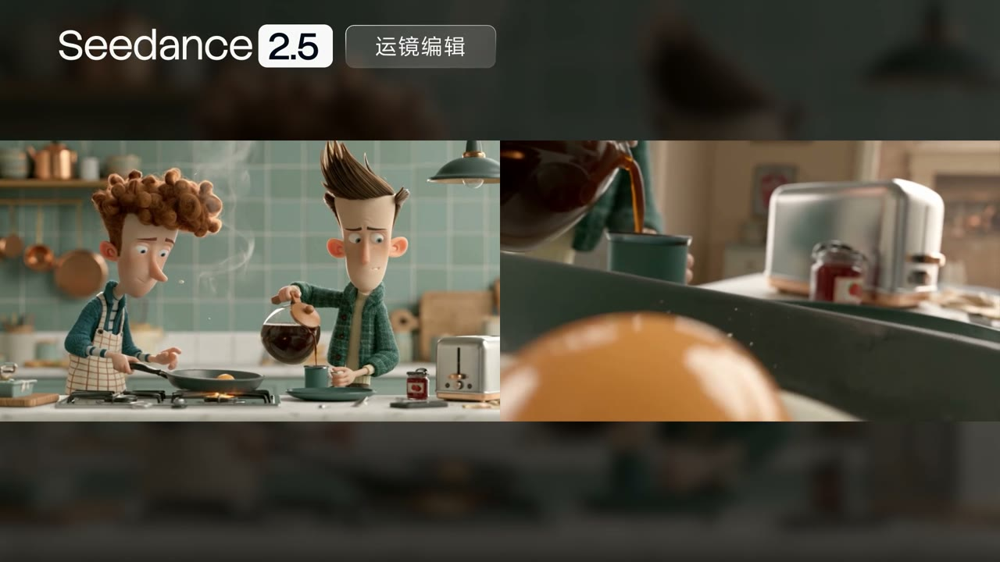
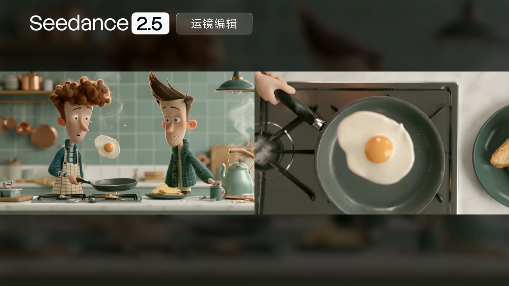

# A-04 官方案例与版本差异

> 核查日期：2026-10-04 ｜ 本教程以通用导演方法为主，以 Seedance 2.5 为实践示例。官方展示不是成功率保证；本项目新增练习尚未经过视频生成实测。

## 一、先分清三种信息

- **官方说明**：模型支持什么任务、输入容量和控制方式。仍需确认使用入口是否提供对应能力。
- **课程建议**：用少量素材、先做短镜头、一次改一个变量。这些是降低学习复杂度的方法，不是模型硬限制。
- **待实测**：某组提示词是否适合你的角色、动作与素材。用结果与复盘记录判断，不凭一条宣传片推断。

## 二、版本差异与使用边界

| 项目 | Seedance 2.0 | 2.5 官方说明 | 通用方法 |
|---|---|---|---|
| 单次时长 | 通常按 4–15 秒规划，具体入口有差异 | 单段最长 30 秒；不能据此推断所有入口的可选时长 | 按事件、动作负载和修复成本分段，不为用满时长填剧情 |
| 参考数量 | 图片 ≤ 9、视频 ≤ 3、音频 ≤ 3，合计 ≤ 12 | 图片 ≤ 30、视频 ≤ 10、音频 ≤ 10，合计 ≤ 50；输入视频合计 ≤ 30 秒，音频合计 ≤ 30 秒 | 每份素材都应解决一个明确问题，不把上限当目标 |
| 时间编排 | 对精确时间段的支持不稳定，通常推荐镜号顺序 | 镜号、时间区间、时间点与相对时间均可；以 1 秒为单位 | 先写因果，再给动作留时间；逐帧落点仍需后期核对 |
| 视频延长 | 需区分原生延长与取尾帧另生成 | 发布文称“多轮延长”，当前模型主页写“两次延长” | 不解释为无限延长；每次交接核对实际状态、运动和声音 |
| 人脸与素材审核 | 部分入口限制写实人脸，练习可用风格化处理降低风险 | 本附录不把任一入口审核规则视为全模型禁令 | 使用原创或已获许可素材，按实际入口规则处理，不保证通过 |
| 多人、复杂动作与运镜 | 初学练习限制为一人主动作、一个主运镜 | 官方展示了多人调度与连续分阶段运镜，也承认复杂物理与多主体仍有不足 | 进阶时写清角色任务、空间交接和运动触发点 |

**来源范围**：2.5 数据来自下方官方指南、模型主页与发布文。2.0 栏是兼容提示，不表示本次重新测量了所有旧版入口。

### 容量不等于质量

官方指南建议使用简约线稿分镜和粗粒度白模。它还给出一些经验性输入建议：宫格图更适用于 15 个以下分镜、视频编辑以 20 秒以内较好、参考图编辑以 1–5 张图较好。这些都不是“超过就不能生成”的硬上限，也不是导演应该切几刀的法则。

白模只需用简单几何体表达空间、人物与轨迹。多主体时，清晰的编号和映射比更多细节重要；不要把所有角色、所有角度塞进一张难以辨认的拼图。

## 三、任务选对，参考才有效

| 你要控制什么 | 选用素材与任务 | 能控制什么 | 不能混淆什么 |
|---|---|---|---|
| 人物、场景、风格、动作或音色 | 语义参考；逐项写素材映射 | 指导对应属性 | “参考”不是逐像素锁定；不同入口标签写法可不同 |
| 大致剧情顺序 | 一张简约多宫格故事板 | 事件与镜头关系 | 不保证逐格复刻具体画面，不要在格里塞大量文字 |
| 多个关键构图 | 分开上传独立关键帧 | 比宫格更直接地指导画面对齐 | 仍须写清各图用途和动作过渡 |
| 起止画面 | 专门首帧或首尾帧任务 | 使用入口提供的首尾帧约束，画幅跟随首帧 | 仅在普通参考提示词写“图片1为首帧”，不等于启用专门模式 |
| 空间、走位、镜头路径 | 白模视频 + 外观参考 | 把结构与外观分开控制 | 白模是否控制光照也要说明；文字不能与预演路线冲突 |
| 已有片段的一部分 | 视频编辑 + 范围 + 改动前后 + 保持项 | 定向改画面或声音，必要时配参考图 | 编辑通常沿用源片段画幅与时长，不应同时要求任意改长短或比例 |
| 继续已有事件 | 原视频延长 | 带入已有动态、场景与声音上下文 | 与“截一张尾帧再生成”不同；成片仍需检查接缝 |

**首尾帧注意**：两图比例应一致。官方指南指出，专门模式中比例不一致的尾帧可能被拉伸；普通参考任务则属于语义引导。课程提示词中的 `@图片N` 是便于阅读的素材记号，执行时绑定到入口实际上传的素材，不能用文字冒充参数设置。

### 三张小表比一大段套话更有用

**素材分工表**

| 素材 | 绑定对象 | 参考维度 | 不转移项 |
|---|---|---|---|
| 图片1 | 主角阿禾 | 外观、服装 | 定妆图背景、拼图布局 |
| 视频1 | 本段摄影机 | 运镜路线、速度 | 原人物、原场景、声音 |
| 音频1 | 阿禾的对白 | 获授权的音色参考 | 原台词、背景音乐 |

参考已足够准确时，少复述其细节。白模是例外之一：仍要补充其缺失的外观、剧情与声音，并让文字和预演一致。

**时间预算表**

| 区间 | 事件变化 | 必须看清的证据 |
|---|---|---|
| 0–4 秒 | 发现门内有灯 | 视线从路面转向门缝 |
| 4–8 秒 | 靠近确认 | 步子放慢，手停在门边 |
| 8–12 秒 | 得到回应 | 门开一线，屋内传来一句回应 |

这是课程设计，不是官方固定节拍。区间连续，不把“每秒做三次动作”当成可靠控制；内容太满就删去非必要细节、加时长或拆段。

**局部编辑单**

```text
源素材：视频1，已保留的12秒版本。
目标范围：4–8秒。
改动前 → 改动后：摄影机向前推近 → 机位固定，人物自己走近。
保持项：角色、衣服、人物动作、场景、光、台词和音效。
检查：0–4秒与8–12秒是否被意外改变；4秒和8秒附近是否跳位、跳光或断声。
```

## 四、官方案例索引

以下均来自[字节跳动 2.5 官方发布文](https://seed.bytedance.com/zh/blog/one-take-creation-flexible-referencing-introducing-seedance-2-5)，不是本项目生成结果。视频可能带有素材展示或对照段，媒体文件时间不一定等于生成提示词时间。

<a id="case-longtake"></a>
### 1. 歌手从后台登台：让空间推进叙事

[观看官方视频](https://lf3-static.bytednsdoc.com/obj/eden-cn/lapzild-tss/ljhwZthlaukjlkulzlp/user-upload/4xfa4ms8eg74b.mp4) ｜ [对应课程：长镜头调度](../05-运镜/教学/L05-08-一镜到底与长镜头调度.md)

- **官方展示**：化妆间、后台通道、登台和全场揭示串成连续段落。
- **方法拆解**：每到一个地标，人物得到新任务或新关系；摄影机运动因人物行动而改变，而不是每隔几秒换一种花样。
- **观察问题**：从跟随人物到展示全场，信息重心在哪一刻变了？转向、后退和拉远分别由什么触发？
- **迁移练习**：设计“演员整理衣领 → 接到道具 → 穿过幕布”的三个节点。先拍短版，确认空间可读，再加最后的舞台揭示。



官方案例关键帧「后台登台」，媒体 00:02。镜框与帘幕包围人物，先建立演出前的私人空间。来源：[官方发布文](https://seed.bytedance.com/zh/blog/one-take-creation-flexible-referencing-introducing-seedance-2-5)。



官方案例关键帧「后台登台」，媒体 00:14。工作人员递麦让空间移动带上具体任务；观察人物与道具的交接关系。来源：[官方发布文](https://seed.bytedance.com/zh/blog/one-take-creation-flexible-referencing-introducing-seedance-2-5)。



官方案例关键帧「后台登台」，媒体 00:29。从后台走向观众，画面尺度与人物面对的关系一起扩大；镜头如何到达这里需观看原视频。来源：[官方发布文](https://seed.bytedance.com/zh/blog/one-take-creation-flexible-referencing-introducing-seedance-2-5)。

<a id="case-extension"></a>
### 2. 车厢追逐延长：续写状态，不重演开场

[观看官方视频](https://lf3-static.bytednsdoc.com/obj/eden-cn/lapzild-tss/ljhwZthlaukjlkulzlp/user-upload/4xfa4ms89gioe.mp4) ｜ [对应课程：连续性与接续](../06-镜头语言综合与分镜/教学/L06-06-连续性与首尾帧链.md)

- **官方展示**：从车厢的既有动作，继续到站台与街道。
- **方法拆解**：交接不只是“这个人长什么样”，还包括运动方向、道具归属、已经发生的事件和持续声音。
- **观察问题**：新地点如何被引入？接点前后的脚步、视线与声场是否连贯？
- **迁移练习**：给已保留片段写“已完成 / 仍在发生 / 本段新增 / 暂不发生”四行交接单。

<a id="case-opera"></a>
### 3. 京剧环绕：用遮挡完成主体交接

[观看官方视频](https://lf3-static.bytednsdoc.com/obj/eden-cn/lapzild-tss/ljhwZthlaukjlkulzlp/user-upload/4xfa4ms89gnha.mp4) ｜ [对应课程：特殊运镜](../05-运镜/教学/L05-07-特殊运镜.md)

- **官方展示**：旋身、靠旗遮挡、水袖动作与环绕、后拉相结合。
- **方法拆解**：先决定“谁把注意力交给谁”，再决定摄影机怎样移动。遮挡是可见触发点，不是省略空间关系的理由。
- **观察问题**：遮挡前后的运动方向与人物位置能否对上？长镜头中主动作由谁接手？
- **迁移练习**：用原创演员排练一次“前景人物经过 → 遮挡 → 露出后景人物”的连续镜头。课程自己设计的时间轴保持连续，不照搬发布示例中有间隔的秒数。

<a id="case-ensemble"></a>
### 4. 多主体音乐会：一份素材只承担明确的职责

[观看官方视频](https://lf3-static.bytednsdoc.com/obj/eden-cn/lapzild-tss/ljhwZthlaukjlkulzlp/user-upload/4xfa4ms89h7hu.mp4) ｜ [对应课程：AI 工作流](../00-导论与工作流/教学/L00-02-AI影像工作流.md)

- **官方展示**：场景、不同乐手、主唱、合唱团和观众分别有参考素材。
- **方法拆解**：以主体和声部组织映射，而不是只列一串图片编号；主要人物与背景群体的任务分层安排。
- **观察问题**：谁在当前镜头里承担信息？镜头切走之后，人物身份和声部有没有混淆？
- **迁移练习**：先用两个角色各一张图，给他们各一个明确动作，再增加声音参考。不要一开始就填满素材容量。

<a id="case-whitebox"></a>
### 5. 白模转幻想短片：先排调度，再定外观

[观看官方视频](https://lf3-static.bytednsdoc.com/obj/eden-cn/lapzild-tss/ljhwZthlaukjlkulzlp/user-upload/4xfa4ms89imyw.mp4) ｜ [对应课程：分镜与场面调度](../06-镜头语言综合与分镜/教学/L06-04-分镜表与场面调度.md)

- **官方说明**：用白模参考运镜、节奏、景别、主体轨迹和调度；用外观图参考角色、场景、材质、光色。
- **方法拆解**：先用几何体回答“谁从哪到哪、摄影机看得到什么”，再处理造型。需要沿用白模光照时单独写明；否则把光交给外观设定。
- **观察问题**：结构、轨迹和镜头顺序中，哪些属于预演，哪些来自外观参考？
- **迁移练习**：用红色几何体代表顾客、蓝色代表店主，预演从门口到柜台的三个节点，再绑定原创角色图。



官方案例关键帧「白模转幻想短片」，媒体 00:02。方块和简化主体即可表达空间占位，白模不需要先做成精细场景。保留官方片头布局与标识。来源：[官方发布文](https://seed.bytedance.com/zh/blog/one-take-creation-flexible-referencing-introducing-seedance-2-5)。


官方案例关键帧「白模转幻想短片」，媒体 00:17。左侧几何结构、右侧幻想外观，比较前景主体与大型遮挡物的关系，不把外观变化误认成轨迹验证。来源：[官方发布文](https://seed.bytedance.com/zh/blog/one-take-creation-flexible-referencing-introducing-seedance-2-5)。



官方案例关键帧「白模转幻想短片」，媒体 00:25。简化人形与星形目标表达动作终点，成片补充角色、服装与环境；检查的是关系与目标，不是逐像素相同。来源：[官方发布文](https://seed.bytedance.com/zh/blog/one-take-creation-flexible-referencing-introducing-seedance-2-5)。

<a id="case-greenscreen"></a>
### 6. 绿幕训练到赛场：保留表演，重建环境关系

[观看官方视频](https://lf3-static.bytednsdoc.com/obj/eden-cn/lapzild-tss/ljhwZthlaukjlkulzlp/user-upload/4xfa4ms89jtbf.mp4) ｜ [对应课程：动作](../08-类型片实战/教学/L08-02-动作.md)

- **官方展示**：以绿幕运动素材转换训练、休息与赛场情境。
- **方法拆解**：背景替换不只是换一张墙纸，还要重新检查地面接触、障碍位置、光线、服装受力与运动方向。
- **观察问题**：脚下有没有滑动？跨越的障碍是否真的处在身体轨迹上？新环境的光是否落到了人物身上？
- **迁移练习**：先只换一个环境、保留一个动作。若接触点失败，简化障碍或改为可独立剪辑的动作镜头。


官方案例关键帧「绿幕训练到赛场」，媒体 00:00。源素材展示脚、球与地面的接触关系，换景后仍应检查这些关系。来源：[官方发布文](https://seed.bytedance.com/zh/blog/one-take-creation-flexible-referencing-introducing-seedance-2-5)。



官方案例关键帧「绿幕训练到赛场」，媒体 00:06。这是官方指令展示卡，不是生成画面；观察环境、障碍、服装与配角如何分阶段安排，卡内时间轴不等于媒体取帧时间。来源：[官方发布文](https://seed.bytedance.com/zh/blog/one-take-creation-flexible-referencing-introducing-seedance-2-5)。



官方案例关键帧「绿幕训练到赛场」，媒体 00:12。观察休息室的光照与人物姿态如何形成环境关系；它与 00:00 不是同一动作的前后对照，动态接触需回看视频。来源：[官方发布文](https://seed.bytedance.com/zh/blog/one-take-creation-flexible-referencing-introducing-seedance-2-5)。

<a id="case-edit"></a>
### 7. 早餐运镜编辑：把修改写成一张编辑单

[观看官方视频](https://lf3-static.bytednsdoc.com/obj/eden-cn/lapzild-tss/ljhwZthlaukjlkulzlp/user-upload/4xfa4ms89jxvz.mp4) ｜ [对应课程：重拍判断与复盘](../09-毕业项目/教学/L09-02-重拍判断与导演复盘.md)

- **官方说明**：保持人物、动作与画风，仅调整运镜，并按时间段描述新机位。
- **方法拆解**：被保留的内容是基线。先决定改哪里、改成什么、不能影响什么，再检查编辑范围外的片段。
- **观察问题**：改变视角后，原动作是否仍然可读？新机位是否迫使模型补出原片看不见的空间？
- **迁移练习**：只把一小段推近改为固定机位，或者只改一句对白。不要同时换服装、场景、运镜与台词。



官方案例关键帧「早餐运镜编辑」，媒体 00:05。官方并排展示双人厨房构图与近距离机位，比较注意力从人物转向食物的变化。来源：[官方发布文](https://seed.bytedance.com/zh/blog/one-take-creation-flexible-referencing-introducing-seedance-2-5)。


官方案例关键帧「早餐运镜编辑」，媒体 00:10。餐盘与手从侧面构图变为顶视关系，新的视角需要补出原先不可见的台面空间。来源：[官方发布文](https://seed.bytedance.com/zh/blog/one-take-creation-flexible-referencing-introducing-seedance-2-5)。



官方案例关键帧「早餐运镜编辑」，媒体 00:13。双人视角与锅的顶视画面并排出现；不能据一帧认定动作相位或时序完全一致，应逐段回看原片。这些是官方原有对照布局，不是本项目拼出的实测前后图。来源：[官方发布文](https://seed.bytedance.com/zh/blog/one-take-creation-flexible-referencing-introducing-seedance-2-5)。

<a id="case-product"></a>
### 8. 汽车装配白模：把机械顺序与材质分开

[观看官方视频](https://lf3-static.bytednsdoc.com/obj/eden-cn/lapzild-tss/ljhwZthlaukjlkulzlp/user-upload/4xfa4ms89k8sg.mp4) ｜ [对应课程：产品广告](../08-类型片实战/教学/L08-07-产品广告.md)

- **官方说明**：白模提供空间、零件位置、装配顺序和轨迹，图片提供材质、光照与反射。
- **方法拆解**：先验收装配逻辑，再验收外观。表面漂亮不能证明机械结构正确。
- **迁移练习**：选一个原创无标识的简单产品，只演示一处装配；逐项检查接触面、遮挡与动作终点。

## 五、引用与实测说明

官方案例的版权不因网页可访问而自动开放。本项目维护者于 2026-10-04 确认已取得允许公开教学引用的授权，本次按该确认使用少量关键帧；未独立审核授权书，也不授予读者完整视频转载、转授权或其他商业用途权利。

配图是官方视频的取帧，不是本项目复现的实验结果。图注时间指媒体文件时间；仅凭静态图不能判断运动质量、编辑成功率或音画同步。完整视频留在官方链接，不作为本项目附件分发。素材引用记录见[官方案例引用清单](../meta/official-frames.json)。

## 六、官方资料

- [Seedance 2.5 中文模型主页](https://seed.bytedance.com/zh/seedance2_5)：当前能力概览。
- [Seedance 2.5 官方发布说明](https://seed.bytedance.com/zh/blog/one-take-creation-flexible-referencing-introducing-seedance-2-5)：2026-07-31 发布，含本文全部视频案例。
- [Doubao Seedance 2.5 提示词指南](https://www.volcengine.com/docs/82379/2607689)：任务区别、素材准备、时间戳与参考编辑写法。
- [Seed 网站声明](https://seed.bytedance.com/zh/disclaimer)：版权和使用声明。

这些页面是能力与方法的依据，不意味着所有产品入口具有相同参数、权限或审核政策。阅读本附录后，回到对应课程完成一个小练习，比一次模仿整条官方长片更容易发现问题。

[返回总目录](../README.md) ｜ [写作规范](../模板/写作规范.md)
